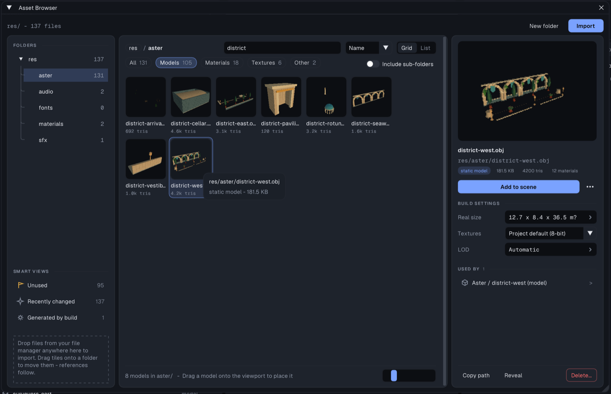

# Asset Browser

The Asset Browser is a file manager for the project's `res/` folder. Open it
with **Tools > Asset Browser** or **Project > Assets > Browse assets**.

## The window

Three columns: **folders** on the left, the **grid** in the middle, and an
**inspector** for the selected file on the right.

- **Folders** — the `res/` tree with file counts. Under it, **smart views**
  list files from the whole tree instead of one folder: **Unused** (nothing in
  the project references them - the cleanup candidates), **Recently changed**
  (written in the last 7 days: fresh imports, repaints, renders) and
  **Generated by build** (baked menu panels, text sprites, font atlases,
  `.tmdl` models; dimmed and read-only - edit their source instead). Click a
  view again, or a folder, to go back.
- **Toolbar** — the breadcrumb, a search scoped to what is shown ("Search
  names in aster/"), the sort order and **Grid | List**. Under it, type chips
  with their counts (types with no files here are hidden) and **Include
  sub-folders** to list the whole subtree.
- **Grid** — tiles with a rendered thumbnail (models and materials; images
  show themselves), the file name on one line and a meta line (triangles for a
  model, the size otherwise). Large folders fill in over a moment without
  blocking the editor (a .glb/.fbx tile appears once its background bake
  lands). The status line under the grid counts what is listed
  and how many of those **no scene uses**; the slider sets the tile size.
- **Inspector** — a large preview (a model or material: right-drag to orbit
  it, middle-drag to pan, wheel to zoom, double-click to reset), the name and path, badges (type, size,
  triangles, materials), the one main action for the type (**Add to scene**,
  **Edit in Material Editor**, **Open in Drone Generator**...) with the rest
  behind `...` (Rename, Duplicate, Animation Editor), then **Build settings**:
  **Real size** (the model's size in meters; click to change it,
  [world-scale.md](world-scale.md)), **Textures** (this asset's texture
  quality - *Project default*, *Full colour*, *8-bit* or *4-bit* - overriding
  Preferences > Textures) and **LOD** (*Automatic* or your own levels,
  [model-pipeline.md](model-pipeline.md)). Problems (missing textures, a
  non-power-of-two image) follow as cards, then **Used by**. **Copy path**,
  **Reveal** and **Delete** sit in the inspector's footer.

With nothing selected the inspector says so; drag-and-drop hints sit at the
bottom of the folder column.

## Importing

Click **Import** (top right) or drag files into `res/` in your normal file manager. There is
no separate asset database: files added outside TyraX appear automatically.

Models go through the model importer ([model-import.md](model-import.md)):
preview, split, pivot, real-world size and optimization in one window. Imported
into a folder under `res/models/`, the result lands in that folder.

## References

Select an asset to see where it is used: each **Used by** row jumps to the
referencing object, even if it lives in another scene. A file nothing uses
says *Not used by any scene*; the **Unused** smart view lists them all.

The scan covers objects, materials, terrain layers, HUD, menus, fonts, loading
screens, audio nodes and custom LODs. Asset settings such as texture quality or
animation clip edits are metadata, not usage.

## Move and rename

Drag files or folders in the browser, or use the context menu. TyraX updates
project references in the same edit.

Wavefront assets need one extra rule: `.obj`, `.mtl` and their textures use
sibling file names. Moving a model therefore moves its dependency group too.
If another file still needs a dependency, TyraX copies it instead. A move that
would leave a broken reference is refused.

Renaming updates `mtllib` and `map_Kd` lines. Paint layers (`.layers/`), custom
UVs (`.uvs`), Drone Generator patches (`.drone`) and Tree Generator parameters
(`.tree`) follow their asset; baked
`.tmdl` files are regenerated on the next build.

You can also drag a model from the browser straight into the viewport.

## Delete

**Delete** lists remaining references before removing anything. Deletion is not
undoable. Objects keep missing model paths so you can repair them; materials
fall back to colour, and missing fonts use the built-in fallback.

## Generated files

The **Generated by build** smart view lists baked menu sprites, text, font
atlases and `.tmdl` models. They are read-only here: edit their source instead.

Asset names are sanitized to `[A-Za-z0-9._-]`. Subfolders are supported
throughout `res/`; only generated font atlases stay at `res/fonts/`.
