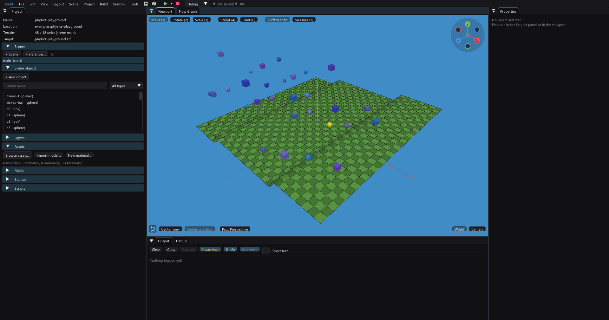
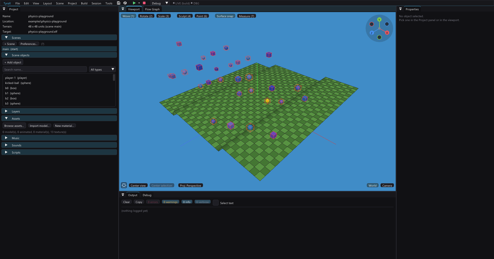

# Collision boxes

What stops the player, and what the third-person camera's spring arm stops
against, is **a box** — not the mesh you see. This page says which box, where
it comes from, and how to look at it, in the editor and in the running game.

Mesh-accurate collision exists and is opt-in per object (*Collision: mesh*, a
static `.obj` feature — see [Rigid-body physics](physics.md)). The player and,
since 1.83.0, rigid bodies collide with such a model's triangles; camera boom and carried/thrown-arc sphere sweeps also query those triangles.
Everything without mesh mode uses the box described here.

## Which box

| Object | Box |
|---|---|
| Box, sphere, cylinder, cone, plane, save point, mirror, portal | the unit cube under the object's position/rotation/**scale** |
| Static model (`.obj` → `.tmdl`) | the **mesh's own bounds**, scaled |
| Animated model (`.glb`/`.fbx` → `.tskl`) | the **baked all-clips pose bounds**, scaled |
| Spawn point, player marker, emitter, sound emitter, point light, empty, decal, camera, area, procedural volume, scroller belt | none — they block nothing |
| Anything with *Collision: none* | none |

Two consequences worth having in your head:

- **A model's box is not centred on the object.** A character or tree
  authored standing on its own origin has its bounds entirely *above* that
  origin, so the box sits above it too. That is what makes it right — the box
  covers the model — and why the box moves when you scale the object rather
  than growing symmetrically.
- **The box is oriented, not axis-aligned.** It is tested in the object's own
  frame, so a wall rotated 30° blocks along its real faces instead of a
  bigger axis-aligned stand-in that juts into the room at the corners. One
  deliberate simplification survives in the walker: the *footprint* uses the
  object's **yaw only**, so a pitched or rolled box still collides upright
  (physics bodies tumble, and projecting a pitched frame onto the ground
  plane is not an isometry — doing it anyway used to teleport the player
  inside thrown crates). Mesh collision is the escape hatch for geometry that
  has to block while tilted. The camera boom does test the full 3D
  orientation.

**Model yaw offset rides along.** An animated model authored X-forward
carries a content-forward correction (*Properties > Model yaw offset*, ±90)
that turns the mesh without touching the facing logic. It turns the **box**
with it. Before, it did not: an X-forward character collided and blocked the
camera across its own body, at 90° to what was on screen — invisible unless
you drew the box, which is half the reason this page and the two overlays
exist.

## A smaller box

A model whose bounds are much bigger than its solid part - a street lamp
whose arm reaches over the pavement, a sign, a tree - can have **its own
collision box**. Select any object made from it, keep *Collision* on
*Box*, and tick **Own collision box** on the Properties **Physics** tab. The box starts as the
mesh bounds; **Box min** / **Box max** edit it in the mesh's own units,
before the object's scale. **Fit to base** takes the footprint of the
model's lower 40% and keeps its full height, so the lamp collides as its
post. **Reset to mesh bounds** puts it back.
*View > Collision boxes* draws the collider in red; the yellow outline
around a selected object is the selection, which is always the mesh bounds.

It is a setting of the MODEL, keyed by its asset path
(`Project::modelCollision`, `"modelCollision"` in the .tyra, format 92): every
box-mode object made from it changes together, and renaming the file in
the asset browser carries it along. The player, the camera boom, cars, rigid
bodies (as an obstacle), navigation and both overlays all use it, because
they all go through the one builder (`MODEL_COLL_BOX` in the generated
`model_data.gen.hpp`, emitted only when some model has a box, so a project
without one generates byte-identical headers). Mesh-mode objects ignore it -
their triangles are the shape. Animated models do not offer it. Dropping
objects onto others in the editor (End, paste) still rests them on the mesh
bounds, because that is about where things visually sit.

Prefer this to mesh mode for a post-like prop: a box costs one test, a
collision mesh several queries (see below).

## What mesh mode costs

A collision mesh stores packed triangle positions and normals plus a flat 3D
AABB BVH. The build writes a versioned little-endian `<model>.tmdl.tcol`
sidecar, copied with the model resources; loading reads that ready-made
structure. Missing or invalid sidecars fall back to runtime construction.
Only models needed by mesh-mode scene objects or prefabs get a sidecar.
The render triangle list supplies exact geometry; it is not automatically
simplified because decimation can open walls or remove thin obstacles.

BVH traversal prunes in all three dimensions, including stacked floors.
Raycasts shrink the remaining distance after each hit. Sphere resolution
preserves triangle order for deterministic sequential pushes. Camera/carry
sphere sweeps test triangle faces, edges and vertices along the entire segment,
instead of treating the whole building as one solid box. Nonuniform model
scale uses a conservative local sphere for sweeps; it may stop early.
The walker retains its chest sphere and floor/ceiling rays, with a continuous
wall sweep before push-out. It is not a full capsule controller.

Box mode has the same far reject: a box whose footprint (half-diagonal plus
the walker's radius, plus the box centre's offset from the object origin)
cannot reach the walker is skipped before its rotation is computed. That
rotation is several `sinf`/`cosf` a box, and a game that resolves its own
actors through the walker's rules pays the whole loop once per actor - measured
in a 24-bot game it was ~11 ms of every frame with ~280 objects in the scene,
almost all of it boxes nowhere near any actor.

## Invisible boundary walls

Use **Scene > Add > Object > Simple > Invisible wall**, or enable **Invisible wall**
on a Box in Properties. Move, scale and rotate it like an ordinary box. The
editor draws a cyan outline; the game keeps its collision without drawing its
surface. Player movement, the camera boom, navigation and rigid-body obstacles
use the same box as before. The wall casts no AO, GI or projected shadow and
does not appear in reflections. It remains an active object: hiding it through
gameplay is different from making its surface invisible.

In the viewport the wall is picked like the other wire boxes (areas, procedural
volumes): a click aimed through it selects what it fences in, and the wall
itself is reached by clicking the same spot again or from the right-click list
([Selecting objects](object-selection.md)). Surface snapping and the drag/paste
raycast ignore it — a prop dropped on top of one would hang in the air in the
game.

This is `"collision": "invisible"` on a Box (format 32). Existing box, mesh and
none modes retain their behavior. Making a wall visible again restores box
collision. Aster uses four tall walls just outside the island's paving. Its
surface portal stays inside that perimeter; the underground cellar is enclosed
by its own collidable floor, walls and vault.

## Seeing them

**In the editor** — *View > Collision boxes*. Every collider gets a red
wireframe of exactly the box above. Session state, not project data, and it
costs one wireframe draw per object.

Without the overlay, you only see the scene geometry:

Turn it on to see the boxes the player and camera actually hit:

**In the game** — *Project > Preferences > Build & debug > Show collision boxes*
(**debug** build profile only, exactly like *Show areas*). Red wireframes
drawn in the running game, following anything that moves — a tumbling physics
body, a prop a flow node slides. It is a **look, not a census**: the nearest
24 colliders within 60 units of the camera are drawn (`COLLISION_BOX_LIMIT` /
`COLLISION_BOX_RANGE` in the generated `terrain_config.hpp`), because each
box is 144 vertices the EE rebuilds every frame. A release build emits none
of it — the flag is a `constexpr`, so the whole pass folds away.

Both overlays and every collision consumer read **one builder**:
`placement::collisionBox` on the host, `TerrainGame::objectCollisionBox` in
the generated game, which are twins. The editor cannot show you a box the
console does not use.

## What has no box

**Runtime-generated geometry** — a procedural volume's merged chunks, a
spawned prefab's static members (docs/procedural-runtime.md,
docs/prefabs.md) — has no scene object behind it, so it has no object box and
neither overlay draws it. It collides through its own conservative world
AABBs (`procColliders`) and a block world through its solid field. Same for
the **terrain**, which is a heightfield and not a box.

**A model still streaming in** collides as a unit cube for the frame or two
before its bounds arrive (assets load one per frame at scene start). It
settles by itself; a wrong box for a moment right after a load is that.

## The broad phase

Every contact query against scene objects goes through **one broad phase**:
the walker (and a game's own actors, through the same `collidePlayer`), the
camera boom / carry / throw sweep (`sweepSphere`), the physics step's static
obstacles and the trace world (`traceLine`). It holds each obstacle's world box
and answers "which objects may be near this area / along this segment" - never
fewer than the ones that are - and the exact tests (box footprint, collision
mesh, the doorway rule) then run on those alone. Before it, each of those
walked every object in the scene, per walker, per sweep, per physics body.

**Preferences > Game > Physics > Broad phase** picks the project's backend
(saved as `"broadPhase"`, only when not the default), and **Scene > Scene
Preferences > Collision** can override it for one level ("Use its own broad
phase") - keep the project on the grid and give the one stacked level the
octree. The game switches backend as it loads that level. Only a scene that
overrides writes anything, and only then does the generated `scene_data.hpp`
carry a per-scene table (`SCENE_BROADPHASES`). The two backends:

| Backend | What it is | Choose it for |
|---|---|---|
| **Grid** (default) | A uniform grid over X and Z, rebuilt when static membership/bounds change; a separate compact grid tracks movers; every box keeps its height, so a query's height range filters the candidates | Flat worlds of similar-sized props (most scenes): the cheapest query and rebuild |
| **Octree** | A loose octree (each node's bounds twice its cell) whose nodes split only past 8 objects and remember the bounds of what they hold; kept across frames - only objects that moved, appeared or left are moved | Scenes that stack in height (multi-floor interiors, bridges over roads, things in the air) or mix dense blocks with open ground |

Both return the same objects for the same scene, in ascending object order
(the order the full walks used, which the walker's order-dependent pushes
need). Measured on the host over the same random scene: a walker-sized query
costs the grid ~0.1 us and the octree ~0.4 us, but the octree hands back about
a fifth of the candidates, so the exact tests behind it do less. A refresh
of 500 objects (20 of them physics bodies), query included, costs about 60%
of a rebuild when nothing placed changed (host x86, -O2, 6-11 us against
11-18 us between runs - proportions, not EE timings).

- **When it updates.** On the first query of each frame (`g_frameStamp`,
  bumped by `updateFrameClock`), at **stage refresh boundaries** in the frame
  loop, and at once after a spawn, despawn or layer (de)activation. The first
  boundary follows the script stage (scripts, the flow graph, a scene switch,
  layer streaming, teleports) and comes before the physics step; the second
  follows the spinners and comes before the vehicles, the portals and the
  carry sweep. A further boundary after vehicles exposes their final poses,
  and a portal teleport invalidates immediately. So whatever a stage moves,
  turns, rescales or switches on or off
  is where it really is for every stage after it. An object's box is cached
  and recomputed only when its position, rotation, scale, model or collision
  mode changed - or when the model it uses streams in after it was spawned (a
  clone made before its template's asset was resident is first boxed from the
  placeholder bounds). A refresh that changes nothing in the structure (no
  object came, went, started or stopped moving, or got a new box) skips the
  rebuild: a boundary after a quiet stage costs one walk over the objects.
- **Moving objects** are spatially indexed alongside static objects. Their
  transformed bounds refresh when their pose changes. Moving entries have a
  compact grid separate from stable scenery, so moving them does not rebuild
  the static grid. Sleeping rigid bodies
  remain indexed. Only oversized grid objects and objects outside the octree
  root are unconditional candidates. The physics body's predicted-pose pair
  index is built separately once per step, so awake bodies query nearby bodies
  rather than walking the whole physics population. Boxes retain the 0.5 m
  padding for small movements within a stage.
- **Moving a collider yourself.** Scripts and flow graphs need nothing: they
  write `ctx.objects` during the script stage, nothing queries the broad phase
  inside it, and the boundary after it picks every change up. Game-side C++
  that moves, turns or rescales a collider (or changes its model or collision
  mode) and then queries in the SAME stage - one actor after another, say -
  is covered only for motion within the 0.5 m padding; for a teleport, a
  large step, a rotation or a scale change, call `broadPhaseInvalidate()`
  between the change and the next query. It is cheap: the next query
  refreshes, and rebuilds only if the structure changed. The stage boundaries
  live in the generated frame loop (`src/terrain_game.cpp`); a project that
  owns that file (its marker line removed) keeps its own loop and adds them
  itself - `broadPhaseInvalidate();` before `updateObjectPhysics()` and after
  `updateSpinners()`, plus after vehicle updates; teleporting a collider
  invalidates before another contact query.
- **Two shapes per object.** The sweep and the physics statics test an
  object's box in its full rotation; the walker's box mode stands the same box
  upright and turns it by yaw alone (a pitched or rolled box collides
  upright - see above). The stored box covers both, so a long box rolled 90
  degrees is still a candidate wherever the walker treats it as a wall or a
  floor.
- **The walker asks for a whole column.** Its box path takes any box under the
  feet as a floor and any box overhead as the jump ceiling, however far, so
  height cannot narrow its query without changing where it stands. The sweep,
  the physics statics and traces pass their real height.
- **Results are unchanged.** A collision-mesh object's box includes the
  0.6-unit band its push reaches. `kBroadPhaseVerify` (a constexpr in the
  generated `game_runtime.gen.hpp`) runs every walker call a second time over
  every object and checks every query against the objects' current boxes,
  logging `[BROADPHASE] ...` on any disagreement.

The structure itself is engine code (`Tyra::BroadPhase`,
`vendor/tyra/engine/inc/physics/broad_phase.hpp`): a caller hands it boxes
(`begin` / `set` / `commit`) and asks `queryBox` / `querySegment`. New code in
the generated game that asks "what objects are near here / along this line"
calls `broadPhaseNear(area, out)` or `broadPhaseAlong(a, b, radius, out)` and
keeps its own exact test, rather than walking `runtimeObjects`.

## Where it lives

| Layer | Code |
|---|---|
| Host (editor overlay, placement snapping, the drag/paste raycast) | `placement::collisionBox` / `placement::collides` (`src/placement.cpp`) |
| Generated game (walker, spring arm, split-screen cull, the overlay) | `TerrainGame::objectCollisionBox` / `objectCollides` (`templates.cpp`) |
| Generated game, broad phase (walker, sweep, physics statics, traces) | `TerrainGame::broadPhaseNear` / `broadPhaseAlong` (`game_templates.inc`) over `Tyra::BroadPhase` (`vendor/tyra/engine/src/physics/broad_phase.cpp`) |
| Editor overlay draw | `Viewport::setCollisionOverlay` (`src/viewport.cpp`) |
| Game overlay draw | `TerrainGame::renderCollisionBoxes` |

The two builders are a twin pair: change one and the other must follow, or
the editor starts drawing a box the console does not collide with.
`src/placement.cpp` is host-only and links on its own, so the box is
checkable from a ~40-line harness rather than by eye.

## Continuous tests and current limits

The walker sweeps its horizontal footprint when a move crosses a box without
ending inside it. Rigid-body sphere/mesh sweeps include triangle edges and
vertices; sphere/box sweeps use an expanded box (conservative at rounded
corners). Hull pairs and hull/box pairs have linear swept SAT at the predicted
orientation. Sphere/sphere pairs use analytic relative-motion time of impact.
These contacts feed the existing impulse solver; they prevent crossings
conservatively rather than running a full event-driven time-of-impact solver.
Exact rotational CCD and sphere/hull CCD are not provided. Fast angular motion
or a sphere crossing an entire moving convex hull can still require smaller
simulation steps. Terrain sweeps retain their existing sampled heightfield path.
