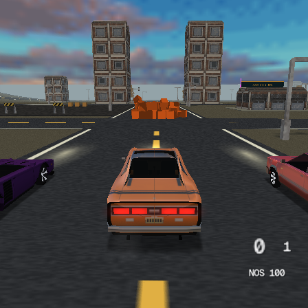

# Collision stress results on PS2

Physical PS2 measurements document the Motor District dense-pile collision regression, its optimizations and the remaining frame-time limits.

These are measurements from 2026-10-29, not a prediction from emulator speed.
They qualify the collision branch, not a general 60 FPS guarantee.

The [final projection-fix run](#projection-fix-console-qualification) improves
the complete-contact pile workloads by 6–25% FPS against the earlier algorithms
with their caps removed. Dense piles still miss 60 FPS. The original capped
results are retained below so these different comparisons cannot be confused.

This first run used the 384-contact/eight-prop caps. The 2.2.1 follow-up removes
those caps and rejects disjoint swept hull envelopes before narrow phase.
The original numbers below remain a historical record, not measurements of
that follow-up.

## Driving results

Each row combines two 360-frame full-throttle driving windows, with the arm
order reversed for the second repeat. FPS is 1 / mean observed frame period;
physics is the 95th percentile of `updateObjectPhysics`, in milliseconds.
Counts are **additional** boxes, alongside the example's ten authored physics
props. Scattered objects mostly sleep; only up to 11 bodies were awake together
in the candidate's +64 scattered test. Total object count is not active-body count.

| Additional boxes | Earlier algorithms FPS | Candidate FPS | Physics p95, earlier → candidate | Candidate missed refresh slots / 720 |
| --- | ---: | ---: | ---: | ---: |
| 0 | 59.9 | 59.9 | 0.04 → 0.07 ms | 0 |
| 32 scattered | 59.9 | 59.9 | 0.92 → 1.07 ms | 0 |
| 64 scattered | 59.9 | 59.9 | 2.15 → 2.19 ms | 0 |
| 128 scattered | 58.5 | 59.0 | 4.12 → 3.32 ms | 12 |
| 32 piled | 55.9 | 50.8 | 6.28 → 9.57 ms | 130 |
| 64 piled | 44.2 | 39.4 | 17.97 → 25.36 ms | 297 |
| 128 piled | 34.4 | 13.4 | 45.61 → 74.17 ms | 720 |

The +128 scattered physics scope improves by about 19%, but whole-frame FPS
improves by only about 1%. At +64 scattered, the physics difference is negligible.
There is no measured overall speedup: the dense cases are slower. The two
candidate repeats gave 50.77/50.77 FPS for +32 piled, 39.30/39.45 for +64 piled,
and 13.02/13.78 for +128 piled. The large regression repeats in both arm orders.
Different contacts change the subsequent motion and awake population, so these
are workload outcomes under equal input, not instruction-cost ratios for equal
trajectories. The probe does not isolate the narrow-phase or solver contribution.

At +64 scattered, candidate EE work p95 is 12.49 ms; at +128 scattered it is
15.27 ms, leaving little room against the NTSC 16.68 ms cadence. At +32 piled
it reaches 20.48 ms. EE work subtracts the renderer's recorded stall delta from
the frame period; it is not a standalone measurement of GS execution. The
observed frame periods, rather than this subtraction, establish the FPS result.

## Collision limits matter too

Both arms retain a 384-contact solver budget. During the driving windows,
candidate +64 piled omitted 700 contact emissions and +128 piled omitted
821,752. The earlier algorithms also saturated: 886 and 241,927 respectively.
These are omitted contact points over many frames, not unique object pairs.
A bounded frame time after saturation cannot certify complete collision handling.

The car also collects at most eight nearby prop candidates per substep. The
candidate exceeded this list from +32 scattered onward (52 additional candidates
over the two drive windows), and much more often in piles. This counter applies
to a loose horizontal reach test, so it does **not** count proven missed exact
collisions. It identifies a completeness limit that still needs qualification.

The practical conclusion is to budget simultaneous awake bodies and contact
density, not promise 60 FPS from the number of props placed in a level. The
current branch does not meet 60 FPS for the tested piles. Dense contact work,
sleep stability and both contact/candidate caps need further work before such
a workload can be accepted.

## Fixture and scope

- Release build; physical PS2; NTSC progressive, vsync enabled, fixed daytime.
  Live debugger/link/logic/time machine/remote pad/input recorder and keyboard
  polling disabled. Ordinary logs suppressed; shared renderer telemetry remains.
- One ELF switches at scene boundaries between the exact physics and scene
  broad-phase algorithms from main `e4acb7379ef3bebc90362e2884719a4d2a8a9df5`
  and candidate `a5141c767fa600b05f06f532f46bbc62c17cf25d`.
  Both share the candidate's `PhysBody`/`RbStep` layout, renderer, assets and
  surrounding runtime. This is an **algorithm A/B in a common runtime**, not
  two stock main/candidate builds. Shared data layout can affect the comparison
  against stock main. Scalar transforms are used in both arms.
- A fixed pool of 128 boxes stays allocated in both arms; surplus boxes are
  inactive and invisible. Each box is 0.9 m per side, mass 0.6, bounce 0.1,
  friction 0.6, tumbling enabled, sleep 1.5, no shadow. Scattered placement is
  eight columns at 2 m spacing and rows at 7 m; piles are 4×4 per layer.
  The original level, its authored props and 32 procedural extras remain.
- Scene reload before every phase; 150 warm-up, 120 parked, 360 driving and
  120 settling frames. The first phase has 300 extra warm-up frames for boot
  I/O. Treat the zero-box physics comparison cautiously because of that extra
  settling time; both arms still hold 59.94 FPS in both repeats.
- The car receives full throttle and zero steering during the driving window,
  with the handbrake outside it. Pose and speed are recorded; collisions change
  the distance travelled. Windows are frame-count based, so a slower phase also
  covers more wall-clock time. No claim of identical trajectories is made.
- All 28 phase files contain exactly 600 measured frames: **16,800 total**.
  COP0 ticks use 294,912,000 Hz. A period over 25 ms counts as a missed refresh
  slot; CSV writes and four VRAM grabs happen outside the measured windows.
  The captures confirmed the car and props; no resource/assert failures occurred.
  All 238 deployed baked PNG/TMDL assets matched the baked reference.
- There are no mesh-mode colliders in this fixture. These results do not
  measure triangle-BVH speed, night rendering, complex hulls or rotational CCD.
  PCSX2 was used for a boot/input smoke check only.

The image is a warm-up capture, not the peak contact load.

The measured ELF SHA-256 is
`c0a00f8c97f8d86cc16b84716455e068636041a43a8f01054a459e73980e2dea`.
The [summary and per-repeat statistics](../tools/ps2rig/results/collision-2026-10-29.json)
and [compressed raw frame CSV](../tools/ps2rig/results/collision-2026-10-29.csv.gz)
are retained with the repository. The [rig instructions](../tools/ps2rig/README.md)
describe how to reproduce the fixture.

## Dense-pile attribution

A second physical PS2 run sampled eight phases: +64/+128 piles, both algorithms,
then reversed order. COP0 brackets separated preparation, world contacts, body
pairs, solver and write-back. A small scope also counted/timed the SAT/CCD
fallback. These diagnostic hooks affect timing and subsequent trajectories;
use them to attribute work, not as replacement headline FPS.

In the first +128 drive window, body-pair contacts cost 7.79 ms/frame with the
earlier main algorithms and 41.67 ms with the unoptimized collision branch.
SAT/CCD fallback alone cost 22.30 ms/frame: 1262.1 calls, of which 1231.0 ran
the linear sweep and only 0.02 sweeps/frame hit. World contacts also rose from
2.79 to 9.63 ms/frame, and the capped solver from 2.13 to 5.50 ms/frame as the
awake/contact workloads diverged. For +64, fallback cost 3.07 ms/frame and the
body-pair stage 5.39 versus 2.08 ms/frame. These scopes identify excessive
negative narrow-phase work; they do not establish equal trajectories.

The [diagnostic summary](../tools/ps2rig/results/collision-diagnosis-2026-10-29.json)
contains both repeats and the ELF hash; [raw diagnostic rows](../tools/ps2rig/results/collision-diagnosis-2026-10-29.csv.gz)
retain all stage counters. The fix keeps the existing SAT/CCD algorithms and
solver iterations, adds conservative tight swept bounds, and lets contact and
car-prop storage grow. The 50,000-pair geometry oracle retained every reference
SAT/CCD hit, including separated-endpoint pass-throughs. New runtime counters
check that every generated manifold point reaches the solver and every car
candidate reaches its exact test. Hardware qualification of the fix is separate
from these pre-fix diagnostic numbers.

## First fix: complete contact handling and swept bounds

The `b0d798cb5` physical-console run completed all 28 phases and 16,800 frames.
Unlike the original capped test, **both** arms used a growing car-prop list and
an uncapped solver. The reference was `cc1f8895b` physics/broad-phase code with
the contact cap removed, sharing candidate runtime layouts and rendering.
This is an equal-completeness algorithm comparison, not stock-main performance.

| Added pile boxes | Prior algorithms, uncapped | Swept-bounds fix | Physics p95, prior → fix |
| --- | ---: | ---: | ---: |
| 32 | 49.5 FPS | 50.3 FPS | 11.34 → 9.66 ms |
| 64 | 29.5 FPS | 32.1 FPS | 30.94 → 23.75 ms |
| 128 | 15.8 FPS | 16.8 FPS | 69.52 → 59.16 ms |

Every frame in both arms had `generated_contacts == contacts` and
`push_candidates == push_tested`, with no contact truncation. The candidate
reached 929 contacts in a driving frame; the reference reached 962. This is
real extra work compared with the old cap, and car trajectories differ too.
The bounds change alone does not recover 60 FPS for piles. Scattered +32/+64
still hold 59.94 FPS; +128 averages 59.3 FPS in the candidate.

The [first-fix summary](../tools/ps2rig/results/collision-bounds-2026-10-29.json)
and [raw frames](../tools/ps2rig/results/collision-bounds-2026-10-29.csv.gz)
retain both repeats, accounting columns and source/ELF hashes. The subsequent
projection optimization shares the SAT/CCD projection pass and uses analytic
OBB ranges for primitive boxes; its console qualification is separate.

## Projection fix: console qualification

The final same-ELF run compares candidate `1e063e0b47bcdd2a7c8664a0d9c5ec0ed32f9e58`
with `cc1f8895b` algorithms with the solver cap removed. Both arms share growing
car-prop lists, the candidate's step/body layout, renderer and assets. As in the
first fix, this is an equal-completeness comparison, **not stock main versus
stock candidate**. The wider candidate step layout also affects the reference.

| Added boxes | Prior algorithms, uncapped FPS | Final FPS | Final FPS change | Physics p95, prior → final |
| --- | ---: | ---: | ---: | ---: |
| 0 | 59.9 | 59.9 | — | 0.04 → 0.04 ms |
| 32 scattered | 59.9 | 59.9 | — | 1.10 → 1.03 ms |
| 64 scattered | 59.9 | 59.9 | — | 1.88 → 1.91 ms |
| 128 scattered | 59.2 | 59.3 | +0.1% | 2.63 → 2.49 ms |
| 32 piled | 48.8 | 51.6 | +5.7% | 11.83 → 8.33 ms |
| 64 piled | 30.0 | 37.1 | +23.7% | 30.92 → 18.88 ms |
| 128 piled | 15.3 | 19.1 | +24.9% | 70.93 → 49.68 ms |

Each row again pools two 360-frame driving windows with reversed arm order.
Candidate pile FPS per repeat: 51.50/51.75 (+32), 37.08/37.08 (+64),
18.73/19.47 (+128). Reference repeats were 48.06/49.61, 29.32/30.65 and
14.77/15.85 respectively. Gains repeat in both orders. These are scene outcomes
under equal input: contact trajectories and awake populations still differ,
so the scope ratios are not isolated per-instruction speedups.

All **28 phases and 16,800 measured frames** pass the frame/state/finite-clock
checks. In **every frame of both arms**, generated reduced manifold points equal
solver contacts, collected car-prop candidates equal tested candidates, and
both omission counters are zero. Candidate peak contacts are 862, reference
940. Car candidates reach 384 per frame across substeps (not unique props).
No solver iterations, SAT axis families or CCD paths were removed. The geometry
oracle checks 50,000 swept/rotated pairs: generic shared projection matches the
reference hit/depth/normal/point; analytic OBB and mixed projection retain all
4420 reference hits. Analytic projection rounds outward for numerical safety.

The performance limit remains visible: candidate EE work p95 is 19.05, 31.79
and 65.03 ms for the three piles, already above the 16.68 ms NTSC frame budget.
The candidate misses refresh slots in 116/720, 440/720 and 720/720 driving frames.
The change reduces dense contact cost; it does **not** qualify dense stacks for
60 FPS. Scattered +32/+64 hold 59.94 FPS without a missed slot; scattered +128
misses eight of 720 drive frames. More placed props are not equivalent to more
simultaneously awake props.

The native instrumented build, isolated PCSX2 boot/autonomous-drive check and
physical PS2 run passed. All 238 deployed baked PNG/TMDL resources matched the
qualified fixture, staged and deployed ELF hashes matched, all four VRAM grabs
completed, and the console log had no resource/assert failures. The two gated
vehicle-grid/substep oracle branches also compile enabled; that compile check
is separate from the runtime completeness counters. Quiet-log builds retain
existing unused-variable warnings. The owned server was stopped and console
reset returned zero after the run.

The [final summary and repeats](../tools/ps2rig/results/collision-projection-2026-10-29.json)
and [raw frame CSV](../tools/ps2rig/results/collision-projection-2026-10-29.csv.gz)
retain the accounting columns and source hashes. Measured ELF SHA-256:
`67f9a2bb425046eb84831701442a636b0aeff527b2b9c35e7a5746cf6851307a`.
