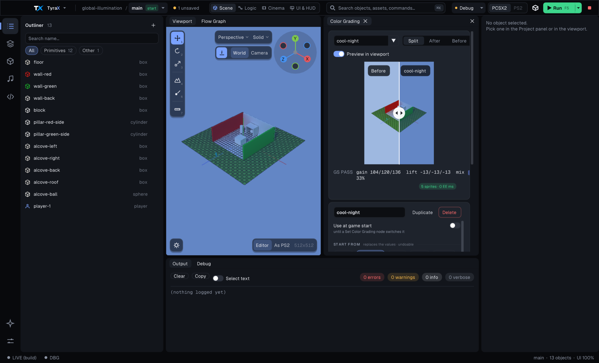

# Color grading

Color grading gives the whole picture a look - warm, cool night, sepia, faded -
that the PS2's GS applies with a few full-screen sprites after the scene is
drawn, at no EE cost. Looks are project-wide presets; one can be the look the
game starts with, and the **Set Color Grading** flow node switches looks at
runtime.

## The window

*Tools > Color Grading* opens docked beside the viewport. It has three parts
(in a narrow dock the list folds into a picker above the preview, and the
controls move under it):

- **Looks** - every look with a thumbnail run through its own GS math, the
  quick look it still matches ("from Warm") or *custom*, its sprite cost, and a
  *start* badge on the game-start look. **None** at the top is the ungraded
  reference. Under the list, **Used by** names the game start and every Set
  Color Grading node that uses the selected look.
- **Preview** - the viewport's last frame before and after the grade pass, with
  a draggable **Split** line, or **After** / **Before** alone. It is the same
  image the viewport shows (no second scene pass), so it follows the editor
  camera; *Preview in viewport* turns the look on in the viewport itself. Under
  it the **GS pass** strip shows the exact numbers the console blends with -
  per-channel gain, lift and the mix colour and amount - and what it costs
  ("5 sprites · 0 EE ms", or *neutral - skipped*).
- **Controls** - the name with Duplicate and Delete; **Use at game start**
  (until a Set Color Grading node switches it); **Start from** chips (Warm,
  Cool night, Sepia, Faded, Neutral) that REPLACE every value of the look -
  one undo step; **Look** (Brightness, Contrast, Saturation, Temperature on a
  blue-to-orange track, Tint and its amount, and *Reset* to neutral); and the
  **Lift** (shadows) and **Gain** (highlights) wheels side by side with their
  master level and RGB values.

With no looks yet the preview shows the ungraded scene and the Start from chips
underneath: the first click creates a named look ("warm", "cool-night").

## What the GS can and cannot do

Every control folds into three blender passes: a per-channel **gain**, a
per-channel **lift** (positive and negative are a pass each - the GS adds and
subtracts unsigned), and a **mix** toward one constant colour. Equal gains
collapse into one sprite. That is why:

- there is no gamma control (the wheels' section says so);
- **Saturation** is an approximation - with no per-pixel luma it mixes toward
  mid-grey, which flattens a little as well;
- Temperature is a gain tilt between red and blue.

The editor previews the same quantized integers, including the clamp after
every step, so the viewport and the console agree.
