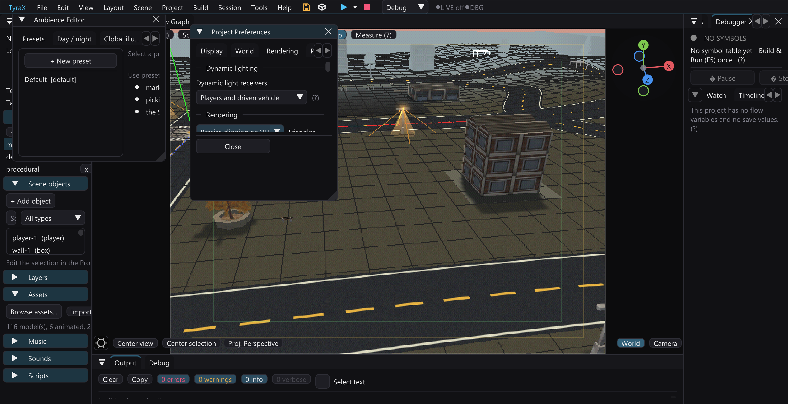

# Dynamic light receivers

Dynamic light receivers choose whether live scene lights and the camera flashlight illuminate every model or only player models and the vehicle being driven.

In **Project > Preferences > Rendering**, set **Dynamic light receivers** to
**All objects** (the default) or **Players and driven vehicle**. A scene can
override this choice independently in **Scene Preferences > Dynamic light
reception**. Disabling its override restores inheritance without discarding the
stored local choice. Project preferences follow the existing project-wide edit
behavior; scene overrides participate in scene undo and redo.

The restricted mode removes live model-light contributions from the world and
parked/traffic vehicles. Active player models and the currently driven vehicle
remain receivers, including their body, glass and wheels. Merely sharing a model
asset or spawning a clone does not make an object a player receiver. This is an
intentional visual/performance choice.

Baked light, probes, sun/moon, emissive materials and shadows remain. Projected
scene/flashlight pools, vehicle headlight projections, beams, coronas and lamp
glow are separate effects and remain visible. In particular, this option does
not remove the pools from the earlier private experiment's second mode.

The authoring viewport previews explicitly identified authored player models.
It has no running game's driver/controller binding: parked vehicle previews
remain world receivers and selection does not change reception. Both viewport
shading modes apply the receiver rule while retaining their existing shader
differences and projected ground-light approximation.

## Project and runtime contract

Format v96 writes `settings.dynamicLightReceivers` as `all` or `players`.
Missing or invalid values preserve full lighting. A scene stores the same
token and an independent `overrides.dynamicLightReceivers` flag; absent flags
inherit the project. Ambience presets and existing lighting overrides do not
implicitly change this policy.

Generated scene data resolves the policy for each scene. Runtime classification
uses live player and driven-vehicle bindings, not asset names, authoring order
or the camera owning a secondary view. Reflections and portal draws retain the
source geometry's ownership. Normal-lit and animated models gate their scalar
live-light pickup as well as the static pipeline's per-bag slot.

`PipelineInfoBag::dynamicLightReceive` defaults to true. False suppresses the
scene-light picker and explicitly selects the disabled spot object, including
the global flashlight fallback. It is independent of `dynLightPick`, `spotLit`
and the skipped light slot. A null picked light alone means the camera
flashlight and cannot implement a receiver rejection.

## Performance evidence

The [private fixed-night experiment](tyrax2-player-light-receivers.md) saved
1.41–1.50 ms with pools retained. Those results describe its own fixture/ELF;
they do not price the public option or guarantee 60 fps in another project.
The stronger private mode also removed pools and is not exposed by this option.

The public implementation has separate
[validation evidence](dynamic-light-receivers-2026-10-06/README.md): actual
model/serialization/undo controls, 22 CLI checks, editor UI interaction and
saving, seven normal native game builds, and owned emulator captures. The
animated All/Players pair shows both active players retaining the red light
while ordinary animated copies lose it only in Players mode. Same-definition
vehicle tests cover driving, exit and switching to the parked clone without
obvious wheel/body corruption. Showcase's targeted fixture renders the
destination through its portal and records an actual round trip; its
original-spawn navigation captures alone do not prove a crossing.

A fresh physical PS2 start and game-owned screenshots cover the restricted
vehicle scene and exit to foot. This is correctness evidence from a debug
build, not a performance comparison. Mirror ownership has source review;
these captures do not independently qualify a mirror ownership transition
or exact per-pixel equivalence. Audio was not qualified.

On R5900, `PipelineInfoBag` grows from 40 to 44 bytes. Engine and game code
must be rebuilt together; the normal build does that. Restricted wheel groups
and secondary-view animated-color refresh also have costs. The common default
path and selector/layout footprint remain unpriced.
The receiver option changes no production VU source.

The [closeout qualification](tyrax2-closeout.md) completes a quiet same-ELF
physical All/Players comparison and separate sampler controls in both orders.
Players saves 0.950/1.024 ms on the fixed night pose while retaining scene pools.
Its priced windows have approximately 16.6833 ms mean loop-entry cadence; the
separate motion and portal routes do not sustain 60 fps. This relative price
includes the private common quieting/observer footprint and does not price
the pristine default implementation or establish a historical 30-to-60 gain.

## Baked lamp light

*Preferences > Rendering > Bake static lamps into scenery*
(`settings.bakeStaticLamps`, format v113, default off) takes the static lamps
out of the per-bag light pick. A dynamic point or spot light is **baked** when
it never flickers, the build can see nothing that moves or retargets it (the
same `project::objectRuntimeMovable` test the static collider grid and static
batching use - no flow-node reference, no layer) and it does not carve shadow
volumes. A baked lamp stays registered with the engine every frame, so the
cars, the player, animated and physics models still pick it per vertex; what
changes is the static geometry:

- Whenever the baked lamps' on/level state changes - the Motor District's
  day/night switch, a Set Light - `updateDynLights` re-derives `g_bakedLamps`
  and `TerrainGame::rebakeLampLight` re-bakes everything the old or the new
  set reaches: solo objects through their ordinary rebuild, static batches by
  going stale, and generated chunks (roads, procedural volumes, prefabs) by
  re-colouring them in place from the colours their builder wrote
  (`ProcChunk::lampBase`). A one-off cost at the switch, never per frame.
- `pushVert` adds the lamps to the FINISHED vertex colour with the VU1 spot
  slot's own constants (`bakedLampAdd`, world space - static geometry has an
  identity model), so a vertex lit by one lamp receives what the live slot gave
  it. Two lamps reaching one vertex now both land; the slot picked one.
- Those bags set `PipelineInfoBag::dynLightSkipBaked`, and the engine's pick
  skips every slot `RendererCore::markDynLightBaked` named. The batch grouping
  key ignores baked lamps (they cannot split a batch's pick any more).
- The terrain never picked a scene light; its pools, the beams and the coronas
  are unchanged. Moving geometry that used to share the batches' info bag (the
  wheels' and the debris' batches) has its own.

Measured on the Motor District (physical PS2, one ELF, the bake switched per
scene load): with the seven steady garage lamps baked and lamp 7 - flicker
0.025 - still live, the frame moved only -0.02..-0.19 ms, because almost
every static bag in the parked view is still in lamp 7's reach and picks it.
All eight baked (lamp 7 steady), physical PS2, one ELF (rig CZ17, 10 cycles
an arm): parked -0.12 ms, first drive -0.48, cruise -0.67, late drive
-0.32 ms; the parked PS2 shots differ in under 0.5 % of pixels (max 30
levels). The Motor District therefore ships the setting on with lamp 7's
flicker set to 0.
