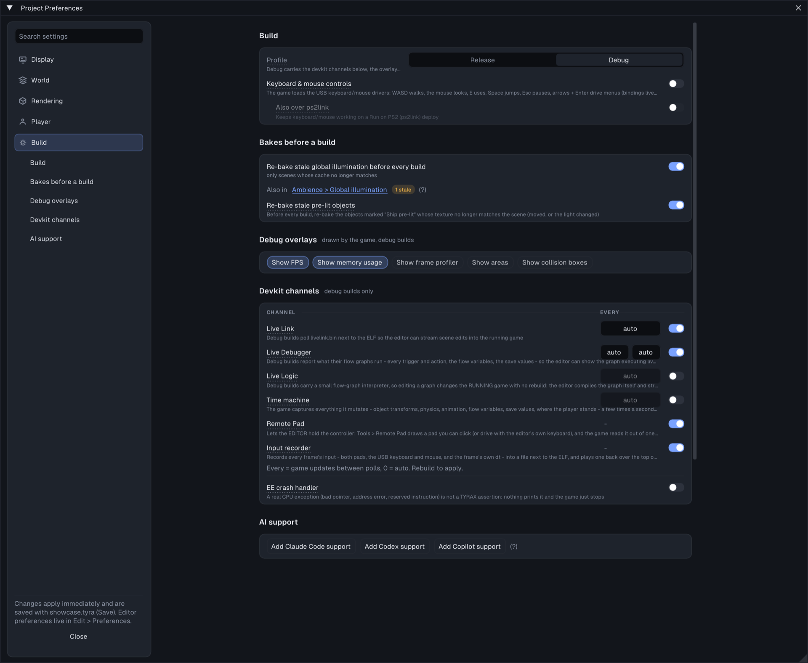

# Editor Preferences

Editor Preferences (*Edit > Preferences*, or *Preferences* on the start page)
holds the settings that belong to this machine rather than to a project: the
theme, where new projects go, where PCSX2 is, the PS2's address, the build
backend, your name in sessions, the AI backend and the update check. They live
in `editor.ini` in the editor's config folder and are shared by every project;
project settings are in *Project Preferences* instead.

## One rule: changes apply at once

Every change takes effect the moment it is made and is saved to `editor.ini`
straight away - a switch or a pick when you click it, a text field when you
press Enter or leave it. There is no Save and no Cancel, only **Done**, the
same model as Project Preferences. (The dialog used to stage the text fields
for Save while the theme, title bar and update switches saved themselves, so
Cancel undid only half of it.) An open project picks up the new emulator path,
PS2 address and build backend immediately.

## Pages

The sidebar has seven pages; **Search settings** above it filters the rows of
every page by name and description (try `ip`, `docker`, `model`).

| Page | Settings |
|---|---|
| **Appearance** | The theme as cards with their colours (applies on click - see [the editor's look](editor-theme.md)); *Use the native title bar* (macOS and Windows; a *Restart TyraX to apply* badge until the next start); *Windows can leave the main window* (a panel dragged out of the editor becomes its own OS window - [details](editor-theme.md#windows-outside-the-main-window); applies at once, on by default except in a Wayland session, where it is unavailable); the interface font and scale in use. |
| **Projects** | *Default folder* for New Project and for opened examples (empty = `~/TyraProjects`, shown in the field). |
| **Running games** | *PCSX2*: empty means auto-detect, and the field shows what was found ("Auto-detected: ...") or that nothing was; a configured path that does not exist is flagged. *ps2link IP* for Run on PS2 (F6) - [setup](ps2link-setup.md) - with **Test connection**, which says whether ps2link listens at that address (answered in N ms / no answer within 2 s / refused - not ps2link) without deploying anything. *Console log*: lines per session file and how many files to keep. |
| **Build** | *Build backend*: Native (default) or Docker fallback. The Docker-only *Compiler image* and *Image name* appear only when the fallback is picked ([toolchain image](toolchain-image.md)). |
| **Collaboration** | *Display name* in [live sessions](collaboration.md) (empty = your system user name) and the *Joined-project cache* folder. |
| **AI assistant** | *Backend*, *Model* (or Custom with a free *Model id*) and *Extended thinking*, used by the [AI Assistant](ai-chat.md) and [Generate with AI](ai-flow-graph.md). |
| **Updates** | *Check for updates at startup*, *Check now*, and *Stop skipping* for a skipped version ([updates](updates.md)). |

## Project Preferences looks the same

*Project > Preferences* (Ctrl+,) holds the project's own settings with the same
model - a sidebar of categories (Display, World, Rendering, Player, Build) with
each one's sections and **Search settings**, changes applied at once and saved
with the `.tyra`. Each section is a card of label-left rows, and under every
row's label sits a dim one-line meaning (the first sentence of its help; the
whole help is on the label's hover). The Build page's **Devkit channels** card
joins each channel's switch with its polling interval in an *Every* column
([devkit](devkit.md)).

