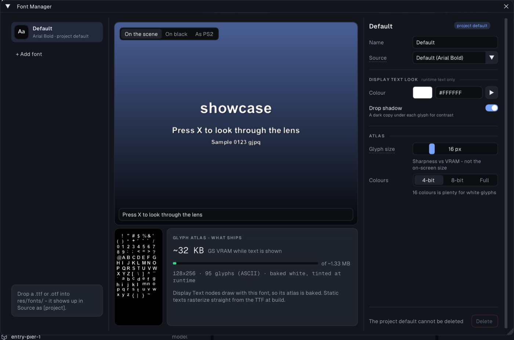

# Font Manager

The Font Manager (**Tools > Font Manager**) holds the project's typefaces: every
text in the game - HUD texts, menus, loading screens, credits and the strings a
Display Text node draws at runtime - names one of these entries, so restyling a
project is an edit here rather than a hunt through every text.

## The window

- **Fonts** (left). One row per entry, with an "Aa" tile rasterized in that
  face and its source. The first entry is the **project default**: a text that
  names no font, or a font that was deleted, uses it. **+ Add font** adds an
  entry on the default face. Until the project has a font of its own, a card
  at the bottom says how to get one in: drop a `.ttf` or `.otf` into
  `res/fonts/` and it shows up in **Source** as `[project]` (or use *Import
  TTF into the project...* at the end of the Source list).
- **Specimen** (centre). The project's name as a title, an editable prompt
  line (the field at the bottom of the specimen) and a small sample, at PS2
  sizes, over a scene-like backdrop. **On black** shows the same over an empty
  frame. **As PS2** draws every glyph from the baked atlas at its palette
  depth, scaled from the glyph size to the text size - exactly the path a
  Display Text node takes, so a small atlas blown up to a title shows its
  softness here. Characters outside printable ASCII are not in the atlas; the
  badge counts the ones the sample would lose.
- **Glyph atlas - what ships** (below the specimen). The real atlas image
  beside its cost: the KB of GS VRAM it holds while text is shown, against the
  ~1.33 MB of texture VRAM left once the frame and z buffers are placed, its
  size and glyph count. The card says whether a Display Text node uses the
  font: only then is the atlas baked and shipped. Static texts rasterize
  straight from the TTF at build and cost the atlas nothing.
- **Inspector** (right). **Name** (the reference key; renaming retargets every
  text that uses it) and **Source** (*Default*, a project font, or a font
  of this machine). *Default* is **Geist Mono SemiBold**, built into the
  editor since 2.0, so a project bakes the same atlas on Windows, macOS and
  Linux; before 2.0 it was the machine's own font (Consolas Bold, Arial Bold
  or DejaVu Sans Bold). A font of this machine is the one choice that still
  bakes differently elsewhere - import it into the project instead. **Display Text look** - runtime text only: the
  **Colour** the white glyphs are tinted with and the **Drop shadow**. Static
  texts keep their own colour and shadow. **Atlas**: **Glyph size** is the
  height the glyphs are rasterized at - sharpness against VRAM, not the
  on-screen size - and **Colours** the palette depth (4-bit, 8-bit or full).
  Glyphs bake white and are tinted at runtime, so 16 colours is normally
  plenty and roughly 8x cheaper than full colour.
- **Delete** sits in the footer. It is refused, with the reason beside it,
  while the project has only one font: that entry is what every unset
  reference resolves to.

Nothing here is undoable (like the rest of the project-wide editors), but every
change marks the project unsaved.
