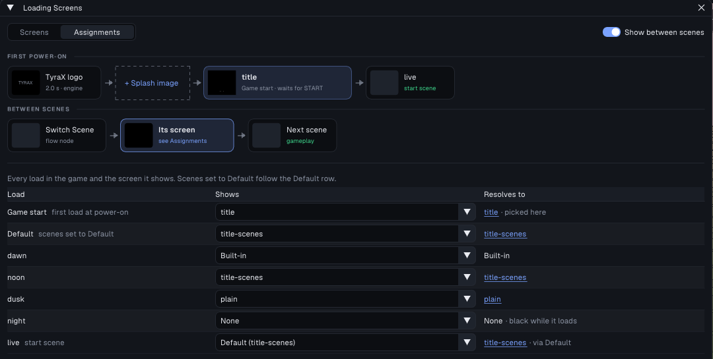

# Loading screens

A **loading screen** is what the game shows while a scene loads — at boot (the
[start scene](#the-start-scene)) and on every *Switch Scene*. You define named
screens, each with a background color, images, texts and **progress bars**,
then say in one table which load shows which screen - the **Game start**, a
project **Default**, and each scene ([Assignments](#assignments)).

Open it from **Tools > Loading Screens** (or the button in *Project >
Preferences*). Two tabs at the top left, **Screens** (design them) and
**Assignments** (which load shows which). **Show between scenes** at the top
right is the master switch (the same setting as *Project > Preferences >
"Loading screen between scenes"*) — off, scenes cut straight in; the Game
start screen still shows if you picked one.

Two strips across the top answer "what does the player see?":

- **First power-on**: *TyraX logo* (2 s, the engine's) → your splash cards (or
  **+ Splash image**) → the **Game start** screen ("Game start · waits for
  START", "via Aster · real progress", *Built-in*, *None* or *No loading
  screen*) → the start scene. Click the logo card to **skip the logo** (it
  turns dashed: "skipped · 0 s"; click again to bring it back). Click a splash
  card to edit it, drag it sideways to reorder. Click the Game start card to
  pick its screen (*Same as start scene* or any screen) or *Edit this screen*.
- **Between scenes**: *Switch Scene* → the **target** scene's screen → the next
  scene. Every later load shows the screen of the scene being loaded; click
  the middle card for the Assignments table.

On the Screens tab, three columns: **Screens** (each tagged *default* and/or
*game start*, and under the selected one a **Used by** line - Game start and
the scenes that show it, "(default)" when they inherit it; an unused screen
says *Not shown anywhere* with a *Make default* link) and the selected screen's
elements **back to front** with one **+ Add** (image, text, animation,
continue prompt, progress bar); the **preview** in the middle; the
**inspector** on the right. The first screen you create becomes the default,
so it is shown straight away.

### Templates

**+** next to *Screens* starts a screen from a template - **Blank**, **Minimal
bar** (LOADING over a filling bar), **Dots** (five segments), **Corner
spinner** (eight generated frames, already spinning), **Animated progress**
(an empty frame strip - slice your sprite sheet into it) or **Press START** (a
bar, then the continue prompt) - or duplicates the selected one. A template
only pre-fills ordinary elements; nothing remembers where a screen came
from.

## Anatomy of a screen

Drawn back-to-front:

1. **Background color** — the whole screen is cleared to it.
2. **Images** — PNGs imported into `res/hud/` (same pipeline as the HUD:
   normalized center anchor, sized in pixels on the 512×448 screen, baked to a
   PS2-valid power-of-two texture). For a logo or artwork.
3. **Texts** — named strings baked to sprites at build (the PS2 engine has no
   runtime font — any TTF, size, color, drop shadow). For a "LOADING" caption
   or a tip line.
4. **Animations** — sprite frames that spin or follow the load (below).
5. **Progress bars** — see below.
6. **The continue prompt** — only on a screen that waits for a button
   (below); always drawn last.

The order is by kind, not free: every image draws under every text, and so on.

Select an element in the list or click it in the **preview** (512×448):
drag it to move it, drag a corner handle to resize an image or a bar about its
centre. Under the preview, **Load progress** scrubs the bars to any fraction,
and **Preview** plays the screen the way the game shows it - the bar steps
(a frame every ~1/24 of the work, unevenly paced), spinners spin, and a
screen that waits for a button ends on *Loaded · waiting for START* with a
**Press START** button that finishes the run. *Background* in the
list selects the screen itself: name, background colour, *When loaded*, and a
read-only **Used by** row of chips (Game start, the scenes) with **Edit in
Assignments** and, unless it is already the default, **Make default** - plus
Duplicate / Delete. Deleting a screen puts every scene that picked it back on
*Default*, and a Game start pick back on *Same as start scene*.

## Animations

An **animation** is a run of sprite frames - two cars closing in and
crashing (the Burnout loading screen), a wheel, a spinning logo. *+ Add >
Animation (frames)* adds one; its inspector holds:

- **Plays as**: **Spinner** loops on its own **Speed** (fps), *Loop* or
  *Ping-pong*, while the scene loads. **Progress** picks the frame from the
  load fraction instead; with **Last frame only when loaded** (on by default)
  the final frame waits for 100%, so the crash lands exactly when the load is
  done.
- **After loading** - what it does while the screen waits for a button:
  a spinner *Hides* or *Keeps spinning*; a progress strip *Holds the last
  frame* or *Loops the last two*.
- **Frames**: a strip of thumbnails. **+ PNG...** adds one frame;
  **Slice a sprite sheet...** cuts a sheet into frames (columns, rows, frames
  used; row by row) and writes each as its own PNG in `res/hud/`, so the game
  only ever sees plain frame textures. Right-click a frame to remove it.
- **Placement** (position, size in px - drag it in the preview too) and the
  **bake** of every frame (one quantization for the whole strip) with what
  the frames cost in GS VRAM while the screen shows.

Spinners are timed by the seconds of loading screen actually shown. The
in-load frames are pumped by work done, not by vsync, so a spinner may skip a
frame while a big scene loads - it is a clock for the eye.

## Press a button to continue

A screen can hold when its load is done until the player presses a button -
a title screen's "PRESS START". On the screen (or on its **Continue prompt**
row): **When loaded** - *Straight away* | *Wait for a button*; **Button** -
*Any* (Cross, Circle, Square, Triangle or START), *START* or *Cross*. A
screen that waits, waits on every load that shows it: for a title-screen
"PRESS START" only at power-on, make it the **Game start** screen and give the
scenes one that does not wait. The prompt is a text
(text, font, size, colour, position) baked like the others, drawn last, with
an **Effect** - *Steady*, *Blink* or *Pulse* - on a **Period**, and **Hide bars
and animations** while it shows (an animation's *After loading* applies when
this is off). The Live Debugger, Remote Pad and frame capture keep working
while the game waits.

## Progress bars

Two kinds, both colored rectangles (no texture needed):

- **Continuous** — a track (the *off* color) with a fill (the *on* color) that
  grows left-to-right with load progress.
- **Quantized** — `N` segments (2–16) with a configurable gap, lighting up one
  per `1/N` of progress (e.g. 5 dots that fill in steps). A quantized bar can
  swap the plain rect for a **segment PNG**: the same texture drawn per
  segment, tinted *on* when lit and *off* when unlit.

Position (normalized, center anchor), total size (px) and the on/off colors are
per-bar.

### The bar shows *real* progress

The load is otherwise a single blocking step, so the generated game counts the
work — assets to stream (textures/materials/models), objects to build, terrain
chunks in view — and presents a loading-screen frame every ~1/24 of the way
through. The bar advances as the scene actually loads, not on a timer. (Very
small scenes may jump straight to full; a big terrain or many assets make it
climb.)

### At boot

The very first scene is covered too. Boot order: the engine's **TyraX logo**
(held ~2 seconds, unless the First power-on strip skips it) → any **boot
splash screens** (below) → the **Game start** screen (the start scene's own
screen unless Assignments picks another) while the **chosen boot scene**
loads → the scene. The first load is deferred into
the game loop on purpose — a frame presented from `init()`, before the main
loop, isn't vsync-paced and would flash by, leaving the boot loading screen
invisible. (The ~2s logo hold is the engine's `banner.show()` re-rendering the
splash for a fixed real-time window; it applies to every generated game,
loading screens or not, unless *First power-on > TyraX logo* is switched off -
`ProjectSettings::showEngineLogo`, `EngineOptions::showBanner` in the
generated `main.cpp`.)

## Boot splash screens

The splash cards of the **First power-on** strip are images shown at startup,
in order, **after the TyraX logo and before the loading
screen** — a studio / publisher / "presents" card. Each splash is:

- an **image** (PNG, imported into `res/hud/`, baked to a PS2-valid size like
  any HUD image; full-screen 512×448 by default, position/size adjustable),
- a **background color** behind it (letterboxing for a non-full-screen image),
- a **duration** in seconds (0.1–10).

Splashes are project-wide and **independent of the loading-screen master
toggle** — they always play when defined. Only images for now. Drag a card
sideways to reorder; strip order is play order. They compile to a
`SPLASHES[]` table in `inc/loading_data.gen.hpp` and render from the game loop
like everything above, so each shows for its full (vsync-paced) duration.

## The start scene

The packaged game's default boot scene is a project setting: **Scene > Preferences >
Startup > "Boot into this scene"**, ticked on the scene you want. New projects
boot the first scene, and the *Project* panel marks the start scene with
**(start)**.

The tick can only be *moved*, never cleared — some scene always has to be the
start, so the checkbox is disabled on the scene that holds it and you tick a
different one instead. Scene Preferences edits the **active** scene, so switch
to the scene first.

It reaches the game as `START_SCENE` in `inc/scene_data.hpp`. **Play** in the
editor, including Play without build, boots the currently selected scene for
that run in PCSX2 or on PS2. The runner supplies a one-shot `bin/launch.scene`
marker; it does not change the saved default. CLI launches and exported games
use the project default.

It is also kept honest automatically: deleting a scene shifts the index so it
still points at the same scene (deleting the start scene falls back to the
first), and an out-of-range value — a hand-edited `.tyra`, a collaboration peer
with a different scene list — folds back to the first scene on load rather than
booting into nothing.

The player uses the chosen scene's spawn point, and at power-on the Game
start screen (by default that scene's own loading screen).

## Assignments

Every load in the game shows exactly one screen, and the **Assignments** tab
lists them all in one table - *Load*, *Shows*, *Resolves to*:

- **Game start** - the first load at power-on. *Same as start scene (live →
  title-scenes)* follows the start scene's row; or pick any screen, e.g. a
  title screen that waits for START, which then shows only there.
- **Default** - the screen of every scene left on *Default*; *Built-in* when
  there is none.
- **One row per scene** - *Default (loading-1)*, a screen by name, **Built-in**
  (the classic `res/hud/loading.png` on black, even when there is a default)
  or **None** (nothing - the screen stays black while it loads). The same
  field as *Scene > Preferences > Loading screen*. Greyed while *Show between
  scenes* is off (still editable).

*Resolves to* says what the game will really show and why ("title-scenes ·
via Default", "plain", a missing screen's name in amber "is gone - via
Default"); click a screen there to edit it. A scene can only show one screen,
so the old question "what if two screens pick the same scene" cannot arise.

**Built-in fallback** — with no screens defined (or a scene on the default
when there is none), the game shows the classic centered
`res/hud/loading.png` on black, exactly as before this feature existed. The
placeholder PNG is generated when missing; replace the file to customize it.

## How it reaches the game

The screens compile to `inc/loading_data.gen.hpp` (element tables + a
scene→screen map). At runtime `loadingscreen::renderFrame` draws the resolved
screen; progress bars are tinted quads over a shared white 8×8 sprite
(`res/hud/loading-white.png`, shipped automatically). Loading images and
segment textures and animation frames are baked (power-of-two + quantized)
like HUD images; loading texts bake to `res/hud/text-ls-<screen>-<name>.png`
and a continue prompt to `res/hud/text-ls-<screen>-continue.png`. Animations
compile to `LS_ANIMS` + `LS_ANIM_FRAMES`; a waiting screen's fields sit in its
`LS_SCREENS` row, and the game loop holds on `loadingWaiting` after the load
until `loadingscreen::continuePressed`. Everything joins the disc's startup
group on ISO export. The screen's `"anims"` and `"wait"` keys and the
project's `"showEngineLogo"` arrived in format 115 and are written only when
used. Format 116 added `"bootLoadingScreen"` (the Game start pick, `LS_BOOT`
in the header; missing = the start scene's screen) and the per-scene picks
`"@built-in"` / `"@none"` (`SCENE_LOADING_SCREEN` -2 / -3). It also removed
115's `"wait": { "bootOnly": true }`: such a screen becomes the Game start
screen on load, and the scenes that showed it get a copy named
`<name>-scenes` that does not wait - the player sees what they saw before.

Loading screens are project-wide data (like Ambience presets and Color
Grading), so edits here are not part of undo — but they are ordinary unsaved
edits: the top bar counts them (**N unsaved**) and Ctrl+S writes them. The per-scene
*assignment* is undoable with the rest of the scene.
