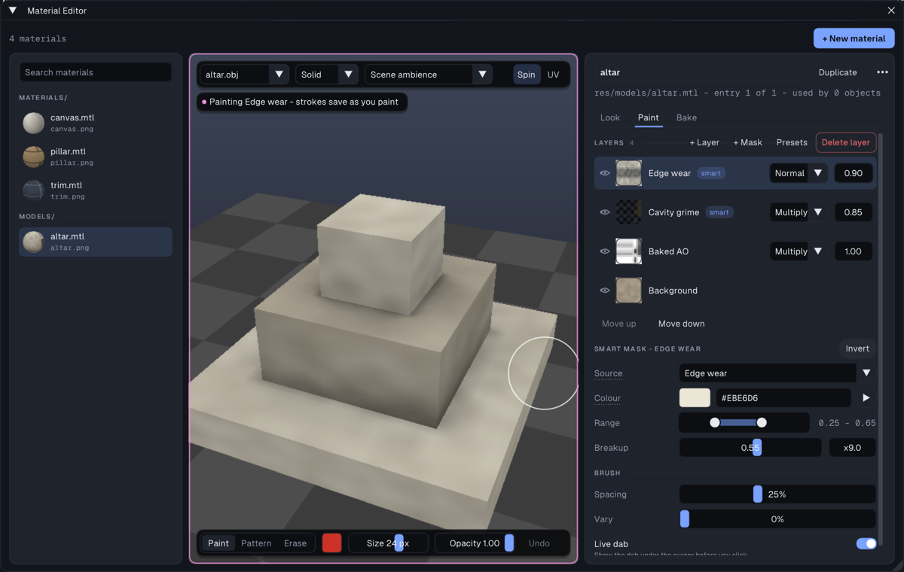
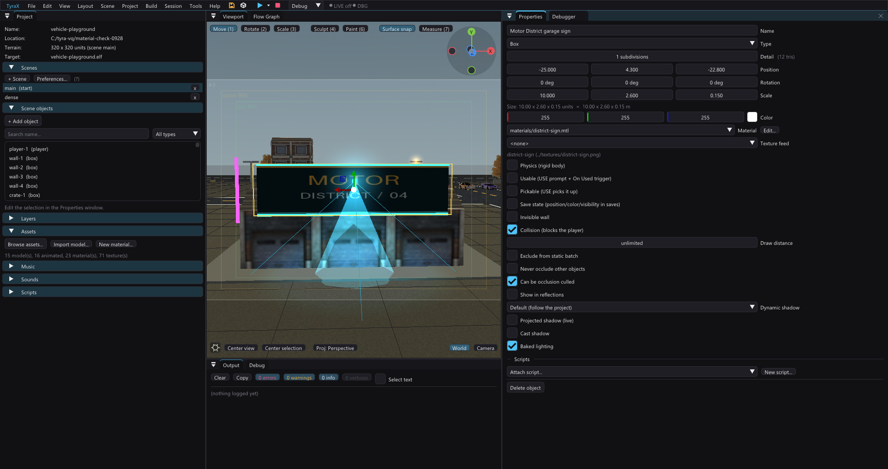

# Materials and texture painting

The Material Editor previews `.mtl` files on their real model, edits their PS2
settings and paints layered textures. Open it with **Tools > Material Editor**,
or click **Edit...** beside an object's **Material** field to select that file
and focus the editor. Models also supply their preview mesh. On a model with
**(model's own)** selected, **Edit...** opens the model's own `.mtl` (its
sibling `<name>.mtl`, else the `.obj`'s `mtllib`) - shared by every object
using that model; a model with no `.mtl` at all gets one made from its built-in
materials. The material list itself lives here, not in Properties, which only
warns when a texture is missing. The **Material** field lists every `.mtl`
under `res/`.

## Edit a material

The window has three columns: the **materials** on the left (each with its
rendered sphere and its texture, grouped by folder), the **preview** in the
middle - the largest part of the window, and it never shrinks - and an
**inspector** on the right with three tabs: **Look**, **Paint** and **Bake**.

Use **Search materials** to filter the left list by filename or folder,
without case sensitivity. A direct **Edit...** clears a filter that would hide
the requested file. External file additions appear within 1.5 seconds; asset
imports, moves and deletes refresh the list immediately. **+ New material**
(top right) makes a new `.mtl` in `res/materials`.

The inspector's header names the entry (click to rename it), says where it
lives - `res/models/altar.mtl - entry 1 of 1 - used by 2 objects` - and holds
**Duplicate** and a `...` menu (Undo, add / remove / reorder entries, Delete
material...). A file with several entries shows them as chips under the
header; the first is what primitives and emitters use.

**Look** holds the colour (swatch + `#RRGGBB`), brightness, the **Texture**
(thumbnail, picker, its size and estimated GS memory, tiling), **Reflection**
(sphere map, strength, rounded normals), **Glow** (an *off* badge until you
raise it, which unlocks the white-hot core and light spill) and the **UV
check**.

The preview's controls float on it:

- top: the preview **mesh** (a primitive, the model that owns the material or
  any other project model), **Solid / Wireframe / UV checker / PS2 CLUT**,
  the **light** (scene ambience or a neutral studio light), **Spin** and
  **UV** (the UV layout panel under the preview);
- bottom left: triangles, vertices and the texture size;
- bottom right: **Editor | As PS2** - the texture quantized exactly as the
  build ships it. Its palette and dithering choices appear in the Look tab
  while it is on.

The texture readout includes dimensions, bit depth and estimated GS memory.
Use 4-bit or 8-bit textures where the colour loss is acceptable; reserve
32-bit textures for gradients or alpha that truly need it.

## Duplicate or delete

**Duplicate** copies the `.mtl` and, when useful, its textures. References are
not changed until you assign the new material. **Delete material...** (in the
`...` menu) shows references first and is not undoable.

## Paint on the model

Open the **Paint** tab: the brush is armed while it is shown. The preview gets
a coloured outline and a status pill - *Painting Edge wear - strokes save as
you paint* - so the mode and the layer your strokes land on are always on
screen. The brush rides on the canvas as a pill: **Paint / Pattern / Erase**,
the colour (or the pattern image from `res/brushes`), **Size**, **Opacity**
and **Undo**. Then drag over the model. The brush projects through the
model's UVs, so paint lands in texture space and survives camera changes.
An entry without a texture offers **Create texture for this entry** instead.

- Spacing, Vary (and for a pattern, Angle / Random angle) and **Live dab**
  sit under the layer stack in the Paint tab.
- Paint and erase work on the selected layer.
- **UV** exposes seams and overlap problems.
- Undo covers brush strokes and layer edits.

Models need usable UVs. The editor can generate replacement UVs without touching
the source model; they live in `<model>.uvs` and follow the model when it moves.

## Layers and masks

Layers are composited top to bottom. Each row has an eye, a thumbnail of the
layer's own pixels over a checker (a smart mask shows the mask it generates;
it follows strokes as you paint), the name
(a `smart` chip on a smart mask), the blend mode and the opacity; **+ Layer**,
**+ Mask**, **Presets** and **Delete layer** sit on the Layers caption,
**Move up / Move down** under the stack. The stack is saved next to the texture in `<texture>.layers/`; the normal
PNG is the flattened result used by the game.

**+ Mask** limits a layer with a baked or procedural mask. Smart masks include
edge wear, cavities, ambient occlusion, thickness and noise. Their range,
breakup and inversion stay editable, so you can tune wear without repainting.

Presets save a reusable layer stack. They keep material logic, not model-specific
pixels, and are best for recurring looks such as painted metal or dusty stone.

## Create a paintable texture

In the Look tab's texture picker, choose **New paintable texture...**, pick a resolution and base colour, then assign
it to the material. Power-of-two sizes are the safest choice. Start small:
256x256 is often enough on a PS2, especially after palette quantization.

For raytraced AO, curvature, thickness and high-poly projection, see
[Material map baking](material-baking.md).

## Box signs and material refresh

The front and back faces of a Box use V=0 at the top, so an upright PNG sign
stays upright in the editor and generated game. Other faces retain their UVs.

Existing textures painted to compensate for the old vertical inversion need
repainting. Procedural and GI cache signatures change so old geometry or baked
lighting cannot silently retain the previous mapping; regenerate the game.

Saving material settings refreshes only models and roads that use that file.
Unrelated scene geometry and resident textures remain cached. The asset list
and PNG dimensions are cached too; see [Editor performance](editor-performance.md).
