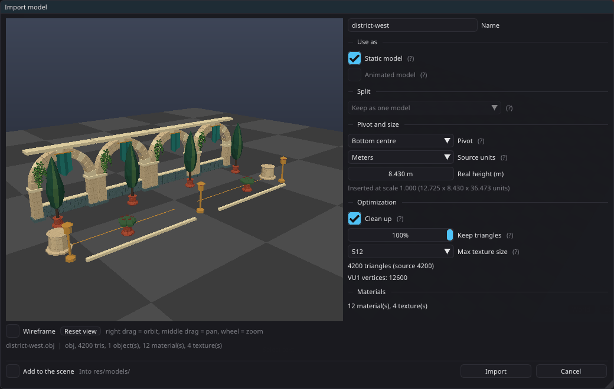

# Importing models

One importer reads `.obj`, `.glb` and `.fbx` the same way, shows the result
before anything is written, and always produces the same kind of files.

## The window



Open it from **Project > Assets > Import model...**, the
[Asset Browser](asset-browser.md)'s **Import...** menu, or **Import new
model...** inside the model picker. Pick a file; it is read in the background
and the window opens with a preview on the left and the options on the right.

- **Preview** — right drag to orbit, middle drag to pan, mouse wheel to zoom,
  **Reset view** to start over, **Wireframe** for the triangles. Missing textures show as plain white surfaces, so a broken import
  is visible before it reaches the project. Selecting a row of the model list
  outlines that model in orange, and in a split import a left click on a piece
  in the preview selects its row (scrolling the list to it).
- **Folder** — where the model goes, e.g. `res/models/terrain/rocks`: type a
  path (missing folders are created; a bare `terrain/rocks` lands under
  `res/models`) or pick an existing folder from the arrow. It is remembered for
  the next import, so filing a pack into a catalogue is one setting. Imported
  from an Asset Browser folder, it starts there. Moving a model later in the
  Asset Browser keeps every reference.
- **Use as** — **Static model** writes an `.obj` (from a `.glb`/`.fbx` that is
  the bind pose). **Animated model** keeps the `.glb`/`.fbx` with its skeleton
  and clips; it is greyed out for a file with neither. Both can be on.
- **Split** — keep the file as one model, or write one model per top-level
  object, or one per mesh. Packs often ship dozens of props in one file; a
  split import writes them into `<folder>/<name>/`, all sharing one `.mtl`
  and the textures. Untick models in the list to leave them out.
- **Pivot** — as authored, bottom centre (stands on what it is placed on) or
  centre. Applied per model.
- **Source units / Real height** — the asset's real-world size, the same record
  the Asset Browser's **Size...** edits ([world-scale.md](world-scale.md)). With
  a model selected in the list, the height is that model's.
- **Clean up** — drops zero-area and duplicated triangles.
- **Keep triangles** — reduces the mesh with the same decimator the build's LOD
  tiers use. 100% leaves it untouched.
- **Max texture size** — the longest side written to `res/`. The PS2 tops out
  at 512 and the build resizes anything bigger anyway; this keeps the project
  small.
- **VU1 vertices** — what the build will ship: the triangle-strip pass every
  static model goes through, run on the planned meshes so the number is the
  bake's own. Flat-shaded meshes rarely strip (see
  [model-pipeline.md](model-pipeline.md), "Triangle strips").
- **Materials** — the count, and the textures that could not be found. Hover
  for the list; **Search folder...** points the importer at the folder that has
  them (searched recursively by file name, `.png` found for a `.jpg` reference
  too) and re-reads the file.
- **Add to the scene** (footer) — places the result. For a split import, **at
  the file's layout** puts every model where the file had it, as one
  [editor group](object-groups.md).

## What gets written

Every import produces the same shape, whatever it came from:

| Use as | Files |
|---|---|
| Static | `<name>.obj` + `<name>.mtl` + PNG textures |
| Animated | `<name>.glb`/`.fbx` + `<name>.mtl` + PNG textures |

There is **always** a `.mtl`, even for a model with no materials (one white
`default` material). Every texture is written as PNG next to it, embedded ones
included, and non-PNG sources are converted. An animated model wears its `.mtl`
through the per-object material override, which a new Animated model entity
picks up automatically, so the Material Editor edits it like any other.

Material names with spaces are renamed (the `.mtl` format cannot carry them);
an animated model then shows that material untextured, and the window says so.

## Model and Animated model

**Add object > Object** has two entries: **Model...** and **Animated
model...**. Each opens the model picker — the folders on the left (with model
counts; the last one opened is remembered), a thumbnail grid and a search box
— and the entity decides static or animated, not the file. It lists models
from anywhere under `res/`, so a project made before this importer (models in
`res/aster/`, a hand-made folder) shows all of them with nothing to migrate;
build products and derived models (distant versions, procedural chunks) are
left out.

- **Model** lists every `.obj`, plus any `.glb`/`.fbx` that has no static copy
  yet. Picking one of those writes `<name>.obj` next to it (the bind pose,
  sharing the existing `<name>.mtl`) and places that.
- **Animated model** lists `.glb`/`.fbx` files.

The **Model** field in Properties opens the same picker for the selected
object, as does a third-person Player's avatar field. Changing the model resets
the clip choices and drops the material that came with the old model; a shared
material you assigned yourself stays.

### Properties sections

A solid object's Properties (models, primitives, save points) come in
collapsible sections, each remembering whether it was open: **Model** (or
**Animated model**), **Transform**, **Material**, **Gameplay** (physics, use,
pick-up, save state, collision), **Distance and LOD** (draw distance, LOD
overrides, the **Distant version**), **Performance** (static batching,
occlusion), **Lighting and shadows** (reflections, shadows, baked lighting,
pre-lit bake) and **Scripts**. Other object types keep their short flat panel.

**Material > Edit...** is always there on a model: with **(model's own)** it
opens the model's own `.mtl` in the Material Editor (where its material list
lives now), otherwise the assigned override. The Model section shows only a
"textures missing" line when something is broken.

**Distant version** is one choice — **None**, **Billboard (captured views)** or
**Hull proxy (low-poly)** — with the billboard's **Views**, one **Bake** button
(its status says whether the baked result matches the choice) and **Switch at**
once something is baked ([impostors.md](impostors.md)).

## Headless

```bash
tyrax-editor --import-model <projectDir> <model> [--split none|top|mesh] [--pivot keep|bottom|center] [--keep 0.5] [--max-texture 512] [--animated] [--no-static] [--textures <dir>] [--name <stem>] [--dry-run]
```

The same code as the window. `--dry-run` prints the source summary, missing
textures and the plan without writing.

## Limits

- `.fbx` geometry is read directly, so a pack of hundreds of meshes splits
  cleanly. A `.glb` goes through the skeletal parser, whose matrix palette holds
  256 rigid nodes; a `.glb` with more meshes than that should be split in the
  modelling tool or exported as `.fbx`.
- The editor decodes PNG and JPEG only. Other texture formats are reported as
  missing.
- Reflection sphere maps from an `.obj` are not carried (only `@sky`).
- Vehicles have their own import in the [Vehicle Editor](vehicles.md).

## Implementation

`src/modelimport.cpp` is the host-only core (`load`, `plan`, `write`,
`staticTwin`), shared by the window (`src/modelimport_ui.cpp`) and
`--import-model`. `objparser::load(..., splitObjects)` keeps `o`/`g` groups
apart for the split; `Viewport::renderImportPreview` draws the plan on its own
framebuffer.
