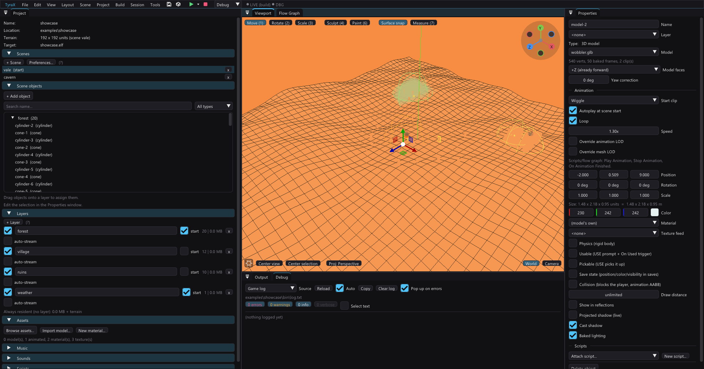
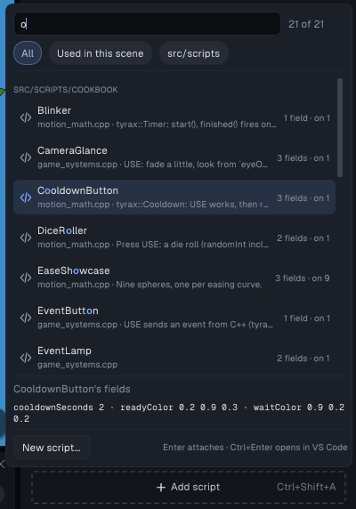
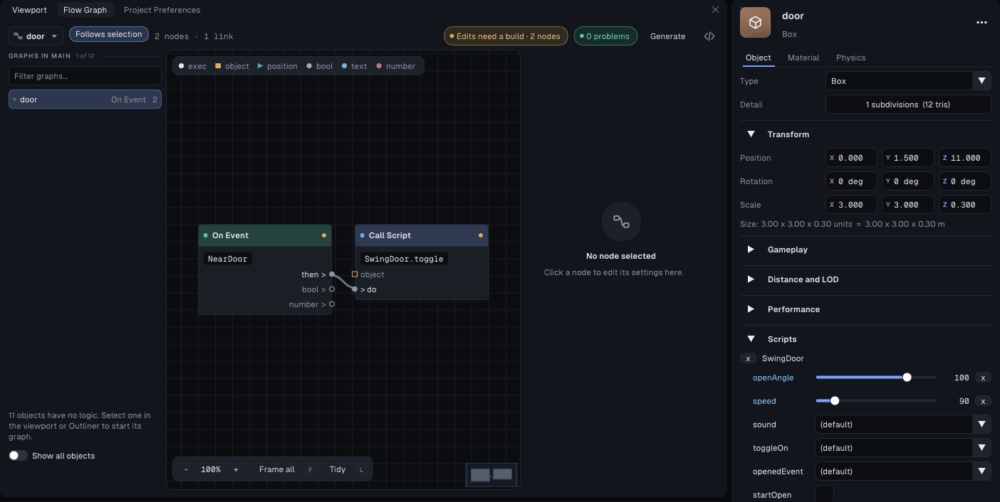
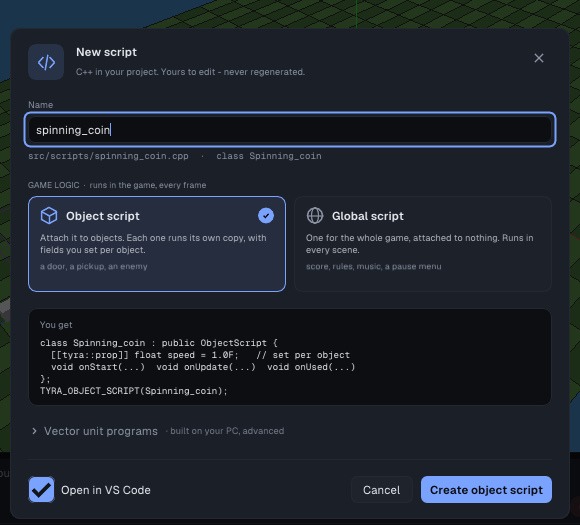

# Object scripts (Unity-style components)



Custom game logic is written in C++ and compiled into the ELF by the normal
build - there is no interpreter on the PS2, so scripts run at native speed.
An **object script** is a class you write once and *attach* to any number of
scene objects, the way components work in Unity: every attachment becomes
its own instance at scene load, with its own member variables and a `self`
pointer to the object it hangs on. Attach `Spinner` to five crates and five
independent spinners run; detach it and the class costs nothing.

```
Properties > Scripts (attach "Spinner" to box-1, box-2)
   │  stored per object in <name>.tyra ("scripts": ["Spinner"])
   ▼
src/gen/object_scripts.gen.cpp        ← regenerated on every build:
   (scene, object, class-name) table  +  a driver that owns the instances
   ▼
scene load: driver looks each name up in the TYRA_OBJECT_SCRIPT registry,
news one instance per attachment, calls onStart; every frame it refreshes
`self` and calls onUpdate (and onUsed when the player USEs the object)
```

`src/scripts/` is **exclusively yours** - engine-generated sources live in
`src/gen/`, so the editor's Scripts list shows only your files. Subfolders
are fine (`src/scripts/ai/guard.cpp` compiles and scans like any other; the
**New script...** dialog accepts `ai/guard`). Your `.cpp` files are **never
regenerated or parsed for compilation** - the editor only scans them
read-only for `TYRA_OBJECT_SCRIPT(...)` registrations to fill the attach
list. (Projects from an older editor still carry generated copies inside
`src/scripts/`; the first build with this version deletes them
automatically.)

## TyraX2 and custom rendering

The experimental [TyraX2 frame pipeline](tyrax2.md) records ordinary engine
render operations and supplies their ordering fences automatically. Custom
logic using those APIs needs no unconditional fence per node or script call.
Raw DMA sends, GS register writes and CPU GPU readbacks bypass that contract;
they are not automatically captured by enabling the project preference.

Change `RendererCore::setFramePipeline(bool)` between frames, before
`beginFrame()`. `getFramePipeline()` reports the **requested** setting, not
whether overlap is active in the current compatibility mode. Before a
between-frame CPU GPU readback, call `renderer.core.synchronizeFrame()` to
complete the pending presentation; the generated debugger capture already
uses it. This is not a mid-recording readback helper.

For custom packets, use the existing adapters in
`renderer/core/paths/path1/frame_submission.hpp` (`Tyra::frameSendPacket` and
its ordering helpers), or explicitly obey the queue/channel completion and
source-ownership contracts. `Tyra::Vif1Queue::drain()` is required before a
foreign direct VIF1 send. An idle DMA channel does not prove the GS has stopped
reading a texture. During recording, `sync.align3D()` / `sync.align2D()` can
record barriers instead of waiting on the CPU: do not use them as proof that
readback or resource destruction is safe. Keep referenced bytes and VRAM
alive until their actual readers finish.

## Quick start

1. Select an object, click **Add script** in **Properties > Scripts** and
   pick **New script...** at the bottom of the list (also on the Project
   panel's *Scripts* page, the `</>` icon on the left rail). The editor
   writes `src/scripts/<name>.cpp` from an attachable stub and attaches the
   class to the selected object.
2. Click the `</>` button on the script's card (or **Open in VS Code** on
   the Project panel's *Scripts* page) - VS Code opens at the class. The generated
   `.vscode/c_cpp_properties.json` gives working IntelliSense against the
   engine and PS2SDK headers.
3. Edit the class:

```cpp
// bobber.cpp - created by TyraX. This file is yours.
#include "scripts/script.hpp"

namespace Mygame {

class Bobber : public ObjectScript {
 public:
  void onStart(ScriptContext& ctx) override {
    base = object.position();            // remember where we were placed
  }

  void onUpdate(ScriptContext& ctx) override {
    const float t = tyrax::sceneTime();  // seconds, PAL == NTSC
    object.setPosition(base + tyrax::Vec3(0.0F, 0.5F * sinf(t * 2.0F), 0.0F));
  }

 private:
  tyrax::Vec3 base;
};

TYRA_OBJECT_SCRIPT(Bobber);

}  // namespace Mygame
```

4. Attach the class to more objects with **Add script** (`Ctrl+Shift+A`
   in Properties) - each gets an independent instance. **Build & Run** (`F5`).

### Scripts in the editor



- **Properties > Scripts** shows one card per attached class: the class
  name over its `file:line`, an *N set* tag when this object overrides
  fields, and three buttons - open the file in VS Code at the class, show
  the class on the Project panel's *Scripts* page, and a menu with *Reset
  all fields*, *Copy class name* and *Detach*. Click the header to fold the
  card. The body is the first sentence of the comment above the class and
  its [public fields](script-api.md#public-fields). A class that no file
  registers gets an amber card with *Create*.
- **Add script** opens a searchable picker: type to filter by name,
  description or file; the chips narrow it to the classes used in this
  scene, to `src/scripts` or to one extension. Classes are grouped by
  folder (recently attached first) and show their field count and how many
  objects use them; the highlighted class's fields and defaults show below
  the list. `Up`/`Down` move, `Enter` attaches, `Ctrl+Enter` opens the
  class in VS Code, `Esc` closes.
- **Project panel > Scripts** lists everything that runs code in foldable
  sections: *Object scripts* (one group per file, an extension being one
  group), *Global scripts*, *Flow graphs*, *VU programs* and *Extensions*,
  with chips for each and for *Unused* classes. Each class shows how many
  objects use it; click an object to select it and frame it in the
  viewport (switching scene first if it lives in another one), click the
  class name to open its file at the class. An unused class has *Attach to
  selected*.
5. To make a value settable per object, mark the member
   `[[tyra::prop]]`, for example `[[tyra::prop(min = 0, max = 2)]] float
   height = 0.5F;`. It then shows up under the script in Properties, with a
   value of its own on each object. See
   [public fields](script-api.md#public-fields).

## The API

Everything lives in the generated `inc/scripts/script.hpp` (regenerated
while its ownership-marker line is intact, so the API tracks the editor).
It includes the **[script API](script-api.md)**, the `tyrax::` library
that does what the flow nodes do (moving objects, raycasts, sounds, events
shared with graphs, save data, HUD, scenes) and names your project's sounds,
scenes and objects as typed constants. The sections below describe the raw
layer that the library is built on.

### Lifecycle

| Override | Called |
|---|---|
| `onStart(ScriptContext&)` | Once per scene (re)load, before the first `onUpdate`. `self` is already valid, and **every** instance of the scene already exists, so `tyrax::getScript` / `findScript` work here. |
| `onUpdate(ScriptContext&)` | Every frame while the owning scene is active (paused while a pausing menu is open, like all scripts). |
| `onLateUpdate(ScriptContext&)` | Every frame, after every object script's `onUpdate`: follow-cameras, and anything that reads what the others just did. |
| `onUsed(ScriptContext&)` | The frame the player pressed USE on `self` (objects with **Usable** checked - same dispatch as the flow graph's *On Used* trigger). |
| `onEvent(ScriptContext&, tyrax::EventId, float value)` | An event is delivered: `tyrax::sendEvent` from any script, or a graph's *Send Event*. Compare `e.index` with `tyrax::Events::X.index`. |
| `onPlayerEnter` / `onPlayerExit(ScriptContext&)` | `self` is an **Area** object and a player stepped into / out of it (also on the first frame, when the player starts inside). |
| `onAnimationFinished(ScriptContext&)` | `self`'s clip reached its last frame (looping clips: every wrap). |
| `onDeactivated` / `onActivated(ScriptContext&)` | `self`'s streaming layer unloaded / loaded again. The instance lives on. |
| `onSceneEnd(ScriptContext&)` | The scene is being left or reloaded and the instance is about to be deleted. `self` and `object` are already empty: write what must survive to a save value or a `static`. |

### Scripts talking to each other and to graphs



- `tyrax::getScript<Door>(someObjectRef)` returns the `Door` attached to that
  object, or null. `tyrax::findScript<GameManager>()` returns the first live
  instance of a class, and `tyrax::findScripts<Enemy>(out, max)` returns all
  of them. These lookups need no RTTI.
- **Graph to script:** register a method with
  `TYRA_SCRIPT_METHOD(Door, open);` (signature `void open(ScriptContext&)`,
  public, placed after the class). The flow graph's **Call Script** node,
  under *Events*, then lists `Door.open` and runs it on the `Door` attached to
  its target object (a wired object, or the graph's own).
- **Script to graph:** `tyrax::sendEvent(tyrax::Events::Opened)` fires every
  *On Event* "Opened". A graph's *Send Event* reaches `onEvent`.

Instances are created at scene load and deleted when the scene is left -
member variables reset on every scene switch or reload. State that must
survive scenes or power-off goes in `ctx.saveValues` (see *Save data* in
the Project panel).

### `self` - the attached object

`object` is the attached object as a [`tyrax::ObjectRef`](script-api.md#objects-objectref):
`object.moveBy(...)`, `object.lookAt(...)`, `object.playAnimation(...)` set
the rebuild and wake-up flags for you. `self` is the same object as a raw
`RuntimeObject*` (`selfIndex` is its index in `ctx.objects`); both are
refreshed by the driver every frame. When you mutate it through `self`, set
`self->dirty = true` so the geometry rebuilds:

| Field | Meaning |
|---|---|
| `self->data.position/rotation/scale` | The transform (rotation in degrees, X→Y→Z order). |
| `self->data.color` | RGB 0..1 - mesh tint on solids, particle tint on emitters, free parameter on empties. |
| `self->visible` | Show/hide (also mutes sound emitters, disables particle emitters). |
| `self->velocityX/Y/Z` | Rigid-body velocity (per-frame displacements) used by object physics. |
| `self->spin` | Angular velocity, degrees/frame (X/Y/Z) - tumbling. |
| `self->restFrames` | Physics sleep counter; write `0` after changing velocities to wake a sleeping body (`PHYS_SLEEP_FRAMES` = asleep). |
| `self->dirty` | Set true after changing any of the above so the frame's rebuild picks it up. |
| `self->anim*` | Animated-model playback state - prefer the `playAnimation`/`stopAnimation`/`animationFinished` helpers (see [animated-models.md](animated-models.md)). |

### Registration

`TYRA_OBJECT_SCRIPT(ClassName);` goes at file scope **inside your project
namespace** (the stub places it correctly). The stringized class name is
what the attach list shows and what the project file stores - rename the
class and existing attachments show a red *not found* until you re-attach
or rename back. One file may register several classes.

### `ScriptContext` - everything a script can see

The same context global scripts receive; the fields you'll actually use:

| Field | Meaning |
|---|---|
| `ctx.engine` | The Tyra engine: `ctx.engine->pad` for buttons/sticks, renderer, audio. |
| `ctx.playerPosition` | Camera/player position this frame. |
| `ctx.objects`, `ctx.objectCount` | All runtime objects of the active scene (your `self` is `ctx.objects[selfIndex]`). |
| `ctx.skyColor` | Write to retint the sky/clear color. |
| `ctx.teleport*` | Set `teleport = true` + `teleportPos`/`teleportYaw` to move the player. |
| `ctx.usedObject` | Index of the object USEd this frame (-1 none) - `onUsed` is the ergonomic form. |
| `ctx.saveValues`, `ctx.saveTexts` | Named values persisted in memory-card saves. |
| `ctx.openMenu`, `ctx.menuEvent` | Open a game menu / react to a menu entry's flow event. |
| `ctx.rumble*` | Pad vibration request — prefer the `padVibrate(ctx, big, small, seconds)` helper (big = heavy motor 0..1, small = the buzz motor, seconds > 0 auto-stops, 0 = until the next call). |
| `ctx.scene`, `ctx.requestScene` | Active scene index; write an index to switch scenes after this frame. |
| `ctx.sceneGeneration` | Bumps on every scene (re)load - object scripts rarely need it (their lifetime already tracks it). |

Handy globals from `scene_data.hpp` (included via `script.hpp`):
`g_frameDt` (seconds per frame - multiply all speeds by it so PAL and NTSC
play identically), `g_frameScale`, the `SCENE_*` accessor macros.

## Empty objects

**+ Add object > Empty** inserts a pure transform: a small sphere marker in
the viewport, *nothing* in the game - no geometry, no collision, no USE
target. It exists so scripts and flow graphs have something to hang on:

- an anchor for a script that manages a spot in the world (spawner, trigger
  zone via distance check, cutscene camera target),
- a waypoint: flow-graph *Move Object* nodes and scripts can read/write its
  position like any object,
- its editable **color** never renders in-game, so it's a free per-object
  parameter (`self->data.color`) - e.g. one "SkyTint" script attached to
  differently-colored empties per scene.

Rotation, scale and *Save state* work like on any object; collision is
always off.

## Global scripts

The pre-existing flavor still works and is the right tool for logic that
isn't about one object: derive from `Script`, override `init`/`update`,
register with `TYRA_SCRIPT(MyScript);` (at file scope, *outside* the
namespace or inside it with a qualified name - see the FPP example script).
One instance for the whole game, `update` runs every frame in every scene.
What makes a script global is only that: the `Script` base class and the
`TYRA_SCRIPT` registration (an object script derives from `ObjectScript` and
registers with `TYRA_OBJECT_SCRIPT`). **New Script** asks which one you want
and writes the matching stub:



- *Object script* and *Global script* are the two kinds of game logic: code
  that runs in the game every frame. The name field shows the file and the
  class it will make; *You get* shows the stub's first lines.
- *Vector unit programs* (folded) holds the two kinds that are not game
  logic: a **VU1 program** and a **VU0 kernel** are C++ run on your PC at
  build time that leave a microprogram behind ([VU authoring](vu-authoring.md)).
- Opened from Properties it only makes an object script, and attaches it
  (*Create and attach*). *Open in VS Code* opens the new file.

The Project panel's *Scripts* page lists global scripts in their own section,
with *New global script...* under them.
Existing projects keep compiling unchanged; the flow-graph compiler and the
object-script driver are themselves global scripts under the hood.

## Performance

- Scripts are compiled MIPS code, not interpreted - an empty `onUpdate` is
  one virtual call per attached instance per frame (nanoseconds on the EE).
- Class-name lookup happens **only at scene load**; the per-frame path
  touches no strings.
- Scenes with no attachments cost an empty loop; unattached classes cost
  only their code size.
- The real costs are what the script *does*: `self->dirty = true` rebuilds
  that object's vertex buffers this frame (fine for a handful of moving
  objects - the flow graph's Move/Recolor nodes do the same), and per-frame
  math over `ctx.objects` scales with scene size.

## Troubleshooting

| Symptom | Cause / fix |
|---|---|
| Class missing from the **Add script** picker | No `TYRA_OBJECT_SCRIPT(Name);` in a `src/scripts/*.cpp` file (the scan is textual and per-file - check spelling and that the file is saved). |
| Attached entry shows red *"not found"* | The registration disappeared (file deleted, class renamed). The game skips it with a log line; remove the entry or restore the class. |
| `Object script not registered: X` in the game log (Debug panel, `bin/log.txt`) | Same as above, seen at runtime - the scene loads fine, that attachment is skipped. |
| Script does nothing | Is it attached to an object *in the active scene*? Attachments are per object per scene. |
| State resets when the scene changes | By design - instances are recreated per scene load. Persist through `ctx.saveValues` or a `static` member (statics survive scene switches but not power-off). |
| Movement speed differs between PAL and NTSC | Multiply per-frame deltas by `g_frameDt` (seconds) or `g_frameScale` (50 Hz-relative) - never hardcode per-frame steps. |
| `onUsed` never fires | The object needs **Usable** checked (Properties), the player must be close and press USE; menus swallow input while open. Markers (spawn, player, lights, empties) cannot be usable. |
| Nothing moves while a menu is open | Menus with *Pause gameplay* checked pause all scripts - that is the pause menu working as intended. |
| Editing the `.cpp` does nothing in the running game | Scripts compile at build time - **Build & Run** again (no hot reload on the console). |
