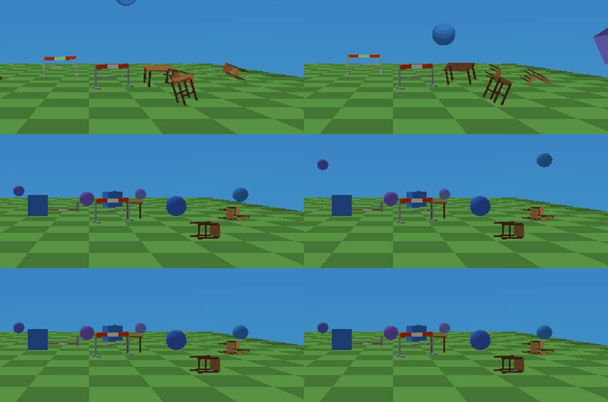
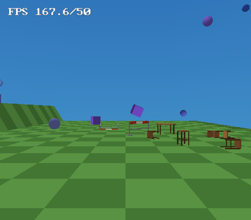

# Rigid-body physics

A scene object with **Physics (rigid body)** ticked is simulated in the game as
a real rigid body: it has a centre of mass, an orientation, linear and angular
velocity and an inertia tensor, and it collides as the **convex hull of its
own mesh** - so a stool stands on its four feet and tips over the edge of one,
a railing falls flat along its length, a chair lands on its backrest and a
ball rolls because the friction at its contact turns it.

It replaced a "rigid-body-lite" (1.123.0) that collided every body as its
bounding box, faked rolling by converting slide into spin as if everything were
a ball, and eased a settling body onto the nearest 90-degree face. That was
fine for crates and balls and looked wrong for anything else.

## Authoring

Properties > Physics, on any box, sphere, cylinder, cone, plane, save point or
static `.obj` model:

| field | meaning |
|---|---|
| Mass | relative; only matters against other bodies and shoves (heavier = harder to push) |
| Bounciness | restitution 0..1, the larger of the two bodies in a collision |
| Friction | 0..1, mapped to a Coulomb coefficient `0.05 + 0.95 * f` (the pair averages) |
| Tumble | off = the body slides but never rotates (infinite inertia) |
| Sleep after | seconds of rest before the body freezes and costs one branch per frame (1 s for new bodies since 2.10.0; 3 s before) |

Nothing else is authored: the shape is derived from the mesh at build time.
`examples/physics-playground` has the reference props (stool, road barrier,
chair, table - `authoring/make-props.py` writes them) next to its boxes and
balls.

## The shape: a baked convex hull

At every build (`--refresh-gen` included) codegen bakes, for every static
model some physics object uses and for the four unit primitives, a hull into
`inc/model_data.gen.hpp` (`PHYS_HULLS`, `PHYS_HULL_VERTS`, `PHYS_HULL_PLANES`,
`MODEL_PHYS_HULL`, `PHYS_PRIM_HULL`) - `src/physhull.cpp`, host-only.

- **At most 24 corners.** The hull is not the full hull of the mesh but the
  hull of its SUPPORT POINTS: the extreme vertex along a fixed, prioritised set
  of directions - the six axes, the eight box corners (downward ones first),
  the twelve edge diagonals, then a Fibonacci sphere. The points a body can
  rest on come first, so a stool's four feet and a table's four legs always
  survive the reduction. Points on a face or an edge that are not corners are
  dropped.
- **Face planes** by brute force over triples (at most 2024 for 24 points) -
  immune to the degenerate cases an incremental hull has to special-case.
- **Solid mass properties** at unit density: volume, centre of mass and the
  second moment about it. The game derives the inertia tensor under any
  per-axis scale from those (the covariance scales as `S C S` and the volume
  cancels against the density), so a stretched table is not re-baked.
- A flat cloud (a Plane, a single card) is thickened to 2% of its largest
  extent, so every shape has a volume.
- A sphere is analytic. An animated model, or a model the build could not
  read, collides as the unit box stretched over its mesh AABB.

**The hull is convex.** A chair's hull fills the space under its seat and a
railing's fills the gap between its bars - a ball rolled at the gap bounces
off. That is the standard trade every game engine makes for dynamic bodies;
concave STATIC geometry uses mesh collision (below), which is exact.

## The solver

`TerrainGame::updateObjectPhysics` (the game template in `src/templates.cpp`)
runs once per frame over the awake bodies:

1. **Predict**: gravity into the velocity, then the pose one frame ahead
   (quaternion integration of the angular velocity).
2. **Contacts against that prediction**, each source reduced to the four points
   that span it (deepest, farthest, then the ones adding the most area):
   - **terrain** - hull corners below the heightfield, with the slope normal;
   - **box colliders** - hull corners inside the obstacle's collision box
     (`objectCollisionBox`, rotation included - the old code ignored the
     obstacle's rotation), pushed out through the face they came in by; plus
     the box's corners inside the hull, so a body lying across a narrow beam
     rests on the edge;
   - **mesh colliders** (`collision: mesh`) - every hull corner casts its own
     path for the frame against the `CollisionMesh`, from a skin behind where
     it was to where it is predicted, so a fast corner cannot cross a thin
     floor and a stool finds its feet inside a building;
   - **other bodies** - two boxes: the clipped face patch (SAT over the 15
     axes; when a face axis wins, the other box's face is clipped to that
     face's rectangle); otherwise each hull's corners inside the other hull,
     sphere against the face of largest separation, sphere against sphere.
3. **Warm start**: a contact found again at the same point of the same pair
   (within 15% of the body's radius, in the body's own frame) starts from 85%
   of last frame's impulses, scaled by the square of the frame-time ratio
   (impulses are per-frame displacements).
4. **Sequential impulses**, 4 passes: normal impulse with restitution (only
   above a resting threshold, so gravity's own frame of fall never buzzes a
   crate), Coulomb friction along two fixed tangents, the pair clamped to the
   circle of the accumulated normal impulse.
5. **Split impulse**, 2 passes: whatever overlap is left after the velocity
   solve is removed through pseudo-velocities that move the body and are then
   discarded - pushing a body out of the ground never launches it.
6. **Integrate and write back**: the object's position and its Euler angles
   (rebuilt from the quaternion, same `Rz*Ry*Rx` order as `rotated()`), the
   sleep countdown, and the matrix fast path exactly as before.

Portals keep their behaviour: the floor-portal swallow and the doorway rule
(`portalDoorwayOpens`) are applied to the new contacts the way they were to
the old box resolution.

### State and the script contract

The rigid-body state lives beside `RuntimeObject`, in `TerrainGame::physBodies`
(one per physics object, `physSlotOf` maps an object to it). `RuntimeObject`
keeps the script-visible half:

- `velocityX/Y/Z` - linear velocity in units per FRAME, read and written every
  frame (Set Velocity, Apply Impulse, carrying and throwing all keep working);
- `spin[3]` - now the angular velocity about the WORLD axes in degrees/frame.
  A script that writes it (Stop Motion zeroes it) is honoured;
- `restFrames` - write 0 to wake a body.

Anything else that moves or turns a body - a portal hop, a carry, Live Link,
the time machine, a script writing `data.position`/`rotation` - is detected
(the sim remembers what it last wrote) and the orientation is re-read from the
Euler angles. `flatTgt` is unused and kept for layout compatibility.

### Shoves have a point of application

The player's walk-into shove and a car's bumper push go through
`TerrainGame::physPushAt`: the same velocity change as before at the centre of
mass, plus the spin that impulse gives at the point where it lands (hip height
for the player, bumper height for a car). A tall stool leans and falls over; a
low crate slides.

Every part of a car's push is divided by the body's mass, the small upward
"hop" of a fresh hit included. Before 1.165.0 the hop was not: a 60-mass
dumpster barely slid but took the same lift as a 0.6 crate, applied at the
bumper, so it tipped and spun as if it weighed nothing. A body of mass 1 or
less is unchanged.

## Cost

Measured in PCSX2 on `examples/physics-playground` (37 bodies), COP0 around
`updateObjectPhysics`, per frame - PCSX2 emulates no EE data cache, so read the
ratio, not the milliseconds:

| state | old solver | new solver |
|---|---|---|
| raining, ~30 bodies awake | 0.88 - 1.02 ms | 0.85 - 1.00 ms |
| settled (60 s in) | 0.33 ms, 3 bodies still awake | 0.07 ms, only the kicked ball is awake |

The new solver costs the same per awake body, and its bodies come to rest
sooner - three of the old one's were still awake a minute in. Where the budget
goes, and what keeps it bounded:

- a sleeping scene returns after one pass over its physics objects;
- static-world queries retain an index until its inputs change; moving world
  solids refresh separately, and awake bodies query only nearby candidates;
- a body carries at most 24 corners and each contact source at most four
  points, however detailed the mesh;
- a separate body grid uses conservative swept hull/sphere bounds; a sleeping
  partner is expanded only when an awake body queries its region.

## Limits

- **Convex contact fallback.** Corner manifolds are supplemented by full
  face/edge-axis SAT and linear CCD when no corner contact exists. This is
  not continuous rotational collision detection; extreme rotation can tunnel.
- The face patch covers box against box only. Other hull pairs (a model
  hull on a box, two model hulls) still use corner-in-hull contacts, and a
  stack of those can select weak support points.
- **Warm starting, no persistent manifold.** Impulses carry over by matching
  contact points frame to frame; there is no manifold object, and a contact
  whose point moved more than 15% of the body radius starts cold.
- A sphere is tested against a hull by the face of largest separation, which
  over-reports contact near a hull's edges by a few percent of the radius.
- A shape is convex (see above), and an animated model is its AABB box.
- There is no editor-side simulation: the viewport shows the authored pose.

## Qualified collision optimizations

The release extraction kept six velocity and three split-impulse passes;
2.10.0 changed that with warm starting (below).
Conservative spatial bounds reject disjoint pairs before narrow phase; SAT and
linear CCD share projections, with analytic outward-rounded OBB intervals.
Cached separating axes are hints: the current geometry and complete movement
interval must still prove separation. Transformed hull axes, static boxes and
sleeping local bounds are reused only while their inputs remain valid.
Scene reloads and shape changes invalidate the relevant caches.

Contacts grow with demand: 384 is an initial reserve, not a scene-wide cap.
Vehicle-to-prop candidate storage also grows beyond eight objects. Each source
still reduces its manifold to at most four points. Vehicles retain their existing
update and push mechanism; this is not the experimental common vehicle solver.
All physics work in this release uses the EE scalar path. VU0 kernels, prepared
solver backends and island sleeping are not included.

### What a body costs on a PS2, and what 2.10.0 changed

Measured on a physical PS2 in a copy of the vehicle playground: 82 bodies (75
unit crates scattered on the road, none touching, plus pallets and barriers),
car parked facing them, debug build with the devkit (Live Debugger, Remote
Pad) off, `TYRA_FRAME_PROFILE` 2. Window means over 50 frames.

| | before | 2.10.0 |
|---|---:|---:|
| scene load, first ~3 s: physics / missed frames of 50 | 9.3 ms / 49 | 1.4 ms / 3 |
| at rest, crates in view: frame work / scene render | 8.15 / 6.73 ms | 6.5 / 5.0 ms |
| all 82 awake and resting: physics / scene render | 8.6 / 7.5 ms | 7.5 / 7.0 ms |
| ... of which the solve | 4.1 ms | 3.4 ms |
| six-crate tower + 4-3-2-1 pyramid, every body awake (PCSX2) | both fall flat | both stand, asleep in ~4 s |

A sleeping body is free in physics; an awake one costs ~90 us a frame even
lying still, so the scene budget is about how many are awake at once - here
~60 at 60 FPS. What changed, and why each one mattered:

- **Bodies placed at rest start asleep.** Every body used to start awake and
  spend its Sleep-after countdown confirming that it had not moved - every
  scene load ran at 30 FPS for three seconds. A still body whose hull touches
  flat terrain at three corners or more, and goes below it nowhere, now
  starts asleep (checked once per body per scene, the first frame it is
  active). A body set on another body, in the air or on a slope keeps the
  old path.
- **Sleeping bodies batch.** Physics bodies are eligible for static batching;
  the first frame the solver moves one takes it out of its batch (the matrix
  promotion never sets `dirty`, so the batch would not have demoted it - it
  would have drawn twice). 75 crates drawn as their own bags cost ~2.8 ms;
  the scene above batches 144 objects instead of 59.
- **Box against box clips the face patch.** Two boxes stacked square put
  each one's corners exactly on the other's side planes, where the
  corner-in-hull test keeps some and drops others by rounding; the lopsided
  manifold tipped towers over. SAT over the 15 axes picks the normal, and when
  a face axis wins the incident face is clipped to the reference face (the
  `box_face_manifold` experiment of the investigation branch, never
  integrated there).
- **Warm starting with 4 + 2 passes** instead of 6 + 3 cold. A per-island
  histogram of the cold solver showed impulses still moving by 1e-5..1e-4 (a
  crate's support is ~4e-4) in its sixth pass: it never converged, it ran
  out of passes. Starting from last frame's impulses lets fewer passes do
  better.
- **Friction along two fixed tangents**, masses inverted once per contact,
  the pair clamped to the Coulomb circle - a pass does no matrix product,
  division or square root unless the clamp bites. The normal masses are
  inverted once too.
- **Island-ordered passes on packed bodies.** Bodies joined by contacts in
  which both can move form an island; a contact against the world or a
  sleeper changes only its own body, so each island runs all its passes
  while its contacts are in the 8 KB data cache - the same result as sweeps
  over the whole list.
- **Rotation trigonometry once per object per change.** `rotTrigCached`
  keeps `rotTrigOf()`'s answer per object slot, keyed by the exact angles, for
  the broad-phase box and the render matrix: a moving body paid ~45 software
  sines and cosines a frame across `broadPhaseBoxOf` and `updateObjMat`.
- **New bodies sleep after 1 s** of rest instead of 3. Existing objects keep
  their stored value.

`FTPHYS awake=` counts awake bodies again (it read 0 before). Contacts
between a model hull and a box still use corners.

### Awake bodies that do not move, and bookkeeping that scaled with the scene

The 2.10.0 table above left every crate awake at 30 FPS. Taken apart on a
physical PS2 (82 crates awake and lying still on the road, none touching
another), per frame: physics 7.6 ms - prediction 1.18, terrain samples 0.68,
broad-phase refresh and queries ~1.0, body pairs 0.57, solver set-up 1.19 and
passes 2.26, write-back 0.52 (0.21 of it quaternion -> Euler) - plus 0.36 ms
of render matrices rebuilt from those Euler angles, and 2.2 ms more scene
render than the same crates asleep (each awake crate is a bag of its own).
With ONE body awake among 81 sleepers physics still cost ~1 ms: syncing,
indexing and pairing every body of the scene each frame. What changed:

- **Held bodies.** A body resting on the world ALONE - grounded, slower than
  the rest thresholds, no other body touching it - for `PHYS_HOLD_AFTER` (10)
  frames is held: no step, so it is an immovable partner like a sleeper,
  while its Sleep-after countdown runs on (and puts it to sleep exactly as
  before). The solver's answer for it was "stay where you are" every frame.
  It goes the moment anything that would wake a sleeper happens, on any touch
  by another body, and when its pose or velocity was changed from outside the
  solver (a script, a push, Live Link). 82 awake crates: physics 7.6 ->
  ~0.3 ms, the frame back at 60 FPS; a slalom through the crate field 2.4-2.7
  -> 1.3-1.6 ms. A body creeping slower than the rest speed now stops after
  ten frames instead of creeping for the rest of its Sleep-after wait.
- **Nothing to solve, nothing to index.** With every body held or asleep the
  step returns before the pair stage.
- **Sines and cosines from the matrix.** The write-back turns the quaternion
  into Euler angles for the scene data; the render matrix and the broad-phase
  box then took those angles' sines and cosines again in software.
  `rotTrigSeedFromMatrix` hands them over from the rotation matrix instead
  (a few ulp from `rotTrigOf`, bodies only), and `updateObjMat` skips an
  object whose pose and matrix have not changed: 0.34 -> 0.12 ms of matrices
  for 82 moving bodies, scene render -0.4 ms.
- **Bookkeeping per awake body** (`PHYS_LEAN_BOOKKEEPING`, false = the old
  walk for an A/B): a sleeper that already has its slot is synced only when it
  is about to be a contact partner; the pair grid holds the awake bodies only,
  and sleepers and held bodies come from the scene broad phase (merged in
  object order, so contacts solve in the same order); a broad-phase refresh in
  which only already-moving boxes moved updates the moving index alone
  (`BroadPhase::updateMoving`, docs/collision-boxes.md). One body awake among
  81 sleepers: sync 0.18 -> 0.06, broad-phase refresh 0.46 -> 0.30, pairs
  0.31 -> 0.03 ms; physics 1.08 -> 0.52 ms.
- **Woken bodies rejoin their batches** (docs/static-batching.md).

### Resting out of sight

After a car ploughs through a crate field, most awake bodies are crates
nobody can see that have all but stopped. Counted on a physical PS2 (a
three-crate-field stress scene, scripted drive): of ~22 awake bodies after
the run, ~19 were outside the view frustum and ~21 slower than the wake
speed - mostly in piles, touching each other, so never held - and each still
paid a full step a frame for the whole of its Sleep after (1 s).

A body that is on something, slower than the WAKE speed and four times the
rest spin, and whose box (centre +- 0.87 x its largest scale + 0.5) is outside
the last frame's view frustum, now counts down to sleep from those looser
thresholds and sleeps after `PHYS_OFFSCREEN_SLEEP_S` (0.2 s). In view nothing
changes. Never in split screen (the planes belong to one half). It can stop a
slow slide early - out of sight.

Measured, two runs against three: awake bodies on the drive ~20 -> ~14,
physics 2.76 -> 2.30-2.36 ms, the update 6.20 -> 5.68-5.76 ms, lost frames
68-79 -> 51-56 in 1 000. Counting only bodies already below the rest speed
(the first version) gave ~16 awake and lost frames 66/70: the slow sliders
were the bulk.

**Library math in the step.** The release ELF's physics functions were
disassembled for calls into libm and soft-float: no double-precision math,
square roots on the hardware `sqrt.s`, and the software trigonometry left is
small - `broadPhaseBoxOf` (5 sin/cos per stale box) and the write-back's
quaternion -> Euler (`atan2f` x3, `asinf`), ~0.15 ms of a crash frame with
~20 awake bodies. `worldShape`'s 12 sin/cos run only when a static box moved
(its geometry is cached by pose).

### The broad-phase walk

`broadPhaseRefresh` compared every object's pose with the one its box was
made for, every frame: ~1.5 us an object on a PS2, nearly all of it memory
traffic. In a stress copy of a vehicle playground (366 crates, ~500 objects)
that walk was 0.78 ms of a crash frame, against 0.29 ms for the rebuild it
feeds; switching the scene to the octree backend changed nothing (1.11 ->
1.02 ms for the whole refresh), because the grid rebuild was never the cost.

Now the walk visits only what can have moved since the last refresh:
- objects the build did not prove static (`batchStatic` 0 - anything with a
  script, a flow graph, a runtime reference, a streaming layer - and the
  spawn pool), every time;
- bodies the physics step had awake in the last two frames (`bpHotAt`,
  stamped in the step's awake loop - only the solver moves an eligible body);
- anything that was moving at the last refresh (`bpMovingNow`);
- and one sixteenth of everything else per refresh, as a safety net (a Live
  Link edit to a static object is picked up within 16 frames).

The first refresh of a scene walks everything. Measured on the same drive:
walk 0.78 -> 0.24 ms, physics 3.41 -> 2.51 ms in the crash, lost frames 153
-> 117 in 1 000.

Measured and dropped in the same round (both A/B'd twice on a PS2, a
three-crate-field stress scene):
- **Awake bodies drawn as instances of one bag** (`StaPipCore::renderInstances`,
  grouped by shape): the solo-body row fell from ~0.87 to ~0.2 ms, but the
  instanced draws cost the same - the Objects total stayed at 4.25-4.44 ms and
  lost frames did not move (68/77 -> 85/67). For a 36-vertex crate an
  instance is no cheaper than a submit.
- **One shared per-frame budget for the work that can wait** (2 ms across
  body pre-bakes, car pre-bakes, rejoins, terrain LOD rebuilds): no gain
  (80/98 lost frames). In that scene the frames are lost to the steady cost of
  dozens of moving bodies, not to queues landing in one frame.

Measured and dropped: ending an island's velocity passes once no impulse
moved more than 1e-6 per contact (no gain - resting contacts under gravity
never fall below it), and reading the terrain table's size and grid once per
frame instead of per sample (no gain - the cost is the arithmetic and the
heightmap reads, ~190 cycles a sample).

**The passes on VU0, macro mode: slower.** The velocity and split passes were
rewritten as a branch-free VU0 macro-mode kernel (three-wide multiplies, the
per-contact scalars in the w lanes, a zero-mass body for the world, the
friction clamp as min(1, lim / sqrt(l2)) from one VRSQRT) and A/B'd in one
build on a physical PS2 with 328 contacts: solve 3.44 -> 4.17 ms. A
sequential-impulse pass is one dependency chain - every contact reads the
velocities the previous one wrote - and macro-mode instructions issue one at
a time from the EE with ~4-cycle latency, so the three lanes buy nothing a
chain of scalar FPU operations did not already get, and copying the contacts
into 16-byte lanes and back costs on top.

**The passes on VU0, micro mode: also slower.** Next, a VU0 microprogram:
whole islands packed into VU0 data memory as two lanes of linked contacts
(14 quadwords each, 4 per body, a zero body for the world and for padding)
that one VCL-scheduled loop runs side by side, so one lane's latency hides
behind the other's; velocity passes, split targets and split passes all on
VU0, results equal to the scalar passes to ~1e-9 in PCSX2. On a physical PS2
(82 awake crates, 326 contacts, 28 batches a frame): solve 3.40 -> 3.91 ms.
Per frame: packing 0.50 ms, upload 0.15, the program 1.12, reading back
0.27. The program itself is ~1.9x the FPU (~180 cycles per contact per
velocity pass against ~340: four extra passes cost +0.84 ms, 2.4x what the
149-instruction loop listing predicts), and the copies in and out eat all of
that. The ceiling - packing folded into the solver set-up and overlapped with
the program - is ~0.3-0.7 ms in this all-awake scene, where held bodies
already make resting crates free, and less in real piles (big islands do not
fit 4 KB). Not pursued; the kernel generator, engine wrapper and game
packing are kept out of tree with the measurement rig.

Checked: the six-crate tower and the 4-3-2-1 pyramid stand and sleep on the
console (sum of heights 32.856, was 32.854); a 34 m/s car-on-car crash with
the crate field on the map still drops no frame.

Historical physical-PS2 qualification, complete contacts enabled in both arms:

| Added boxes | Earlier complete-contact algorithms | Optimized algorithms |
|---|---:|---:|
| 32 piled | 48.8 FPS | 51.6 FPS |
| 64 piled | 30.0 FPS | 37.1 FPS |
| 128 piled | 15.3 FPS | 19.1 FPS |
| 32 / 64 scattered | 59.9 / 59.9 FPS | 59.9 / 59.9 FPS |

This is not a stock-main comparison. Subsequent geometry-cache qualification
measured 32.17 to 27.48 ms of physics at 128 piled boxes (32 boxes slightly
regressed). Cached-world qualification independently measured 19.05 to 20.19
and 20.04 to 22.67 FPS in two 128-pile repeats, with 48,502 query-oracle checks
and zero errors. These are different runs: gains must not be added together.
Variable-step trajectories differ, so whole-frame gains do not isolate query
cost, and dense piles do not reach 60 FPS.

The original reports and raw inputs remain on the investigation branch at
[the retained checkpoint](https://github.com/doctorspider42/tyraX/tree/84e4d465c/tools/ps2rig).
They qualify the source algorithms before this clean extraction; this PR's
fresh build/smoke validation is reported separately in its description.
