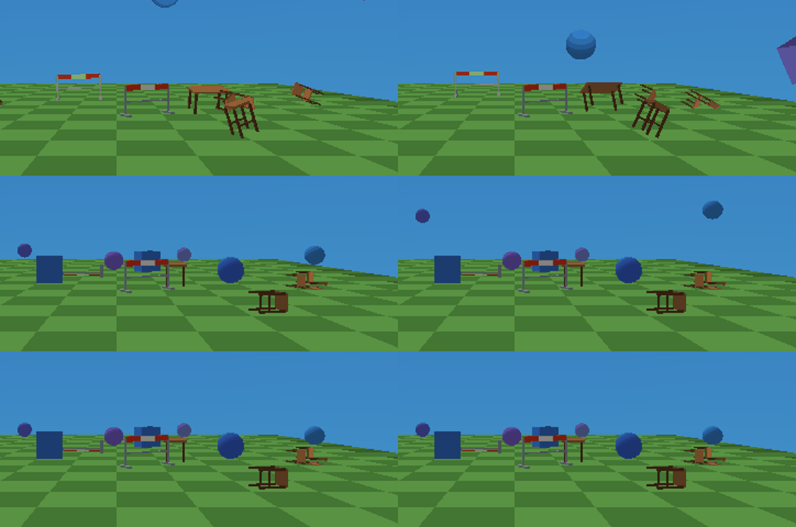
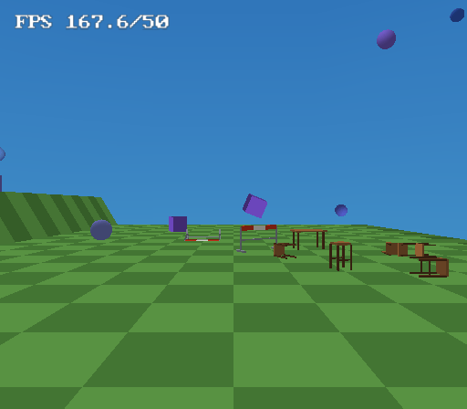
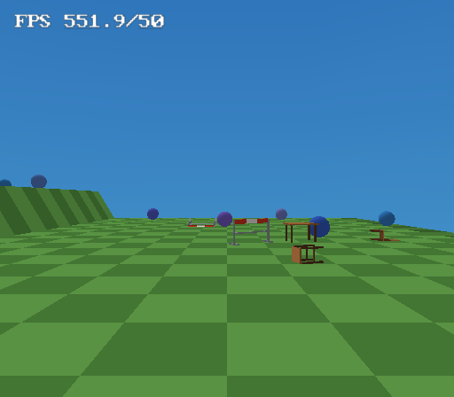

# Rigid-body physics

A scene object with **Physics (rigid body)** ticked is simulated in the game as
a real rigid body: it has a centre of mass, an orientation, linear and angular
velocity and an inertia tensor, and it collides as the **convex hull of its
own mesh** - so a stool stands on its four feet and tips over the edge of one,
a railing falls flat along its length, a chair lands on its backrest and a
ball rolls because the friction at its contact turns it.

It replaced a "rigid-body-lite" (1.123.0) that collided every body as its
bounding box, faked rolling by converting slide into spin as if everything were
a ball, and eased a settling body onto the nearest 90-degree face. That was
fine for crates and balls and looked wrong for anything else.

## Authoring

Properties > Physics, on any box, sphere, cylinder, cone, plane, save point or
static `.obj` model:

| field | meaning |
|---|---|
| Mass | relative; only matters against other bodies and shoves (heavier = harder to push) |
| Bounciness | restitution 0..1, the larger of the two bodies in a collision |
| Friction | 0..1, mapped to a Coulomb coefficient `0.05 + 0.95 * f` (the pair averages) |
| Tumble | off = the body slides but never rotates (infinite inertia) |
| Sleep after | seconds of rest before the body freezes and costs one branch per frame |

Nothing else is authored: the shape is derived from the mesh at build time.
`examples/physics-playground` has the reference props (stool, road barrier,
chair, table - `authoring/make-props.py` writes them) next to its boxes and
balls.

## The shape: a baked convex hull

At every build (`--refresh-gen` included) codegen bakes, for every static
model some physics object uses and for the four unit primitives, a hull into
`inc/model_data.gen.hpp` (`PHYS_HULLS`, `PHYS_HULL_VERTS`, `PHYS_HULL_PLANES`,
`MODEL_PHYS_HULL`, `PHYS_PRIM_HULL`) - `src/physhull.cpp`, host-only.

- **At most 24 corners.** The hull is not the full hull of the mesh but the
  hull of its SUPPORT POINTS: the extreme vertex along a fixed, prioritised set
  of directions - the six axes, the eight box corners (downward ones first),
  the twelve edge diagonals, then a Fibonacci sphere. The points a body can
  rest on come first, so a stool's four feet and a table's four legs always
  survive the reduction. Points on a face or an edge that are not corners are
  dropped.
- **Face planes** by brute force over triples (at most 2024 for 24 points) -
  immune to the degenerate cases an incremental hull has to special-case.
- **Solid mass properties** at unit density: volume, centre of mass and the
  second moment about it. The game derives the inertia tensor under any
  per-axis scale from those (the covariance scales as `S C S` and the volume
  cancels against the density), so a stretched table is not re-baked.
- A flat cloud (a Plane, a single card) is thickened to 2% of its largest
  extent, so every shape has a volume.
- A sphere is analytic. An animated model, or a model the build could not
  read, collides as the unit box stretched over its mesh AABB.

**The hull is convex.** A chair's hull fills the space under its seat and a
railing's fills the gap between its bars - a ball rolled at the gap bounces
off. That is the standard trade every game engine makes for dynamic bodies;
concave STATIC geometry uses mesh collision (below), which is exact.

## The solver

`TerrainGame::updateObjectPhysics` (the game template in `src/templates.cpp`)
runs once per frame over the awake bodies:

1. **Predict**: gravity into the velocity, then the pose one frame ahead
   (quaternion integration of the angular velocity).
2. **Contacts against that prediction**, each source reduced to the four points
   that span it (deepest, farthest, then the ones adding the most area):
   - **terrain** - hull corners below the heightfield, with the slope normal;
   - **box colliders** - hull corners inside the obstacle's collision box
     (`objectCollisionBox`, rotation included - the old code ignored the
     obstacle's rotation), pushed out through the face they came in by; plus
     the box's corners inside the hull, so a body lying across a narrow beam
     rests on the edge;
   - **mesh colliders** (`collision: mesh`) - every hull corner casts its own
     path for the frame against the `CollisionMesh`, from a skin behind where
     it was to where it is predicted, so a fast corner cannot cross a thin
     floor and a stool finds its feet inside a building;
   - **other bodies** - each hull's corners inside the other hull, with full
     convex SAT when neither contains a vertex; sphere against the hull's
     closest feature, and sphere against sphere.
3. **Sequential impulses**, 6 passes: normal impulse with restitution (only
   above a resting threshold, so gravity's own frame of fall never buzzes a
   crate), Coulomb friction clamped by the accumulated normal impulse.
4. **Split impulse**, 3 passes: whatever overlap is left after the velocity
   solve is removed through pseudo-velocities that move the body and are then
   discarded - pushing a body out of the ground never launches it.
5. **Integrate and write back**: the object's position and its Euler angles
   (rebuilt from the quaternion, same `Rz*Ry*Rx` order as `rotated()`), the
   sleep countdown, and the matrix fast path exactly as before.

Portals keep their behaviour: the floor-portal swallow and the doorway rule
(`portalDoorwayOpens`) are applied to the new contacts the way they were to
the old box resolution.

### State and the script contract

The rigid-body state lives beside `RuntimeObject`, in `TerrainGame::physBodies`
(one per physics object, `physSlotOf` maps an object to it). `RuntimeObject`
keeps the script-visible half:

- `velocityX/Y/Z` - linear velocity in units per FRAME, read and written every
  frame (Set Velocity, Apply Impulse, carrying and throwing all keep working);
- `spin[3]` - now the angular velocity about the WORLD axes in degrees/frame.
  A script that writes it (Stop Motion zeroes it) is honoured;
- `restFrames` - write 0 to wake a body.

Anything else that moves or turns a body - a portal hop, a carry, Live Link,
the time machine, a script writing `data.position`/`rotation` - is detected
(the sim remembers what it last wrote) and the orientation is re-read from the
Euler angles. `flatTgt` is unused and kept for layout compatibility.

### Shoves have a point of application

The player's walk-into shove and a car's bumper push go through
`TerrainGame::physPushAt`: the same velocity change as before at the centre of
mass, plus the spin that impulse gives at the point where it lands (hip height
for the player, bumper height for a car). A tall stool leans and falls over; a
low crate slides.

Every part of a car's push is divided by the body's mass, the small upward
"hop" of a fresh hit included. Before 1.165.0 the hop was not: a 60-mass
dumpster barely slid but took the same lift as a 0.6 crate, applied at the
bumper, so it tipped and spun as if it weighed nothing. A body of mass 1 or
less is unchanged.

## Cost

Historical pre-2.2 measurements in PCSX2 on `examples/physics-playground`
(37 bodies), COP0 around
`updateObjectPhysics`, per frame - PCSX2 emulates no EE data cache, so read the
ratio, not the milliseconds:

| state | old solver | new solver |
|---|---|---|
| raining, ~30 bodies awake | 0.88 - 1.02 ms | 0.85 - 1.00 ms |
| settled (60 s in) | 0.33 ms, 3 bodies still awake | 0.07 ms, only the kicked ball is awake |

That older sleeping change reduced idle cost; the table does not compare the
current collision branch against main. The [physical PS2 stress results](collision-stress-results.md#projection-fix-console-qualification)
record the original dense-pile regression and its optimizations. With complete
contact handling in both arms, 32/64/128 piled boxes now average 51.6/37.1/19.1
FPS versus 48.8/30.0/15.3 for the prior algorithms with caps removed. Scattered
32/64 added boxes hold 59.9 FPS. This is not a stock-main comparison or a dense
60 FPS guarantee. Contact density and simultaneously awake bodies determine
the budget. Current bounds include:

- a sleeping scene returns after one pass over its physics objects;
- the static obstacles are gathered ONCE per frame with a reject radius and
  no trigonometry, then every awake body tests only the near ones;
- a body carries at most 24 corners and each contact source at most four
  points, however detailed the mesh;
- a sleeping body is only expanded into a contact partner when an awake one is
  inside its bounding sphere.

## Limits

- **No warm starting and no persistent manifolds.** Stable stacks of a few
  bodies are fine because sleeping bodies are immovable partners; tall stacks
  of awake bodies jitter before they sleep.
- Contact storage and the car's nearby prop list grow to retain every reduced
  manifold/candidate. The older 384-contact/eight-prop caps saturated in the
  [original stress measurement](collision-stress-results.md#collision-limits-matter-too).
  Memory and solver cost still rise with contact density.
- A shape is convex (see above), and an animated model is its AABB box.
- There is no editor-side simulation: the viewport shows the authored pose.

## Collision pipeline

The prepared impulse solver caches normal angular responses once per step
and computes the six independent coefficients of its 3x3 response matrix
on first use by a nonzero friction update. Its repeated passes use separate aligned body/contact
buffers instead of fetching solver state from the larger geometry steps.
The compact format stores the symmetric response matrix in six coefficients;
body indices and inverse mass use spare vector lanes. This preserves the
physical matrix rather than dropping a response component.
The scalar and experimental VU0 macro-mode paths retain the same dynamic slip
direction, circular Coulomb-friction bound, contact order and six velocity plus
three split-impulse passes. There are no collider, inertia or simulation-rate
simplifications. The prior solver remains the default after console comparison. Set
`TYRA_PHYSICS_PREPARED=1` to opt into the prepared solver, and add
`TYRA_PHYSICS_SOLVER_VU0=1` to use its VU0 backend.
See the [prepared solver experiment](prepared-contact-solver.md) for the
three-arm console results and the distinction between arithmetic correctness
and a demonstrated whole-frame gain.

The EE controls broad-phase queries and the impulse solver. Moving and sleeping
colliders are spatially indexed. A separate per-step grid uses swept
centre-of-mass sphere bounds to select body pairs. Its slots are compact body
indices, so building it scales with the body population rather than every
render-only scene object. It preserves ascending object
order and including sleeping partners only when needed.

Existing vertex contacts still provide stable multi-point manifolds. When
those contacts are empty, full convex SAT tests both face normals and edge
cross-products, catching crossed beams with no contained vertex. Unique hull
edge directions are cached when a shape is built. Sphere/hull contacts use
closest face, edge or vertex distance rather than inflated face planes alone.
Selective linear CCD is described in [Collision boxes](collision-boxes.md).

Each predicted step also caches a tight hull/sphere envelope for the existing
fixed-orientation linear sweep. Disjoint envelopes skip vertex planes and
SAT/CCD. The hull envelope includes its predicted vertices translated back by
the COM displacement, retaining pass-through hits even when the endpoint poses
are separate. This is conservative rejection, not a limit on pairs or contacts.
The fallback shares one set of axis projections between discrete SAT and
linear CCD. Primitive boxes also cache their oriented half-axes: their range
on each axis is computed from the centre and half-axes instead of all eight
vertices. The same face/edge axes remain; projection rounding is outward.

Hull vertex transforms have an optional batched VU0 macro-mode path: one
matrix load for up to 24 aligned points. `TYRA_COLLISION_VU0=1` enables it;
the faster scalar path is the default after physical-console measurement. This does not move the branch-heavy solver to VU0 or
use VU1's rendering time. It is not an asynchronous microprogram/DMA pipeline;
transfer and staging overhead must be included in performance comparisons.

Physical PS2 acceptance (2026-10-28, same ELF, four alternating samples of
1,000 batches including staging/copy): median COP0 ticks per batch were
545.2 VU0 / 379.8 scalar for 8 points, and 1113.7 / 992.5 for 24 points.
This implementation was 43.6% / 12.2% slower and is therefore disabled by
default. The kernel probe's 1,000 randomized comparisons had zero failures,
maximum summed component error 0.00000095. These are transform-kernel costs,
not whole-frame or collision-system speedups. Reproduce with
`tools/verify-collision-ps2.cpp`, called once from a scratch game's script init.

Acceptance also includes warning-clean native FPP and orbit builds, the
physics playground booting in an isolated PCSX2 software renderer, and
Remote Pad turn/walk/release captures. The image below is that runtime
check; its uncapped emulator FPS is not a physical-console performance claim.

`tools/verify-collision-codegen.py --editor <editor> --scratch <checkout>/.tmp/tests`
checks sidecar creation, byte/mtime-stable regeneration, ignore migration and
removal after switching mesh collision off, then cleans its scratch fixture.

Vehicle-stage completion and individual portal teleports invalidate the shared
scene broad phase before subsequent camera/carry/world queries; moving
colliders no longer rely on being unconditional candidates for freshness.

## Temporal contact experiment

Collider transforms and per-step SAT normals/edges can be reused while their
inputs stay unchanged. A remembered separating axis tests current geometry and
the complete linear interval; it never reuses a previous collision boolean.
Contact impulses can be matched by both local anchors, normal, object identity,
shape/transform revision and dynamic/static state. Matching is one-to-one;
scene changes and incompatible timesteps discard history. Split-position
impulses are not carried across steps, and bounce targets precede warm impulses.

Dynamic islands preserve contact order within a connected component. World
and immovable partners do not connect unrelated components. Sleeping uses the
existing speed thresholds and authored delays, coordinated across the entire
component; waking any sleeping member wakes its recorded component. All
contacts still receive six velocity and three split passes. The new warm-start
and island switches are experimental until physical-console qualification.
See [the temporal physics experiment](temporal-physics.md).

The body-pair cache path indexes conservative swept hull/sphere bounds rather
than COM spheres. Sleeping hulls use a transformed local-box superset, with
outward rounding; narrow phase and all contact tests remain authoritative.
