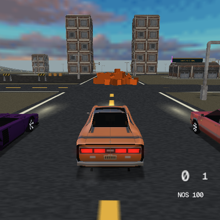

# Prepared contact solver

The prepared contact solver evaluates the existing rigid-body model from compact aligned state and a response matrix cached once per contact and step.

It preserves collider shapes, inertia, the slip-direction Coulomb friction
model and circular friction bound, contact order, and six velocity plus three
split-impulse passes. There is no simulation-rate reduction or contact cap.
Impulse accumulation still starts from zero each step; this experiment does
not introduce warm starting or change sleeping rules.

For a contact impulse `p`, the relative velocity change is `K p`, where `K`
combines inverse masses, inverse inertias and the contact offsets. The repeated
friction solve can use this prepared response instead of recomputing those
terms for its current slip direction. Normal angular responses are cached too.
The scalar and VU0 macro implementations share prepared inputs and retain
sequential dependencies between contacts. VU0 updates operate directly on
aligned buffers; they do not stage each impulse through temporary arrays.

## First physical PS2 trial

One ELF compared the prior solver from `2ed7cb6f7`, prepared scalar and prepared
VU0 from `6d610765f`, across seven workloads and reversed arm order on repeat.
All arms shared the existing step layout, renderer and complete baked assets.
The first implementation used 128-byte solver bodies and 160-byte contacts.

| Additional piled boxes | Prior FPS | Prepared scalar FPS | Prepared VU0 FPS |
| --- | ---: | ---: | ---: |
| 32 | 48.2 | 49.4 | 49.1 |
| 64 | 35.4 | 35.1 | 33.0 |
| 128 | 19.2 | 19.4 | 19.8 |

This is **not a convincing general speedup**. Contact trajectories and active
populations differ, and small pooled FPS differences must not be interpreted
as isolated kernel gains. The 64-box VU0 case is worse. Both repeats and raw
frames are retained in the [wide-buffer summary](../tools/ps2rig/results/solver-wide-2026-10-29.json)
and [compressed CSV](../tools/ps2rig/results/solver-wide-2026-10-29.csv.gz).

All 42 phases / 25,200 measured frames passed the completeness checks. The
physical-console startup comparison on 64 coupled graphs found zero errors:
maximum scalar/reference component difference 0.000000063 and VU0/scalar
0.000000047. The host's 2,000-graph reference comparison also passed. Numerical
agreement is a correctness result, not evidence of a speedup.

## Compact representation follow-up

The next representation uses 112-byte bodies and 128-byte contacts, maintaining
16-byte alignment. Inverse mass and existing body indices use otherwise unused
vector lanes. The physical response matrix is symmetric, so six independent
coefficients retain the full response; no matrix direction is removed.
The host reference comparison's maximum component difference is 0.000000268.

The follow-up rig also measures contact preparation, all solver passes and
copy-back separately from detection. Its `solver_ticks` scope includes the
packing/preparation cost that a standalone arithmetic kernel would miss.
The complete-contact accounting and the three-arm reversed-order comparison
remain mandatory. The final qualification and default decision are recorded below.

A 20-phase partial compact run exposed that eager matrix preparation did not
amortize consistently. Its inclusive drive solver cost per contact was about
16.6/18.3/18.8 microseconds for the prior solver at +32/+64/+128 piles and
18.9/19.1/19.1 for prepared scalar. Different contacts and trajectories limit
these ratios; this partial run is not a completed reversed-order comparison.
It was intentionally stopped before a further implementation change. Its
[partial summary](../tools/ps2rig/results/solver-eager-partial-2026-10-29.json)
and [raw rows](../tools/ps2rig/results/solver-eager-partial-2026-10-29.csv.gz)
are retained as negative evidence.

The final preparation computes the six response coefficients directly from
inertia/contact offsets, and defers them until friction needs a nonzero update.
A zero normal impulse plus zero accumulated friction has an exactly zero
Coulomb-friction update; that arithmetic is skipped while all normal and split
passes remain. The physical model and nonzero friction updates are unchanged.
The independent 2,000-graph host reference comparison has maximum component
difference 0.000000231. The final full console run is qualified below.

## Final physical PS2 qualification

The lazy/direct-response implementation from `b8bd7f719` completed all 42
phases and 25,200 measured frames in one ELF. Each workload has two repeats,
with arm order reversed. Release profile, NTSC progressive, vsync on, daytime,
complete assets and disabled devkit polling are shared across all three arms.
The ELF SHA-256 is `147cb91d3f0a15c71a5b3433da34a3d789bea7495e0236fad877417387e8da77`.
All 283 baked files match the earlier fixture byte for byte.

Pooled **drive** results (720 frames per cell):

| Additional piled boxes | Prior FPS | Prepared scalar FPS | Prepared VU0 FPS |
| --- | ---: | ---: | ---: |
| 32 | 50.07 | 51.26 | 50.07 |
| 64 | 36.30 | 35.96 | 36.98 |
| 128 | 19.70 | 20.53 | 18.90 |

Inclusive solver p95 in milliseconds, including pack, prepare, all 6+3 passes
and copy-back, excluding contact detection:

| Additional piled boxes | Prior | Prepared scalar | Prepared VU0 |
| --- | ---: | ---: | ---: |
| 32 | 3.109 | 2.705 | 2.744 |
| 64 | 6.427 | 6.059 | 5.416 |
| 128 | 16.061 | 15.064 | 11.818 |

Aggregate solver cost per contact for +32/+64/+128 piles is
16.74/18.72/18.93 microseconds for prior, 16.84/16.77/16.87 for prepared scalar,
and 15.43/15.38/15.57 for prepared VU0. VU0 is about 8/18/18 percent lower than
prior on this metric. This ratio includes preparation but is **not** an
identical-input microbenchmark; contacts and trajectories differ.

At +128, average drive contacts are 459.7 prior, 449.6 prepared scalar and
478.7 prepared VU0. Mean total physics time is 27.69/26.27/28.66 ms, while
solver time is 8.70/7.58/7.45 ms. Work outside the solver remains larger than
the solver itself, and changed contact populations can erase its savings.
Repeat FPS also varies: +128 prior 20.28/19.15, scalar 19.60/21.56 and VU0
18.90/18.90. A universal frame-rate improvement is not established.

For spread props, +64 prior/VU0 both average 59.94 FPS; prepared scalar is
59.77. At +128 all average about 59.20. At +32 prior/scalar average 59.94,
VU0 59.86. These trials do not demonstrate 60 FPS with dense active piles.

All three arms retained every generated contact and tested every vehicle
candidate; omission/overflow counters were zero in every measured row. The
console startup oracle passed 64 coupled graphs with zero errors, maximum
scalar/reference difference 0.000000078 and VU0/scalar 0.000000030. The host
2,000-graph comparison passed (maximum difference 0.000000231), and the
software-renderer emulator probe passed too. These numerical tolerances
qualify arithmetic agreement, not bit-identical trajectories over time.

See the [final summary, including both repeats](../tools/ps2rig/results/solver-lazy-2026-10-29.json)
and [compressed raw frames](../tools/ps2rig/results/solver-lazy-2026-10-29.csv.gz).
The console was returned to ps2link after capture.

## Default selection

The prior solver remains the default. The compact paths are retained as an
opt-in experiment: define `TYRA_PHYSICS_PREPARED=1` for prepared scalar, and
also `TYRA_PHYSICS_SOLVER_VU0=1` for prepared VU0. Lower solver cost under dense
contacts is useful, but the whole-frame measurements do not establish a
consistent improvement across these workloads. In particular, the 128-box
pile can run slower as trajectories and contact populations diverge. No
collision, contact or iteration is removed to improve the reported numbers.

The final default integration was also checked with a fresh editor Release
build, refreshed example snapshots, a native PS2 build of stock Motor District
and an isolated PCSX2 software-renderer startup. It rendered the scene without
assertions, exceptions or missing-resource diagnostics. The default solver
body was compared directly against 2ed7cb6f7 and matches exactly.
