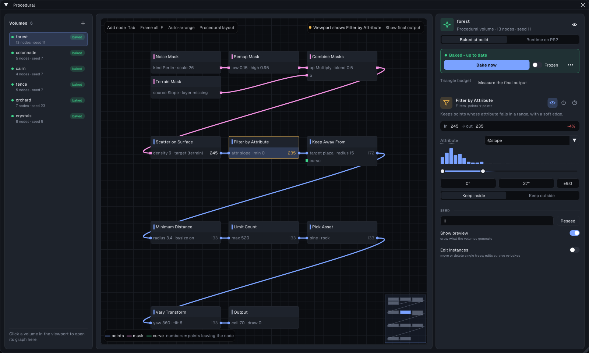
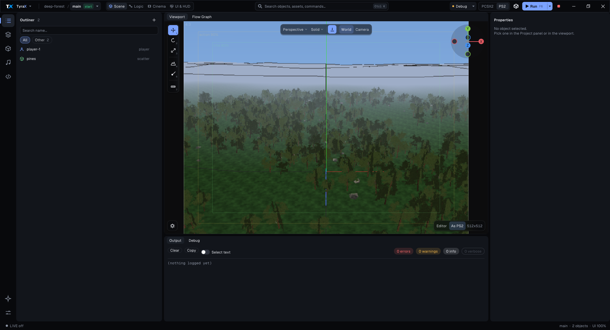
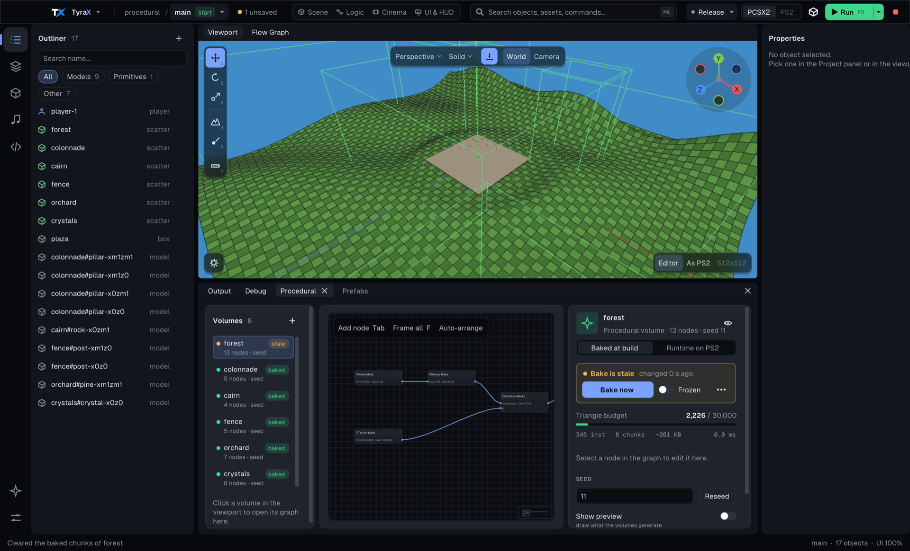
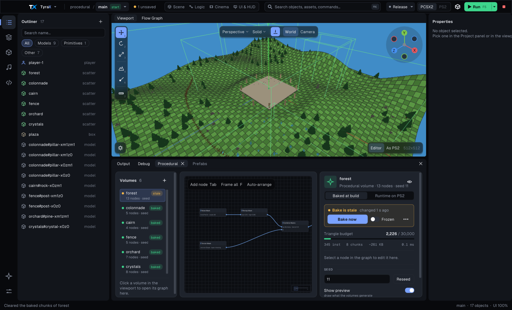
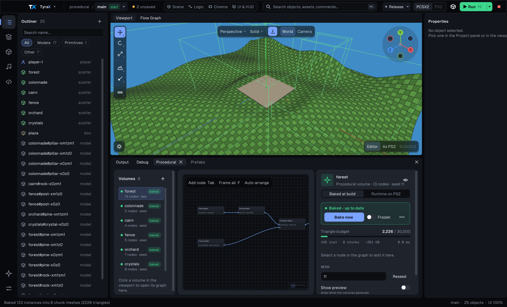
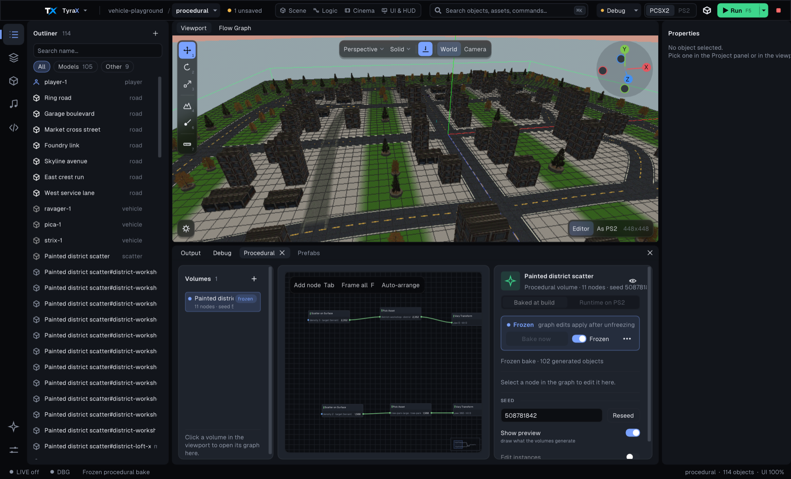
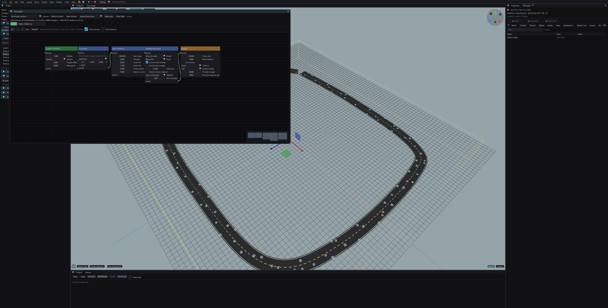
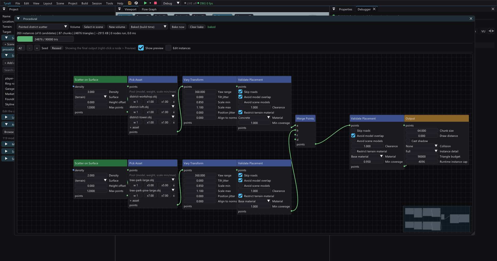
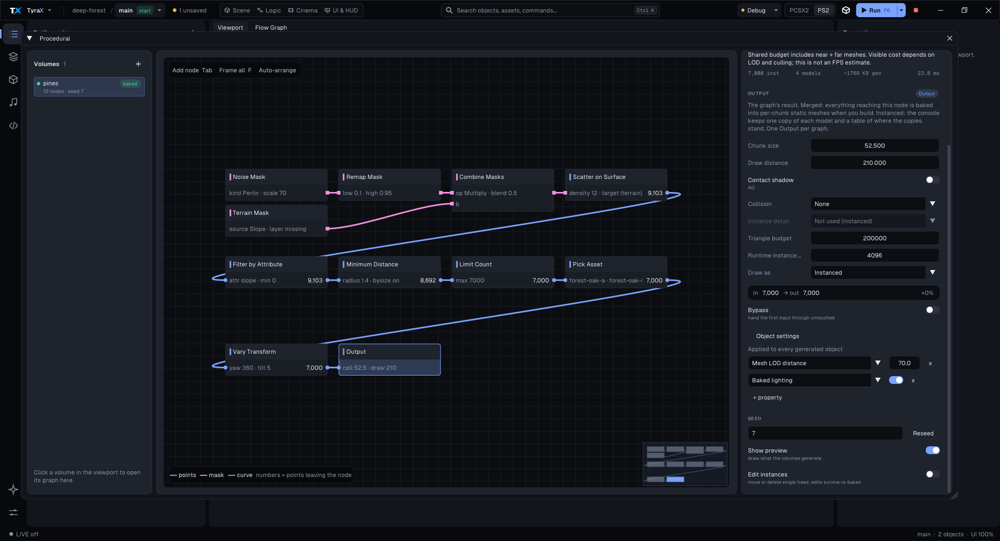
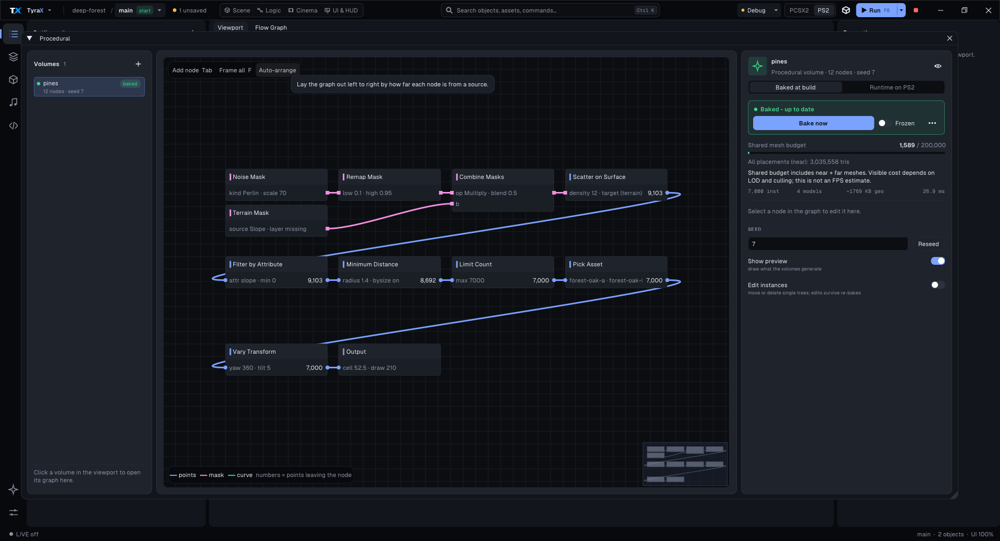

# Procedural generation

Procedural volumes fill a region with rule-driven objects: forests, rocks,
fences, orchards or exact arrays. Open **Tools > Procedural** or switch to the
**Procedural** layout.

The window is three panes. **Volumes** on the left lists every procedural
volume in the scene with its state (`baked`, `stale`, `frozen`, `runtime`),
node count and seed; **+** adds one. The **graph** in the middle shows each
node as a compact card: its title, one line of what it is set to
(`slope · min 0`, `pine · rock`) and the number of points leaving it, so the
recipe reads without opening a node and the filter that thins the forest is the
one where the number drops. The canvas frames the graph whenever a volume is
opened; its toolbar has *Add node* (Tab, or right-click), *Frame all* (F) and
*Auto-arrange*, which lays the graph out left to right in rows that fit the
canvas, plus *Procedural layout* while another layout is active - one click to
the docked desk with the graph under the viewport. The **inspector** on the right holds the volume - *Baked at build* /
*Runtime on PS2*, the bake state card, the labelled triangle budget - then the
parameters of the selected node with its description and *In → out* count
(`245 → 235, -4%`), then the seed and the preview switches.

Selecting a node also shows its output in the viewport (*Viewport shows
Filter by Attribute* on the canvas, with *Show final output*); counts on the
nodes after it are from the last full pass and are drawn dim until then.

The graph runs on your PC. A build merges its instances into ordinary chunk
meshes, so the PS2 never evaluates the graph. For generation on the console,
see [runtime procedural generation](procedural-runtime.md).

Try the six graphs in [examples/procedural](../examples/procedural).

Dense **Pick Asset** previews keep their geometry even above 4,000 instances.
They use each pool row's distant model and switch distance, the Output node's
draw distance (0 means unlimited), and reject models outside the camera view.
Zooming beyond the authored draw distance hides those instances; move closer
to inspect them. Green crosses mark points without an assigned asset or prefab,
such as a preview isolated before Pick Asset, rather than an entire dense forest.
Missing far geometry falls back to the near model. Expanded prefabs retain their
existing object preview and 6,000-object expansion limit.

Keep the editor camera above the terrain when inspecting a forest. A saved view
under the ground can hide the trees even with Show preview enabled.

## From rules to geometry

1. Edit the graph with **Show preview** off. The volume is visible, but it has
   not placed anything in the scene.

   

2. Turn on **Show preview** to inspect the result without changing scene
   objects.

   

3. Click **Bake now**. The preview becomes chunk meshes that will ship in the
   game; the state card turns green, *Baked - up to date*. A stale bake reads
   *Bake is stale* with how long ago the graph changed.

   

## Freeze a finished layout

In baked mode, turn on **Frozen** beside **Bake now** (**Clear bake** is in the
card's `...` menu). If the current layout
has not been baked, or its bake is stale, the editor bakes it first. The saved
chunks then stay in place when roads, painted materials, terrain, the volume
transform or graph parameters change. The viewport draws those chunks, and
builds keep them even after saving and reopening the project.

The graph remains editable; its changes take effect after unchecking **Frozen**.
Unfreezing resumes live preview and the next build refreshes a stale bake.
**Bake now**, **Clear bake**, instance editing and the runtime-mode switch are
disabled while frozen. Runtime volumes must switch to baked mode before freezing.
**Show preview** also hides or shows frozen geometry. Deleting a volume still
deletes its generated output.

## Start a volume

Add **Procedural volume** from the object menu or click **+** (*New volume*) in
the Procedural window's volume list. Its transform is the region: position sets the centre, scale
sets its size and Y rotation turns the footprint.

The window lets you:

- choose a volume and seed;
- edit its graph;
- preview the result in the viewport;
- bake or clear its generated chunks;
- hand-edit individual preview instances.

Graphs pass three data types: **points**, **masks** (0–1 fields over the region)
and **curves**. Pins only accept their own type, and cycles are refused.
Pins are coloured by type - points blue, masks pink, curves green, from the
theme's accent / special / ok colours (the legend is on the canvas); a node with more than
one input or output labels the extra ones beside their pins.

## Node cheat sheet

| Group | Main nodes | Use them for |
|---|---|---|
| Sources | Scatter on Surface/Grid/in Volume/along Curve, Single Point, Blocks Fill | Create points |
| Masks | Noise, Terrain, Combine, Remap | Say where or how densely |
| Filters | Attribute, Mask, Minimum Distance, Keep Away, Validate Placement, Limit Count | Remove unwanted points |
| Repeat | Array, Radial Array | Exact rows, stacks, rings and arcs |
| Assign | Pick Asset, Pick Prefab, Vary Transform, Set Attribute | Choose and vary the result |
| Output | Output | Set chunks, budget and shared properties |

Select a node to edit it in the inspector; hover a node or a control for the
full parameter description.

### Common recipes

**A natural forest**

1. **Scatter on Surface** over the terrain.
2. Feed a large **Noise Mask** into density.
3. Filter steep slopes with **Filter by Attribute**.
4. Add **Minimum Distance**.
5. **Pick Asset** from weighted tree variants.
6. **Vary Transform**, then connect to **Output**.

**Trees only on painted grass**

Use **Terrain Mask > Terrain material**, choose the grass layer and connect it
to density or **Filter by Mask**. The mask reads visible coverage, so rock
painted over grass counts as rock. This source is build-time only.

**A colonnade**

Use **Single Point > Radial Array > Pick Asset > Output**. Arrays are exact and
do not add random placement.

**Buildings on concrete, trees on grass, roads kept clear**

Use **Scatter on Surface > Pick Asset > Vary Transform > Validate Placement**
for each species. Set **Roads = Avoid roads**, enable **Restrict terrain material** and
choose the allowed **Material**: concrete for buildings, grass for
trees. **Min coverage = 1** requires fully visible material throughout
the footprint, including any clearance. A centre on concrete is insufficient
when part of the building would extend onto grass.

For a uniform building heading, set the building branch's **Vary Transform >
Yaw range = 0**, **Tilt jitter = 0** and **Align to normal = 0**. Terrain
scatter starts with zero rotation, so every building keeps that heading while
scale can still vary. The vehicle-playground procedural scene uses this setup;
its trees retain random yaw.

Enable **Avoid model overlap** to reject intersections between accepted
instances, and **Avoid scene models** to include placed static models and
solid primitives. These switches are independent. **Clearance** adds a gap
in world units. Merge the species, then add one final **Validate Placement**
with model overlap enabled to check them together; earlier input wins, so
connect buildings to Merge's first input to give them priority. Two separate
volumes do not check each other's generated instances; baked procedural chunks
are excluded to keep previews and repeated bakes independent of bake order.

**Using a road as a scatter path**

Set **Validate Placement > Roads = Only on roads**. **Road** selects a named
road; **(every road)** accepts any road in the scene. Feed points from **Scatter
on Surface** or **Scatter on Grid** through Pick Asset and Vary Transform first.
Only origins inside the road's full spline ribbon survive, including soft edges
and bends; a canopy or arch can extend outside it. This is an area filter, not
centreline spacing, and does not change height or heading. Keep the source's
terrain snap and height offset as appropriate for the asset.

**Ignore roads** disables road filtering. **Avoid roads** checks the whole
transformed model footprint plus clearance. **Only on roads** checks the origin
without a road inset; clearance still applies to model overlap and painted
material checks. Collision and material switches remain independent. Turn off
**Restrict terrain material** when the path should ignore the paint under it,
and turn off both overlap switches if models should intersect. No road surface
means an empty result in Only mode. A missing or non-road target warns rather
than silently falling back to all roads. Existing saved `roads=0/1` values keep
their Ignore/Avoid behavior.

The check uses conservative world AABBs from actual OBJ bounds, transformed
with rotation, offset and scale. It can leave extra room beside rotated or
concave models. Roads use the full authored width (including faded edges) and
the same spline triangles as the road renderer. Painted coverage uses a lower
bound across all intersected splat cells, including layers painted on top;
blended borders may reject additional placements. Material checks require
terrain and reject footprints outside its bounds. Missing models and prefab
instances are rejected with a warning; use Pick Asset for this workflow.

Keep this filter after all automatic transform edits. Manual instance overrides
apply after graph evaluation and can intentionally move an accepted object
across a boundary. This is an authoring placement check; **Output > Collision**
separately controls the baked geometry's gameplay collision.

The host CPU evaluates the filter on the background preview worker. A spatial
hash checks nearby occupied cells rather than every model against every other
model; giant bounds use a bounded overflow path. No GPU or runtime PS2 work is
required. Validate Placement is build-time only and the runtime capability
checker reports it as unsupported.

Try the **procedural** scene (index 2) in
[vehicle-playground](../examples/vehicle-playground): existing urban buildings
and park trees, painted concrete lots, grass strips and seven roads, with one
merged scatter graph. The project's default start scene remains `main`.

## Curves and hand edits

A **Curve** node exposes its control points in the viewport. Move, add or delete
them there; **Scatter along Curve** places points at a fixed spacing and can turn
them along the path.

Enable **Edit instances** to move, rotate, scale or delete preview instances.
Overrides are tied to stable point identities, so they survive re-evaluation as
long as the upstream rule still produces that point. **Reset overrides** returns
to the pure graph.

## Seed and stability

Generation is deterministic: the same project, graph and seed produce the same
instances. Editing a downstream node does not reshuffle unrelated upstream
points. Use **Reseed** when you want a new arrangement.

The preview evaluates in the background. Expensive graphs show progress and
keep the last good result visible until the new one is ready.

## Bake and budget

**Bake now** creates scene objects and chunk meshes. Builds and
`--refresh-gen` also bake stale volumes automatically.

Chunks exist because hundreds of separate PS2 draw submissions are too costly.
Larger chunks mean fewer draws but coarser culling; 48 units is a sensible
starting point. The Output node shows instance and triangle counts and warns
when the graph exceeds its budget.

Keep source assets deliberately low-poly. Instance count can be misleading:
500 trees at 600 triangles each are still 300,000 triangles after merging.

Generated chunks inherit the volume's layer. Put them on a streamed layer when
the region should load and unload together. Use **Output > Object settings** for shared
mesh LOD, baked lighting and reflection flags; edit the graph, not individual
generated chunks, when the setting should survive the next bake.

## Distant version per row

Every row of a **Pick Asset** or **Pick Prefab** pool has a second line: an
optional **distant version** (a `.obj` from `res/models`) and the distance it
takes over at, in world units. Past that distance every instance of the row
draws the distant version instead of its own geometry; collision stays the
near geometry's at any distance. *0* keeps the model chosen but never switches.

- **Pick Asset, baked volume**: each chunk of the row also bakes a
  `procgen-...-far.obj` from the distant version (same instances, never
  decimated, written next to that model so its materials resolve) and the chunk
  object switches to it through the ordinary
  [distant version](impostors.md) of a model. The distance is measured to the
  chunk object, like any other.
- **Pick Asset and Pick Prefab, runtime volume**: see
  [runtime procedural generation](procedural-runtime.md#distant-versions).
  This is the one way to switch a whole prefab: the one model replaces every
  merged member together (a room's slabs and its detail mesh), which a
  per-member draw distance cannot do without opening holes.

The distant version does not have to share anything with the row's model -
other materials and one texture atlas instead of several are the usual reason
to author one. Its origin, orientation and scale must match the row's model or
prefab, because it is placed with the same transform. A baked Pick Prefab row
ignores it: baked volumes do not merge prefab points at all.

## Instanced

The Output node's **Draw as** chooses how the copies reach the console:

- **Merged** (default): every copy is baked into the chunk meshes. Full baked
  lighting (probe GI, ambient occlusion, lamps) and a handful of draws - but
  each copy is its own geometry in EE RAM. A 32-triangle tree costs ~7 KB, so
  a whole scene tops out at roughly 2,900 trees: 4,307 crashed a PS2 with
  `std::bad_alloc`, 2,800 used 31.1 of 32 MB.
- **Instanced**: the console keeps ONE copy of each model and a table of
  where the copies stand (~60 bytes each), and draws the visible ones as many
  matrices of one mesh. 2,800 spruces used 11.4 MB in total; see below for
  what 10 ha can hold.

What Instanced costs and drops:

- Light: copies are shaded with the scene's sun and ambient only, baked once
  per model in four 90° yaw buckets (a copy takes the nearest one). No probe
  GI, no ambient occlusion, no point or baked lamps, no tint per copy.
- Only **Pick Asset** points; prefab and Blocks points are not placed in this
  mode (the budget card warns). *Instance detail* does not apply - the shared
  copy is the model as authored, so author it low-poly.
- A row's [distant version](#distant-version-per-row) switches per COPY at the
  row's distance.
- Collision Box = one box per copy, from the model's bounds.
- EE time per frame grows with the copies in view: every copy in a visible
  cell is frustum-tested, the first copy of each (model, yaw bucket) is an
  ordinary submit and every further one costs a matrix product and seven DMA
  quadwords (`StaPipCore::renderInstances`). The game logs
  `INSTANCES copies N tested T appended A ordinary O (crossing C)` every 50
  frames with the frame profiler on; `crossing` counts copies that had to be
  clipped (near plane, guard band) and took the ordinary path.

Baked volumes write no chunk files in this mode: the build evaluates the graph
and emits `inc/proc_instances.gen.hpp`, which exists only while some volume is
Instanced. Runtime volumes honour the same switch on the console.

Measured on a physical PS2 (10 ha of the deep-forest fixture, frozen camera,
three Blender spruces with 12-triangle distant versions at 45 units, draw
distance 120, frame profiler on):

| copies | draw as | drawn / frame | SCENE (EE) | MEM | FPS |
|---|---|---:|---:|---:|---:|
| 2,800 | Merged (Half detail) | - | 5.4 ms | 24.2 / 32 MB | 50 |
| 4,307 | Merged (old pine) | - | `std::bad_alloc` | - | - |
| 2,800 | Instanced | 238 | 6.3 ms | 11.4 / 32 MB | 50 |
| 5,000 | Instanced | 443 | 8.9 ms | 11.8 / 32 MB | 50 |
| 10,000 | Instanced | 875 | 13.5 ms | 12.5 / 32 MB | 50 |
| 17,081 | Instanced | 1,531 | 20.3 ms | 13.8 / 32 MB | 25 |

Memory stays flat; the price moves to EE time, about 11 µs per DRAWN copy
(each drawn one comes with ~2.7 tested). So density is now a draw-distance
decision: keep the copies in view around a thousand for 50 fps, and let fog
hide where the draw distance cuts. Two things made those numbers and are the
traps if this path is ever reworked: the baked-stream cache holds one entry per
vertex ARRAY, so every colour variant needs its own position array (sharing one
made every group re-bake each frame: 14.5 ms at 2,800), and the per-copy tests
are world bounding spheres against planes normalised once per call
(transforming the planes into each copy's object space was ~40% of the cost).

## Limits

- Baked instances cannot move, hide or run scripts independently.
- Prefabs keep their object identity and are not merged like plain models.
- Collision on dense scatter can be expensive; enable it only where needed.
- Graphs stop before runaway arrays consume the editor.
- Runtime volumes support a smaller node set and different budgets.

If the result is empty, check the selected volume, source surface, filters and
Output connection in that order. If it is too dense, lower source density or
add **Limit Count** before tuning chunk size.

### Shared object settings and bypass

Select **Output** to edit **Object settings** in its inspector. Existing graphs
keep their saved properties automatically; the old disconnected Object Settings
card no longer appears in the canvas or Add node menu.

**Instance detail** simplifies source geometry only when baking merged chunks:
Full preserves it, while Half and Quarter target roughly 50% and 25% of its
triangles. Simplification can damage leaf cards and silhouettes. Prefer authored
distant models when their shape matters. In **Instanced** mode this control is
disabled and reads **Not used (Instanced)**: shared models retain full detail.

**Bypass** passes a node's first input through without applying that node's
operation. For example, bypassing Vary Transform removes its random transforms;
bypassing a filter keeps the points it would discard. It does not delete the
node or disconnect its wires. Source nodes with no input have nothing to pass
through, so bypass does not disable those generators.

### Budget in Instanced mode

**Shared mesh budget** counts each used near and authored far mesh once, against
Output's geometry budget. **All placements (near)** is the informational sum
across every placement at full near detail, not a per-frame submission count.
It does not turn the shared budget bar red. **KB geo** estimates geometry and
instance-table memory, excluding textures, engine allocations and other scene
assets. Neither readout measures free RAM or predicts FPS: LOD, visibility,
materials and overdraw matter, and actual performance needs a running game.
Merged mode continues to compare the baked triangle total against its budget.
