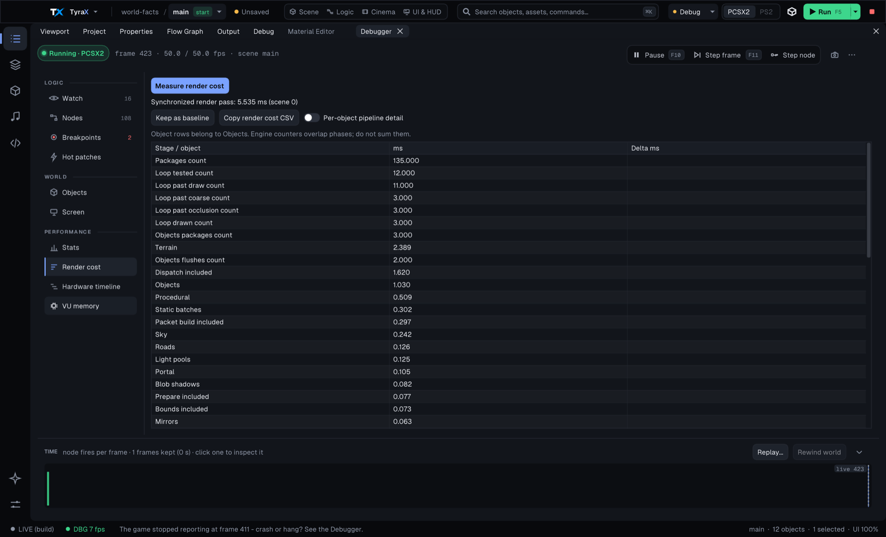

# Profiling the generated game (EE frame time)


The PS2 games this editor generates are almost always **EE-bound**: a frame
that misses the vsync budget (20 ms PAL / 16.7 ms NTSC) drops straight to the
next divisor (50 → 25 FPS), and it is nearly always the EE, not the GS, that
ran out of time. Finding *which* EE phase overran is the whole game. This doc
describes the built-in profiler and the deeper manual technique behind it.

## Static packet structure profile

`TYRA_FRAME_PROFILE=1` also enables an exact structural walk of every completed
static-pipeline DMA/VIF chain. The generated game attributes the stream to sky,
terrain, static batches, roads, procedural geometry, objects or effects and
prints one `FTPKT` row per active producer every 50 frames. The row contains
DMA tags and payload QW, 128-byte REF alignment, VIF command counts, derived
GIFtags, A+D state writes, GS payload QW and XGKICKs. `bad=0` is the validity
gate: a non-zero value means the closed decoder met an unknown or truncated
command and the structural totals for that row must not be trusted.
`reuse` counts packages that inherited TEST/TEX1/TEX0/ALPHA from package zero
of the same material bag. It is a 50-frame total like the other fields. The
derived `gif`, `ad` and `gqw` values already include that saving; do not subtract
`reuse` from them a second time.

Capture a physical-console run without losing ps2link output, then summarize
the four frozen benchmark poses:

```powershell
ps2client -h 192.168.100.150 execee host:bin/game.elf 2>&1 |
  Tee-Object packet-console.log
python examples/vehicle-playground/authoring/summarize-packet-profile.py `
  packet-console.log -o packet-summary.csv
```

The logged values are totals over the 50-frame reporting window; the script
converts them to per-frame medians and discards benchmark transition margins.
The GIF/GS values are derived from the selected resident VU1 program and its
package vertex count, while DMA and VIF values are read from the exact chain
sent to VIF1. Whole-bag retained-stream replay is included. This is a structure
instrument, not a timing optimization: it parses payload words on the EE, so
compare timings only between equally instrumented builds. Both the parser and
counters compile out when the profile is disabled.

The 2026-09-22 physical-console capture and the rejected 128-byte allocator A/B
are stored with the Motor District example under
`authoring/packet-structure-2026-09-22/`.

The worked example throughout is the usable-object highlight: it looked like a
cheap effect but dropped the showcase to 25 FPS. The full write-up is in the
retired `PROGRESS.md` (the usable-highlight rounds) — see [Backlog](backlog.md)
for how to read it out of git history.

## The built-in frame profiler

**Project > Preferences > Build & debug**, set the profile to **debug**, then tick
**Show frame profiler** (alongside *Show FPS* / *Show memory usage*). The game
draws a per-phase EE-time breakdown in the top-left corner, averaged over ~1 s:

```
FRAME 22.00 SCENE 12.90
HL 1.46 PART 0.99
```

- **FRAME** — whole-frame wall-clock (ms). With vsync on this reads the
  quantized budget (20.0, 40.0 …); the phase sums below it are the real work.
- **SCENE** — sky + terrain + objects + animated models (+ the bodies of
  highlighted usables, which are real geometry).
- **HL** — usable-highlight *overhead* only (the shell/apron submits, not the
  object bodies).
- **PART** — particle systems.

Everything here is gated behind the `DEBUG_SHOW_PROFILER` constexpr in
`terrain_config.hpp`, so a release build (or the option unticked) contains
none of the timer reads — zero cost. The timing uses the EE **COP0 Count**
register (`mfc0 $9`), which ticks at 294.912 MHz (half the 590 MHz EE clock);
divide tick deltas by 294912 for milliseconds.

Every window is also logged as `PROFILE FRAME 20.84 SCENE 8.82 HL 0.00 PART
0.00`, so a run on the console (the `[ps2]` lines of *Run on PS2* or
`--build <dir> --run-ps2 <ip>`) or in a headless emulator is read from the log
instead of a photo of the HUD. Quote a settled window: the first few after a
scene load still contain the load. `MEM` is the EE memory in use at that
moment (the allocator's books, no probe).

A scene with an instanced procedural volume also logs, every 50 frames,
`INSTANCES copies N tested T appended A ordinary O (crossing C) per frame`:
copies in the scene, copies in visible cells that reached the frustum test,
copies drawn as one REF to the shared body, copies that took an ordinary
submit, and how many of those had to be clipped
(docs/procedural-generation.md, "Instanced"). `ordinary` should be about the
number of (model, yaw bucket) groups in view; far more means the shared bodies
are being re-baked.

This is enough to answer "is the highlight/particles/scene the problem?". For a
finer breakdown you drop to the manual technique.

### Shared reflection-probe attribution

**Render cost** captures add `Reflections_shared_probe` when a classic shared
`@sky` environment target is refreshed. It covers only the 128 x 128 target
bracket (clear, sky, sky bodies, resident terrain, road chunks and objects
marked **Show in reflections**), not the reflective material passes that remain
nested in their ordinary
`Object` rows. It appears only on the cadence frame that actually refreshes
the target; compare repeated captures from the same frozen camera and report
both the capture and non-capture frame. The serialized render-cost request
drains the pipeline, so it is attribution evidence rather than an ordinary FPS
sample.

### Cross-material transform reuse (1.86.2)

An imported model normally enters StaPip once per material part even though
every part shares one model matrix and camera. `StaPipCore` now caches the most
recent TyraMVP transform for the current frame and reuses its MVP and transformed
frustum planes while the key stays identical. The key compares matrix and
view-projection contents as well as the model pointer, so in-place physics edits,
portal cameras and split-screen views invalidate it naturally.

The test fixture was a `%TEMP%` copy of `examples/showcase` with both portals and
the ray-traced mirror removed. Across six alternating, cold-booted PCSX2 debug
runs, median serialized `Total` moved 21.322 -> 19.172 ms and `Objects` 14.102 ->
12.425 ms. The directly attributed `Prepare_included` counter moved only 1.375
-> 1.341 ms, so the larger aggregate emulator delta is directional evidence,
not a physical-console claim. The first ordinary-HUD pair moved 51.6 -> 56.3
FPS. A real-PS2 A/B is still required before quoting the hardware gain.

### Direct whole-IN submission (1.86.3)

When the bag-level bounding box has already proved that every range is visible,
StaPip now points qbuffers directly at contiguous ranges of the bag's vertex
streams. It no longer constructs pooled package descriptors whose classification
the whole-IN branch would ignore. Partial-frustum and EE-clipped paths retain
their existing package storage.

In a clean two-kick PCSX2 run, six captures moved median `Prepare` from 1.390 to
1.262 ms (-9.2%, 0.128 ms); `Dispatch` was flat and process-level `Total` was too
noisy to claim. The physical-PS2 comparison used five settled captures per ELF
at the same camera. `Total` was neutral at 34.349 -> 34.342 ms and `Objects`
moved 25.051 -> 24.951 ms (-0.100 ms, -0.4%); individual included counters
varied by roughly 0.1-0.16 ms. The candidate ran beyond 3360 frames and its GS
capture matched the baseline scene. Treat the path as removed redundant work,
not as a demonstrated frame-rate increase on this fixture.

A separate attempt to link deferred uniforms and first geometry with a zero-QWC
DMA `NEXT` looked substantially faster in PCSX2 (`DMA submit` 1.837 -> 0.983 ms),
but was rejected. It froze a physical PS2 on the first gameplay frame in three
fresh boots, while an otherwise identical baseline ran past 600 frames and
produced five valid reports. This is why PCSX2-only DMA wins are not accepted.

### Native uniform + geometry chain (1.86.4)

StaPip now constructs the first packet for a visible bag as one native packet2
chain: the leading `FLUSHE` and absolute-address uniform unpacks are written
first, geometry is appended before the chain receives its single `END`, and the
whole packet is submitted once. This is deliberately different from both failed
experiments above. It neither copies a finished chain as payload nor jumps to a
separately allocated chain with `NEXT`, so packet2's tag/TTE contract and the
physical DMAC's sequential traversal stay intact. Later half-buffer flushes are
unchanged. A wholly culled bag simply replaces its unsent packet on the next
draw.

On the portal/mirror-free Aster fixture, five settled physical-console captures
moved median `DMA_submit_included` 3.034 -> 2.029 ms (-1.005 ms),
`Dispatch_included` 16.827 -> 15.544 ms (-1.283 ms) and
`VU1_wait_included` 5.847 -> 5.130 ms (-0.717 ms) against the 1.86.3 two-kick
path. `Objects` moved 24.951 -> 24.840 ms and serialized `Total` stayed GS-bound
at about 34.3 ms. The candidate ran beyond 2100 frames after a fresh hardware
boot and produced a correct 448x448 GS capture; PCSX2, `--vu-check`, and the
static-batched two-player example also passed. This is measured EE/VIF headroom,
not a claim that every fill-bound scene gains frame rate.

### Spatial static-model batching (1.87.0)

The static batcher now accepts compact immutable `.obj` instances as well as
generated primitives. A model part groups by its loaded texture and coarse
world cell; singleton groups are removed, while LOD/impostor/reflection paths
and models wider than half a cell remain solo. This preserves the spatial bound
that the rejected cross-district material-batching experiment lost.

On a portal/mirror-free Aster copy, three supply-crate instances were moved into
the fixed entrance view and opted out of mesh LOD. Five synchronized PCSX2 debug
captures per arm measured mean `Total` 21.970 -> 21.608 ms (-0.362 ms, -1.6%)
and `Objects` 15.081 -> 13.839 ms; the merged batch itself averaged 0.524 ms.
With the same group behind the camera, the one batch-level rejection replaced
the individual object paths and moved mean `Total` 23.256 -> 21.494 ms. Both
views rendered correctly. These are directional EE-side emulator measurements.

The matching physical-PS2 test used the visible three-crate pose, OpenVCL and
five settled captures per arm. Median direct crate work fell
0.853 -> 0.714 ms (-16.3%), while median `Total` moved
34.317 -> 34.166 ms (-0.151 ms, -0.4%). The full frame remained GS-bound near
28 FPS, so three small props are a correctness and direction check rather than
an FPS-changing workload. The batched build ran beyond 12,000 frames and a
448x448 capture read back from GS showed all three crates correctly.

A separate texture-atlas fixture exercised the broader case: 30 visible static
boxes, each with a distinct material, shared atlas textures. The new
texture/cell grouping reduced them to two batches and rendered all numbered
faces correctly. Five PCSX2 captures per arm measured mean `Total`
4.58 -> 2.38 ms (-48.0%) and object work (`Objects` when batching was off,
`Static_batches` when it was on) 2.39 -> 0.44 ms. This test had AO disabled so
the immutable objects were intentionally eligible; AO-lit and other dynamic
paths remain solo by design.

On the physical PS2, five settled captures per arm made the same result less
ambiguous: median `Total` 6.468 -> 3.281 ms (-49.3%) and object work
4.063 -> 0.873 ms (-78.5%). Median dispatch fell 3.168 -> 1.626 ms, DMA submit
0.644 -> 0.115 ms, bounds 0.661 -> 0.153 ms and prepare 0.716 -> 0.115 ms;
VU1 wait stayed effectively flat at 0.567 -> 0.542 ms. A 512x512 GS capture
showed all 30 numbered boxes with their correct atlas regions. Both arms were
below the PAL frame budget, so ordinary gameplay remained refresh-capped.

### Draw distance stopped disqualifying a batch (1.98.0)

Before changing anything, the Motor District's own population was counted, and
it did not say what it was expected to say. Of 142 authored objects, 111 are
batchable shapes and exactly **27 carried `batchStatic = 1`** - every one a
primitive box (walls, asphalt aprons, pavements, one sign). **Not one of the
70 imported models was eligible.** The census, read off the committed
`inc/scene_data.hpp` rather than inferred:

| rejected by | objects |
| --- | ---: |
| not a batchable shape (road, area, light, vehicle, player) | 31 |
| `reflected` (env-map re-submit) | 18 |
| **`drawDistance != 0`** | **60** |
| `physics` | 6 |
| eligible (`batchStatic = 1`) | 27 |

All 70 models carry `drawDistance = 145`; 60 of them reach that row, the other
10 having already been taken by `reflected` or `physics`. **`dynamicLighting`
rejected nothing at all** - no object in the scene sets it, which is the same
fact the `cull_td` probe in
[vu1-and-dma-cache-cost.md](vu1-and-dma-cache-cost.md) reported as a +0.000 ms
null result. The ~61% of colour-program triangles that pick a dynamic light do
so through `StaPipCore::render`'s **runtime** per-bag pick
(`wantsLightPick = !bag->lighting && info->dynLightPick`), which is a different
mechanism from the authored `dynamicLighting` flag and never touches batching
eligibility.

With the cut-off moved onto the batch
([model-pipeline.md](model-pipeline.md), "Draw distance on a batch"),
`batchStatic = 1` goes from **27 objects to 87** - the 60 the `drawDistance`
row had been taking, read back out of a regenerated `scene_data.hpp`. The
game's own scene-load line, read from `bin/log.txt` with each arm running in
PCSX2, says what survived singleton-dropping:

| arm | `Static batching:` |
| --- | --- |
| before | **18 objects in 8 batches** |
| after | **65 objects in 48 batches** |

Keying on the reaching lamp as well (see "A batch gets ONE dynamic light" in
[model-pipeline.md](model-pipeline.md)) costs a little of that: without it the
same scene reads **71 objects in 49 batches**, because six objects that the
lamp key separates then fall into singleton groups and are dropped back to the
solo path. Six solo bags is the price of not shading a lit prop from its
neighbour's lamp, and it is worth paying.

### What it actually costs, measured

Three arms, one fixture, one knob each, PCSX2 software renderer with the
camera pinned by the district benchmark sampler; counters are the game's own
`FTCLIP` line out of `bin/log.txt`, per 50-frame window (`verts` is per
frame). Each arm's captures repeat **byte-identically** in the day pose, so
these are not noise:

| garage day | before | + batching | + strips kept |
| --- | ---: | ---: | ---: |
| cull packages | 41 175 | 41 825 | **40 925** (−0.6%) |
| strip packages | 25 925 | 22 025 | **25 675** |
| vertices/frame | 54 930 | 56 754 | **55 602** (+1.2%) |
| packet flushes | 5 900 | 6 000 | 6 000 (+1.7%) |
| VIF1 wait ms | 0.20 | 0.20 | 0.22 |

| garage night | before | + batching | + strips kept |
| --- | ---: | ---: | ---: |
| cull packages | 43 600 | 44 250 | **43 350** (−0.6%) |
| vertices/frame | 56 952 | 58 776 | **57 624** (+1.2%) |
| packet flushes | 7 025 | 7 125 | 7 125 (+1.4%) |

**The honest reading: this does not pay on these two poses.** Keeping the
strips recovers nearly all of the naive version's loss and takes cull
packages slightly below the baseline, but **packet flushes — bags — go UP by
two per frame** (118 → 120 day, 140 → 142 night) and vertices by 1.2%. 65
objects merged into 48 batches is fewer bags in total, and yet more bags are
*submitted*: a batch's bounds are the union of its members, so it passes the
frustum where its members individually would not. In a view down a street,
where most props are off-screen, that trade is a loss.

This is the widened-bounds effect the cross-district experiment found,
arriving at a smaller scale inside the existing 80-unit cell. The cell was
not changed here, and a finer one is the obvious next lever — but it has to
be measured, not assumed, because it also makes more singleton groups.

**And here is the projection that got it wrong, kept because the way it was
wrong is the lesson.** Counting the authored scene statically — how many
groups, how many parts in each — predicted this:

| pose | bags before | bags after | triangles |
| --- | ---: | ---: | ---: |
| garage (eye 0,4,-32) | 202 | 147 (−27%) | +360 (+1.6%) |
| outer road (eye 4,9,102) | 145 | 108 (−26%) | +1340 (+8.8%) |

The measured answer for the garage pose is **+1.7% bags, not −27%**. The
projection counted the batches that exist; the console pays for the bags it
**submits**, and a merged bag with union bounds is submitted in frames where
none of its members would have been. A static group count cannot see frustum
culling, so it cannot predict this sign, let alone its size. Measure bags with
`flush`, never by counting groups.

## The three frame rate counters, and which one to believe

Three surfaces print a frame rate. They measure **three different quantities**,
and until 2026-08-11 one of them was wrong by a factor of two on every
progressive project. Read this before quoting any FPS number, and before
believing two of them that disagree.

| surface | what it counts | clock | window |
|---|---|---|---|
| the game's HUD, `FPS` (`Info::getFps`) | **rendered** frames — game-loop iterations | COP0 `Count`, 294.912 MHz | 0.5 s average |
| the same line's `SHOWN` (`Info::getPresentedFps`) | **presented** frames — buffer flips | same | same |
| Live Debugger header, `N fps rendered` | rendered frames | the **editor's** wall clock | ≥ 0.15 s between snapshots |
| Live Debugger *Stats*, `FPS rendered` / `presented` | relays the game's own two numbers | as row 1 | as row 1 |
| `FRAMETIME work=` (the rig below) | **not a rate at all** — sub-frame WORK in ms | COP0 | 50 frames |

**The defect, and why it only bit some projects.** `Info::calcFps` read EE
**Timer 3** — the kernel's alarm timer, which is clocked by **H-BLNK** — and
divided a hardcoded `15625.0` into a **single frame's** delta. T3 therefore
counts SCANLINES, so its rate is a property of the video mode, while the
constant is PAL 576i's line rate. Measured on the same fixture, same build,
changing only `displayMode`:

| mode | measured T3 rate | true rate | the old formula printed |
|---|---|---|---|
| PAL 576i (`interlaced` + `palFullHeight`) | **15 626 Hz** | 48.00 | **48.00** — exact |
| 480p (`progressive`) | **31 470 Hz** | 59.94 | **29.76** — 0.4965x |

So a PAL interlaced project read correctly and every progressive one read
**half**, which is the shape of the report this came from ("the editor says 19,
the game says 10"). NTSC interlaced is 15 734 Hz, i.e. 0.7 % low, and NTSC 480p
is the same 2x as PAL. Three further faults were in the same six lines: it was
an **instantaneous** frame-to-frame reading that merely refreshed every fifth
frame, so it jittered with one frame's noise; `getFps()` returned a `const u32&`
fed from a float, so 19.6 displayed as 19; and nothing said whether it counted
rendered or presented frames.

It reads **COP0 `Count`** now — the same clock the rig uses, a property of the
CPU and not of the video mode — averaged over a stated 0.5 s window and returned
as a float. That the constant is right is not an assumption either: on the PAL
576i arm the H-BLNK clock and the COP0 clock independently give 48.00, and on
the progressive arm the COP0 figure (59.94) matches both the editor's host-clock
number (59.94, measured over 8 s) and PCSX2's own status bar (59.92). Three
clocks, one number.

**Rendered is not presented, and only one feature makes them differ.** Frame
extrapolation presents a synthesised frame from `presentWarpFrame`, after
`endFrame()` has returned — so the game shows about twice the rate it renders.
Every other counter in this repo counts rendered frames; `getPresentedFps` is
the only one that answers "how often did the picture change". Measured on the
fpp fixture with the gate forced on: **15 rendered against 30 presented per
0.5 s window**, i.e. `FPS 30.0 SHOWN 59.9`, with PCSX2's own counter reading
59.89. The HUD prints `SHOWN` only when the two genuinely differ, so an ordinary
game's line is unchanged.

> **Worth stating plainly, because it is what the reporter was looking at:** on
> a progressive project with extrapolation on, the old counter was **4x low**
> against what the eye sees — 2.014x from the scanline clock and 2x from
> counting rendered frames while the television gets presented ones. The two
> faults are independent and stacked.

**None of this is the frame-timing rig**, and the rig is still what a
measurement is quoted from. `work` is milliseconds of sub-frame work, not a
rate; a vsync-locked frame has a fixed period whatever the work inside it is, so
a frame rate cannot see a 22 ms -> 17 ms improvement at all. **Quote
milliseconds from `FRAMETIME`; use these counters to notice that something is
wrong, never to price it.**

### The rate is printed over its cap, because the cap moves with the mode

The HUD line reads `FPS 30.0/60`, not `FPS 30.0`. The denominator is
`RendererSettings::getRefreshRate()` — 60 Hz for the DTV modes (480p, 1080i),
50 Hz for PAL 576i, and the video mode's own rate for everything else.

Without it the same build looks like it counts wrong. Reported exactly that
way: *"with the upscaler on, 576i shows 25 fps; switch to HD and it can be
30–40 — something is counting wrong here."* Nothing was. A vsync-locked frame
that misses its field halves to the next divisor of the **mode's** refresh, and
those two modes do not refresh at the same rate:

| mode | refresh | a frame that misses | what the HUD shows |
|---|---|---|---|
| PAL 576i | 50 Hz | 25 | `FPS 25.0/50` — half the cap |
| 1080i / 480p | 60 Hz | 30 | `FPS 30.0/60` — half the cap |

Both are the *same* result — one missed field — and printing the cap beside the
rate is what makes that legible. `25/50` and `30/60` compare; `25` and `30` do
not. Read the ratio, not the numerator.

## Static-pipeline VU1 telemetry

`StaPipCore` also has an opt-in counter block for questions below the frame
profiler's resolution: how many packages actually took the cull, clip, or
outside route; how many triangles those routes represented; how many frustum
planes each clip package crossed; how often the qbuffer flushed; how long the
EE waited for VIF1/VU1; and how often the resident/billboard program set was
swapped.

```cpp
stapip.core.setTelemetryEnabled(true);

// Render the interval to measure.

const Tyra::StaPipTelemetry sample = stapip.core.takeTelemetry();
const float vuWaitMs = sample.vu1WaitTicks / 294912.0F;
const float swapWaitMs = sample.programSetWaitTicks / 294912.0F;
```

**The frame-timing rig is its first shipped reader**, and the only one: under
`TYRA_FRAME_PROFILE` the generated game enables the counters at init, drains
them **every frame** (`takeTelemetry` clears as it reads, so a skipped frame is
a lost frame) and prints the `FTCLIP` line below beside `FRAMETIME`. Nothing
outside that `#if` switches them on - except `--profile-frame`, whose cost CSV
sums the same counters over the one frame it captures: `Program_swap_wait_included`
(ms) and `Program_swaps_count`, the number of billboard/resident program-set
swaps. Both read 0 whenever the billboard programs fit in the resident set,
which is every built-in configuration since the clip TD merge
([vu1-clipping.md](vu1-clipping.md), "The resident set after the VU1 audit").

**The three timing brackets do not cover the whole of `StaPipCore::render`,** and
that is worth knowing before any of them is compared with a frame-level number.
The function's head — the fog decision, the frustum-culling read and thirteen
`TYRA_ASSERT`s that a release game really does execute — and its tail sit
outside all three. `TYRA_STAPIP_ATTRIB` (default **0**) brackets the whole
function, splits `prepare` six ways and picks up the GIF wait that lived inside
no bracket at all; see
[render-submission-attribution.md](render-submission-attribution.md).

`takeTelemetry()` returns the accumulated interval and clears every counter.
`activePlanePopcount[0..6]` is a histogram for clip-routed packages. With VU1
clipping enabled this is the exact mask that the clip program consumes, derived
from the MVP/clip-margin planes rather than the looser view-frustum culling
planes. Mask generation stays active when telemetry is off because it is part
of rendering; only the histogram increments and COP0 timing reads disappear.
Telemetry is disabled by default.

## Manual deep-dive (finer breakdown)

When you need to see *inside* a phase — e.g. "which branch of the engine's
`StaPipCore::render` is the highlight spending its time in?" — the recipe that
works:

1. **Own the generated `terrain_game.cpp`.** Copy the project to a short path
   (`%TEMP%\tyra-editor-test\<name>` — long `host:` ELF paths crash PCSX2), and
   delete the first-line ownership marker so the build stops regenerating it.
2. **Bracket the phases you care about with COP0 reads** and accumulate into
   file-scope counters, exactly like the built-in profiler does — but as deep
   as you need (per engine call site, per package branch). Prefer the built-in
   `StaPipTelemetry` API for static-pipeline routing, qbuffer waits, or
   program-set swaps; add temporary engine counters only for phases it does not
   expose, then revert those edits.
3. **Make the repro deterministic without a pad.** Overwrite the camera in
   `loop()` with a slow orbit around the object of interest, e.g.

   ```cpp
   static float a = 0.0F; a += 0.004F;
   entX = cx + r * cosf(a); entZ = cz + r * sinf(a);
   entY = terrainHeightAt(entX, entZ);
   entYaw = atan2f(cx - entX, cz - entZ);
   cameraPosition = Vec4(entX, entY + PLAYER_EYE_HEIGHT, entZ);
   cameraLookAt   = Vec4(entX + sinf(entYaw), cameraPosition.y, entZ + cosf(entYaw));
   ```

4. **A/B in the same run.** Flip the feature under test on/off every N frames
   (a `static bool`, toggled when the averaging window rolls over) and print
   two labelled rows. Comparing HL-on vs HL-off *in one session* removes
   scene/camera variance — this is how the highlight cost was isolated.
5. **Read it on screen.** EE `printf` / `TYRA_LOG` does **not** reach
   PCSX2's `emulog.txt`, so print with the debug glyph HUD (`drawHudText`).
   That atlas only has **digits, `.` and UPPERCASE** letters — keep labels
   uppercase (`SCENE`, `HL`, `PART`). Screenshot the window with
   `.claude/skills/tyra-testing/scripts/screenshot-window.ps1 -ProcessName pcsx2-qt`.

### Gotchas learned the hard way

- **PCSX2's EE is faster than a real PS2 relative to the budget**, so a drop
  that shows in the emulator is real, but the emulator can also *hide* a
  real-hardware drop. Numbers are directional; confirm pathological cases on
  hardware (see the `dynpip-guard-band-cost` / `vu1-clipping-cost-measurement`
  developer notes for the real-PS2 deploy recipe).
- **`endFrame` time is mostly vsync idle** on a vsync-locked frame — do *not*
  read it as GS load. The reliable signals are whole-frame time and the
  per-phase EE sums.
- **Submit count × near-object cost dominates.** A near object is always
  partially in the frustum, which routes it through the engine's most
  expensive path (subpackage classify + clip). Any effect that re-submits a
  near mesh N times multiplies that. The highlight's 25 ms was 5 extra
  full-mesh submits of a 9k-vertex primitive; the fix cut both the submit
  count and the per-submit vertex count.
- **FRAME high with SCENE / HL / PART flat means the cost is not rendering
  at all**, and the built-in profiler cannot see it — those three phases live
  inside `renderScene`, and everything else the loop does is unbracketed. The
  showcase's "25 FPS for the first ten seconds, then 50 for good" was this:
  `FRAME` fell 31 → 20 ms while `SCENE` sat at 5.7 the whole way. Bracketing
  the loop itself (before `beginFrame` / render / `endFrame`, then splitting
  the first of those) put all ~10 ms in the sound step, and an A/B — remove the
  music, then remove the emitter — pinned it on an audsrv call waiting behind
  the music stream's blocking one. The fix was one line in the engine; see
  [sound.md](sound.md#emitters-and-streaming-music-no-longer-fight-over-audsrv).
  Two habits from that hunt: bracket **phases the profiler does not cover**
  before theorising, and check the emulator's own speed readout in the same
  capture — PCSX2's `Speed:` stayed at 70–85% across the whole run, which is
  what ruled out host-side warm-up and proved the drop was real inside the
  emulated machine (the game's own FPS comes from the PS2's T3 hblank timer, so
  it never sees how fast the emulator is running).

## Timing a frame that BLSS is in (the frame-timing rig)

The built-in profiler above answers "which EE phase overran". It cannot answer
the question the upscaler ([upscaler.md](upscaler.md)) poses, which is a
different one: **did trading GS fill for EE work make the frame shorter?** For
that there is a second, finer instrument in the engine —
`vendor/tyra/engine/inc/debug/frame_profile.hpp`.

### Turning it on

```c
#define TYRA_FRAME_PROFILE 1        // the counters + the FRAMETIME line
#define TYRA_FRAME_PROFILE 2        // ... or FRAMETIME ALONE (see below)
#define TYRA_FRAME_PROFILE_CALIB 1  // ... and the destructive GS fill sweep
```

**Level 2 still changes renderer synchronization.** Any nonzero
`TYRA_FRAME_PROFILE`, including 2, enables the fairness fence in
`RendererCore::endFrame`: `sync.align3D()` drains configured PATH1 before
presentation. It is a serialized diagnostic interval, not ordinary asynchronous
TyraX2 timing. Level 1 additionally switches on
the static pipeline's telemetry (`FTCLIP`) and the packet-structure walker
(`FTPKT`), and the walker parses every DMA tag and VIF code of every packet
sent, every frame. That is not transparent: on a physical PS2 at a parked Motor
District vantage the HUD's SCENE row read **13.21 ms uninstrumented, 17.70 ms at
level 1 and 13.04 ms at level 2**, and in PCSX2 `work` read 20.54 ms at level 1
against 8.12 ms at level 2 - most of what level 1 "measured" was itself. So
level 1 answers what a frame is MADE of, and deltas between two level-1 arms
describe that diagnostic apparatus; level 2 omits the walker but retains the
drain. Matching HUD SCENE to an uninstrumented pose cannot prove identical
overlap, presentation cadence or observer cost. For ordinary-clock measurements,
compile FrameProfile and HardwareTrace out, sample existing loop/presentation
boundaries without adding a fence, and qualify sampler Off/On/Off and reverse
controls on the same ELF. See [closeout qualification](tyrax2-closeout.md).

Both default to **0**, and at 0 neither `libtyra.a` nor the generated game
carries a single instruction of any of it — the whole file is inside the
`#if`. It is a source-level switch rather than a project preference on purpose:
the engine is compiled **once per checkout** into a shared Docker volume and
reused by every project, so there is no per-project engine to flag. Edit the
header, run any game build, and the Runner rsyncs + rebuilds the engine for
you. (`-DTYRA_FRAME_PROFILE=1` on both compiler command lines works too, but it
has to reach both halves — the game reads the same header.)

### Why not just turn vsync off and read FPS

Because **it changes what is being measured.** Particles, cutscene tracks and
every `dt`-driven move advance differently at a different frame rate, so the
scene draws a different amount of fill and the two arms stop being the same
scene. The generated game's `updateFrameClock()` also clamps `dt` and stops tracking
above ~200 FPS. So the rig reads **COP0 `Count` inside a vsync-locked frame**:
once at the top of `RendererCore::beginFrame()` and once immediately before
the present wait at the end of `endFrame()`. Everything after that second read
is idle, so what is left is the real sub-frame work — where a 22 ms → 17 ms
improvement is fully visible at a locked 50 Hz.

**Frame pacing and frame extrapolation both move what is on the other side of
that read, and neither moves the read** (docs/frame-pacing.md,
docs/frame-extrapolation.md). Say what each does to the numbers, because the
line looks identical in all three configurations:

- **Triple buffering** replaces the `graph_wait_vsync()` with a wait for a free
  buffer *inside* `flipBuffers`. It is still after the second read, so
  `tFrameWork` still means exactly what the table says. The renderer also
  accumulates that wait as `RendererCore::takeStallTicks`, which is what the
  extrapolation gate reads and what makes "the loop's period minus its stall"
  the whole-loop work figure. `FRAMETIME` does not print it.
- **Frame extrapolation** presents a synthesised frame from
  `presentWarpFrame`, which runs **after `endFrame()` has returned**. So the
  warp's own cost — the per-corner reprojection, the ~2 000-qword grid packet
  and its GS raster — is in **no counter at all**, and `n`/`f` count *rendered*
  frames only. On an extrapolating game the presented rate is therefore about
  twice the rate `FRAMETIME` describes, and `FTRAW`'s per-frame ticks are a
  sample of the rendered half. Quote both numbers or neither.

Nothing here is a defect to fix by widening the bracket: `tFrameWork` is
deliberately the cost of *producing a rendered frame*, and the synthesised one
is not that. It does mean a before/after A/B of the extrapolation switch cannot
be read off `work` alone — the gate's own `Frame extrapolation ON/OFF` log line
and the game's FPS readout are the other half.

### The counters

| Counter | Where | Meaning |
|---|---|---|
| `tFrameWork` | `beginFrame()` → just before the present wait | **the primary metric** — per-frame work, present idle excluded |
| `tDrain` | the fairness fence, `endFrame()` | GS overhang of the whole frame |
| `tBlssBegin` | `RendererCoreBlss::beginScene` / `beginParticles` | Whole scene: raster redirect + clear + drain. Particles only: the depth and colour copies into the quarter-area targets |
| `tBlssEnd` | `RendererCoreBlss::endScene` | **GS overhang of the reduced scene** (0 in Particles only) |
| `tBlssComposite` | `RendererCoreBlss::composite` / `endParticles` | the bilinear pass back to full size (Particles only: alpha normalise + blend back), packet + GS raster |
| `tBlssCompositeEe` | ... up to the DMA kick | the EE half of the line above (Whole scene only) |
| `tExcluded` | written by the game | its own logging, subtracted back out |

`tBlssProxy`, `tBlssAccum`, `tBlssReproj`, `tBlssFeat`, `tBlssNet` and
`tBlssPacket` (and the `FTSPLIT` line that prints them) priced the removed
neural reconstruction and read 0 now. The lesson that created them stands: the
first hardware A/B got one big term by **subtracting everything else from the
A/B difference**, which is an inference, not a measurement, and it pointed the
next round of work at the wrong half of the feature. Measure a term on its own
counter before optimising it.

**The fairness fence is not optional.** BLSS' three brackets each end in
`dma_channel_wait(GIF)` + `draw_wait_finish()`, so a BLSS frame is *serialised*
— its GS work lands inside `tFrameWork`. A frame with BLSS off drains nothing
until `flipBuffers`, i.e. **after** the vsync wait, so its GS work would fall
outside the window entirely and the plain arm would read as free. `endFrame()`
therefore runs one guarded `sync.align3D()` at the same point in both arms and
charges it to `tDrain`. The guard is `path1.isVU1Configured()`: before a 3D
pipeline has brought VU1 up (the pure-2D loading screen) the FINISH handshake
spins forever.

> **`drain` IS NOT THE EE-BOUND / GS-BOUND DISCRIMINATOR, and this page said it
> was for four months.** The claim - near zero means the EE is the bottleneck,
> so an upscaler cannot help - is what the verdict "BLSS saves nothing" rested
> on. It is **wrong**, and it was falsified on hardware on 2026-08-08:
> `examples/upscaler-lab` reads `drain = 0.02 ms` in **both** arms and BLSS
> still made the frame **3.4x faster** (530 -> 157 ms).
>
> The mechanism is DMA backpressure. When the GS falls behind, the GIF FIFO
> fills, VIF1's DMA stalls, and the EE blocks **inside the submission it is
> already in** - which the rig charges to `submit`, not to `drain`. `drain` only
> measures the tail still in flight *after the last packet was sent*, and in a
> fully saturated pipeline that tail is short. So `drain ~ 0` is equally
> consistent with "the EE is the bottleneck" and with "the GS has been throttling
> the EE all frame". It cannot tell those apart, and neither can `tBlssEnd`.
>
> **The only honest discriminator is to change the GS load and see whether the
> frame gets shorter** - which is exactly what a BLSS on/off A/B is. Run the A/B;
> do not predict it from `drain`. A large `submit` with a near-zero `drain` and
> a frame far over budget is the signature to be suspicious of.

### The output line

Once a second, never once a frame — `TyraDebug::writeInLogFile` does a full
`ofstream` open + append + flush **per line** (`engine/src/debug/debug.cpp`),
over `host:` on real hardware. One `snprintf`, one `TYRA_LOG`, the same 1 Hz
cadence `logFeatureSpread` already uses:

```
FRAMETIME n=50 f=1200 work=17.42/16.98/21.30 submit=11.20 drain=2.11 blss=3.02/0.41/2.61 comp=1.90/0.71 over20=0 cam=1.2566
```

- `n` — frames in the window; `f` — index of its first frame, the **alignment
  key** between runs A and B.
- `work` — mean / median / p95 milliseconds. `submit` = `work − drain`.
- `blss` — mean `begin` / `end` / `composite` (the three rows of the table
  above); `comp` — the composite split into EE (packet build) / GS (raster).
  All zero when BLSS is off.
- `over20` — frames in the window whose WORK is past the 20 ms PAL budget.
- `cam` — camera heading, the independent confirmation that frame `f` of run A
  really was looking where frame `f` of run B was.
- `pre` / `stall` / `period` / `miss` (appended 2026-09-23, after `cam` so
  every older prefix is unchanged) — the rest of the frame. `work` starts at
  `beginFrame()`, and a game does a lot before it calls that: `pre` is the
  previous present's end to `beginFrame()` (the engine's pad/info update and
  every line of `loop()` ahead of the render), `stall` is the present itself
  (vsync wait + flip), `period` is present-to-present, and `miss` counts frames
  whose period took a second field. **`pre + work + stall` must come to
  `period`** - on the console it closes to ~0.2 ms, which is the rig checking
  itself. Not meaningful with frame extrapolation on.

  Why they exist: with only `work`, a day frame read **17.4 ms with 0 of 50
  frames over budget while the HUD said 38.5 FPS** - three frames in ten still
  missing their field, in a term nothing timed. `miss` against `over20` is the
  discriminator: `over20` high means the render is too slow, `miss` high with
  `over20` low means something OUTSIDE the render is.

A second line comes off the same window — the static pipeline's ROUTING, which
is what usually explains a `work` figure that moved without any BLSS number
moving (docs/vu1-clipping.md):

```
FTCLIP f=1200 cull=3451/110733 clip=1501/9409 guard=2094/68672 out=10416 flush=519 strip=0 sexp=0 verts=8214 vuwait=0.01
```

- `cull` / `clip` / `guard` — `packages/triangles` over the window. `guard` is
  the SUBSET of `cull` that took that route only because the package stayed
  inside the VU1 guard band, i.e. what the clipper no longer sees.
- `out` — packages dropped on the EE; `flush` — qbuffer flushes; `vuwait` — ms
  the EE spent waiting on VIF1/VU1.
- `strip` — packages submitted as a TRIANGLE STRIP rather than a list
  (model-pipeline.md, "Triangle strips"), a subset of `cull`. `sexp` — stripped
  packages the clipper forced back into a triangle list on the EE, which is the
  cost side of that change.
- **`verts` — vertices handed to a VU1 buffer per FRAME** (every other count on
  this line is a window total). This is the number every EE term in the static
  pipeline scales with, so it is the one to quote when two builds of one view
  are compared; `flush` counts BAGS rather than packages, so it barely moves
  when the vertex count does.

Counts, never milliseconds: `work` above is the milliseconds and this line says
why it moved. In an A/B the two arms' `cull + clip` totals must stay comparable,
or the arms are not looking at the same scene — **except across a topology
change**, where they cannot: a strip run of 75 vertices reports 73 triangles
including the degenerate joins and padding, against a list package's 25 real
ones. Compare `verts` there, not the triangle halves.

Every 512 frames it also dumps the raw per-frame `work` ticks as `FTRAW <first>
<64 hex values>` × 8 lines — same I/O cost, 512× the data, and the only way to
get **paired** per-frame samples out of two runs. The block's own cost
(sorting, `snprintf`, the log write) is charged to `tExcluded` and subtracted
from `tFrameWork`, so the frame that prints is not an outlier.

### The measurement protocol

1. **A frame-indexed camera in an object script.** Not `--pad`: the Remote Pad
   driver refreshes at 25 Hz off the *host* wall clock, so the stick lands at a
   different frame offset in each run. `src/scripts/*.cpp` is never
   regenerated (`object-scripts.md`) and `ScriptContext` exposes
   `cameraOverride`/`cameraEye`/`cameraAt`:

   ```cpp
   const float a = 0.004F * (float)(f++);   // the FRAME index, NOT g_frameDt
   ctx.cameraEye = Tyra::Vec4(R * cosf(a), H, R * sinf(a));
   ctx.cameraAt  = Tyra::Vec4(0, 0, 0);
   ctx.cameraOverride = true;
   ```

   Frame *k* of run A then shows exactly the view of frame *k* of run B, which
   makes the comparison **paired** — worth about an order of magnitude in
   statistical power over two independent means.
2. **Pin everything else.** `buildProfile: debug`, a fixed `videoSystem` and
   `displayMode`, and **Live Link / Live Debugger / Live Logic / Remote Pad /
   Time Machine off** — a debug build otherwise polls `livepad.bin` through
   HostFs every frame and writes `livedbg.bin` every 6, which is real per-frame
   network file I/O landing inside the thing you are measuring. Delete
   `bin/livedbg.cmd` before booting. Keep the ELF path ≤ 145 characters
   (`%TEMP%\tyra-editor-test\<name>`).
3. **Discard the first 150 frames** — texture uploads and VRAM eviction
   settling.
4. **Report milliseconds, never FPS**, with the sign convention stated. Mean of
   the per-frame paired difference ± 1.96·sd/√n, plus per-arm median, p95, max
   and `over20`. Repeat each arm.

### The calibration gate — run it before trusting any emulator number

PCSX2 runs a **software rasteriser** and is not fill-rate accurate, and BLSS
trades GS fill for GS fill. So before quoting any emulator figure about this
feature's GS cost, measure whether the emulator can see GS cost at all.

`TYRA_FRAME_PROFILE_CALIB 1` makes the game draw *K* extra full-screen
textured, alpha-blended sprites per frame (K = 0, 2, 4, 8, 16, ten frames each,
rotating), each followed by its own `draw_finish` + wait, and log the sweep plus
a least-squares slope:

```
GSFILL k0=0.000 k2=... k4=... k8=... k16=... raster=512x448 slope=... perMpx=...
```

`slope` is milliseconds per full-screen pass on the machine under test. Real
hardware should read roughly **0.2–0.6 ms** at SDTV rasters (229 376 px at
512×448, ~8 px/clk textured at 147 MHz). **A slope near zero means that machine
cannot measure this feature** — say so and stop quoting its GS numbers. The
sweep is destructive (it paints over the displayed frame), which is why it is a
separate switch.

> **`slope` IS PER RASTER, AND THE RASTER IS NOW ON THE LINE — because leaving
> it off cost this page a wrong constant for a year.** `gsFillProbe` sizes its
> sprite from the **current framebuffer**, so the slope is milliseconds per pass
> *at whatever display mode the fixture happened to boot in*. The 0.5872 this
> page published was measured on a **PAL 576i fixture, i.e. 512×512**, and was
> then read against coverages counted at the project's own raster — 512×448 for
> `examples/upscaler-lab` and for any ordinary PAL project, which is **14.3 %
> fewer pixels than the constant describes**. `raster=WxH` and a
> mode-independent `perMpx=` are printed beside the slope now, so the two can
> never be separated again (`FrameProfile::gsFillProbe` hands its `outW`/`outH`
> back for exactly this).
>
> **Both rasters have now been measured on the same console, back to back**
> (2026-08-09, a `--new` project with six haze banks, `palFullHeight` the only difference):
>
> | raster | pixels | `slope` (ms per full-screen pass) | `perMpx` |
> |---|---|---|---|
> | 512×512 (PAL 576i) | 262 144 | **0.5896** | 2.2489 |
> | 512×448 (PAL interlaced) | 229 376 | **0.5174** | 2.2557 |
>
> The two `perMpx` figures agree to **0.3 %**, so on this console the cost is
> pure per-pixel and the mode is the whole story. Note the 512×512 figure
> reproduces the published 0.5872 to within 0.4 %, which is what makes the pair
> a rescale of one constant rather than two unrelated measurements.
>
> **So the number to use against a 512×448 coverage is 0.5174, measured** — not
> the 0.5872 in the older tables on this page, and not the 0.5138 that pure
> arithmetic predicts from it (the arithmetic is right to 0.7 %; the residual is
> the published constant having been 0.4 % low to begin with). Quote a
> break-even WITH its raster: plain BLSS's is **2.6** full-screen coverages at
> 512×448 and 2.3 at 512×512 (below).

### Getting the log off real hardware

**`bin/log.txt` does not exist on hardware.** `writeLogsToFile = !ps2link`
(`src/templates.cpp`), so under ps2link the game logs to the EE console,
forwarded over UDP 18194 to `ps2client`'s stdout, and never to disk. Host the
file server yourself from `<projectDir>/bin`:

```
tools/ps2client/bin/ps2client.exe -h <ps2-ip> execee host:<name>.elf -ps2link > run.log
```

`ps2client`'s stdout is **block-buffered when redirected**, so nothing appears
until it exits — let it run the whole benchmark and terminate gracefully rather
than hard-killing it, or the tail is lost. Only one file server at a time (kill
stale `ps2client` first); `reset`/`execee` are UDP fire-and-forget and "succeed"
against a dead console, so the first `[ps2]` line is the only liveness signal —
ping proves nothing. Prefer the main checkout's `ps2client.exe`: a new path
triggers an unattended Windows Firewall prompt.

Two more rig facts that each cost a session. A plain `tyrax-editor --build`
**deletes `bin/ps2link.run`** (so a leftover marker cannot confuse a PCSX2 run),
and without it the game decides it is not under ps2link and writes its whole
`FRAMETIME`/`FTRAW` stream into `bin/log.txt` over `host:` - per-line network
file I/O inside the measurement, and a `run.log` that stops after ps2link's own
`open fd = -1`. **Recreate the marker after every build you deploy by hand.**
And `taskkill` without `/F` does not close `ps2client`, so run long enough that
the `FTRAW` blocks you need are well before the end.

### What the rig established about BLSS (2026-08-08 .. 2026-08-09, REAL HARDWARE)

Most of this rig's history was spent pricing the neural reconstruction BLSS used
to carry (a per-tile network fed by bag proxies, with jitter and a temporal
pass). That mode is gone (docs/upscaler.md, "The neural reconstruction that
used to be here"); its per-term tables are in git history. What it established
about the reduced raster itself still holds:

**PCSX2 cannot see GS fill.** The calibration sweep, same fixture, both
machines:

| machine | k=2 | k=4 | k=8 | k=16 | slope (ms per full-screen pass, 512x512) |
|---|---|---|---|---|---|
| PCSX2 (software renderer) | 0.016 | 0.031 | 0.062 | 0.123 | **0.0077** |
| real PS2 | 1.177 | 2.352 | 4.700 | 9.396 | **0.5872** |

Both are perfectly linear, which is what makes the ratio meaningful: PCSX2
under-reports GS fill by **76x** (0.0077 ms for a blended 512x512 pass would be
34 Gpixel/s - it is timing its emulated GIF, not a raster). Its EE numbers
transfer in aggregate (a BLSS A/B read +8.55 ms there against +9.83 ms on the
console) but not per function, and no PCSX2 GS figure is admissible.

**An EE-bound frame gains nothing.** On a terrain-plus-slabs orbit fixture
(almost no fill) BLSS made the frame 9.8 ms *longer*: the network's EE bill, with
nothing to win back - `drain` read 0.02 ms in both arms, and even sixteen nested
full-screen cubes did not make untextured opaque geometry GS-bound. Most
generated games are on this side.

**A fill-bound frame can gain a lot.** `examples/upscaler-lab` with 3 072 large
blended haze billboards went from **530 to 157 ms** a frame (3.4x) with `drain`
still at 0.02 ms in both arms - which is what falsified `drain` as the
discriminator (the box above). Re-tuned against the console to 192 haze puffs
(11 emitters / 568 billboards in all), it went **52.95 -> 32.42 ms** (1.63x,
n = 1024 paired frames per pairing, four cross-pairings within 0.010 ms) - and
that was while still paying the network's ~4.6 ms.

**The fill model.** Stepping the haze per segment with a frame-indexed script
(and one segment with every particle simulated but `emitSize 0.05`, so the EE
cost and the fill separate) fitted, over a 0.7-34 ms fill range, RMS 0.093 ms:

> **saved(ms) = 0.7548 x (scene fill, ms) - (the feature's own cost)**

0.7548 is the 2x2 raster keeping 24.5 % of the fill (a quarter of the pixels;
`blssScale 0` is `Scale::X2Y2`, half in **each** axis). It is a property of the
reduced raster, not of the reconstruction, so it carries to plain BLSS.

**Plain BLSS's break-even: 2.6 full-screen coverages at 512x448** (2.3 at
512x512). Its EE cost is the two brackets - `begin` 0.41 + `end` 0.10 ms on
hardware, the raster redirect and its GS round trips - plus a ~0.01 ms composite
packet; the composite adds 0.50 ms of GS back. So (0.52 + 0.50) / (0.7548 x
0.5174) = 2.6. The network's was 13. Two caveats:

- `begin` + `end` is a floor, not overhead to trim: it is the redirect itself.
- The brackets are serialised, so in a frame whose GS is still busy at
  `endScene` deleted EE work comes back as `end` (PCSX2 showed 3.4 ms of EE
  removed against 1.9 ms of frame). A plain break-even is a floor, not a
  promise; prefer a frame-level A/B to a counter sum whenever both are possible.

**Adaptive resolution** (docs/upscaler.md) on `examples/upscaler-lab`'s parked
camera: native 16.1 FPS / 60.76 ms, adaptive 2x2 44.0 FPS / 22.06 ms, scene CPU
nearly unchanged (5.67 vs 5.44 ms).

### The stability gate (capturing a still picture for an A/B)

Judge pictures in PCSX2 (its pixels are right even where its timing is not),
and capture them so the capture cannot lie. Each rule below is the residue of an
instrument that reported a still picture at a console a person watched shake,
or the reverse:

- **Freeze everything that moves.** Particles look like scenery and are not: on
  `examples/upscaler-lab` the running emitters alone contribute ~1/255 of
  frame-to-frame change. For a camera A/B there, drop the director object whose
  On Start plays the "haze tour" sequence and set the Player's walk/look speed
  to 0 (tyra-testing).
- **Turn the debug HUD off** (`showFps` / `showMemory` / `showProfiler`) - its
  frame counter changes every frame - and **use progressive 480p**: PAL
  interlaced alternates fields, which is a period-2 signal by construction.
- **Use content that can show the difference.** A flat untextured surface
  measures byte-identical truthfully and says nothing about a textured scene.
- **Capture back to back, never on a fixed stride** (an even stride can land
  on the same phase forever), and test for structure - cluster the captures by
  pairwise difference - rather than "% of pixels changed".
- **Never let the crop move with the picture** (no `-Trim`: a one-line slide
  trims to an identical image) and report a displacement estimate alongside the
  pixel count.
- **Prove the capture is the game.** `screenshot-window.ps1 -ProcessName
  pcsx2-qt` takes the first PCSX2 it finds, and a GDI grab reads the screen:
  select the instance by the project on its command line
  (`Get-CimInstance Win32_Process ... CommandLine -like "*<project>*"`) and diff
  frame 0 against the other arm's frame 0 before trusting a number.

## See also

- `.claude/skills/tyra-testing` — building, booting PCSX2, the screenshot
  script, and the layered verification story.
- [VU1 clipping and the guard band](vu1-clipping.md) — the cull/clip routing,
  the guard band the GS scissor finishes, and the measured cost of clipping
  what did not need it.
- [Attributing render submission](render-submission-attribution.md) — the
  opt-in counters that close the gap between the static pipeline's three
  telemetry brackets and the whole `beginFrame`..`endFrame` block. **Read it
  before subtracting one from the other**: they are not the same quantity, and
  the "unmeasured pipeline overhead" that difference was read as is mostly the
  post-process passes, the HUD and the generated game's own renderScene.

## On-demand render cost (1.80)

Debugger > **Render cost > Measure render cost** captures one synchronized
render pass on PCSX2 or a physical PS2. A debug build with Live Debugger enabled
and a live host file server is required. Normal gameplay does not perform the
extra timing reads or pipeline drains. Older games ignore the request; rebuild
and use Cancel measurement if no report arrives.

The table lists phases and object draws, including sky, terrain
streaming/draw, highlights/outlines and particles, dearest first. **Every
column header sorts** - by name, by ms or by delta - and a third click on the
same header clears the sort and restores the original grouping: phases first,
dearest first, object rows after them. Sorting by delta puts the rows the
baseline does not carry last in both directions rather than treating a missing
delta as zero. **Keep as baseline** retains a
report for delta comparisons; **Copy render cost CSV** exports the raw indices,
stages and milliseconds. Object rows are children of the Objects phase, so do
not sum both. Rows ending in `_included` are nested engine counters, also
already included in phases: bounds classification, material preparation,
geometry dispatch, packet construction, DMA submission and VU1 waits. They
overlap each other (packet construction and DMA submission occur inside
preparation/dispatch), so compare them individually rather than summing them.
Object names use the current scene order: rebuild after editing
or reordering scene objects, and compare the same scene and camera.

This is attribution, not an FPS benchmark: explicit VU/GS drains serialize the
measured pass. The total excludes update, vsync and the report's network write;
compare ordinary FPS separately after the capture finishes. Each request is
one-shot, with a sequence-checked footer to reject stale or partial transfers.

The headless equivalent (use without an editor also writing debugger commands):

```
tyrax-editor --profile-frame PROJECT [-o report.csv]
```

It waits up to 45 seconds for `bin/rendercost.txt` with the matching request
sequence. The command uses spare bit 7 of the existing debugger protocol;
regular snapshots and the project format are unchanged. The result is a
versioned `TXRP 1` header, bounded timing rows and an `END` sequence echo.
Stage names are whitespace-free protocol tokens (for example `Shadow_decals`);
a space in a generated stage name makes the reader reject the entire report.



Aster hardware tuning uses this report to distinguish portal work from the
ordinary scene. The optimized engine overlaps next-mesh preparation with VU1,
uses coarse package bounds, and avoids duplicate first-packet cache writeback.
These improvements preserve interpolated static vertex colours. The example
also uses spatial face order, scoped cellar visibility and a smaller ocean grid.

The multi-part model coarse reject was measured on Aster at the fixed entrance
camera (2026-09-12, PCSX2 software renderer, debug, 10 captures after a 55 s
boot settle). The synchronized report changed as follows:

| stage | baseline | coarse reject | change |
|---|---:|---:|---:|
| Total | 24.685 ms | 23.226 ms | -5.9% |
| Objects | 15.011 ms | 13.723 ms | -8.6% |
| Bounds included | 1.971 ms | 1.846 ms | -6.3% |
| Dispatch included | 9.032 ms | 8.998 ms | -0.4% |
| Portal (median) | 2.596 ms | 2.398 ms | -7.6% |

The ordinary, non-capture frame at that camera stayed at the emulator's 45 FPS
limit while scene time improved from 18.67 to 18.03 ms and frame time from
22.55 to 22.17 ms. Two 448x448 GS captures differed in about 1.1% of channel
values, confined to the profiler digits and animated water/scene content; visual
inspection found no missing geometry. These are PCSX2 comparisons, not GS
claims. A physical-console run was attempted, but that console remained in a
`freepad: DMA Busy` shutdown state and its ps2link file channel did not recover
after the remote reset, so no hardware number was accepted from that session.

### What the whole frame looked like, 2026-09-23

Motor District, parked street vantage, physical PS2, level 2, six windows per
row. The devkit-off arm is the same ELF with Remote Pad and Live Debugger
compiled out.

| | `pre` | `work` | `stall` | `period` | `miss` |
|---|---:|---:|---:|---:|---:|
| day, debug profile | 1.6 | 17.8 | 6.8 | 26.3 | 15/50 |
| day, devkit off | **0.9** | 17.0 | 2.6 | **20.4** | **0-1/50** |
| night, debug profile | 3.4 | 21.2 | 15.7 | 40.4 | 50/50 |

**The day frame of the shipped scene already holds 50 FPS here.** Every one of
the debug build's day misses was the devkit's `host:` polling over ps2link:
Remote Pad reads `livepad.bin` every 4th frame there (12.5 per 50) and Live
Debugger polls every 25th (2-4 per 50), both inside `loop()` ahead of
`beginFrame()` - 14.5 to 16.5 network round trips per 50 frames against 14-16
measured misses. Take a frame-rate claim off a debug build over ps2link and it
is a claim about the devkit.

The night frame is not the devkit: its render alone is 21.2 ms, over the field
before anything else runs, so every frame waits a second field. It needs about
4.6 ms of `pre + work` to lock 50, and `pre` itself doubles at night (1.6 to
3.4 ms) - a night-only term in the update, unexplored.

**The same devkit polling is the prime suspect for the console wedging on a
software reset.** From 2026-09-22 evening most `reset` + `execee` cycles of a
debug build ended with `freepad: DMA Busy` on the next boot and needed a power
cycle; the devkit-off build came back clean from two consecutive resets. The
polling code itself is months old, so this is evidence about the mechanism,
not an explanation of why it became frequent - see the session notes.

### Where a solo object's time goes (2026-09-23)

The capture also splits the pipeline telemetry at the Objects phase:
`takeTelemetry()` clears as it reads, so one take before the object loop and
one after it give an exclusive Objects-only bill, and the frame-wide
`*_included` rows are the sum of all three takes, unchanged in meaning. The
extra rows are `Objects_bounds/prepare/dispatch/DMA_submit/packet_build/
VU1_wait_included`, and two counts printed in the ms column as whole numbers:
`Objects_packages_count` and `Objects_flushes_count`. With
`TYRA_STAPIP_ATTRIB 1` (engine `stapip_attrib.hpp`) every attribution counter
follows as `Objects_attrib_<name>`.

Motor District, authored start pose, physical PS2, 77 objects tested, 46 bags
drawn in 53 packages and 13 packet flushes:

| | ms | per drawn bag |
|---|---:|---:|
| Objects phase (serialized by the capture) | 4.745 | |
| - the capture's own drains (~0.015 ms per row) | ~1.16 | |
| **inside `stapip.core.render()`** | **1.793** | **39 us** |
| of which bounds (package sizing, transform cache, bbox, frustum) | 0.813 | 17.7 us |
| of which dispatch | 0.462 | 10.0 us |
| of which prepare (object header 0.217) | 0.411 | 8.9 us |
| of which DMA submit | 0.245 | 5.3 us |
| ~~game-side per-object code, outside `render()`~~ | ~~~1.8~~ | **wrong - see below** |

Texture bind, light selection and program choice together are ~3 us per bag -
not where the time is. **The ~1.8 ms "game-side" row was a subtraction, and it
was wrong.** Timed directly (next section) the game's own loop is 0.36 ms; the
rest sat inside the `Object` rows, which hold more than `render()`'s counters
do - the companion passes, the flush and, above all, the GS drawing the object,
because each row ends in a drain. Never attribute a remainder: time the thing.
The `bdSize` attribution counter (7 us per bag
for three assignments) is mostly the cost of the nested COP0 reads around it -
dense attribution inflates short code, so do not optimize off it.

### The game side of the object loop (2026-09-23)

The capture now laps the solo-object loop itself - bare COUNT reads, no
drains, so the laps add up to the loop - as `Loop_*_included` rows, with
`Loop_*_count` rows saying how many objects reached each stage. Each object
that reaches the pipeline also gets its own bill: `Obj_main_ee` and
`Obj_companion_ee` (EE time of the base bag and of its lightmap/emission/env
bags), `Obj_bounds/prepare/dispatch/DMA_submit/VU1_wait`, and package counts
`Obj_cull/guard/clip/outside/vertices/flush_count`; under `TYRA_STAPIP_ATTRIB`
also `Obj_gif_wait`, `Obj_prep_texture`, `Obj_ds_render`, `Obj_ds_flush` and
`Obj_render_total`. The editor hides the `Obj_` rows unless *Per-object
pipeline detail* is ticked; they give way first when a big scene nears the
row cap.

Motor District start pose, physical PS2, three captures, medians:

| loop stage | ms | objects past it |
|---|---:|---:|
| impostor decision | 0.086 | 92 tested |
| geometry (rebuild / matrix refresh) | 0.055 | 0 rebuilds, 4 matrix |
| draw distance | 0.029 | 86 |
| coarse box | 0.079 | 77 |
| occlusion | 0.005 | 77 |
| billboard / split band | 0.014 | |
| mesh LOD | 0.084 | |
| rest before `render()` | 0.003 | 77 entered the pipeline |
| **the whole game side** | **0.36** | |

**Read an `Object` row as EE plus GS.** It ends in a drain, so it includes the
GS rasterising that object: the 44 x 36 m asphalt apron under the camera is the
dearest row at 0.36 ms with 0.18 ms of EE. The ordinary frame is EE-bound here
(`drain` 0.02 ms) and the GS overlaps, so `Obj_main_ee` is the column that
predicts the frame. Two things stood out in it:

- **64 of the 77 objects that entered the pipeline drew nothing** - every
  package outside - for 0.55 ms of EE, 0.43 of it bounds: ~17 us per
  off-screen bag, paid again for each companion bag. The coarse box that could
  have rejected them for ~2 us was reserved for models of three or more parts.
- Bags with guard-band packages take the generic package route
  (`Obj_ds_render` + `Obj_ds_flush`, ~0.07 ms an object) where a fully visible
  bag takes the direct one (~0.012 ms). Fixed in 1.124.2 - docs/vu1-clipping.md,
  "Whole bags inside the guard band". The GIF wait inside `sendPacket` measured 0 - no texture re-uploads
  (no VRAMSTAT eviction line either).

**The coarse box for every object (1.124.1)**, same pose, the one change
between the two ELFs:

| | before | after |
|---|---:|---:|
| `Obj_outside_count` (packages classified off-screen) | 216 | **0** |
| `Obj_cull` / `Obj_guard` / `Obj_vertices` | 42 / 11 / 1932 | 42 / 11 / 1932 |
| Objects bounds, capture | 0.673 | 0.245 |
| game-side coarse lap | 0.056 | 0.182 |
| **FRAMETIME `work`, level 2, fairness-drained diagnostic frame** | **14.20** | **13.80** |

Everything drawn is identical to the vertex and the frame lost 0.40 ms (2.9%).
Both arms were stable to +-0.03 ms over six 50-frame windows; a rerun of the
"after" build by mistake read 13.79, which is the repeatability.

### An A/B needs the SAME view - check `Loop_past_coarse_count` (2026-09-23)

The first guard-band A/B compared a capture that saw 40 objects past the coarse
test with one that saw 61, from the same car at the same spot: the pad's right
stick rested slightly off centre on one boot, and the car's glance camera read
it through a hardcoded 0.15 threshold instead of the project deadzone (fixed in
1.124.2 - it now uses `stickAxis` with `g_deadzoneR`, and Motor District's
right deadzone is 0.3). The difference looked like a regression of +2.7 ms in
Objects. **Before comparing two arms, compare `Loop_past_draw_count` and
`Loop_past_coarse_count`; if they differ the arms are not looking at the same
thing.** Also: `Objects_packages_count` summed guard into cull until 1.124.2
(`packagesGuardBand` is a subset of `packagesCull`), so the "53 packages" of
the start-pose table above were 42.

### The update half of `pre` - FTUPD (2026-09-23)

With `TYRA_FRAME_PROFILE` on, the FPP game loop laps its update and prints an
`FTUPD` line after every `FRAMETIME` line - the window's mean ms per section:
`in` (input, the devkit's ticks, menus, the Live Debugger), `player` (player
update and use target), `scripts`, `stream` (layer streaming), `phys` (object
physics and spinners), `veh` (every vehicle, AI drivers included), `portal`
(portals and the carried object), `part`, `sound` (emitters and reverb) and
`rest`. These scopes use bare COUNT reads; the enclosing level-2 build still
adds the fairness drain. `pre` is these plus the
gap after the previous present.

Its first reading answered "where is the missing millisecond" at the Motor
District 25 FPS spot, car parked at (0, -74), physical PS2:

| | debug build, devkit on | devkit off |
|---|---:|---:|
| `in` | 1.63-2.39 | **0.011** |
| `phys` / `veh` / everything else | 0.30 / 0.54 / 0.13 | 0.30 / 0.51 / 0.12 |
| `pre` | 2.65-3.43 | **1.01** |
| `work` | 18.98 | **18.26** |
| `period`, missed fields | 34-36 ms, 35-38 of 50 | **20.4 ms, 1-2 of 50** |

**The spot holds 50 FPS in the player's build.** What a debug build shows there
is the devkit: Remote Pad and the Live Debugger polling the host over ps2link
put ~1.7 ms into `pre` and ~0.7 ms into `work`. The headroom left is ~0.7 ms.

### More FRAMETIME companions: FTOCC, FTPHYS, FTVEH (1.125.2)

Printed with `FTUPD` when `TYRA_FRAME_PROFILE` is on, all window means in ms:

- `FTOCC` - the occlusion buffer: `clear`, `hull` (corner projection and hull),
  `raster`, `erode`, `test`, plus `builds`/`tests`/`boxes` per frame,
  `recompute` (occluder corner caches rebuilt) and `proj`/`objfrustum`.
- `FTPHYS` - `updateObjectPhysics` alone and the awake bodies per frame. It
  found 0.51 ms spent with zero awake bodies in the dense scene: both passes
  walked every object to find the six with physics set, pass 2 once per body.
  They now walk an index list of the bodies (0.51 -> 0.013 ms).
- `FTVEH` - the per-car update by stage (docs/vehicles.md, "What a car costs").
