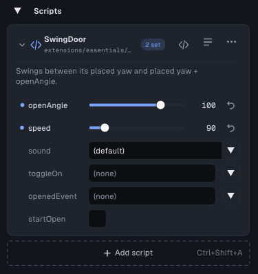

# Script API (`tyrax::`)

The script API is the C++ library every TyraX script can call: everything the
flow-graph nodes do — moving objects, raycasts, sounds, events, save data, HUD,
scenes — as plain functions, plus the helpers a programmer expects (vectors,
easing, random numbers, timers). It is generated into each project as
`inc/tyrax/tyrax.hpp`, and `scripts/script.hpp` includes it, so an
[object script](object-scripts.md) or a global script can use it with no setup.

```cpp
#include "scripts/script.hpp"

namespace Mygame {

class Door : public ObjectScript {
 public:
  void onUpdate(ScriptContext& ctx) override {
    using namespace tyrax;
    const bool near = object.distanceTo(playerPosition(ctx)) < 3.0F;
    if (near && actionPressed(ctx, Actions::Use) && cooldown.use(1.0F)) {
      open = !open;
      playSound(ctx, Sounds::DoorCreak);
      sendEvent(Events::DoorToggled, open ? 1.0F : 0.0F);  // On Event in graphs
    }
    const float target = open ? 90.0F : 0.0F;
    object.setYaw(moveTowardsAngle(object.yaw(), target, 120.0F * dt()));
  }

 private:
  bool open = false;
  tyrax::Cooldown cooldown;
};

TYRA_OBJECT_SCRIPT(Door);

}  // namespace Mygame
```

## How it fits together

- **`tyrax/tyrax.hpp`** is the library. It is regenerated on every build, so it
  follows the editor. Every function in it is `inline`, so a function that no
  script calls adds nothing to the ELF.
- **`tyrax/names.gen.hpp`** holds your project's names as **typed constants**:
  `tyrax::Scenes::Level2`, `tyrax::Sounds::Explosion`,
  `tyrax::Objects::Main::Gate`, `tyrax::Actions::Jump`. A typo is a compile
  error, IntelliSense lists what exists, and nothing compares strings at
  runtime.
- **Shared state with the flow graphs.** Some state is shared, so a graph and
  a script never fight over it: the event bus, the random sequence, the
  priority table that decides which sound gets a voice, and what the Raycast
  node returns. A script's `sendEvent` fires a graph's *On Event*, and a
  graph's *Send Event* shows up in a script's `eventReceived`.
- Everything works with the `ScriptContext` your callbacks receive, either as
  the first argument or carried by an `ObjectRef`. In an object script,
  `object` is your own object as an `ObjectRef`.

### Names become identifiers

An editor name becomes a PascalCase identifier. Spaces, dashes and other
non-alphanumeric characters split words, and the first letter of each word is
upper-cased:

| Editor name | Identifier |
|---|---|
| `far wall` | `FarWall` |
| `door-left` | `DoorLeft` |
| `sfx/explosion_big.wav` (a sound uses its file name) | `ExplosionBig` |
| `2nd floor` | `_2ndFloor` |
| `throw` (a C++ keyword) | `Throw_` |

PascalCase keeps names clear of the generated headers' `ALL_CAPS` macros. Two
names that become the same identifier are numbered: `Crate`, then `Crate2`.
Objects and layers belong to a scene: `tyrax::Objects::<Scene>::<Object>`. An
id from another scene gives an empty `ObjectRef`.

| Namespace | Type | Source |
|---|---|---|
| `Scenes` | `SceneId` | scenes |
| `Objects::<Scene>` | `ObjectId` | each scene's objects |
| `Layers::<Scene>` | `LayerId` | each scene's streaming layers |
| `Sounds` | `SoundId` | *Project > Audio* sound effects |
| `Music` | `MusicId` | music tracks |
| `SoundBanks` | `SoundBankId` | sound banks |
| `Events` | `EventId` | graph events, any `Events::X` your scripts name, **and** any event typed into a script's `tyrax::EventId` field in Properties |
| `SaveValues`, `SaveTexts` | `SaveValueId`, `SaveTextId` | *Save data* |
| `Menus` | `MenuId` | game menus |
| `HudTexts`, `HudBars`, `HudElements` | … | the HUD (elements: images, then texts, then bars) |
| `Sequences`, `Credits` | `SequenceId`, `CreditsId` | Cutscene Director, credits rolls |
| `Prefabs` | `PrefabId` | prefabs |
| `Actions` | `ActionId` | *Tools > Input Map* actions |
| `Facts`, `FactPositions` | `FactId`, `FactPosId` | stored [World Facts](world-facts.md) |

**Events can be declared by a script.** Naming `tyrax::Events::Alarm` in any
`src/scripts/` file creates the event `Alarm`, even if no graph uses it. A
graph's *On Event* "Alarm" then receives it. Comments and string literals do
not count.

**Sounds named in scripts are kept loaded.** Since 2.0, a sound effect is
loaded only in scenes that play it. A sound your scripts name
(`tyrax::Sounds::X`) is loaded for the whole game, unless it is in a
[sound bank](sound.md), which then decides when it loads. *Project > Audio*
lists these sounds under *Always loaded*. A sound picked in a script's
`tyrax::SoundId` field in Properties loads with that object's scene, like a
graph's *Play Sound*.

## Public fields

Mark a member of an object script with `[[tyra::prop]]` and the editor shows
it under the script in *Properties > Scripts*, on every object the script is
attached to. Each attachment sets its own value, and the game writes the
values in before `onStart`. A field you leave alone keeps the member's own
initializer, so changing a default in code reaches every object that did not
override it.



```cpp
class Turret : public ObjectScript {
 public:
  [[tyra::prop(min = 0, max = 720, tooltip = "Degrees per second")]]
  float turnSpeed = 90.0F;
  [[tyra::prop(header = "Targeting")]] tyrax::ObjectRef target;
  [[tyra::prop]] float range = 20.0F;
  [[tyra::prop(options = "Idle|Track|Sweep")]] int mode = 1;
  [[tyra::prop(color)]] tyrax::Vec3 laserColor{1.0F, 0.2F, 0.1F};
  [[tyra::prop]] tyrax::SoundId fireSound = {-1};
  [[tyra::prop]] const char* callsign = "T-1";
  ...
};
```

| Member type | Editor widget | Stored as |
|---|---|---|
| `bool` | checkbox | `true` / `false` |
| `int` | drag (slider with `min` and `max`) | the number |
| `int` + `options = "A\|B\|C"` | drop-down | the option's index |
| `float` | drag (slider with `min` and `max`) | the number |
| `tyrax::Vec3` | three drags | `x y z` |
| `tyrax::Vec3` + `color` | colour picker | `r g b`, 0..1 |
| `const char*` | text field | the text |
| `tyrax::ObjectRef` | an object of the same scene | the object's id, so a rename keeps the link |
| `tyrax::SoundId`, `MusicId` | the project's sounds / tracks | the file path |
| `tyrax::EventId`, `SceneId`, `SaveValueId`, `PrefabId`, `ActionId`, `HudTextId`, `HudBarId`, `SequenceId`, `MenuId` | the project's items | the item's name |

Attribute options are `min = <number>`, `max = <number>`,
`tooltip = "..."`, `header = "..."` (a caption above the field),
`options = "A|B|C"` and `color`. Options go in parentheses and are separated
by commas: `[[tyra::prop(min = 0, tooltip = "Metres")]]`.

How it works: the editor reads the attribute **textually**, the same way it
finds `TYRA_OBJECT_SCRIPT`. The build writes `inc/tyrax/script_props.gen.hpp`,
which holds a `TYRAX_PROPS_<Class>` macro with one assignment per field, and
`TYRA_OBJECT_SCRIPT` pastes that macro into your class's own file. The
assignments are therefore compiled against your real declaration: a field the
editor misread is a compile error, never a silently wrong value. The values
are a small table per attachment in `src/gen/object_scripts.gen.cpp`, and an
attachment with every field at its default costs nothing.

- **A field's colour** in *Properties* tells you whether it is set: blue is
  set on this object, plain is the script's default. Hover the name for the
  type, the tooltip and the default. `x` returns the field to the default.
- **Values are kept when a field disappears.** If you rename a field, remove
  it or detach the script, the stored value stays in the object's file and
  comes back when the name does. A reference that no longer resolves, such as
  a deleted sound or an object in another scene, falls back to the default.
- **A field the editor cannot offer** shows why: an unsupported type, or a
  `static` member, which belongs to the class and not to one attachment.
- **Changes apply on the next build.** Fields are compiled into the game, so
  Live Link does not stream them.
- **Compiler warnings.** GCC does not know the `tyra::` attribute namespace.
  The generated `Makefile` passes `-Wno-attributes=tyra::`, or plain
  `-Wno-attributes` on the GCC 11 of the default Docker image.

## Reference

### Vectors and math

`tyrax::Vec3` is a small `{x, y, z}` with `+ - * /`. It converts from the
engine's `Tyra::Vec4`, so `Vec3 p = ctx.playerPosition;` works. `Vec3::from(float*)`
reads an object's `data.position`, and `.store(float*)` writes one back.

| Function | Does |
|---|---|
| `dot`, `cross`, `length`, `lengthSq`, `normalize` | `normalize` returns zero for a zero vector, never a NaN |
| `distance`, `distanceSq`, `distanceXZ` | `distanceXZ` ignores height |
| `lerp(a, b, t)`, `moveTowards(a, b, maxStep)` | floats and `Vec3` |
| `clamp`, `clamp01`, `inverseLerp`, `remap`, `smoothstep`, `sign`, `safeDiv` | `remap` and `safeDiv` follow the *Remap Range* and *Divide* nodes: clamped, with no division by zero |
| `wrapDeg`, `deltaAngle`, `moveTowardsAngle` | degrees, folded into (-180, 180] |
| `yawTo(from, to)`, `forwardFromYaw(yaw)`, `forwardFromRotation(rot)` | yaw 0 faces +Z, the walker's and *Look At*'s convention |
| `ease(t, Ease::...)`, `tween(elapsed, seconds, from, to, ease)` | `Linear`, `In`, `Out` and `Smooth` are the *Tween Value* node's curves; also `InCubic`, `OutCubic`, `InOutCubic`, `OutBack`, `OutBounce` |
| `randomU32`, `random01`, `randomRange`, `randomInt(lo, hi)`, `chance(p)`, `randomInCircle(r)`, `seedRandom(seed)` | one sequence shared with *Random Branch* and *Roll Random*; `randomInt` includes both ends |

### Time

| Function | Does |
|---|---|
| `dt()` | seconds this frame lasted; multiply speeds by it so PAL and NTSC play the same |
| `sceneTime()` | seconds since the active scene (re)loaded, as the *Scene Time* node reports |
| `frame()` | frames since boot |
| `Timer` | `start(s)`, then `finished()` returns true once when the time is up; also `running()`, `remaining()` and `stop()` |
| `Cooldown` | `use(s)` succeeds, then refuses until `s` seconds have passed (the *Cooldown* node); `ready()`, `reset()` |

### Objects (`ObjectRef`)

`tyrax::object(ctx, Objects::Main::Gate)`, `tyrax::object(ctx, index)`,
`tyrax::findObject(ctx, "name")` and the `object` member of every object
script all give an `ObjectRef`. It is cheap to copy, and every call checks the
index first, so an empty or stale reference does nothing instead of crashing.
Writes set the flags the game reads, the way the flow nodes do: `dirty` to
rebuild the mesh, and `restFrames = 0` to wake a physics body.

**Moving every frame is cheap; recolouring every frame is not.**
`setPosition`, `moveBy`, `setRotation`, `rotateBy`, `setYaw` and `lookAt`
put the object on the per-object matrix path (`wantsMatrixPath`). From the
next frame on, a move only refreshes a matrix that VU1 applies for free. A
mesh rebuilt on every move costs the EE its whole vertex array each frame:
the cookbook level ran at 12.5 FPS in PCSX2 that way, and runs at 50 now. A
colour or a scale is baked into the vertices, so `setColor` and `setScale`
always rebuild the mesh, except that passing the value the object already has
does nothing. Change a colour only when it actually changes.

| Group | Members |
|---|---|
| Identity | `valid()`, `index()`, `type()`, `active()`, `get()` / `->` (the raw `RuntimeObject*`) |
| Transform | `position`, `setPosition`, `moveBy`, `rotation`, `setRotation`, `rotateBy`, `yaw`, `setYaw`, `forward`, `scale`, `setScale`, `lookAt(target, tilt)`, `spin(degPerSec)` |
| Look | `color`, `setColor`, `visible`, `setVisible`, `show`, `hide`, `toggleVisible`, `usable`, `setUsable`, `setLight(on, intensity)` |
| Physics | `velocity`, `setVelocity`, `addImpulse` (units per **second**), `stopMotion`, `asleep` |
| Animation | `playAnimation(clip, loop, speed, fade)`, `stopAnimation`, `animationFinished` |
| Questions | `distanceTo(point / object)`, `contains(point)` (Area objects), `despawn()` |

Searches: `findNearest(ctx, point, maxDist, filter)` and
`overlapSphere(ctx, point, radius, out, max, filter)`, where an
`ObjectFilter` can restrict the object type, keep only visible objects, skip
one index, or run your own test. `spawn(ctx, template, point, yaw)` clones an
object, as the *Spawn Object* node does.

### Raycasts

| Function | Hits |
|---|---|
| `raycast(ctx, origin, dir, maxDist, radius, skip)` | **what blocks movement**: object collision boxes, rotated, exactly as the walker and the camera boom see them, and the terrain. `radius > 0` sweeps a sphere. Objects without collision, markers and areas never stop it. |
| `raycastFromPlayer(ctx, maxDist)` | **what you can see**, the *Raycast* node exactly: every visible object's bounding sphere, with collision or without, and the terrain, from the player's eye along the view |
| `lineOfSight(ctx, a, b, skip)` | true when `raycast` finds nothing between `a` and `b` |
| `terrainHeight(ctx, x, z)` | the ground height |
| `playerInArea(ctx, areaIndex)` | either player inside an Area object |

Both raycasts return a `RayHit` with `hit`, `distance`, `point` and `object`.
`object` is empty when the terrain was hit. A project whose
`terrain_game.hpp` was taken over before 2.3.0 lacks the game's sweep, and
its `raycast` falls back to the bounding spheres.

### Player and input

`playerPosition`, `playerLook`, `playerObject`, `distanceToPlayer` (the
nearer player in two-player modes), `teleportPlayer(ctx, point, yaw)`,
`setPlayerInput(ctx, enabled)`, `setFlashlight`, and `vibrate(ctx, big, small, seconds)`.

Input goes through the Input Map's actions, so a rebind in the pause menu
reaches scripts too: `actionHeld(ctx, Actions::Jump)`, `actionPressed` (the
frame it went down, like *On Action*) and `actionValue` (0..1 for an analog
binding). `stick(ctx, right)` reads a stick as -1..1 per axis, with a small
dead zone.

### Audio, camera, screen and HUD

| Function | Node |
|---|---|
| `playSound(ctx, sound, volume, priority, channel)` | *Play Sound*: voices are shared with the graphs, so a higher priority steals the lowest; returns the channel, or -1 |
| `playMusic`, `stopMusic`, `setSoundBankLoaded`, `setReverb` | the matching nodes |
| `cameraShake`, `setFade`, `setCamera(eye, target)`, `releaseCamera`, `setSkyColor` | *Camera Shake*, *Set Screen Fade*, *Set Camera* |
| `setFog`, `setParticles`, `setBloom`, `setGrain`, `setLensFlare`, `setGodRays` | the *Set …* graphics nodes; amounts are 0..1 (bloom up to 2) |
| `setHudVisible`, `showText(text, seconds)`, `hideText`, `setHudBar(bar, value, instant)`, `setHudElementVisible` | the HUD nodes; a bar bound to a save value gets the value written too |

### Save data, facts and events

| Function | Does |
|---|---|
| `saveValue`, `setSaveValue`, `addSaveValue`, `saveText`, `setSaveText` | the save-data slots; a memory-card save stores them |
| `openSaveMenu`, `saveCheckpoint`, `loadCheckpoint` | the save nodes |
| `fact(Facts::X)`, `setFact`, `factPosition`, `setFactPosition` | stored [World Facts](world-facts.md), written through the same path as *Set Fact*, so the Live Debugger shows the write and the rules run on it |
| `sendEvent(Events::X, value)` | every *On Event* and every script polling the event sees it on the **next** frame |
| `eventReceived(Events::X, &value)` | true during the frame the event is delivered |

An event sent from `onStart` in the frame a scene loads is delivered to that
scene: the scene reset drops only mail sent before the switch.

### Other scripts and graphs

| Function | Does |
|---|---|
| `getScript<T>(objectRef)` | the `T` attached to that object, or null |
| `findScript<T>()`, `findScripts<T>(out, max)` | the first, or every, live instance of `T` in the scene |
| `callScriptMethod(ctx, objectIndex, "Class", "method")` | what the *Call Script* node runs: a `TYRA_SCRIPT_METHOD` on the instance attached to an object |

The lifecycle callbacks that go with these (`onEvent`, `onPlayerEnter`,
`onLateUpdate`, `onSceneEnd`, …) are listed in
[object scripts](object-scripts.md#lifecycle).

### Scenes and the rest

`switchScene(ctx, Scenes::X)`, `restartScene`, `setLayerLoaded`,
`layerLoaded`, `playSequence`, `stopSequence`, `sequencePlaying`,
`playCredits`, `openMenu`, `spawnPrefab`, `despawnPrefabs`, and
`debugLog(...)`, which writes to `bin/log.txt` and the Output panel in debug
builds.

## Global scripts

A global script (`TYRA_SCRIPT`) uses the same functions with its own `ctx`.
`sceneTime()`, `Timer` and `Cooldown` run on a clock that the object-script
driver advances. That driver is always compiled in, but a global script that
runs earlier in the frame sees the clock as of the previous frame.

## When you own `script.hpp`

If you deleted the ownership line of `inc/scripts/script.hpp` before 2.3.0,
your copy does not include the API. Add `#include "tyrax/tyrax.hpp"` after the
`ScriptContext` definition to get it. `ObjectScript::object` exists only in
copies from 2.3.0 on. The generated driver checks `TYRAX_SCRIPT_API` and
builds either way.
