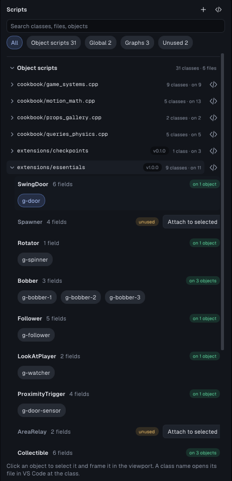

# Script extensions

A script extension is a folder of reusable game code: object scripts, global
scripts, helpers and custom flow nodes. It moves from one project to another
as a plain copy and needs no build changes. TyraX ships one, **Essentials**
([`extensions/essentials`](../extensions/essentials)), and the
[script-cookbook example](../examples/script-cookbook) uses it in row G. The
same row has **Checkpoints**, a small extension written inside the project,
with a [step-by-step walkthrough](../examples/script-cookbook/README.md#write-your-own-extension)
of how it was made: an object script with fields, a flow node whose C++
reads the script's state, and the level that uses both.

```
<project>/src/extensions/<name>/
    extension.json          {"name", "version", "description", "author"}
    *.cpp, *.hpp            compiled with the game
    flow-nodes/*.flownode   custom flow nodes, loaded like the project's own
```

## Why `src/extensions`

The game's Makefile compiles every `.cpp` under `src/`, so an installed
extension builds with no extra step. The editor reads `src/extensions/*`
everywhere it reads `src/scripts`:

- the *Add script* picker (with a chip per extension),
- the `[[tyra::prop]]` fields in *Properties*,
- events and sounds that scripts name (`tyrax::Events::X`, `tyrax::Sounds::X`),
- the *Project > Scripts* page.

## Managing extensions



On *Project panel > Scripts* each extension's classes form one group under
*Object scripts*, with the manifest's version. The installed extensions are
listed in the **Extensions** section,
with each one's version, object scripts and flow-node count. Clicking a row
opens its manifest.

- **New extension** writes a skeleton under the name you type: a manifest, an
  object script with a public field, and a custom flow node. It then opens the
  script in VS Code.
- **Install from folder…** copies a folder that holds an `extension.json`.
  An extension with the same folder name is never overwritten.
- **Remove** deletes the folder, after a confirmation.

The same operations are available headless:

```powershell
tyrax-editor --list-extensions <projectDir>
tyrax-editor --new-extension <projectDir> "My Extension"
tyrax-editor --install-extension <projectDir> path\to\folder
```

## Writing portable code

An extension cannot name the project's namespace, because every project has a
different one. Wrap the code in the two macros that `scripts/script.hpp`
defines:

```cpp
#include "scripts/script.hpp"

TYRAX_NAMESPACE_BEGIN

class Rotator : public ObjectScript {
 public:
  [[tyra::prop(tooltip = "Degrees per second around X, Y and Z")]]
  tyrax::Vec3 speed{0.0F, 90.0F, 0.0F};
  void onStart(ScriptContext&) override { object.spin(speed); }
};
TYRA_OBJECT_SCRIPT(Rotator);

TYRAX_NAMESPACE_END
```

Use the [script API](script-api.md) rather than raw `ScriptContext` fields.
Reference a project's sounds and events through fields
(`[[tyra::prop]] tyrax::SoundId sound;`), not through `tyrax::Sounds::X`:
the project the extension lands in decides what exists.

Class names share one namespace with the project's own scripts, so two
classes with the same name are a compile error. Give names that might collide
a prefix.

## Flow nodes in an extension

A `.flownode` in `flow-nodes/` is loaded like one in the project's own
`flow-nodes/` folder (see [custom flow nodes](custom-flow-nodes.md)). If both
define the same node id, the project's version wins and the extension's is
reported. A `call = fn` node usually keeps its function in the extension, and
names the header that holds it:

```
title = Player Near
category = Essentials
string = object
num0 = Radius
call = essentialsPlayerNear
include = essentials_nodes.hpp
out = bool
exec_out = true
---
```

`include =` is relative to the folder that holds `flow-nodes/`. The generated
flow graph includes the header for every node in use. The header wraps its
`inline` functions in `TYRAX_NAMESPACE_BEGIN` / `_END`.

## Essentials

| Script | Does | Fields |
|---|---|---|
| `Rotator` | spins continuously (the cheap matrix path) | `speed` (degrees/s per axis) |
| `Bobber` | floats up and down around its placed height | `height`, `period`, `phase` |
| `Follower` | follows an object, or the player, and stops at a distance | `target`, `distance`, `speed`, `face`, `keepHeight` |
| `LookAtPlayer` | keeps facing the player | `tilt`, `turnSpeed` |
| `ProximityTrigger` | sends events as the player comes near and leaves | `radius`, `enterEvent`, `exitEvent`, `once` |
| `AreaRelay` | on an Area object, turns enter and exit into events | `enterEvent`, `exitEvent` |
| `Collectible` | picked up by walking over it: adds to a save value, plays a sound, hides, can respawn | `radius`, `counter`, `amount`, `sound`, `pickedEvent`, `respawn` |
| `SwingDoor` | swings open around its Y axis; `open`, `close` and `toggle` for *Call Script*; toggles on USE or on an event | `openAngle`, `speed`, `sound`, `toggleOn`, `openedEvent`, `startOpen` |
| `Spawner` | clones a template around itself every few seconds; `reset` for *Call Script* | `templateObject`, `interval`, `maxCount`, `scatter` |

Flow node **Player Near** (category *Essentials*): is the player within
*Radius* of the target object? The answer goes to a bool output.
