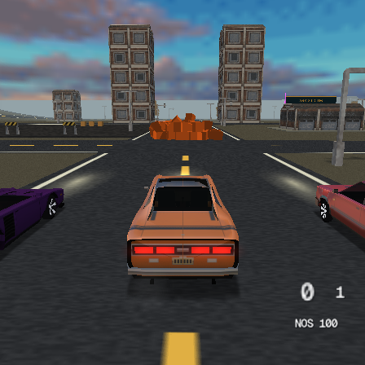

# Temporal physics experiment

Temporal physics adds conservative collision caches, persistent contact impulses
and independent dynamic islands without reducing collision coverage or solver passes.

## Asynchronous VU0 SAT/CCD experiment

The final physical same-ELF timing completed **16,800 measured frames** across
28 phases. A separate run of that exact ELF shadow-checked **101,641 jobs** with
zero hard errors or missed reference hits; 13,695 small accepted differences
remained in the simulation. Timing disabled reference comparisons and recorded
258,201 jobs plus 27,280 observations of EE query work while VU0 was busy.

Driving-phase FPS, pooling both reversed-order repeats:

| Added cubes | Layout | Scalar | VU0 micro |
|---|---|---:|---:|
| 32 | Spread | 59.94 | 59.94 |
| 64 | Spread | 59.94 | 59.94 |
| 128 | Spread | 59.20 | 58.88 |
| 32 | Pile | 49.04 | 50.77 |
| 64 | Pile | 33.25 | 37.14 |
| 128 | Pile | 19.92 | 19.72 |

This does **not** establish a general kernel speedup: variable dt and accepted
numerical differences produce different trajectories and contact populations.
For 128 piles, micro repeats were 18.67/20.91 FPS versus scalar 19.30/20.57;
the outcome is mixed. Dense 60 FPS remains unqualified and the backend stays
**default-off**. All generated contacts and vehicle candidates passed capacity
accounting; reference geometry was checked in shadow mode, not during timing.
The [timing report](../tools/ps2rig/results/vu0-micro-2026-10-29.json),
[timing frames](../tools/ps2rig/results/vu0-micro-2026-10-29.csv.gz) and
[qualified shadow](../tools/ps2rig/results/vu0-shadow-2026-10-29.json) retain the
source/ELF/assets and per-phase raw hashes, scopes and both repeats.

The independent stationary 64-cube gate completed **5,040 measured frames**
with scalar/micro order reversed on the second repeat. All four arms had zero
awake bodies and zero squared-velocity sum in the final 120 park and recovery
frames. The known base impulse woke bodies and both implementations recovered.
The 26,300 micro jobs passed full scalar shadow checks with no missed hits or
capacity omissions. This is a bounded settling test, not universal stability or
performance evidence; see the [settle report](../tools/ps2rig/results/vu0-settle-2026-10-29.json).

Final default-path qualification used a freshly generated Release furniture
scene with production Pad code and `TYRA_PHYSICS_MICRO=0`: native build plus a
private PCSX2 software-renderer run, 46 finite-state samples over 37 bodies and
three captures. The unstripped symbol audit found no SAT backend functions or
batch storage; its stripped relink matched the tested ELF byte for byte.
See the [smoke metadata](../tools/ps2rig/results/vu0-default-smoke-2026-10-29.json)
and [capture](../tools/ps2rig/results/vu0-default-smoke-2026-10-29.png).

The interpenetration diagnostic completed on physical PS2: **720 physics calls**,
including the first call after spawning 64/128 spread, partially overlapping and
coincident-centre cubes, with scalar and micro-shadow arms. No EE/VU0 division-by-zero,
invalid-operation or overflow flags were observed. Intentional EE `1/0` and `0/0`
first verified the exception monitor. Every generated contact was retained and
all runtime shadow comparisons passed the practical tolerances below.

The scalar first call for 128 coincident cubes generated **8,156 contacts** and
took **474 ms**; partial overlap produced 6,424 contacts and 220 ms. The run
completed, reproducing an apparent freeze through contact-density cost rather
than an arithmetic exception. The 128 cubes alone have 8,128 possible unordered
pairs. This evidence does not exclude unrelated hangs in other scenarios.
Per-call diagnostic logging changes subsequent real dt, and micro-shadow also
executes the reference; those timings must not be used as an FPS/backend A/B.
See the [report](../tools/ps2rig/results/collision-overlap-2026-10-29.json),
[raw frames](../tools/ps2rig/results/collision-overlap-2026-10-29.csv.gz) and
[full log](../tools/ps2rig/results/collision-overlap-2026-10-29.log.gz).

`TYRA_PHYSICS_MICRO` is an experimental, default-off backend for dynamic OBB
pairs that reach SAT after the existing corner tests. Seven jobs fit VU0's
4 KB data memory. VU0 computes every existing face/edge axis projection,
minimum penetration and linear time interval. EE reconstructs the winning
support feature with the original scalar normalization, preserving feature
selection when rounding would otherwise select a different corner. Ambiguous
normal signs fall back to the complete scalar algorithm. Other shapes and
world contacts retain their algorithms. Solver passes, colliders, candidate
coverage and contact order remain unchanged.

While one batch runs, EE builds the next using scalar RbV and broad-phase
code. Deferred contacts reserve their original positions; stable compaction
removes misses after the final completion fence. VU0 memory accesses happen
while idle. Macro-mode transforms disable the asynchronous route. Built-in
ray-tracing and generated compute wrappers share a micro-image owner token
and reload their programs after an owner switch.

The first semantic gate runs the actual VCL source through the host VU0
simulator against `convexMotionContact`: 10,000 rotated/swept pairs, including
stationary and coincident-centre cases. Classifications agree; measured depth,
normal and point errors are zero after winning-feature reconstruction. The
first openvcl image is 2,048 bytes. These gates do not qualify assembled-code
execution or establish a console speedup; console validation and same-ELF
timing remain required.

The extended gate adds 2,048 cases in batches of up to seven, with six face normals,
touching faces, near-parallel orientations, large coordinates and separated
CCD endpoints. The data-memory sentinel survives. A deliberately inverted
axis gate fails immediately, proving the oracle observes the tested path.
Near-parallel jobs use the original scalar tie policy; the runtime does not
queue those jobs. Rejected micro jobs also restore separating-axis history.
The default-off runtime compiles out batch storage and VU0 calls.

`collision_stress.py --micro-comparison --baseline 0647f5596` prepares the
same-ELF 28-phase console comparison. It runs an assembled-kernel 2,048-case
oracle before measurements. A boot-time `bin/sat-verify.cfg` enables shadow
comparison of runtime micro jobs with the full scalar result; remove the file
for timing the same ELF. Per-phase `vu0-phase-*.csv` records actual jobs,
batches, busy observations during EE queries, completion waits and validation
errors. Busy observations prove overlap at those sample points, not overall
VU utilization. Shadow-enabled runs are correctness evidence, not performance.
Shadow mode runs the +128 pile pair (phases 12 and 13); timing runs all 28 phases.

The initial assembled image was rejected in PCSX2: openvcl paired an upper
`addx.x` with lower `mfir.y` to the same VF register, and the overlap flag
retained old bits despite the disjoint component masks. The source-level
oracle cannot model this scheduling fault. An explicit scheduling barrier
fixes it: the next assembled startup oracle passes all 2,048 cases with zero
depth/normal/point error. Explicit CLIP initialization and exit directives
also let Sony VCL assemble the kernel (2,144 bytes, within 4 KB).

The first physical startup gate rejected four positive CCD cases out of
2,048: normal differences below 9e-8 still changed strict support-vertex
selection by up to 1.94 units. The corrected backend confirms positive
linear sweeps with the original EE algorithm. VU0 still evaluates the full
SAT/CCD rejection; it never drops an axis or replaces a collider. These
confirmations are included in the backend's eventual performance cost.
Physical startup and full-scene shadow validation must pass before timing.

### Physical equivalence, rather than bit identity

The practical shadow gate permits depth error and additional shallow touches
up to **0.01% of the smaller body's radius**, contact-point displacement up
to **1% of that radius**, and normal-vector error up to **0.01** (about 0.57
degrees for unit normals). Every lost reference hit remains a hard failure.
For a 0.9-unit cube these are roughly 0.00008 units of depth and 0.008 units
of point displacement. The existing solver's penetration slop is 0.005 units.
These are diagnostic acceptance thresholds; they do not change colliders,
SAT axes, solver slop, iteration counts or the collision algorithm.

Small accepted differences remain in the simulation, and are counted separately
from hard failures. This avoids testing a scalar-repaired trajectory while
timing another one. Large CCD support-feature changes still use the original
scalar confirmation. Near-equal discrete minimum axes may differ within the
physical tolerances; no extra per-axis tie detector is required for bit identity.
The sidecar records numerical differences, extra shallow touches, missed
reference hits and maximum normalized errors. `vu0_sat_analyze.py` validates
those bounds along with every-contact accounting, complete phases, finite
state, parent/child scopes and sampled EE/VU0 overlap. A ray-tracer/SAT/ray-tracer
micro-image round trip also checks ownership reloads at startup.

Scalar confirmations and the diagnostic reference use one compiled EE routine.
Object inspection found that the compiler inlined a separate copy into the
confirmation path while the game also emitted an out-of-line copy. FPU
contraction/scheduling differences between those EE copies could exchange
strict CCD support vertices even without a VU arithmetic error. Calling the
same compiled scalar body avoids that misleading comparison and stabilizes
the confirmed feature; ordinary scalar physics keeps its existing algorithm.

Aligned packet uploads and result readback use the EE integer `LQ/SQ` path,
moving 128 bits at a time without COP2 instructions. The single-word control
write and any unaligned endpoint retain a scalar copy. These accesses remain
inside the VU0-idle ownership fences; packet storage is explicitly 16-byte
aligned. Transfer, packing, launch, completion and scalar confirmations all
belong to the backend cost measured in the same-ELF comparison.

## Selected defaults and final PS2 result

The refined geometry/admission cache is enabled by default
(`TYRA_PHYSICS_COHERENCE=1`). Warm starting and coordinated island sleep/wake
remain opt-in (`TYRA_PHYSICS_WARM_START=0`, `TYRA_PHYSICS_ISLANDS=0`): their
fixed-iteration dense-pile results are worse. The prepared-solver experiment
also remains disabled by default. No collider, contact or iteration is removed.
Cache storage is allocated when active physics needs it; empty/sleeping scenes
do not initialize the scene-sized collider cache, and disabled islands do not
allocate a scene-sized membership map.

The final same-ELF cache-only comparison from `3fa710314` completed 28 phases
and 16,800 measured frames. Pooled drive FPS (720 frames per cell):

| Additional piled boxes | Prior | Refined cache |
| --- | ---: | ---: |
| 32 | 50.89 | 49.89 |
| 64 | 35.90 | 37.56 |
| 128 | 18.32 | 20.58 |

At +128 this is about **12.3% higher FPS**, and mean physics time falls from
32.17 to 27.48 ms. Body-grid candidate visits average 1,623.8 versus 774.1 per
frame, about **52% fewer**, with every generated contact retained. At +64 visits
fall from 476.8 to 268.7. These are candidate visits, including the grid's own
and duplicate-direction entries, rather than discarded collisions.

The gain is workload-dependent: +32 regresses slightly. +128 repeat FPS is
18.55 -> 19.30 and 18.09 -> 22.04. Frame timing changes the engine's variable
timestep and subsequent contact trajectories, so this is a whole-game test,
not identical-input kernel timing. Both repeats and stage/candidate counters
are retained in the [final summary](../tools/ps2rig/results/temporal-refined-2026-10-29.json)
and [raw frames](../tools/ps2rig/results/temporal-refined-2026-10-29.csv.gz).
The ELF SHA-256 is
`c5417acd86fba2cc1b5a446c91712d62dfe4748ce5bd0e5f55d1e7aacc9a3141`.

The 56-phase exploration, eight-phase stationary gate and 28-phase follow-up
cover **60,480 measured physical-console frames**. All arms retain every
generated contact and test every vehicle candidate, with zero omission/overflow
counters and passing timing/finite-state gates. Assets are complete and shared;
the private fixture disables physical padman polling/rumble in every arm while
injecting the same controls. Production Pad code is unchanged.

This does **not** reach 60 FPS in dense active piles: +128 physics alone still
exceeds the 16.68 ms whole-frame budget. These results do not establish the
console's hardware limit or a universal speedup across scenes.

The previous scalar integration is the reference. A same-ELF four-arm rig
compares reference, geometry/axis caches alone, caches plus warm starting, and
caches plus warm starting and islands, with reversed arm order in a second repeat. Stage timings include
prediction, world contacts, body-grid construction, body contacts, solver and
write-back; nested query/SAT scopes must not be added twice to their parents.
Host gates cover cached-axis CCD conservatism, contact identity/invalidation,
unbounded history storage and stable island partitioning. Full-game and
physical-console qualification are recorded below.

## Implementation and gates

`TYRA_PHYSICS_COHERENCE` controls persistent world-box transforms and per-step
hull normal/edge transforms, plus a previous-frame separating-axis hint.
`TYRA_PHYSICS_WARM_START` controls impulse history, and
`TYRA_PHYSICS_ISLANDS` controls stable component grouping and coordinated
sleep/wake. The selected defaults are 1/0/0 after console comparison.
The prepared scalar/VU0 experiment remains separate and disabled in this rig.

Host gates passed 50,000 swept/rotated box pairs, including arbitrary cached
axes and separated-endpoint crossings. History gates passed one-to-one
matching, shape/state/scene/timestep invalidation, 4,096 simultaneous records
and stable island order. The first native integration build exposed an orbit
header dependency and a timing-scope visibility issue; both were corrected.
External-change revisions now live in always-regenerated side state, preserving
owned header layouts. The subsequent full native PS2 build passed.

The benchmark adds squared-velocity and maximum contact-depth diagnostics.
Squared velocity is not mass-weighted kinetic energy, and its units depend on
the frame timestep. Driving adds physical impulses, so settling and wake
behaviour must be assessed alongside FPS, rather than requiring monotonic
energy during a car impact.

The isolated PCSX2 software-renderer run completed six 600-row phases,
including both full-feature drive trials. Contact/candidate accounting and
disjoint-stage timing checks passed; history recorded 2,636 and 2,300 matches
in the two full-feature phases. No assert, exception or missing-resource
diagnostic occurred. The later physical qualification is recorded below.

## Stationary settle and wake gate

`collision_stress.py --settle-check` uses the same four arms and reversed
repeat order, with 64 piled boxes and no driving. After 150 warm frames it
records 600 park frames, applies one horizontal 0.12 per-frame velocity impulse
to a base box, records a 60-frame wake interval and 600 recovery frames.
All eight phases must have 1,260 rows. The test checks late-park/late-recovery
motion and the first frames after the impulse, in addition to complete contacts
and finite disjoint/nested timing scopes. It does not replace representative
non-box or moving-support qualification.

Fixture qualification caught a missing reflection-panorama binary in a manual
asset copy; that attempt is rejected. Baked binary resources must be copied
alongside textures/models, and the complete 283-file cache is hash-qualified
before hardware timing. A premature manual launch without the resident-IOP
marker required a console power cycle; no result from that attempt is used.

The six-phase stationary software-emulator gate completed 7,560 rows with full
contact/candidate accounting and finite, consistent timings. Both full-feature
repeats had zero awake bodies and zero squared-velocity sum in their final
120 park and recovery frames. Their first wake frames activated 64 and 60
bodies, versus 2 and 1 in the prior-solver repeats: whole-component waking is
functionally conservative but can increase transient workload substantially.
This motivates measuring warm starting separately from coordinated islands.
Emulator timings are not physical PS2 performance evidence.

## Separate warm starting from island wake cost

The initial three-arm stationary probe is preserved as
[stability summary](../tools/ps2rig/results/temporal-settle-emulator-2026-10-29.json)
and [raw rows](../tools/ps2rig/results/temporal-settle-emulator-2026-10-29.csv.gz).
It is explicitly emulator-only, not a performance qualification. The revised
rig uses four arms by default: reference, cache, cache + warm starting, and
cache + warm starting + islands. The full driving matrix is 56 phases and
33,600 measured frames; the stationary matrix is eight phases and 10,080 rows.
Use `--temporal-arms 3` only to replay/analyze the initial prototype.

## Physical-pad transport isolation

The first qualified four-arm hardware attempt completed only two control
phases, then stopped in repeated `freepad: DMA Busy` output during scene
reload. It is incomplete and provides no performance qualification. Temporal
fixtures now initialize neutral synthetic pad state and skip physical pad
polling and rumble RPCs in their private engine copy, identically in every arm.
Driving already comes from the rig's direct vehicle inputs. Production Pad
code remains unchanged. This isolates the physics experiment from resident-IOP
pad transport; it is not a fix or a qualification of that transport.

## Profile-guided pair admission follow-up

The first four-arm console trial attributes a large share of dense-pile cost
to world/body contact work and nested broad-phase queries. The follow-up uses
the existing swept hull/sphere envelope as the awake body's grid box and query
area. A sleeping hull uses a cached local AABB transformed conservatively at
its current pose; local bounds invalidate on shape/external-change revisions.
Outward rounding and query padding preserve the later envelope test's tolerance.
Only candidates that would fail that existing test can be removed early.

The cached separating-axis test also uses analytic OBB projection for known
boxes. Successful overlap axes are discarded rather than retested every frame.
These changes retain every face/edge SAT axis and every solver pass.

The host pair-grid oracle runs 200 scenes of 128 off-centre hulls/spheres,
with awake motion and sleeping rotations. All 39,126 exact-envelope pairs
survive 17,171 awake queries in the same order. Candidate visits fall from
247,114 to 84,568 in this host dataset; this is not a PS2 timing claim. The
50,000-pair cached-axis SAT/CCD oracle and contact-history gates also pass.
A focused `--temporal-comparison --temporal-arms 2` run compares prior against
the refined cache path with warm starting and islands compiled out, across
28 phases / 16,800 measured frames. It records body-grid candidate and later
bounds-rejection counts alongside the stage timings. Results are recorded above.

## Completed four-arm physical PS2 trial

The implementation from `407585452` completed all 56 phases and 33,600 frames
with the four arms in reversed repeat order, complete 283-file baked assets,
and synthetic physical-pad isolation. The ELF hash is
`aafd0828e259a1a581f740d3ad3e25b6ad6297538290af5d2a7e84632603d24f`.
Every generated contact was retained and every vehicle candidate was tested;
all omission counters were zero. Disjoint and nested timing gates passed.

Pooled drive FPS (720 frames per cell):

| Piled boxes | Prior | Cache only | Cache + warm | Cache + warm + islands |
| --- | ---: | ---: | ---: | ---: |
| 32 | 48.88 | 49.49 | 47.01 | 49.95 |
| 64 | 34.50 | 34.53 | 33.51 | 27.68 |
| 128 | 20.75 | 20.40 | 18.69 | 14.18 |

The first cache implementation does not establish a general frame-rate gain.
Warm starting and coordinated islands stay opt-in: with the fixed 6+3 passes,
bookkeeping adds cost, and waking complete components substantially increases
active work. At +128, average drive awake bodies are 58.6/51.8/63.8/114.7 and
contacts 449.9/413.9/458.6/872.5, respectively. Inclusive solver cost per contact
is 18.86/19.14/22.73/23.28 microseconds. These are workload ratios, not isolated
identical-input arithmetic benchmarks.

Mean +128 physics time is 26.58 ms prior and 48.22 ms with the full experiment.
The prior solver uses 8.49 ms; world/body contact stages use about 5.5/10.1 ms,
with roughly 6 ms of nested query time across those stages. Grid build itself
is about 0.26 ms. This identifies pair admission and queries as useful next
targets, rather than assuming the grid construction or impulse arithmetic is
the dominant cost. Timestep/contact trajectories vary, so both repeats remain
in the [complete summary](../tools/ps2rig/results/temporal-four-2026-10-29.json)
and [raw frames](../tools/ps2rig/results/temporal-four-2026-10-29.csv.gz).

A separate software-renderer non-box smoke run exercised 37 authored bouncy
bodies/furniture with all features enabled and normal production Pad code.
Across 35 telemetry samples all positions, rotations and velocities were
finite. Squared-velocity sum ranged up to 0.743 and ended at 0.0094; the authored
periodic ball impulse remained enabled, so monotonic energy decay is not
expected. Three captures rendered correctly. This is functional coverage, not
a physical-console performance or complete non-box settling qualification.

## Physical stationary settle and wake qualification

The eight-phase four-arm stationary gate completed 10,080 measured rows on
physical PS2 with the same `407585452` implementation and synthetic-pad setting.
Every generated contact and vehicle candidate was retained/tested, and timing
and finite-state checks passed. Both full-island repeats had zero awake bodies
and zero squared-velocity sum in their final 120 park and recovery frames.
The first three frames after the known base impulse activated 60/60/60 and
63/63/63 bodies, versus 1/4/5 and 1/6/6 in the prior repeats. Warm-only activated
1/5/6 and 2/6/6; one warm-only repeat retained one slowly moving original prop
with late energy about 7.3e-7. Thus convergence/recovery works, but complete
component waking has a substantial transient cost and is not the default.
The [stationary summary](../tools/ps2rig/results/temporal-settle-2026-10-29.json)
and [raw frames](../tools/ps2rig/results/temporal-settle-2026-10-29.csv.gz)
retain both repeats. This gate does not establish universal sleep stability.

The refined admission implementation passed a native PS2 build and isolated
software-renderer startup; both comparison arms produced complete 600-row CSVs
including candidate/rejection counters, without assert/exception/missing-resource
diagnostics. The conservative-bound gate also covers cancellation at large
off-centre coordinates using a double-precision eight-corner oracle.

The refined bound implementation was also exercised with all three feature
flags enabled in the 37-body software-renderer furniture scene. All 34 samples
were finite; sampled awake counts and squared-velocity sums matched the prior
implementation exactly at the same frame numbers. See the
[refined non-box smoke evidence](../tools/ps2rig/results/temporal-refined-nonbox-emulator-2026-10-29.json).
This does not prove full-state identity or qualify physical-console non-box
performance. The final lazy-allocation integration preserves these admission
and solver rules.

Final integration gates also passed: a Release editor build, refreshed vehicle
and physics example snapshots matching the exact template function, and a
native build/software-renderer smoke run of the selected 1/0/0 defaults with
production Pad code. All 18 samples over 37 authored bodies were finite and
the capture rendered correctly. The [default smoke metadata](../tools/ps2rig/results/temporal-default-smoke-2026-10-29.json)
records working-source/function hashes and the ELF; this gate includes the final
lazy-allocation control flow, rather than claiming that an unmeasured stock ELF
has exactly the benchmark's frame rate. The console was returned to ps2link.
