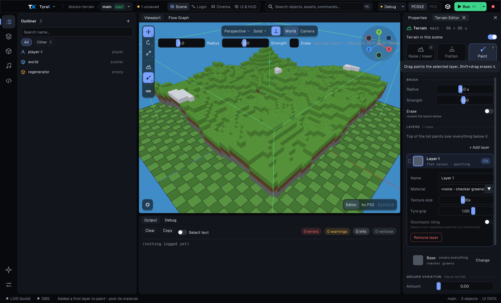

# Terrain painting

Terrain painting blends material textures directly on the scene's ground. Open
the **Terrain Editor** (*Tools > Terrain Editor*, or press **6** in the
viewport) and choose **Paint**.

The Terrain Editor opens docked in the right-hand column beside the viewport
(a tab next to Properties), not floating over the ground it edits. Drag it
anywhere; the editor remembers where you put it.

## Tools

Three tiles at the top pick what a drag in the viewport does:

- **Raise / lower** (**4**): drag raises the ground, Shift+drag lowers it.
- **Flatten**: drag levels the ground toward the **Level** height shown in
  Brush.
- **Paint** (**6**): drag paints the selected layer, Shift+drag erases it.

The line under the tiles always says what the next drag does - "Painting
**Concrete**" names the layer you are about to paint - with the modifier keys
(Shift, and **[** / **]** to resize the brush).

Paint is never a dead button: in a scene with no layers yet, choosing it adds
**Layer 1** and opens it, ready for a material.

## Brush

- **Radius** sets the brush size (up to half the map).
- **Strength** sets how quickly the layer builds up (or how fast the ground
  rises / levels while sculpting).
- **Erase** removes the selected layer, revealing the layers below (Shift
  does the same while you drag).

The brush has no falloff control: its edge is always soft. Painting is
non-destructive: TyraX stores blend weights, not a flattened ground texture.
Sculpting and painting can be mixed freely.

## Layers

The list is in **paint order**: the top row paints over everything below it,
and **Base** - the terrain material, covering the whole ground - is pinned at
the bottom under a dashed rule. **+ Add layer** puts a new layer on top. Drag a
row to move it in the stack (or right-click it: Move up, Move down, Remove
layer).

Each row shows the layer's material swatch, its name, `material · texture size
· grip`, and how much of the ground it visibly covers (a percentage of the
terrain, counting only what the layers above it leave showing). Click a row to
select it - the selected layer is the one Paint paints, and it opens to show:

- **Name** and **Material** (a `.mtl` with a texture, or a flat colour);
- **Texture size**: how large the texture pattern appears (bigger = fewer
  repeats);
- **Tyre grip** (1.142.0): a tyre-grip multiplier where the layer is painted.
  Mud is about 0.5 and sand about 0.8. It multiplies each vehicle's own
  Off-road grip, blended by the painted weight in the stack's order. See
  [vehicles.md](vehicles.md), "Off-road grip";
- **Stochastic tiling** (see below);
- **Remove layer**.

Colour comes from the material itself; there is no per-layer tint (edit the
`.mtl` in the [Material Editor](material-painting.md) instead). **Change** on
the Base row picks the terrain material and its stochastic tiling.

Keep the stack short. Every extra painted layer adds another GS pass over the
affected terrain patches.

## Break up repetition

**Stochastic tiling** bakes a larger, non-repeating supertile from the layer's
texture at build, so the texture does not form an obvious grid. It costs no
runtime time; leave it off for textures with fixed seams (bricks, tiles).

**Ground variation** adds slow light/dark patches over the base and the
painted layers together: **Amount** controls how strong they are and **Patch
size** how large. It is free on the PS2 (it is baked into the vertex shade).
Use it lightly: it is meant to break large uniform areas, not recolour the
material.

## Blend resolution

**Resolution & cost** at the bottom of the Terrain Editor shows the blend grid
(vertices across the terrain), the finest edge a blend can have (one grid cell,
in units) and the extra PS2 passes per painted chunk. Layer weights follow the
terrain grid. Raise **Terrain detail** in Project Preferences (the link in that
section opens it) for sharper borders; this also increases terrain geometry and blend
data. A small brush cannot create detail finer than that grid.

The editor stores weights in `terrain-<scene>.splat`. Builds quantize them into
compact masks and draw only the layers used by each terrain patch. The same data
is read by procedural material filters and terrain-aware effects.

## Practical limits

- Prefer a few reusable materials over many near-duplicates.
- Paint broad regions first, then add detail.
- If a border looks blocky, raise terrain detail before repainting it.
- If distant ground shimmers, increase tile size or reduce high-frequency
  texture detail.

See [Terrain](terrain.md) for sculpting and terrain-free scenes, and
[Materials](material-painting.md) for editing the textures themselves.
