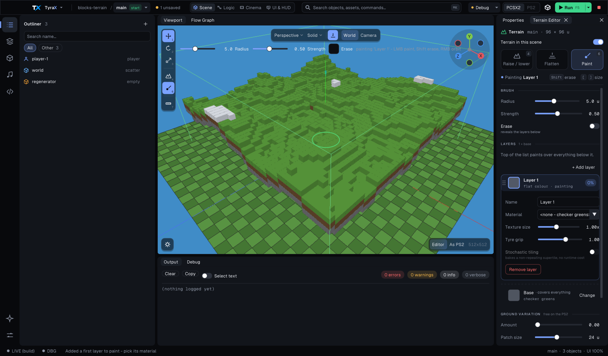
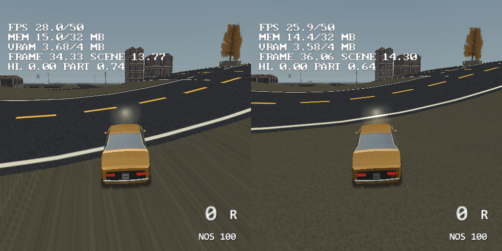

# The terrain, and building without one

Every scene starts with a **terrain**: a flat ground plane, as wide and deep
as the scene, that you can sculpt and paint ([terrain
painting](terrain-painting.md)). It's what everything stands on — the player,
physics bodies, dropped props, the AI.

Every height query follows the same diagonal split as the two rendered
triangles in each heightfield cell. This matters on non-planar cells: a
bilinear interpolation would describe a smooth saddle that is not the visible
surface, letting projected roads intersect it and making ground contact differ
from the picture.

A scene doesn't have to have one. An interior, a platformer, a space level or
a cutscene-only scene has floors of its own, and a ground plane under them is
geometry the console draws for nothing. So the terrain is **optional per
scene**, and removing it removes it completely — not just its picture.

## Creating a scene with or without a terrain

- **New project** (*File > New Project*): the **Ground** row's *Create
  terrain* switch, on by default. Width and depth stay meaningful either way — they are the
  scene's **world bounds**, the rectangle every walker is clamped to.
- **New scene** (the scene picker in the top bar > *New scene...*): the same checkbox.
- Headless: `tyrax-editor --new <name> <dir> [w] [d] [preset] [unitsPerMeter]
  --no-terrain`.

## Removing (or creating) the terrain later

*Tools > Terrain Editor* opens with a **Terrain in this scene** switch.
Turning it off removes the ground; turning it on brings it back. Both are one
undo step.

Nothing is destroyed: the heightmap you sculpted, the painted layer weights
and the layer list stay in the project, so the terrain you had comes back
exactly as it was. While it's off, the rest of the Terrain Editor is hidden —
there is nothing to sculpt or paint.

## What "removed" means

In the editor:

- no ground mesh, no grid lines, no painted layer passes in the viewport,
- the **Sculpt (4)** and **Paint (6)** tools are disabled,
- surface snapping and **End** (drop to floor) rest objects on **other
  objects only** — an object over nothing keeps its height ([object
  placement](object-placement.md)),
- the ambient-occlusion **ground contact** shading is off (there is no ground
  for a prop to sit against).

In the generated game:

- no terrain chunks are built and no ground textures ship (they are not even
  listed, so they cost no [GS VRAM](gs-vram.md)), no terrain lightmap is
  baked ([ambient occlusion](ambient-occlusion.md), [global
  illumination](global-illumination.md)), no ground light pools under dynamic
  lights,
- **there is no floor.** The height sampler answers a value far below the
  world everywhere, so the player, physics bodies, thrown props and particles
  rest on the **geometry you place** — a box, a plane, a model with collision
  — and fall through the void anywhere else. Blob and projected shadows land
  on that geometry and are skipped over the void.
- The player still starts where you put it: with no terrain the spawn point's
  (or the Player object's) own **Y** is the starting height, instead of the
  ground under it.

So a terrain-less FPP or third-person scene needs a floor before the player
has anywhere to stand. The New Project dialog says so when you pick that
combination; build it anyway and the player falls at boot.

The scene's **world bounds still apply** — X/Z are clamped to width/depth as
before, and physics bodies still bounce off those walls. Only the ground is
gone.

## Triangle strips (1.96.0)

A terrain chunk reaches VU1 as a **triangle strip**: one strip per quad row,
walking `(x, z), (x, zN), (x + lod, z), (x + lod, zN), …`, whose successive
triples are that row's quads cut along the same diagonal the triangle list
used. A 16x16 chunk goes from 1 536 vertices to about 550, and every per-frame
EE term of render submission scales with the VU1 package count, which scales
with the vertex count — the same lever the baked models and the roads pull (see
[model-pipeline.md](model-pipeline.md), "Triangle strips", and
[roads.md](roads.md)). `pinPackageSize` pins **every** pass over the chunk —
base, each painted layer, the occlusion and lightmap passes — to the 72-vertex
run, so they still split the array identically and still take the same route,
which is what keeps coplanar passes off a z-fight.

Nothing else moves. Heights, shades, STs, splat weights and the geomipmap edge
snap are all functions of the grid coordinate, so a vertex shared between two
quads carries the values it carried in both of them. The distance LOD, the
crack-free edge interpolation and the per-chunk culling are untouched, and a
shared vertex is now shaded **once** instead of twice, which makes the build
cheaper as well as the frame.

**A terrain without a material keeps its triangle list.** The untextured
fallback is a two-green **checker**, and that colour belongs to the *quad*,
while a strip vertex belongs to two quads — stripping it would collapse the
checker into a flat sheet. With a terrain material both checker colours are the
same tint and there is nothing in the way, so the gate is the material, not the
texture. `TERRAINSTRIP scene N ... triangles T` in `bin/log.txt` is the
acceptance line, and `strips 0` there is this case rather than a failure.

## Limits worth knowing

- **Navigation (AI) needs a terrain.** The navmesh is a rasterization of the
  ground surface, so a scene without one has no walkable cells at all and the
  Patrol / Chase / Flee nodes hold their agents still ([navigation
  AI](navigation-ai.md)). Building AI-driven characters on placed floors is
  not supported yet.
- **Projected decals** need a receiver: with no terrain they project onto
  overlapping objects only, and a decal over empty space projects nothing.
- **Nothing catches a falling body.** There is no kill plane and no respawn:
  an object that falls off the world keeps falling (at terminal velocity, at
  a finite depth — the game does not misbehave, the object is simply gone).
  Build the floor, or a Box with collision, wherever the player can reach.
- The terrain **size** is not a terrain setting only — it is the world
  bounds, so it still matters with the ground removed.

## Resident is not visible: the chunk's own frustum reject (1.123.6)

`renderTerrain` handed every RESIDENT chunk to StaPip to be classified package
by package. Residency is the streaming ring's verdict - "within the view
distance" - and says nothing about whether a chunk is behind the camera, so on
the Motor District (25 chunks, 8 packages each) most of that classification was
work done to be thrown away.

The chunk now takes the same conservative whole-box reject every other
generated chunk has always had (`renderProcChunks`, `renderVehicleWheels`, and
the road chunks again since 1.123.5): `CoreBBox::frustumCheckAABB` against the
box `outsideSplitBand` already trusts, built with the chunk's real `minY` and
`maxY`. A chunk the camera stands on contains the eye, so it comes back
INTERSECTS rather than OUTSIDE and is never dropped underfoot.

Measured in PCSX2 at a parked street vantage (counts are exact there,
milliseconds are not), one knob, per 50 frames:

| | before | after |
|---|---:|---:|
| `out` (packages rejected) | 13 200 | **10 500** |
| `cull` / `clip` / `guard` | 15 100 / 950 / 3 500 | identical |
| `verts` / `flush` | 21 171 / 3 000 | identical |

Taken together with the road half, the district went from 24 850 to 10 500
rejected packages per 50 frames - **-58%** - with everything drawn identical to
the digit. Pictures: 0 pixels differ on both DAY benchmark poses, both arms
byte-identical within themselves. The night poses cannot be read; their own
repeats disagree (lamp flicker, star twinkle).

## A map that fits is not streamed (2026-10-14)

The chunk ring (focus +- *Terrain view distance*) evicts the chunks behind the
player and builds the ones ahead. On a map whose every chunk fits the slot pool
that is pure loss: the pool reserves memory for all of them anyway. The Motor
District has 25 chunks and a 25-slot pool, and on a physical PS2 the ring rebuilt
chunks behind a driving car for 2.6-5.7 ms of EE apiece.

When the pool holds the whole map (`terrainWholeMapResident`), the generated game
now builds every chunk behind the loading screen and never evicts one. The view
rects still decide what `renderTerrain` draws (a chunk outside every rect is
skipped), so the picture is the same as with streaming.

A rebuild still happens when a chunk's LOD band changes. It now reads its
vertex shade from a per-node cache instead of recomputing it. The shade (normal,
GI probes, point lights, emissive pools, tint noise) depends only on the
heightfield node, so `terrainShadeCache` holds r, g, b and a valid flag per
node, about 105 KB on an 81 x 81 map. The cache is kept only for a whole-map
resident terrain and is dropped wherever every chunk is thrown away (scene
reset, the terrain texture landing).

Physical PS2, heavy-spot drive, lean build:

| | Build cost in frames with a build | Late frames, heaviest window |
| --- | --- | --- |
| Streamed, LOD 70 | 1.9 ms | 7 |
| Resident + shade cache, LOD 70 | 1.2 ms | 7 |
| Resident, LOD off | no builds | 4 |

LOD off still costs +0.4 ms parked (more vertices through StaPip), so LOD 70
stays.

### What a LOD rebuild still costs (2026-10-14, later)

The heavy-spot trace repeats in both drive cycles. The worst frames
(16.5-20 ms) are the same few frames of one road stretch, where LOD rebuilds
land on top of an Objects baseline of 7.2-7.7 ms:

- `T.build` takes up to 2.4-2.8 ms in a frame;
- the first draw of the rebuilt chunks adds ~1.2 ms to `Terrain`.

Inside a build frame (lean COP0 ticks, averages over the slow frames):

| Stage | Before | After |
| --- | --- | --- |
| Head | 63 us | 51 us |
| Vertex emission | 712 us | 570 us |
| Bags | 4 us | 4 us |
| Tail (ground shadow pass, diagnostics) | 272 us | 250 us |
| `T.build` | 1 055 us | 879 us |

Two habits removed:

- **Per-layer constants per vertex.** The tint scaled for modulate, the
  tiling and the whole-repeat UV rebase (two software `floorf` calls) are
  properties of the layer and the chunk. They were recomputed for every
  vertex of every painted layer; they are now computed once per build.
- **A diagnostic on every rebuild.** The TERRAINSTRIP log line walked every
  vertex of the chunk to count degenerate triangles on every rebuild. It now
  runs on a slot's first build only (the scene load), which is where the A/B
  tooling reads it.

A resident map also rebuilds at most **one chunk a frame** (a streamed map
keeps two, because a missing chunk is a hole). Two LOD rebuilds in one frame
were the heaviest frames of the drive. Same ELF, two cycles each on a PS2:

| Budget | Late frames, heaviest window | p95 |
| --- | --- | --- |
| Two a frame | 9 and 7 | 16.9 and 16.1 ms |
| One a frame | 4 and 5 | 16.3 and 15.9 ms |

Parked frames do not change. A crack along a neighbour's new band can now
live one frame longer.

Emission is still ~1 us a vertex. `BagArray::push_back` bumps a global
content stamp on every push, and each vertex evaluates the edge snap twice
(height and shade). Writing into a pre-sized raw buffer is the next step if
the rebuild frames still matter.

## Built to a time budget (2.12.1)

A terrain chunk is now built over several frames, ahead of when it is needed,
and no frame spends more than `TERRAIN_CHUNK_BUDGET_US` (default 700 us) on
terrain chunk geometry plus its pre-bake.

**Why.** The headline benchmark (`docs/architecture-loop.md`, R9-A) is the
vehicle-playground crate-field drive at ~22 u/s, release build. Its missed
frames were not the crates: in those frames `settleTerrainChunks` built a
chunk. The drive crossed LOD snap lines often enough to build one chunk a frame
for long stretches, each 1.0-3.8 ms (`updateTerrainChunks` 1.4-2.4 ms plus
0.4-1.3 ms of pre-bakes). When that frame was also an impact frame it missed
60 Hz.

**How it works.** One chunk is in work at a time (`terrainJob`):
- **Into a slot nobody draws.** The job fills a free pool slot whose `cx`
  stays -1, so `renderTerrain` skips it. The version on screen, if any, keeps
  drawing until the new one is complete. The pool has one spare slot for this
  (a whole-map-resident map has `chunks + 1` slots).
- **A row at a time.** `terrainChunkWork` is `buildTerrainChunk`'s body made
  resumable: stage 0 sets the chunk up, stage 1 emits one quad row per unit,
  stage 2 (the tail) binds the bags. The strip packer's open run is carried in
  the job, so the vertex stream is the same as a build in one go.
- **Pre-baked one bag at a time.** Base, layers, occlusion, ground shadow,
  light: each `prebakeBag` is one unit.
- **Then live.** The slot is mapped (`terrainChunkSlot`), the slot it replaces
  is freed (its buffers keep their capacity) and the stamp class is bumped.
  A half-built chunk is never drawn.

**Budget accounting.** The settle reads COP0 Count (`profTicks`) at its
start. A unit starts only while the time spent so far plus the unit's
predicted cost stays inside the budget. A row is predicted by the last row, the
tail by two rows, and a pre-bake by a running cost per vertex. The first unit
of a frame always runs, so a job always moves. A frame can therefore go over
by at most one unit: a row is ~0.1-0.15 ms on a PS2, one bag's pre-bake up to
~0.6 ms.

**Look-ahead.** The first focus' travel this frame, times
`TERRAIN_CHUNK_LEAD_FRAMES` (default 60), clamped to one chunk per axis,
widens the build rect in the direction of travel. A streamed map therefore
starts a chunk about a chunk before it enters the view rect; the pool gets
one more row and column for it. The view rect, and so what is drawn, is
unchanged. The LOD bands are not moved ahead: a chunk changing detail keeps
its old detail for a few more frames, ~70 units away (about a pixel, see
[terrain-lod.md](terrain-lod.md)).

**Order.** A missing chunk of the build rect first (nearest the predicted
focus), then a chunk on the wrong side of the ground-shadow fold, then a chunk
whose detail is stale (nearest the focus, where it used to be the first slot).

**Forced completion (correctness first).** Two cases are finished at once,
whatever they cost, and counted:
- a chunk **missing inside the view rect** is a hole the camera can see
  (the old one or two a frame);
- a **stale chunk under a focus** (the chunk the camera target stands in).

If the job is building that chunk, the job is finished; otherwise the chunk is
built whole the old way.

**Dropped jobs.** A job is dropped if its chunk leaves the ring, someone else
built it, or its detail, terrain texture or shadow fold changed since its rows
began. The picker then starts over.

**Counters.** `g_terrainBudgetStats` (always kept, for a rig to read) counts
budgeted frames, frames with terrain work, frames that stopped at the budget
with work left, chunks gone live, forced completions, dropped jobs, and the
worst settle in us with and without a forced completion. Building a game with
`-DTERRAIN_CHUNK_BUDGET_REPORT=1` also logs a `TERRAINBUDGET` line every 300
frames.

**The kill switch.** `-DTERRAIN_CHUNK_BUDGET_US=0` is the old behaviour: the
settle builds whole chunks in place (one a frame on a resident map, two on a
streamed one), with the old pool size and no look-ahead.
`buildTerrainChunk` runs `terrainChunkWork` with no budget, so its build is the
same build as before.

**To be measured on a PS2** (not done yet): the headline benchmark in
release, 2 runs. The goal is 0 missed frames in 1 000, no budgeted settle
above ~0.7 ms (`max_us`), and how many forced completions the drive needs.

| arm | missed of 1 000 | worst settle (us) | forced | chunks built |
|---|---:|---:|---:|---:|
| 2.12.0 (unbudgeted) | 3-4 | 1 000-3 800 | - | - |
| 2.12.1 (700 us) | to measure | to measure | to measure | to measure |

## Texture coordinates are chunk-relative (1.124.3)

The ground texture tiles in world space - `u = x * tile`, from the material's
`map_Kd -s` - so the far side of a big map asks for thousands of texels: Motor
District at x = 128 with `-s 0.5` and a 64-texel texture is 64 repeats, ~4100
texels from zero. The GS keeps STQ at reduced precision, and at that range it
smeared the grass into streaks along the view that swam as the camera moved -
the "PS1 texture wobble" seen on a physical PS2 on the eastern crests, and
invisible near the map centre where the numbers are small.

Every chunk now subtracts a whole number of repeats taken at its own centre,
for the base texture and for each painted layer at that layer's tiling, so no
coordinate is more than half a chunk from zero. Under `WRAP_REPEAT` a whole
repeat is invisible and chunk seams still meet. Roads already did the same for
their arc-length V (`chunkVBase` in `buildRoads`); a new generator that tiles
in world space needs it too.

