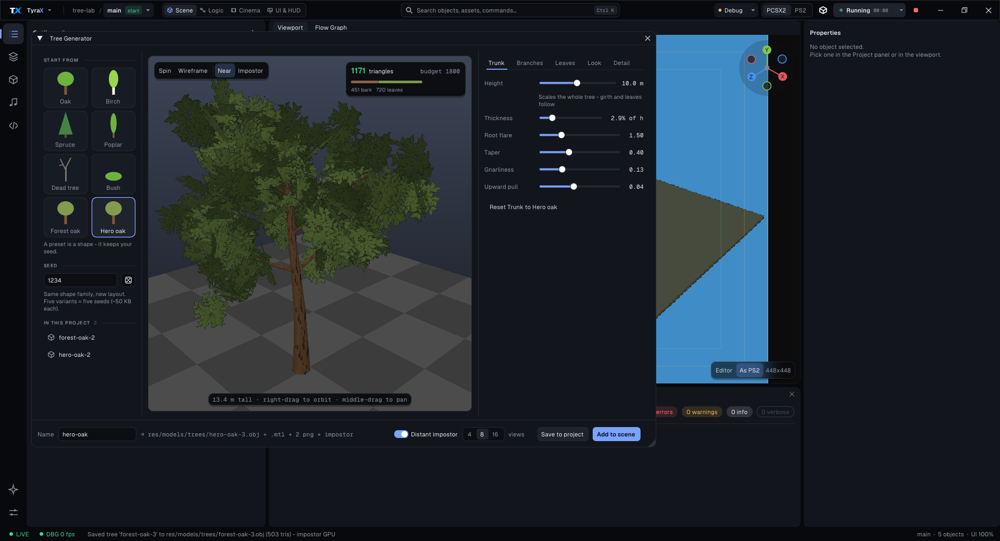
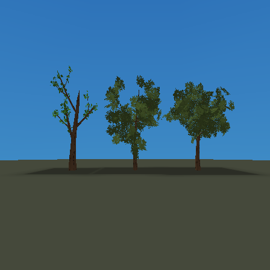

# Tree Generator

*Tools > Tree Generator* authors low-poly trees procedurally and bakes them into
the project as ordinary assets. Inspired by [EZ-Tree](https://github.com/dgreenheck/ez-tree)
(MIT), reimplemented host-side in `src/treegen.cpp`.



The generator exports ordinary OBJ/MTL/PNG assets. **Distant impostor** also
captures 4, 8 or 16 views (the segmented control beside it) for a two-triangle
camera-facing card and assigns that far model to the inserted object. See [Distant foliage impostors](impostors.md) for distance
controls, approximation limits and runtime costs.

## Blender-baked broadleaf sprays

**Forest oak** and **Hero oak** use **Leaves > Foliage > Baked broadleaf**:
an orthographic Blender capture of a branching spray with 90 folded leaves.
The folded blades supply shading and irregular silhouettes; muted green/brown
tones avoid the bright, oversized-leaf look. Both colour controls still work.
The forest preset spends fewer triangles on wood and uses larger sprays;
the hero preset adds branches and smaller, more numerous sprays for a landmark.
These are starting budgets, not a guaranteed instance count or frame rate.

At the default seed (1234):

| Preset | Wood triangles | Foliage triangles | Total |
|---|---:|---:|---:|
| Original Oak | 336 | 260 | 596 |
| Forest oak | 223 | 280 | 503 |
| Hero oak | 451 | 720 | 1171 |



The comparison uses a frozen camera and the ordinary native PS2 build pipeline.
The hero is scaled to 70% for a similar on-screen size. This verifies rendering,
not dense-forest frame time on hardware. Editor build, preset selection,
save/reopen, deterministic output, height scaling and binary alpha were also
checked. The original presets matched their prior mesh/texture hashes across
three seeds each.

Each spray remains one two-triangle card and one 128-square hard-cutout
texture. The capture covers about 36% of the card; transparent pixels still
cost raster work. Use distant impostors and control visible instance count.
Increasing Count or Size thickens the crown but also increases alpha overdraw.
The new style distributes even a small card budget across the entire crown,
sampling along branches independently of their tube tessellation.
The original six presets and existing `.tree` recipes retain their old output.

The editor embeds the baked tone stamp, so installed builds need neither
Blender nor external source images. To regenerate it with Blender 5.1:

```sh
blender -b --factory-startup --python tools/bake-tree-foliage.py
```

Append `-- --blend /absolute/path/foliage.blend` to save an editable source
scene. The script produces `assets/tree/broadleaf-source.png` and
`src/tree_foliage.inc`; commit both when changing the source geometry.
The geometry is original to this repository, with no third-party texture input.

## Host-only generation, ordinary PS2 rendering costs

The generator is a **host-only module** (the `stochtile` / `matbake` /
`decalproj` pattern): no GL, no `Project` dependency, pure functions over a
`Params` struct. Generation happens in the editor; the console only ever loads a
static mesh with two materials.

The static pipeline already alpha-tests and
alpha-blends material textures, so leaves are the classic textured cards. The
leaf PNG bakes **hard binary alpha** (0 or 255) on purpose — the engine's
tRNS→CLUT path loses a soft gradient, and a hard cutout is what the era did
anyway. Opaque colors are dilated into the transparent margin so bilinear
sampling never rings a dark fringe around a leaf.

## Determinism

Everything is a pure function of `Params`, and `seed` drives every random draw,
so the same knobs always produce byte-identical output. Consequences worth
knowing:

- **"Five oak variants" is five seeds**, not a mesh library — a generated tree
  is ~50 KB of `.obj`, so variants are cheap to keep in the project.
- Each branch derives its own RNG stream from `(parent seed, child index)` via a
  splitmix mixer, so nudging one slider does **not** reshuffle the whole tree:
  siblings and their subtrees keep their shapes. Without this, every drag of
  "Trunk sides" would regenerate a different tree and the tool would feel random
  instead of adjustable.
- **Roll** re-seeds (same shape family, new layout); switching **Preset** keeps
  the current seed, because a preset is a shape, not a dice roll.

## The poly budget

The whole point is trees that fit a PS2 frame, so tessellation is explicit
rather than emergent. Radial sides and length rings **interpolate from the trunk
values down to the `*Min` values on the outermost branch level** — the trunk
gets 6 sides, twigs get 3, and detail lands where it reads.

The original six presets land at **437–1440 triangles** each (measured, see PROGRESS).
Spruce is the expensive one by nature: a conifer's look IS its bough count, so
it spends ~50 short tubes plus 300 needle cards where a broadleaf spends a
dozen big branches.
The window shows a live triangle count, green under 1800, amber past it, red
past 3000 with a nudge to trim — advisory, never blocking.

A generated tree is an ordinary static model, so it rides the `.tmdl` pipeline
like any other: the build compiles it to binary and can bake distance **mesh
LOD** tiers for it (see [model-pipeline.md](model-pipeline.md)). Keeping the
source mesh light still pays — LOD thins the distant draw, not the near one.

Practical ceiling is **instance count, not tree cost**: models don't join static
batching (only primitives do), so every tree is its own draw bag. The optional impostor reduces distant triangle work, but each instance still
has a draw bag; dense forests must budget both draw calls and alpha overdraw.

## What the UI gives you

Three columns and a footer:

- **Start from** (left): the eight presets as silhouette tiles in their own
  colours, then the **Seed** with a dice button (**Roll**). Below them, **In
  this project** lists the trees the generator already saved; clicking one
  loads its parameters back (see *Re-opening a tree*).
- **The tree** (centre), framed to its own height so the crown fills the view:
  right-drag to orbit, middle-drag to pan, wheel to zoom, double-click to reset. The pill top-left holds
  **Spin** (the turntable), **Wireframe** (the tessellation) and **Near** /
  **Impostor**: Impostor shows the distant card the bake would make (captured
  on the CPU, the view the turntable faces, 128 px) - what players see past
  six tree heights. The card top-right is the budget: triangles against 1800,
  split into bark and leaves.
- **Parameters** (right) on five tabs: **Trunk**, **Branches**, **Leaves**,
  **Look** and **Detail**. Each tab ends in *Reset <tab> to <preset>*, which
  puts only that tab's values back to the preset the tree started from.
- **Footer**: the **Name** (it follows the preset - `oak`, `birch` - until you
  type one), the files a save writes (`res/models/trees/oak.obj + .mtl + 2 png
  + impostor`; a name already taken becomes `oak-2`), the **Distant impostor**
  switch with its view count, **Save to project** (write the asset without
  placing it) and **Add to scene** (write it and place a Model object).

The preview renders from the **in-memory** mesh and textures — nothing touches
disk or the shared asset caches until you add — so slider drags stay instant.
It renders into its **own framebuffer**, not the Material Editor's: both tools
can be open at once and size their previews independently.

Parameter groups: **Trunk** (height, thickness, root flare, taper,
gnarliness, upward pull), **Branches** (crown architecture, levels 1–4,
children per level, tilt + jitter, length/radius ratios, spawn start),
**Leaves** (count, size, aspect, how many outer levels get them, foliage
style), **Look** (bark style, four colors) and **Detail** (the
poly-budget levers above).

Presets: **Oak**, **Birch**, **Spruce**, **Poplar**, **Dead tree** (no leaves),
**Bush**, **Forest oak**, **Hero oak**.

### Re-opening a tree

Every save also writes `<name>.tree` beside the `.obj`: the generator's
parameters (seed, preset and every slider) as JSON. It is editor-only - the
build never ships it - and it travels with its model when the Asset Browser
moves or renames it. **In this project** in the left rail lists these trees;
clicking one loads its parameters and name back. Saving again writes a new
variant (`oak-2`) rather than replacing the old files, so copies already placed
in a scene never change under you.

### Height is the tree's size

Everything with a world dimension — trunk radius, leaf card — is a **fraction
of height** (the sliders read as `% of h`, with the resulting world units in
the tooltip). So dragging Height scales the whole tree, which is what you
expect from a size control. Absolute radii did the opposite: a taller tree kept
its old girth and turned into a pole, a shorter one into a stump.

The **"too small to bother" cutoffs** that drop a child branch are fractions of
height for the same reason. As absolute sizes they made a small tree a
different tree rather than a smaller one: at height 0.5 a spruce lost whole
whorls to the cutoff and came out a pole with a skirt, while the identical
parameters at 20 kept everything — the slider read as two shapes with a jump
between them. The invariant to preserve when adding anything with a world
dimension: **the same parameters at two heights must produce the same mesh,
scaled** — same triangle count, same proportions, positions differing only by
the ratio.

### Crown architecture

**Spread** is the branching recursion: children spiral up every parent and the
shape emerges from the ratios. That is a broadleaf.

**Conical** is the conifer habit, and it is a different growth rule rather than
a preset of the same one — which is why no amount of slider tuning produced a
believable spruce before. The trunk runs unbroken to the apex (an *excurrent*
leader) and carries **whorls**: rings of boughs, each ring offset from the last
by the golden angle so they never stack into columns. Two things make the
silhouette, and neither is a per-generation ratio:

- **length follows a profile along the trunk** — longest low, vanishing at the
  apex. That profile *is* the cone. `Length ratio` sets the bottom bough, the
  falloff is fixed.
- **tilt sweeps with height** — lower boughs droop past horizontal, the ones
  near the apex sweep up. `Branch angle` is the tilt at mid-trunk.

Foliage differs too: a conifer needles the bough from the trunk outward (a
broadleaf clusters toward the tips), and cards spread over the **branch length
an anchor owns** rather than over the card size, so a low-poly bough with two
rings still comes out evenly needled instead of clumping at its ring points.
The leader is sampled at its own fixed rate for the same reason — foliage is
shared out per anchor, so hanging the apex off the trunk's few rings starved it
against the ~200 anchors down in the whorls.

Needle cards also lie **along** the twig and spin around it, instead of facing
a random direction like a broadleaf cluster.

Bark styles bake tileable procedural textures (rough ridges, birch lenticels,
cracked plates); foliage styles bake the leaf card (broadleaf cluster, needle
sprig, single blade).

## Files it writes

For a tree named `oak`, into `res/models/trees/`:

| File | What |
|---|---|
| `oak.obj` | the mesh, two `usemtl` groups (`bark`, `leaf`) |
| `oak.mtl` | the two materials, each with its `map_Kd` |
| `oak-bark.png` | tileable bark, 128² RGBA |
| `oak-leaf.png` | leaf card, 128² RGBA with a hard alpha cutout |

Positions and UVs are de-duplicated on exact bits (tube rings share most
corners — roughly a 2.4× smaller vertex list than raw triangle corners). A
bare tree (leaf count 0) writes no leaf material or PNG.

Adding a tree whose name is taken picks the next free `-N` suffix rather than
overwriting, so re-adding never clobbers an earlier tree that scene objects
still reference.

## The AMD driver crash this shook out (fixed)

Generated trees turned out to reliably trip a **GL driver bug** that predates
this tool: opening the Tree Generator, or adding a tree while the Material
Editor was open, killed the editor ~50-100% of the time — an access violation
(`0xc0000005`) inside `atio6axx.dll`, at the same fault offset every time.

gdb put it in `glTexImage2D` reached from `Viewport::glTexture`, with every
argument valid (128², RGBA8, power-of-two, non-null pixels). So the arguments
were never the problem — the single-call *form* was. Every RGBA upload now goes
through **`glUploadTexRgba()`** (`gl_loader.h`), which allocates the level empty
and fills it with `glTexSubImage2D`; that path does not fault. Verified 0/12
crashes across the three paths that previously failed 4/4, 3/4 and on every
attempt.

If you are adding a texture upload anywhere in the editor, use that helper
rather than handing pixels to `glTexImage2D` — see PROGRESS entry 101.

## Where the code lives

| File | Role |
|---|---|
| `src/treegen.hpp/.cpp` | `Params`, `generate()`, the two texture bakers, `writeAssets()`, `presets()` — host-only, no GL |
| `src/hud_ui.cpp` | `drawTreeGeneratorWindow()` (the tool), `rebuildTreePreview()`, `addTreeToScene()`, `openTreeInGenerator()`, the `.tree` sidecar |
| `src/treeimpostor.cpp` | `writeImpostor()` and `captureImpostor()` (the same capture, in memory, for the preview) |
| `src/viewport.cpp` | `renderTreePreview()` + its own framebuffer |

`addTreeToScene()` hands off to the existing `addModelObject()`, so naming,
selection and `commitChange()` behave exactly like any other model import.

**Distant impostor** uses offscreen GPU capture, with automatic CPU fallback. The
result status names the backend. See [impostors](impostors.md) for memory costs.
