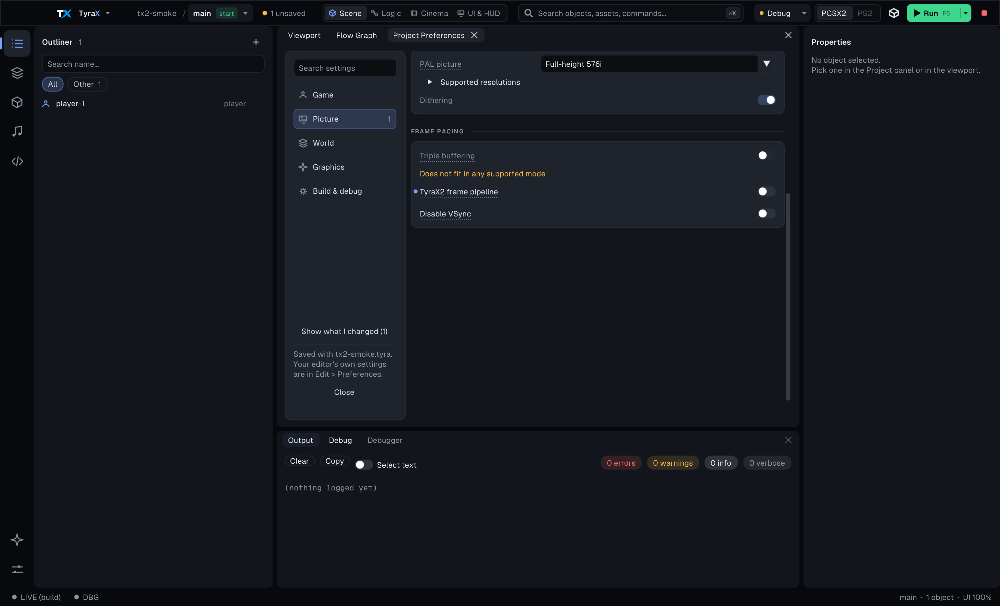
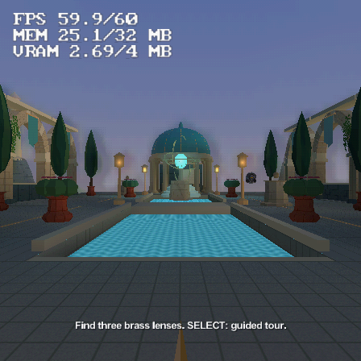
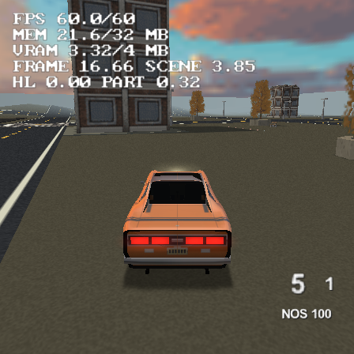

# TyraX 2.0

TyraX 2.0 combines the redesigned editor and the TyraX2 frame pipeline with the latest mainline collision improvements.

The integration branch is `codex/tyrax-2.0`. Its source heads are `origin/main`
(`45336c896`), `origin/claude/ui-redesign-foundation` (`08b691342`) and
`origin/codex/tyrax2-foundation` (`2c9a4d334`, then `def0086d3` for its
1.177.11-1.177.14 fixes and the critical-path/offline-world experiments). The six changes on the local
`runtime-b-tool-redesign` branch already have equivalent commits in the UI branch.

- [The redesigned interface](editor-theme.md) supplies the main window, workspaces, command palette and tool windows.
- [TyraX2](tyrax2.md) supplies ordered frame recording and the renderer improvements documented in its acceptance records. A pipeline request is distinct from effective overlap in compatibility modes.
- [Collision broad phase](collision-boxes.md) supplies the shared grid/octree queries and scene overrides. Camera sweeps combine that candidate query with the cached TyraX2 box tests.

Project Preferences keeps the redesigned five-page layout. The pipeline switch
is in Picture > Advanced; light receivers and static lamp baking are in Graphics;
the baked reflection background is in Graphics > Advanced. Game contains the
collision backend, and Scene Preferences retains its per-level override.

The editor identifies itself as **2.0.0** and writes project format **114**.
The format combines optional fields from branches that independently used the
same version stamps. TyraX2 is the default renderer: a project that never chose - a missing
`framePipeline` - gets it, and an explicit `false` is shown and kept as
*Renderer: Legacy*. No destructive migration
is needed; [format versioning](format-versioning.md) explains the gates.

This branch prepares a release candidate. It does not create a release tag or
publish installers. Historical PS2 measurements remain scoped to their original
fixtures and builds; they are not universal 2.0 performance guarantees.

The host verification scripts lift the current generated functions. Their
stubs include reflected batch/lamp fields, and terrain-focus extraction ends
at the streaming block rather than assuming reflection capture follows it.

## Integration verification

The combined editor builds on macOS. All 44 bundled examples regenerate
successfully. `--vu-check`, the static-batch twin oracle and terrain-focus host
checks pass. The two host scripts were updated for current generated fields,
the moved reflection code and macOS dynamic linking.

Five compatibility fixtures cover missing pipeline requests from formats
94/95/96 and explicit on/off requests from format 113. They preserve the
pipeline choice, octree backend, scene overrides and Outliner visibility;
a second resave is byte-identical and every saved manifest reports 2.0.0/114.

A real UI script opens Picture > Advanced, asserts the initial pipeline
request, switches it off, asserts the result and saves it. The screenshot below
shows that state. A native FPP terrain project with the pipeline requested and
the octree backend builds and boots in PCSX2's software renderer, accepts a
Remote Pad script and returns a GS frame capture without an assertion. Two idle
captures differ by 0 pixels, the turn changes 75,503 pixels, and two captures
after releasing the stick again differ by 0 pixels.

These checks qualify this integration on macOS. Windows/Linux builds, physical
PS2 integration and installer/update qualification remain release work in the
[backlog](backlog.md).

## Showcase and Motor District smoke checks (2026-10-22)

Both examples were copied to short `/tmp` paths and built natively from the
2.0 branch. The authored debug profile, progressive display and enabled
TyraX2 request were retained. Each ran separately in PCSX2 2.8.2 with the
software renderer and an isolated emulator configuration.

- **Showcase:** booted through the arrival film, then accepted right-stick look
  and left-stick walking. GS captures at frames 753 and 987 show the changed
  viewpoint; the debugger reached frame 1929 without a halt or crash report.
  The log reports a one-frame DynamicMesh warning and repeated music-ring
  starvation warnings (1–5 per five-second reporting window). Audio quality
  is not qualified by this smoke check; the underruns remain open.
- **Vehicle playground:** booted seated in the Ravager. A fresh seated run
  used R2 to accelerate, the left stick to steer and L2 to brake. Telemetry
  moved from `(-119, 0)` to `(-51, 9)`, reached `spd10 215`, changed heading
  from 89 to 69 degrees and returned to `spd10 0`. A frame capture and
  debugger heartbeat confirm the run continued. No warnings, assertion block
  or crash report appeared in this run.

The first vehicle input probe used Cross (nitrous) and Square (exit), rather
than the example's R2/L2 bindings. It confirmed exit but did not prove driving;
the fresh seated run above supplies the driving evidence. These are functional
emulator checks, not physical-console performance or audio-quality claims.

