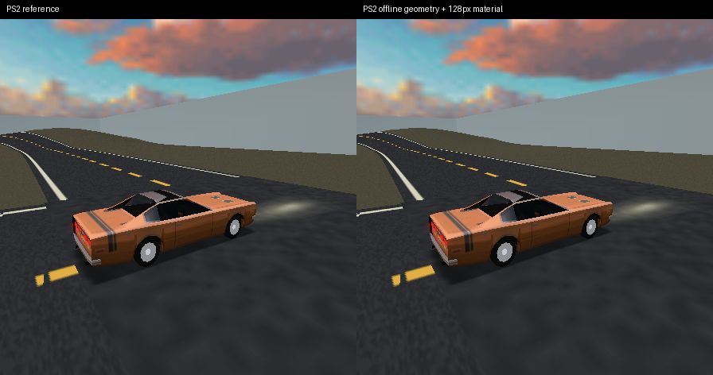

# Offline world compilation experiments

These private experiments investigate exporting terrain LOD geometry and composing static terrain materials before gameplay, rather than producing the same work on the EE during a drive.

The experiments are not production defaults. Terrain and material changes need independent controls and a combined comparison; a smaller command stream alone is not evidence of faster frames.

## Terrain bootstrap

`tools/tyrax2-offline-terrain-fixture.py OUT QUALIFIED_AUDIO_EVENT_FIXTURE` creates a separate, source-bound initial-daylight dump fixture. The original native terrain producer enumerates every effective own-LOD and neighbouring-edge combination for every chunk, independent of the later driving route. It exports positions, colours, texture coordinates, lifted shadow geometry and bounds. It then stops before normal rendering.

This is an arithmetic oracle for developing the offline format. It deliberately uses the original target producer in an emulator; it is not yet an editor-side exporter. The source fixture's static daylight contract excludes painted layers, AO, emissive maps and probes. A separate material workload must contain active layers rather than claim savings from inactive passes.

The host compiler must preserve strip padding, seam interpolation and all active source bytes. The original producer may retain an unused `gsCols` allocation after its shadow geometry disappears; only that explicitly inactive stream is canonicalised to empty. The raw oracle input remains intact. Factor common interiors and independent edge changes rather than keeping a complete chunk for every neighbour combination. Actual DMA readers must retain old sources through replacement. Offline storage size, resident RAM, cold loading and moving replacement cost must be reported separately.

`tyrax2-offline-terrain-compile.py SOURCE OUT` validates the complete input/footer, all keys and effective neighbour coverage, then factors base LOD streams and independent sparse edge patches. It reconstructs every captured variant exactly, rejects conflicting corner edits, and exercises truncated, trailing, bad-magic and bad-version input controls. The initial 25-chunk fixture contains 75 base LODs and 1370 effective variants: 43,171,488 active stream bytes become a 1,312,292-byte file, including 4406 changed edge words. This is format size, not bandwidth or FPS.

`tyrax2-offline-terrain-price-fixture.py OUT QUALIFIED_AUDIO_EVENT_FIXTURE COMPILED` integrates a private owned-array restore path. Cold loading is common to both roles. Six native producer comparisons and held-arm reconstruction retain the original material bindings, strip layout, shadow subsets, stamps, queue reader ownership, live reflections and presentation. The new data tables are not queued as borrowed DMA memory. The initial hidden-emulator run passes 54 held images, 3942 pose rows and all six native producer oracles; each moving On phase restores 93 replacements without fallback. The first physical run rejects at the native producer oracle before pricing. Its failure must not be converted into a timing result or waived as a rounding tolerance.

The diagnostic follow-up and a complete physical bootstrap find identical bounds and all geometry, UV and shadow streams across all 1370 emulator/PS2 variants. The colour streams differ in 627,816 words, at a maximum bit-pattern distance of two. This observes a platform arithmetic difference without diagnosing its source. The corrected protocol keeps separate explicitly pinned emulator and physical bootstrap assets; `--ps2-compiled PS2_COMPILED` declares them, and `tyrax2-offline-terrain-stage.py FIXTURE FRESH_ATTEMPT` stages the physical asset. Both platforms still require exact original/prepared producer comparisons. Same ELF does not imply identical cross-platform asset bytes, and this is not a finished portable host colour exporter.

`--current-producer` takes the current checkout's builder into the common fixture, including existing shade reuse, per-layer constants and once-per-slot diagnostics. The inherited fixed drive, residency and renderer fixture remains a controlled experiment, not the full current production checkout. The prepared producer uses stored bounds and does not repeat a diagnostic triangle walk or regenerate constant shadow colours. Its native capacity accounting is 1,345,264 bytes excluding allocator overhead, plus ordinary restored arrays and compiled cells. The first attempt to import the current builder accidentally included an adjacent helper and is retained as a rejected build, with no runtime or timing claim.

## Static material composition

The qualified daylight driving scene has no painted layers or AO/emissive terrain map. It does have separate lifted ground-shadow subsets, so the material prototype composes the repeating ground texture and these active static shadow masks. It does not claim a gain from inactive layer passes.

`tyrax2-terrain-material-compose.py BIN OUT --resolution 128` produces 18 indexed chunk textures, with an accounted texel/CLUT payload of 313,344 bytes. A chunk spans 64 world units and repeats its 64-pixel tile 32 times: preserving that source frequency requires 2048 pixels per chunk and a separate GS texture-subdivision scheme. The 128-pixel experiment has 16 source texels per output texel in each axis. Even before filtering/quantisation, the original shadow's nonzero colour is added after vertex shading, whereas a composed material is shaded with the base. This is an explicit appearance trade, not equivalent rendering.

`tyrax2-terrain-material-fixture.py OUT OFFLINE_PRICE_FIXTURE MATERIALS [--terrain]` tests that trade with ordinary or prepared terrain common to both roles. `--terrain-with-material` instead compares the full reference against both changes together. Composed textures load outside recording, are bound to the current scene generation, and join the normal reserved world-texture set. The candidate changes base ST/texture and removes the matching shadow bag before world-cell compilation. The reference retains the original repeating texture and lifted subset. Fresh original/compiled producers are compared within the selected quality mode, and held controls must return to identical pixels. Use `verify-world-cell-price.py ... --quality-trial` explicitly; its protocol result cannot grant equivalent-output or visual acceptance.

The standalone material hidden-emulator protocol completes six trips with 54 endpoint captures and identical poses. One recorded main endpoint differs in 3980 pixels, with mean absolute RGB error 0.04886 and maximum channel error nine. This selected view does not qualify close-up detail, every point on the moving route or general material equivalence.

## Acceptance

Automated emulator runs use an invisible WSL/Xvfb session. Host compilation and native byte comparisons precede physical tests. Exact terrain image/pose/owner gates remain in force; a material composition may require an explicitly reviewed visual difference because texture filtering and quantisation do not generally commute with pass composition. Physical controls must price each change and their combination in the same ELF, retaining scene quality, reflections and presentation mode.

## Physical results

All three private comparisons now complete six source-bound physical trips and their hidden-emulator controls. Each platform/trial retains 3942 exact pose rows, 54 held main/environment/Hybrid2-display captures, live capture/paint workload equality and actual producer comparisons. Terrain images are exact across roles. Material and combined runs explicitly compare changed appearance, retain exact returning controls and do not grant visual acceptance. Source, logs, assets and reports were revalidated after the owned processes stopped; the [sealed machine report](tyrax2-offline-world-2026-10-20.json) records the inputs and limits.

| Candidate | Mean non-pacing saving, forward / reverse | Physical On presentation | Missed refreshes per 537 moving frames |
| --- | --- | --- | --- |
| Offline geometry and seams, current builder common | 0.057107 / 0.046389 ms | 59.278 Hz | 6 / 6 / 6 |
| Composed ground and static shadows, inherited builder | 0.319158 / 0.285163 ms | 59.497–59.607 Hz | 3 / 3 / 4 |
| Offline geometry plus composition, current builder common | 0.376389 / 0.342656 ms | 59.497–59.607 Hz | 3 / 4 / 4 |

These are same-ELF net elapsed comparisons within each row, including remaining waits and scheduling; do not add gains or compare absolute times across rows. None sustains every refresh in the measured drive. The terrain and combined fixtures import the current builder, while retaining the earlier fixed drive/residency/renderer harness. The standalone material row predates that common builder refresh. None is a pristine full-current-production, variable-dt, all-view or night performance qualification.

The offline data remains about 1.35 MB of additional native capacity, excluding allocator overhead. Original arrays and final world-cell bodies remain resident too. The source-to-SDK/body compiler still executes on replacement (approximately 0.57 ms elapsed per replacement in this run); this experiment removes geometry/shade/seam generation and redundant scans, not the final packet compiler. The [final-VIF follow-up](tyrax2-offline-vif.md) tests that next boundary with live material/VRAM heads. A full production offline VIF format with relocatable material state remains separate work.

The measured prototype is therefore not a large FPS gain on this workload. Do not promote the extra terrain storage as the primary 60 Hz solution or tune its edge patches for another small saving. Composition is a separate, modest quality/performance trade with close-up appearance still unqualified. The console remains powered, all owned test servers/emulators have stopped, and production defaults remain unchanged. The bootstrap is not a completed editor exporter.
