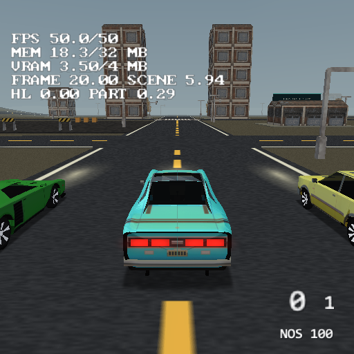
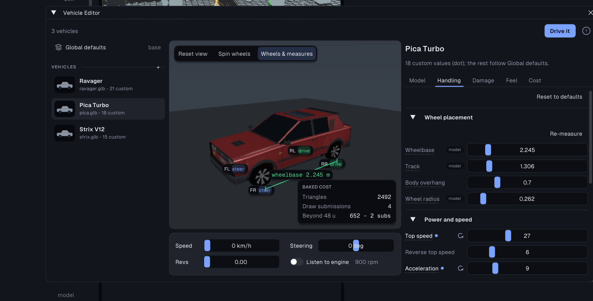
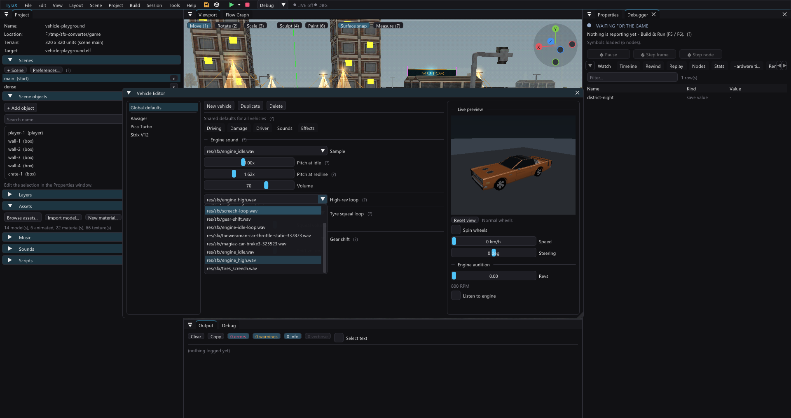
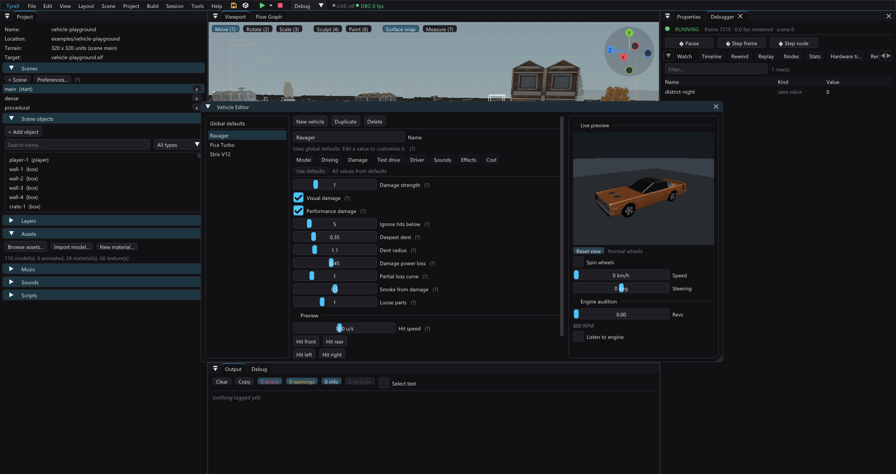
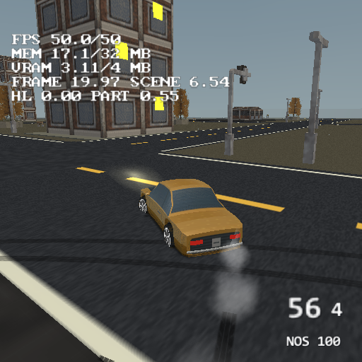
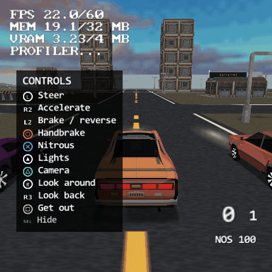

# Vehicles

Create a vehicle definition in **Tools > Vehicle Editor**, assign an imported
model, then place instances in scenes. Walk up to a driveable vehicle, look at
it and press **Use** to enter; press it again to exit. The same definition can serve many
placed cars. [The Blender tutorial](blender-vehicle-modeling.md) covers making
and exporting a model from scratch. [Motor District](../examples/vehicle-playground/README.md)
is a playable example with three editable Blender cars.

[Dynamic light receivers](dynamic-light-receivers.md) can keep live light on
the driven vehicle's body, glass and wheels while excluding parked/traffic cars.

A placed vehicle whose definition has no ID or model path is skipped. If no
usable definitions remain, generated code keeps a complete inert placeholder
(including both engine sound layers and the controls card fields), so an
incomplete vehicle setup still compiles.

## Importing a model

Import a `.glb` into `res/models/`, then select it on the Vehicle Editor's
**Model & cost** tab. Keep four separate, similarly sized wheel mesh objects with
their origins at the hubs. The importer detects them by shape and position;
the wheel table lets you mark each one **Steered** and **Driven**. Check the
measured wheelbase, track and radius. Use **Flip front/rear** if it guessed the
nose incorrectly. Re-export from Blender when geometry or UVs are wrong.

Give lamps materials named `headlights` and `rear lights`; use `glass` or
`window` for glazing. A single compact body atlas and few materials reduce
PS2 draw submissions. The default body budget is 2400 triangles; roughly 160
per wheel is a useful target. The **Model & cost** tab reports the actual baked
triangles and submissions. Models with an interior can use translucent glass.

For traffic and distant cars, assign a **Far model** on the Model & cost tab. Export it
in the same coordinates and with the same atlas as the full model. The Model & cost tab
also sets the full-to-far distance and the separate distance for parked and AI
cars. An optional fast-wheel model replaces all four wheels above the authored
spin threshold. The full model remains the source of wheel positions and
handling geometry.

### Changing body paint colour

For a textured body, make a grayscale PNG with exactly the same dimensions as
its atlas: white where paint should change, black on glass, lamps, wheels and
trim. Select it as **Paint mask** in the Vehicle Editor. The mask is applied
during baking and can be overridden per placed vehicle. An untextured model
can instead use a material whose name contains `paint`.

## The Vehicle Editor

The window is three columns: the vehicle list, the **live preview** in the
middle, and the settings. The list starts with **Defaults** (the base every
vehicle follows - "base for 3 vehicles"), then each vehicle with a silhouette
in its paint colour and how much of it is its own ("all from Defaults",
"8 own - 63 from Defaults"), with the own-value count as a badge; a vehicle
made before Defaults existed reads *legacy*. **+** adds a vehicle, right-click
one for *Duplicate* and *Delete*.

### Defaults and own values

The top of the settings says **which values you are editing**: *Editing:
Defaults | <vehicle>* switches between the project-wide Defaults and the
selected car, and a line under it says how many of the car's values are its
own. In Defaults there is no switch - the list on the left goes back to a car.

Every tuned value is a row of three columns - caption, control, and a fixed
**state slot** on the right, so nothing is drawn over a caption:

- **follows Defaults**: the row is dimmed and the slot reads *Defaults*;
  hovering the row turns it into **Make own**, and editing the value does the
  same;
- **own**: full ink, an **Own** pill, a grey tick on the slider at the
  Defaults value, and a revert button (its tooltip names the value it goes
  back to);
- **measured from the model** (wheel placement): a *Model* pill, and
  **Re-measure** takes the model's numbers back;
- **waiting on another value** (a pitch with no sample, the high-rev loop
  switched off): faded, with the reason in the slot instead of disappearing;
- in **Defaults** the slot shows who follows: a square per vehicle in its
  paint colour, filled when it follows and outlined when it has its own -
  click it for the list and a **Follow** per vehicle.

**Reset to defaults** at the top of a tab resets every own value of that
section; **Show: Own only** hides everything that follows. A legacy vehicle
gets one banner and one button, **Adopt Defaults**, which keeps the values
that differ as its own and lets the rest follow. Model, wheel geometry,
paint, the body's shine and glass, LOD and exit offset stay local to each
definition.

| Tab | Main controls |
|---|---|
| Handling | Wheel placement (measured), power and speed, steering and grip, road surfaces, suspension, gearbox, nitrous, fast wheel swap - each a collapsible section |
| Engine & sound | A pitch-against-revs chart (idle loop, high-rev loop over its crossfade band, the Defaults curve dashed), then Idle loop, High-rev loop, Tyre squeal and Gear shift - each sample picker shows the file's length and size |
| Camera & HUD | Cameras, HUD, controls card, exit position |
| Damage | Visual and performance damage, dents, loose parts, power loss and test hits |
| Look | Paint, body shine, reflection map and glass (this vehicle), then headlights, skid marks, tyre smoke, lamp glow, speed feel and exhaust |
| Model & cost | Model, the import summary, front direction and the wheel table, then triangle budgets, submissions, fast wheels and far model |

Each tab shows how many of its values are the car's own.

The **live preview** uses the baked body and wheels. Right-drag to orbit,
middle-drag to pan, scroll to zoom. Its overlay has **Near | Far** - *Far* shows the far tier the console
swaps to past the far distance: every tiered part at its first tier, the
wheels baked in (no wheel meshes), the parts an authored far model hides left
out; disabled when the car has no far tier or a damage test is showing -
*Reset view*, **Spin wheels** and **Wheels & measures**,
which tags each wheel with its position and role (FL *steer*, RL *drive*...)
and draws the measured wheelbase under the car; hovering a row of the Model
tab's wheel table rings that wheel. The **Baked cost** card (triangles, draw
submissions, the far tier) stays visible whatever tab you are on. Under the
preview, **Speed**, **Steering** and **Revs** scrub the pose and the engine;
**Listen to engine** auditions the current sound tuning without driving the
game. The Damage tab can apply test hits and repair the preview.

**Drive it** is hidden in 2.0 (`kShowDriveIt` in `vehicle_ui.cpp`; the
simulation behind it stays). When shown, the green button, top right, drives the first placed instance of the vehicle in the
active scene with the same simulation the console runs (W/S/A/D, Space, E);
the card under the preview then shows the telemetry, and *Stop driving* puts
the car back where it was. With no instance placed the button is disabled and
says why.

## Driving and handling

The drive model uses wheelbase, steering, grip, suspension and weight transfer.
**Acceleration** sets low-speed pull; **Power fade** reduces pull toward top
speed, so the final-gear redline takes a long straight to reach. Nitrous adds
power and allows speed above the ordinary cap. **Has nitrous** enables a tank;
**Nitrous seconds** and refill control its use. Off-road acceleration and grip
can be set separately from road handling, while road materials and painted
terrain layers supply their own grip multipliers.

The gearbox derives engine RPM from driven-wheel speed and gear ratios.
**Shift up at**, **Shift down at**, **Shift time** and **Gear torque character**
control its presentation and power interruption. Wheelspin raises RPM without
raising road speed. Vehicles can drift under handbrake grip and slide against
walls rather than stopping on a glancing contact.

### Rev limiter

**Rev limiter** (Engine and gears, 0 = off, the default) makes a flat-out
engine bounce off the redline: the note dips and climbs back
**Limiter bounces** times a second, quieter in the dip, like a fuel cut. It
engages with the throttle above half, the engine past 96.5% of the idle to
redline range, not mid-shift and not on nitrous (nitrous over-revs the final
gear on purpose). The 96.5% is there because drag and the power fade hold a car
on the level at about 98% of its top speed, never 100%. The box changes up
before the redline in every other gear, so in practice that is the final
gear near top speed. The depth is the dip: 1 takes off
15% of the rev range. It changes only the sound and the RPM readouts, never
the car's speed. **Listen to engine** with **Revs** at the top of the slider
plays it. `vehiclesim::revLimiterStep` and the runtime's
`vehRevLimiterStep` are twins.

A held handbrake locks the driven wheels: the throttle drives nothing while
it is held, and the car slides against its whole ground velocity at 0.4x
*Brake decel*. From top speed on the default tuning it rests in about 20
units, gas or no gas. A flick (pull, steer, release, throttle) still throws
the rear out into a drift. Before 1.162.2 gas plus handbrake out-accelerated
the handbrake and the car skated on for hundreds of units (`--vehicle-check`
now pins this).

| Default control | Action |
|---|---|
| Square / Use | Enter or exit |
| R2 | Accelerate; brake when rolling backwards |
| L2 | Brake, then reverse once stopped |
| Left stick X | Steer |
| Circle | Handbrake |
| Cross | Nitrous |
| D-pad up | Headlights |
| Triangle | Cycle chase, bumper and far cameras |
| Right stick | Glance around and raise or lower the camera |
| R3 | Hold for rear view |

Throttle and brake read DualShock 2 pressure; digital sources use full input.
Actions can be rebound in the [Input Map](input-bindings.md). The Driver tab
sets the camera rig and door-side exit offset. Exit placement automatically
keeps the player's capsule clear of the car's side even when the authored
offset is too close; both Use and the Exit Vehicle flow node use it. When the
door opens into another car or a wall, the player is placed further out, on
the other side, behind or in front - the first spot clear of every collision
box (a walker that starts inside a box cannot move until it jumps out). The
log line `VEH exit spot N` names the spot taken (0 = the door, -1 = none was
clear, so the door spot stands). Chase and far cameras shorten their boom
against terrain and obstacles. The bumper camera is bolted to the body: it
takes the drawn pitch, roll and lean, sits just past the front bumper (the
baked `bodyOverhang`), is kept above the ground surface under it, and follows
the body's pitch a beat late so a rough road does not shake the horizon. It
never rolls.

Use enters the car you are **looking at**, not just the nearest one: it must
be in reach (1.2x wheelbase + 2 units from the player) and under the camera's
aim - a car whose footprint the aim crosses wins, otherwise the car closest to
the aim within 45 degrees. The prompt follows the same choice, so with two
cars side by side it shows only for the one Use would enter.
`TerrainGame::vehicleUseTarget` is that one decision.

### AI drivers and flow graphs

Assign a vehicle a waypoint route to make it drive itself. AI uses the same
handling, surface grip and collision model as the player, with steering and
speed planning for bends and other cars.

The Player flow nodes **Enter Vehicle**, **Exit Vehicle** and **Repair Vehicle**
seat, release or repair the player without a pad press. Enter Vehicle can seat
the player from anywhere, including at scene start. Repair Vehicle restores
the body and performance. These nodes are handled in the generated game.

### The static collider grid

Every car's wall, floor and push-body tests read one per-frame list of the
scene's colliders (`buildVehicleColliders`). It used to be rebuilt from every
runtime object each frame and then scanned whole by every car, although almost
nothing in it moves. Now the build flags the objects nothing can move
(`SCENE_STATIC_COLLIDER_TABLES`, the inverse of `project::objectRuntimeMovable`:
no physics, no flow-graph or script reference, no layer, no pickup, no save
state), and the game places those **once** into a cell grid. Each frame only the
rest - vehicles, physics bodies, scripted props, the spawn pool - are derived
again, and a car walks just the grid cells its reach can touch plus that short
dynamic list.

The list every consumer reads keeps the same entries in the same object order,
and a car's candidates are sorted back into that order, so each cap (12 walls,
8 floors, 8 bodies, 4 mesh props) fills exactly as before. A static object is
still guarded every frame by the flags at the tail of its `RuntimeObject` - one
cache line: a dirty flag or a visibility flip re-places the static half, a spin
or the matrix path demotes the object to the dynamic half for good, and a
rebuild that consumes a dirty flag later in the frame
(`rebuildObjectGeometry` raises `g_colStaticRebuilt`) re-places it on the next
step. What is not followed is a global script writing a static object's
position without setting `dirty`; the renderer does not follow that either.

`TYRA_VEH_COLLIDER_GRID` (0 = the old full walk) is the A/B knob, and
`TYRA_VEH_COLLIDER_GRID_VERIFY` the oracle: every merged list and every gather
is redone by the full walk and compared to the byte, logged as `VEHCOLGRID`.
On the Motor District in PCSX2 (78 entries, 68 static, 10 dynamic, 64x64
cells) it compared 0 mismatches over the whole rig drive, plain and with two
sub-steps forced every frame (where `VEHSUBSTEP` checked the recorded
candidates the same way). On the physical PS2 (one ELF, the grid switched per
cycle, 6 cycles an arm) the vehicle update fell from 0.52 to 0.36 ms parked
and 0.58 to 0.42 ms driving, frame work -0.10 to -0.16 ms in the driving
windows ([night EE notes](tyrax2-night-ee-2026-10-12.md), "Static collider
grid").

### Headlight pools

A car's headlight pool is a 3x3 cell patch laid on the ground ahead of it. It
is rebuilt whenever the car moves, and each rebuild asked `groundSurfaceAt`
(a road and junction search) for 16 lattice heights - per moving car, per
frame. `TYRA_VEH_POOL_PLANE` (off by default until priced on a physical PS2)
takes the heights from the plane the car's four wheel contacts measured this
step (`v.wheelY`), a multiply-add each, falling back to the searched surface
when a wheel is off every surface. The trade: a pool reaching past a crest or
off the road edge follows the car's plane instead of the ground there.

The searched pool crosses the road's edge step (0.12 over the terrain) with
cells as wide as half a metre, and a cell with corners on both sides used to
dip under the asphalt just past the edge - a dark hole in the beam while
driving along the verge. `liftLatticeOverRoadStep` (1.177.2) raises such
corners to the road step; blob shadows and lamp pools share it. Details and
the measurement: [roads.md](roads.md#beams-and-shadows-at-the-road-edge-11772).

## Sounds

Choose an imported WAV for **Idle loop**. Its pitch moves from **Pitch at idle**
to **Pitch at redline** as RPM rises, including the first pull away. The
optional **High-rev loop** fades in from **High-rev starts at** and has its own
start and end pitch. Uncheck **Enable high-rev loop** to play only the idle
recording across the whole range without losing the selected high-rev sample
or its settings. The Sounds tab also sets volumes, tyre squeal and gear shift.

Use short, clean, steady-RPM loops; the build encodes continuous roles as
looping PS2 audio. **Listen to engine** under the preview follows the same pitch
and crossfade controls. The preview uses host audio, while the game plays the
encoded samples on SPU2.

## Damage

**Damage strength** sets how much a qualifying collision hurts; zero disables
damage. **Visual damage** independently controls dents, loose parts, broken
lamps, impact dust and engine smoke. **Performance damage** independently
controls lost acceleration and top speed, nitrous lockout and immobilisation
at a full wreck. If both are off, impacts do not increase the damage meter.

**Ignore hits below** filters small speed changes. **Deepest dent** and
**Dent radius** shape body deformation; **Loose parts** allows authored
bonnets, doors, boot and glass pieces to break away. **Damage power loss** sets
the maximum partial loss, and **Partial loss curve** decides when it arrives:
1 is linear, below 1 hurts sooner, above 1 preserves power until later damage.
With performance damage enabled, a fully wrecked car cannot drive until
repaired. The HUD shows damage when relevant.

## Effects and display

Headlights project pools onto the ground; lamp glow follows the authored lamp
materials. Skid marks and tyre smoke respond to slip. Feel > Effects accepts
built-in effects, materials, or a particle-library smoke effect. **Body shine**
uses a reflection texture or the sky (with the city as boxes when *Reflect static
scenery as boxes* is on, and a flat-colour ground that costs ~2 ms less a turning
frame on the open road with *Reflect the ground as flat colour* -
docs/reflective-materials.md); translucent glass needs a useful
interior. **Speed feel** adds authored shake, blur, camera widening and nitrous
flames as speed rises. The Driver tab controls the speedometer and HUD scale.

### Controls card

*Feel > Driver > Controls card on entry* shows a short list of what to press the first
time the player gets into each car (each definition, once per boot). The card is
built while the game runs, so it always matches what is actually set up:

- every button glyph comes from the **current** binding of its Input Map action
  (`veh-throttle`, `veh-brake`, `veh-handbrake`, `veh-nitrous`, `veh-camera`,
  `veh-rearview`, `use` for getting out), so a preset switch or an in-game rebind
  changes the card too. A project without one of these actions shows the
  button the car falls back to;
- rows the car has no use for are left out: *Nitrous* needs a bottle
  (`nosCapacity` > 0), *Lights* needs headlights or a lamp part. An action bound
  only to a key has no glyph and is left out too;
- a row dims once the driver has tried it. When everything has been tried the
  card closes after a second; otherwise it stays for *Card stays* seconds.
  **Select** (shown at the bottom of the card) or getting out closes it at once.

Steering and looking around are the sticks, which no binding names, so they use
the `{{lstick}}` / `{{rstick}}` icons. Ticking the option adds both to *UI
Editor > Button icons* if the project lacks them (a missing icon reads as
`L-STICK` / `R-STICK`). The card uses the HUD font and sits at the left of the
screen inside the title-safe area; it is hidden with the HUD (*Set HUD Visible*,
cutscenes that hide the HUD). Stored as the definition's `"tutorial"` seconds
(format v94), inherited from the global defaults like other Driver settings.

### Exhaust pipes

The nitrous flame, the blue-orange pop on every upshift and a thin, constant
exhaust smoke come out of the model's **exhaust markers**: geometry-free nodes
(Blender empties) whose name starts with `exhaust` - `exhaust`, `exhaust.001`,
`Exhaust_L` all count, up to six per car. Put each at a pipe's opening; the
flame and smoke leave along the empty's arrow (Blender's *Single Arrow*, local
+Z), so rotate it to point out of the pipe. An empty left unrotated points
straight up, which the import reads as "out of the back"; tilt a real upright
stack a degree off vertical. Both `.glb` and `.fbx` work - the two exporters
store that arrow on different node axes and the bake reads each correctly. The
[Blender tutorial](blender-vehicle-modeling.md#4-mark-the-exhaust-pipes) shows
the steps.

A model with no markers keeps the old behaviour: two pipes guessed a quarter of
the track apart under the rear bumper, and one centred pop per upshift. The
Feel > Effects says which one a car has. **Exhaust smoke** (Feel > Effects > Exhaust)
scales the smoke, 0 switches it off; it puffs only from cars that are driven
(by the player or an AI route) within about 35 units of the camera, thicker on
the throttle, and shares the tyre-smoke pool, so it costs no draw submission.

## Build and verify

The editor bakes the imported model, paint, wheels and optional far tier, then
generates the vehicle definitions and runtime for the PS2 project. Build the
project and inspect the car from behind, beside the wheels, at night and at a
distance. Drive it over roads and terrain, test entry and exit, then audition
engine pitch across the RPM range. The Vehicle Editor's preview catches many
geometry issues before a game build; the generated game is the final check.

For the example's source assets and build steps, see [Motor District](../examples/vehicle-playground/README.md).
