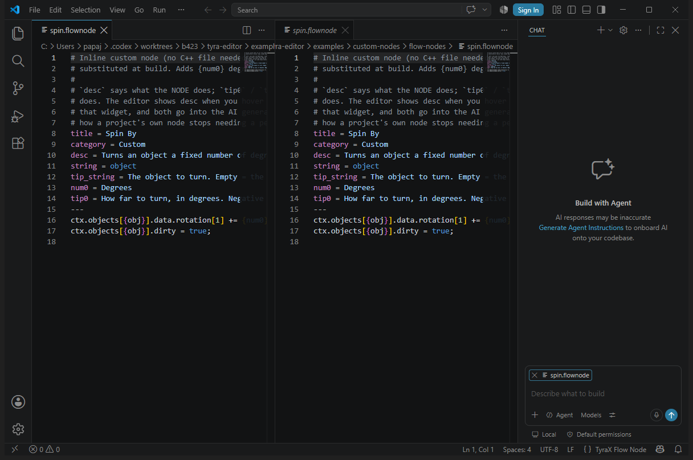

# The TyraX VS Code extension



Generated projects carry a bit of C++ that lives in plain text files:
[custom flow-graph nodes](custom-flow-nodes.md) (`.flownode`) and
[custom screen effects](custom-screen-effects.md) (`.screenfx`). Both are a
`key = value` header, a `---` separator, then a C++ body with `{placeholder}`
substitutions. The **TyraX VS Code extension** (`tools/vscode-tyrax`) turns those
files from plain text into a first-class editing experience.

A project can also carry [menu stylesheets](menu-styles.md) (`.menustyle`), which
are a different shape - CSS-like blocks, no C++ - and get highlighting and
snippets here too (see below).

## What it gives you

- **Syntax highlighting** — the header (keys, values, `#` comments) plus **full
  embedded C++ highlighting** of the body after `---`, with the placeholders
  (`{obj}`, `{num0}`, `{p0}`, …) overlaid on top.
- **Snippets** — `flownode-inline`, `flownode-call`, `screenfx`, and one per
  header key (type `title`, `param`, `call`, …).
- **Validation** (the Problems panel) — unknown or duplicate keys, bad enum
  values (`string`, the `in`/`out` pin kinds, `exec_out`), non-contiguous
  `num*` / `param*` params, a missing or empty body, `call = fn` with a stray
  inline body, and unknown or undefined `{placeholder}`s.
- **Hover & completion** — a description for every header key and placeholder,
  key/value completion in the header, and placeholder completion in the body.

The C++ body itself resolves against the project's engine headers through the
generated `.vscode/c_cpp_properties.json`, so open the **whole project folder**
(not a single file) for IntelliSense on `flow_nodes.hpp` and effect bodies. The
config lists the engine's `inc/`, the project's own `inc/` and `src/`,
`vugen/` when the project has a VU script, and **all three** PS2SDK trees —
`ee/include`, `common/include` and `ports/include` — exported out of the build
container on the first build. All three matter: `<tyra>` reaches libpng's
`png.h`, which lives only in `ports`, and **one** unresolved include makes
cpptools disable squiggles for the whole file rather than for that header, so a
missing tree costs every completion in the file. If you see *"#include errors
detected. Squiggles are disabled for this translation unit"*, build once and
reload the window — the export is what a fresh cache is missing. The
`call = fn` logic still belongs in `flow_nodes.hpp` — the `.flownode` stays a
thin manifest — but the extension now colours and checks that manifest too.

## Menu stylesheets (`.menustyle`)

Highlighting (selectors, `:selected` / `:disabled` states, `menu#name` scopes,
`--variables`, `var()`, colours, gradients, `url()`, `{{icons}}`, `@style` and
`@transition`) plus snippets for the shapes worth starting from: a whole sheet,
a selected-row highlight, a scrolling list, a description pane, a value bar, a
transition, a per-menu override.

There is deliberately **no property table** in the extension. The authoritative
list is `menustyle::propSpecs()` in `src/menustyle.cpp`, a copy here would drift
the day someone adds a property, and the grammar does not need one: anything
before a `:` inside a block highlights as a property. Validation lives where the
list already is - the Menu Editor's *Stylesheet* tab reports every parse error
with its line number, live, next to a preview of the baked result.

## VU1 microprograms (`.vclpp`, `.vcl`, `.vsm`)

The third language, and the one where the help matters most - a VU1 program is
an unbroken wall of three-letter abbreviations, which is most of why the
[VU framework](vu-framework.md) exists in the first place.

- **Syntax highlighting** - the vclpp layer (`#include`, `#define`, `#macro`,
  `Name{ }` calls, `#vuprog`), the VCL markers (`--enter`, `--cont`,
  `--barrier`), instructions with their `.xyzw` destination mask, registers
  (`vf00` and `vi00` highlighted as the hardwired constants they are),
  broadcast fields and labels.
- **Hover on every instruction** - 54 of them, each with what it actually does:
  what `madd` accumulates, why `sq.xyz` writing three words and not four
  matters, that `rsqrt` writes Q and therefore has to precede a perspective
  divide, what `xgkick` hands to the GS.
- **Hover and completion on the Tyra macro library** - with the macro's
  parameters, its comment block and how many instructions it expands to.
  Completing one inserts a filled-in `Name{ a, b }` call.
- **Hover and completion on the `VU1_*` addresses** with their values and the
  comments that explain them.
- **Two warnings the assembler will not give you**: a `div`/`rsqrt` whose Q is
  overwritten before anything reads it, and a macro call inside a macro body
  (vclpp does not nest macros - the line reaches the assembler verbatim).
- **Snippets** - `vuprog` for the whole per-buffer skeleton, plus `vuloop`,
  `vumvp`, `vupers`, `vufixcolor`, `vuscale`.

**The catalogue is read from the engine tree, not copied into the extension.**
On activation it scans `vendor/tyra/engine/.../shared/*.i` and the
`*_shared_defines.h` headers for `#macro` and `#define`, and a file watcher
re-scans when they change - so adding a macro to `tyra_macros.i` makes it
complete and hover immediately, with no extension change. Only the instruction
set is written down in `vu.js`, because that is fixed silicon. Open the whole
repo (not a single file) for the scan to find anything; without it the
instruction help still works and only the macro/address entries are missing.

**In a generated game project the scan follows a different pointer.** That is
where a project's OWN microprogram lives - `src/gen/vu_custom_*.vclpp`
([docs/vu-authoring.md](vu-authoring.md)) - and such a project has no
`vendor/tyra` to glob, so until 0.3.1 the file most likely to be read by
someone who does not already know the engine was the one getting the least
help. When the workspace globs find nothing, the extension reads the engine
path out of the project's own `.vscode/c_cpp_properties.json`, which the editor
already writes for IntelliSense. No new file, nothing to keep in sync.

## VU scripts (`src/vu/*.cpp`)

A project's own VU program written in C++ ([docs/vu-authoring.md](vu-authoring.md))
is an **ordinary `.cpp` file**, so none of the `.vclpp` help above applies to it -
what it wants is plain C++ IntelliSense over `vu::` and `vugen::`. The Scripts
panel lists these under *VU programs* and clicking one opens the project in
VS Code with that file focused.

It resolves through the same generated `.vscode/c_cpp_properties.json`, which
lists `${workspaceFolder}/vugen` - the copy of the framework the editor drops
into the project whenever it has a script (and removes when the last one goes).
That entry is what makes `#include "vushader.hpp"` resolve and
`c.` / `vugen::` / `vuir::M` complete; without it that one file was the only
one in the project with no IntelliSense at all. Open the **project folder**, not
the file.

On top of that C++ baseline the extension adds the part a header cannot carry,
scoped to `**/src/vu/*.cpp` so ordinary game code is untouched:

- **Diagnostics for rules that hold BETWEEN declarations** - each one learned
  from a Docker build or a console run, and now reported where it is typed:

  | Reported | Why it matters |
  |---|---|
  | a script writes **Q** (`divQ`, `rsqrtQ`, `persCorrect`, `envStq`) | Q carries the perspective divide and has a latency the assembler schedules around; the write gets moved into that window and vertices land wrong. Grey stipple on the console, **nothing** wrong on the host |
  | `scratch(n)` with `n > 3` | there are four (`vu::Ctx::kScratchCount`); the call clamps, so the fifth silently aliases the fourth |
  | `Slot::ObjectSpace` / `ClipSpace` without `movesGeometry()` | the EE clipper cuts the mesh before the program runs; every prop at the edge of the screen tears |
  | `movesGeometry()` on `Slot::Ndc` | not needed there, and not free - the game starts submitting props unclipped for nothing |
  | `movesGeometry()` with `classes()` narrower than `vu::kAll` | an object draws several passes over the same vertices in different classes; move one and not the other and the copies separate |
  | writing the position at `Slot::Color` / `Texture` | by then it is a GS 12.4 integer, not a position |

- **Hover that bridges C++ to the machine** - `b.mulInto` shows `mul` and what
  it does, `b.sineApprox` its seventeen instructions, `MXYZ` which fields it
  writes. The descriptions come from the same opcode catalogue the `.vclpp`
  hover uses; only the *method → instruction* mapping is new.
- **A `vuprogram` scaffold** with the five overrides in the order they matter.

What it deliberately does **not** do is repeat the headers. `vu::Ctx` and
`vugen::Vu` hover out of `vugen/vushader.hpp` through cpptools already, and a
copy here would be a second source of truth for exactly the thing the VU
framework exists to stop duplicating.

### When `vugen::` completes nothing

**First: is the C/C++ extension installed at all?** `ms-vscode.cpptools` is what
reads `c_cpp_properties.json` and provides every C++ completion; the TyraX
extension provides none of them and never did. Without it VS Code answers with
**"No suggestions."** in any `.cpp`, which reads as a broken project rather than
as a missing extension - and until this was fixed the editor wrote that careful
configuration for an extension it never recommended. Generated projects now list
it in `.vscode/extensions.json`, and existing ones have it MERGED in on the next
build (the file is otherwise write-once, so anything you added stays). VS Code
then offers it in the Extensions view under *Recommended*.

```
code --install-extension ms-vscode.cpptools
```

Once it is installed and `vugen::` still completes nothing, the next candidate
is that **there is no C++ standard library on the include path**. `vugen.hpp`
opens with `<cstdint>`, `<string>` and `<vector>`; the PS2SDK tree the config
points at carries C headers and no libstdc++, so with no `compilerPath` there is
nowhere to find them, the parse dies on line one, and the symptom is again an
empty list rather than an error. The generated config now writes a
`compilerPath` pointing at whatever host `g++` / `clang++` / `c++` is on PATH,
with `intelliSenseMode` derived to match it - a mode that contradicts the
compiler is its own warning. If `compilerPath` is missing from your file, put a
host compiler on PATH and rebuild.

To tell the remaining cases apart in ten seconds, Command Palette ▸ **C/C++: Log
Diagnostics**. It prints the configuration actually in use and every include
path it resolved:

- Open the **project folder**, not the repository root - `${workspaceFolder}` is
  what every path in that file is relative to, and the repo root has no
  `.vscode/c_cpp_properties.json` at all.
- After the editor regenerates the file, run **C/C++: Reset IntelliSense
  Database**; cpptools caches an unresolved include and does not retry on its
  own.

## Debugging scripts (the `tyrax` debug type)

With the [script debugger](script-debugger.md) on, **F5** in a TyraX project stops
the game in PCSX2 on breakpoints in your C++ scripts. The generated
`.vscode/launch.json` holds one configuration of type `tyrax`; the extension
resolves it into an ordinary `cppdbg` configuration for Microsoft's C/C++
extension, which drives GDB:

- **the GDB the toolchain ships** (`mips64r5900el-ps2-elf-gdb`), run through
  `wsl.exe` on Windows, where the toolchain is a Linux bundle;
- **the connection spelled out** as `customLaunchSetupCommands`
  (`-file-exec-and-symbols`, `-target-select remote 127.0.0.1:<port>`) with
  `launchCompleteCommand: exec-continue` and `targetArchitecture: mips`. Under
  `pipeTransport` the C/C++ extension ignores `miDebuggerServerAddress` and sends
  `-exec-run` ("Don't know how to run"), and custom launch commands without an
  architecture fail with "Parameter 'arch'". Both were measured against
  cpptools 1.34.4's own debug adapter;
- **`-gdb-set mi-async on`**, without which Pause cannot reach a running target;
- **a source map** from the `/mnt/<drive>/...` paths in the debug info to the
  Windows paths, with `useForBreakpoints`, so breakpoints set on `C:\...` files bind.

Everything machine-specific comes from `.vscode/tyrax.json`, which every build
writes (with whether the debugger is on and the build profile). F5 is the whole
workflow (`decide()` in `debug.js`). It saves the open files, then compares the
newest code file (`src/`, `inc/`, `flow-nodes/`, `screen-effects/`) with the
built ELF: with the editor serving a game built from the current code it
attaches; changed code makes it ask for a rebuild (the editor's, or a fresh
headless one in place of the old); with the editor open but no game or the debugger off it writes
`bin/gdbserver.request` and follows the editor's `bin/gdbserver.json` until it
says `waiting for GDB`; with no editor it runs `tyrax-editor --debug-run --enable`
(asking first when that turns the debugger on) and attaches once it prints
`[gdb] ready`. Progress goes to *Output > TyraX*. The command
*TyraX: Debug Game in PCSX2* does the same from the palette and from the run
button in the editor title bar (`editor/title/run`, shown while the context key
`tyrax.project` - a folder with `.vscode/tyrax.json` - is set). In those folders
the extension also writes `C_Cpp.debugShortcut: false` to the folder settings,
unless the user already set it: the C/C++ extension's button there offers to
build and debug the active file with g++ or cl.exe, which cannot run PS2 code.
`test/activate.test.js` checks both offline.

Restart: cpptools' adapter has no `restart` request, so VS Code ends the session
and resolves the configuration again - through `decide()`, BEFORE it drops the
old session. When the rebuild closes a RUNNING game, the old session ends on its
own ("has exited with code 0") and VS Code CANCELS that resolution and never
starts the new session: the provider sees the cancellation token and starts the
session itself (`finishRestart`). A game parked on a breakpoint does not end the
session, VS Code restarts by itself, and starting one too made two sessions
fighting over one game - the token is the only signal that tells the cases
apart (`test/restart.test.js`). The *Rebuild and Restart* button (notification,
status bar) is the extension's own `tyrax.rebuildAndRestart`: stop, wait for the
end, start - an order VS Code cannot drop. The game is then still "attached", so `decide` takes a 4th argument,
`ours` (this window has its own session on the project, tracked from
`onDidStartDebugSession` by the `tyrax` key `toCppdbg` adds to the resolved
configuration): attached + ours = a restart (rebuild if stale, else attach),
attached + not ours = another debugger. The same tracking drives the stale-code
warning: on every save of a code file during a session, `codeChanged()` against
the session's ELF shows the status bar item and one notification per session
(`test/stale.test.js`).

**In a real VS Code** - what none of the offline tests reach (VS Code's own
Restart order, cpptools, the WSL pipe): `node tools/vscode-tyrax/test/integration/run.js
<projectDir>` opens a VS Code window with its own profile (workspace trust off -
a trust dialog otherwise blocks F5 forever) and this folder as the development
extension, starts the `tyrax` configuration, stops on a breakpoint, rewrites
`tyraxProbe` in the script, restarts and passes when the new session stops with
the new value. `TYRAX_IT_RUNNING=1|0` restarts a running game or one parked on the
breakpoint, `TYRAX_IT_RESTART=workbench.action.debug.restart|tyrax.rebuildAndRestart`
picks the green button or ours; the log counts the sessions (3 = one too many). Measured 2026-10-29, Windows:
restart with rebuild ~28 s, editor open and headless both PASS.

## Installing it

The extension is **TyraX** (`tyrax.tyrax`) on the Visual Studio Marketplace and
on Open VSX (for VSCodium and Cursor). Install it from the Extensions view, or
open a TyraX project: its `.vscode/extensions.json` recommends it together with
`ms-vscode.cpptools`, and VS Code offers both. The C/C++ extension reads the
`c_cpp_properties.json` the editor writes; without it every C++ completion in
the project answers "No suggestions." (see above). It is also what runs GDB for
the debugger.

The editor still carries the package (`tools/vscode-tyrax/tyrax-<version>.vsix`),
so a machine with no internet gets the extension too. The first time you use
**Open in VS Code** in a session (Flow Graph *Custom nodes...*, UI Editor *Add >
Custom effects*, the Scripts panel, the GDB chip), the editor:

1. finds VS Code's `code` CLI, on PATH or in the standard install locations (a
   fresh macOS install has no `code` on PATH);
2. reads `code --list-extensions --show-versions`;
3. uninstalls the old id `tyrax.tyrax-flownode` if it is there (the extension's
   name before the Marketplace listing, never published);
4. installs the bundled `.vsix` only when `tyrax.tyrax` is missing or older -
   a newer Marketplace update is never downgraded, and an up-to-date copy is
   not reinstalled every session.

If VS Code was already open, reload the window once (*Developer: Reload Window*).
The outcome is in the status bar.

Projects that already have a `.vscode/extensions.json` get the old id renamed in
place on the next build (the rest of the file is left alone).

### Installing it by hand

```sh
code --install-extension tools/vscode-tyrax/tyrax-0.5.0.vsix
```

## For maintainers

`tools/vscode-tyrax` is a self-contained extension:

- `package.json` — declares the languages (`tyrax-flownode` → `.flownode`,
  `tyrax-screenfx` → `.screenfx`, `tyrax-menustyle` → `.menustyle`, `tyrax-vu`
  → `.vclpp`/`.vcl`/`.vsm`), their grammars and snippets, and the `tyrax`
  debugger.
- `debug.js` — the `tyrax` debug type: reads `.vscode/tyrax.json`, starts
  `tyrax-editor --debug-run` when nobody serves the game, and resolves the
  launch into a `cppdbg` configuration (`toCppdbg`, a pure function).
  `node tools/vscode-tyrax/test/debug.test.js` checks it offline for the WSL
  and native shapes.
- `syntaxes/*.tmLanguage.json` — TextMate grammars. The body is a begin/end
  region that starts at `---` and runs to end-of-file, sets
  `contentName: meta.embedded.block.cpp` (so VS Code injects the C++ grammar),
  and overlays a `{placeholder}` pattern.
- `snippets/*.json`, `language-configuration.json` — snippets and comment /
  bracket config.
- `extension.js` — diagnostics, hover and completion. The `SPEC` table (valid
  keys, enum values, placeholders) **must stay in sync** with the editor
  parsers `src/flownode.cpp` and `src/screenfx.cpp`; when you add a header key or
  placeholder to one, update the other and the docs above.
- `vuscript.js` — the `src/vu/*.cpp` support. Registered with a **path**
  selector, not a language one, so it never touches ordinary game C++. The
  rules it checks are the ones in `docs/vu-authoring.md`; when one changes
  there, change it here.
- `tyrax-<version>.vsix` — the **prebuilt package the editor installs**, and the
  file that gets published,
  committed to the repo. It is not rebuilt automatically, so after **any** change
  to the extension you must regenerate and re-commit it (bump the `version` in
  `package.json` first so `code --install-extension --force` picks up the new
  build). Either way works:

  ```sh
  cd tools/vscode-tyrax && npx @vscode/vsce package     # canonical, needs node
  python3 tools/vscode-tyrax/package-vsix.py            # same archive, stdlib only
  ```

  The Python packager exists because this trap has already fired **twice**: the
  VU language shipped in 0.3.0 sources against a committed 0.2.0 package, and
  menu stylesheets did the same — in both cases the source looked updated while
  every user got the old build, with no error anywhere. It derives its file list
  from `package.json`'s own `grammars`/`snippets` entries and globs every `*.js`
  module (0.4.1 shipped without the menu-stylesheet grammar and a module list
  that had to be kept by hand), adds the repository's Apache-2.0 `LICENSE`,
  deletes the previous
  `.vsix` (the editor globs `*.vsix` and would otherwise pick whichever it found
  first) and prints what went in. **Check the printed language list against what
  you changed** before committing.

  A grammar itself is worth a look before packaging, and it does not need VS
  Code: applying its top-level patterns to a real sample file line by line shows
  which rule claims which token and, more usefully, whether some rule never
  fires at all (a dead pattern is the normal way a grammar "works" but colours
  nothing). Keep such a checker in the scratchpad — a 50-line script over
  `json` + `re` is enough, and remember to descend into a rule's nested
  `patterns` only when it has no `match`/`begin` of its own, or `declaration`
  and `variable-decl` read as dead when they are fine.

  The editor installs the NEWEST `.vsix` in the folder rather than the first one
  the directory iterator returns, so a forgotten old file is harmless — but still
  delete it.

The extension is verified offline (no VS Code UI needed): the grammars are
tokenized with `vscode-textmate`, the `extension.js` / `debug.js` logic runs
against a mock `vscode` module (`test/debug.test.js`), and the debugger's
resolved configuration was driven end to end through cpptools' own
`OpenDebugAD7` over DAP - breakpoint, locals, step, Pause, disconnect - which is
exactly what VS Code does, without a window.

### Publishing

The listing's publisher is `tyrax`; publishing needs that publisher on the
[Visual Studio Marketplace](https://marketplace.visualstudio.com/manage) and a
namespace of the same name on [Open VSX](https://open-vsx.org). With the
package built (`package-vsix.py`):

```sh
npx @vscode/vsce publish --packagePath tools/vscode-tyrax/tyrax-<version>.vsix   # VSCE_PAT
npx ovsx publish tools/vscode-tyrax/tyrax-<version>.vsix                          # OVSX_PAT
```

Every release does both: `release.yml` calls
`.github/workflows/vscode-extension.yml` with the released commit (it can also
be dispatched by hand). It runs the offline tests, packages, and publishes with
`--skip-duplicate` - the extension has its own version (`package.json`), so a
release that did not bump it publishes nothing, and a failure there holds back
nothing of the editor's release. **Releasing the extension = bump `version` in
`package.json`, add its `CHANGELOG.md` section, repackage, merge.**

Repository secrets (*Settings > Secrets and variables > Actions*); a store
whose secret is missing is skipped:

| Secret | Where it comes from |
|---|---|
| `VSCE_PAT` | An Azure DevOps personal access token: [dev.azure.com](https://dev.azure.com) > *User settings > Personal access tokens*, organization **All accessible organizations**, scope **Marketplace > Manage**. Its account must be a member of the `tyrax` publisher ([marketplace.visualstudio.com/manage](https://marketplace.visualstudio.com/manage) > *Create publisher*, ID `tyrax`). Expires (max. 1 year): renew it. |
| `OVSX_PAT` | [open-vsx.org](https://open-vsx.org): sign in with GitHub, sign the Eclipse Publisher Agreement (link your eclipse.org account in *Settings*), *Settings > Access Tokens > Generate*. Create the namespace once: `npx ovsx create-namespace tyrax -p <token>`. |
