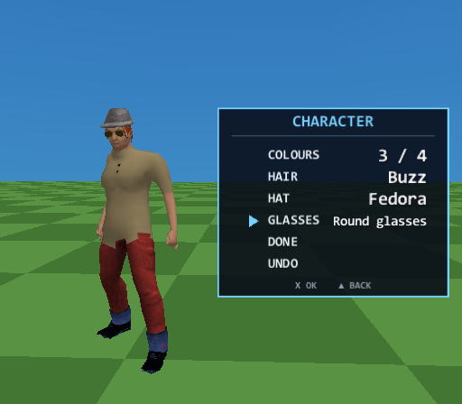
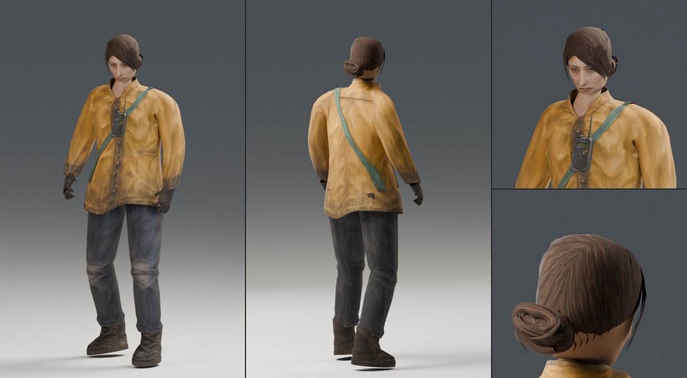
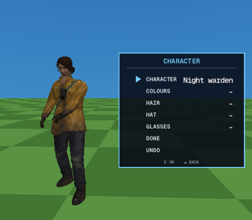
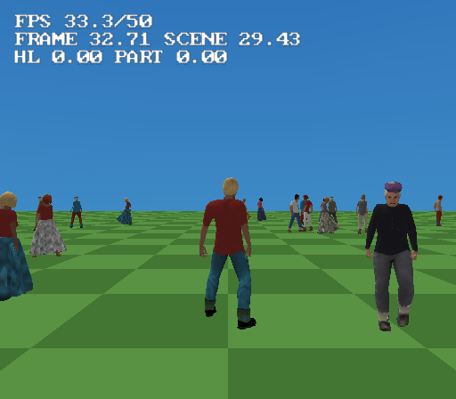

# character-generator example

The cast combines six people made in *Tools > Character Generator* with Night
Warden, a playable character modelled in Blender. The generated characters use
body and face sliders, clothes and hair from the studio wardrobe, and motion-captured
clips. Night Warden uses the same rig and locomotion clips with her own meshes
and textures.

Open `character-generator.tyra` in the editor and Build & Run (`F5`), or build
headless: `tyrax-editor --build <this folder> --run`.

## What to do

The game opens in the **Character Creator**: dress `hero` before you play.
Up/Down picks a row, Left/Right changes it - **who** (either hero, the clerk, or Night Warden), four colour
looks, three hairstyles, two hats, two sets of glasses, or none - L1/R1
turn them round, Cross keeps it and Circle puts back what they wore. **Select** opens it again
any time. That is the player's own flow graph (On Start and On Button Select
into a Character Creator node), and `hero.chargen.json` lists the choices in
its `"options"` (docs/character-generator.md, "In-game character creator").

The **CHARACTER** row offers four models. The hero's recipe sets
`"bodyChoice": true`, which exports `hero-alt.glb` beside `hero.glb`. Both
players also list the clerk and Night Warden under *Characters to choose from*
in the Inspector. These two have fixed outfits. The game loads the selection
in the background and keeps it across scenes and saves.

The screen itself is the `character` **menu**, picked in the node's *Menu*:
restyle it in *Tools > Menu Editor* like any other menu - stylesheet, labels,
row order, position (docs/character-generator.md, "The creator as a menu").
Clear the node's *Menu* and you get the built-in screen instead.



### Night Warden

From **Hero (man)**, press **Left** once on **CHARACTER** to select the warden.
Her oilskin coat, belt radio, gloves, work boots and low chignon were built
for this example. The head and facial texture are original. The Blender source
contains the mesh, editable UVs, packed images and the 50-bone character rig.
The exported GLB includes all ten movement clips.

- [Blender source](authoring/night-warden.blend)
- [Game model](res/models/characters/night-warden.glb)

The 256 × 256 coat texture came from painting a guide made from its unwrapped
front, back and sleeve panels with ImageGen. The placket and storm flap sit
in the texture. The silhouette, collar and radio are geometry. The neck tapers from the collarbones to the jaw, which sits just above the open collar. Extra loops around
the sleeve caps blend upper-arm motion into the shoulders. The radio strap
uses the coat’s skin weights where it crosses the clavicle. The face, neck,
denim and leather share a 512 × 512 atlas. The swept hair and coiled bun use
a 256 × 256 strand texture, and the radio uses a 128 × 128 texture.





### Movement

The third-person camera follows the chosen character. With the default hero,
walk (left stick) and he walks, push to full tilt and he runs, let go and he
idles. Nothing is scripted - `hero.glb` contains clips named `idle` / `walk` /
`run` / `jump`, which is what the generated game's third-person locomotion
looks for.

The five bystanders are ordinary **Model** objects, each autoplaying a
different clip from the library: the dockhand stands with his arms folded, the
kid dances, the punk talks with his hands, the clerk and the elder idle.
Walk up to any of them and they look at you, blinking as they do; the punk's jaw moves with the talking clip. The generator assigns the facial bones.
See [A living face](../../docs/character-generator.md#a-living-face).

Behind them stands a **crowd of eight commuters**: one character
(`commuter.glb`) in six colour schemes, made with the generator's *Crowd...*
button. They share one mesh, one atlas and one skin per frame; each colour
scheme is a 1 KB palette (`commuter_skin.v<k>.png` beside the model, fitted at
build time - docs/character-generator.md, "Crowds"). Pick one and look at
*Palette variant* in Properties. They do not stand still: each one has
*Wander* set, so they walk between random spots near where they were placed,
stop a while and pass each other on the right
(docs/navigation-ai.md, "Wandering").

## The crowd scene

Press **R2** for the second scene, `crowd`: a plaza of 18 pedestrians - the
commuter, a shopper and a pensioner, six of each in six colour schemes -
walking between random spots, stopping, passing each other on the right.
Three models, three atlases and a 1 KB palette per person; R2 goes back.



The three pedestrians use crowd detail. Each model shares its skinned mesh
and colour palettes across six walkers. The playable hero uses standard detail.

## The cast

Each generated model has an editable recipe alongside its GLB. Open it in
*Tools > Character Generator* to adjust the build, face, hair, outfit and
motion. For example, regenerating the hero also writes the alternative
body and both models’ colour variants:

```
tyrax-editor --chargen res/models/characters/hero.chargen.json res/models/characters/hero.glb --variants 3
```

| Recipe | Hair | Outfit | Atlas size |
|---|---|---|---|
| `hero` | side crop | yard jacket, washed jeans, storm boots | 256 |
| `clerk` | tide knot | mill flannel, station cords, service derbies, wire frames | 256 |
| `dockhand` | side crop | yard jacket, ranger cargos, storm boots, yard cap, dock gloves | 256 |
| `kid` | rain bob | watch henley, washed jeans, service derbies | 128 |
| `punk` | rain bob | mill flannel, washed jeans, storm boots, smoke lenses | 256 |
| `elder` | tide knot | watch henley, station cords, service derbies, wire frames | 256 |
| `commuter` | side crop | watch henley, washed jeans, service derbies | 128 |
| `shopper` | rain bob | mill flannel, station cords, service derbies | 128 |
| `pensioner` | side crop | watch henley, ranger cargos, storm boots, watch cap | 128 |
| `lala` | tide knot | yard jacket, station cords, storm boots | 256 |

## Making your own

*Tools > Character Generator*: move sliders, or press **Randomize** until
someone interesting turns up, then **Add to scene**. That writes a plain `.glb`
and its recipe into `res/models/characters/` and drops in a Model object -
from there it is an ordinary [animated model](../../docs/animated-models.md),
so the Animation Editor, the `.tskl` bake with its distance LODs, Live Link and
the NPC AI all work on it without knowing it was generated.

[Studio bodies](authoring/studio-bodies.blend) contains the two bare hero builds with editable skin meshes and the 50-bone rig. Their custom torsos and limbs join the fitted head, hands and feet.

The editor embeds the studio artwork, MakeHuman-derived body data and
Quaternius motion clips. See the [asset notices](../../THIRD-PARTY-LICENSES.md).

The editor's Man and Woman presets start undressed. Skin offers four face
textures. Clerk demonstrates the cardigan and A-line skirt, and Lala wears
the moss dress. All four new garments are available in the editor wardrobe.
