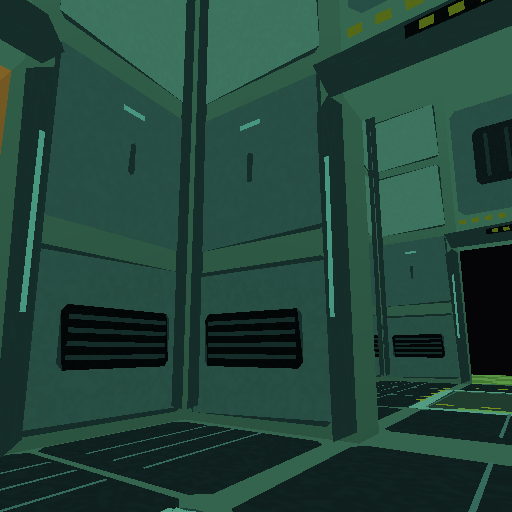
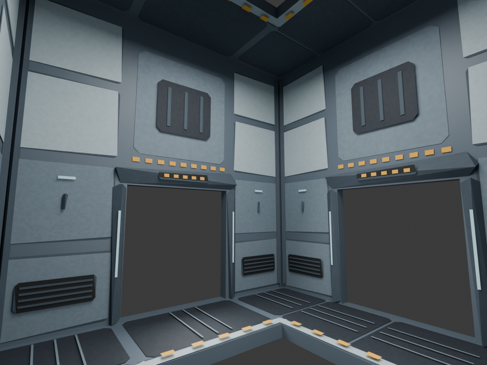
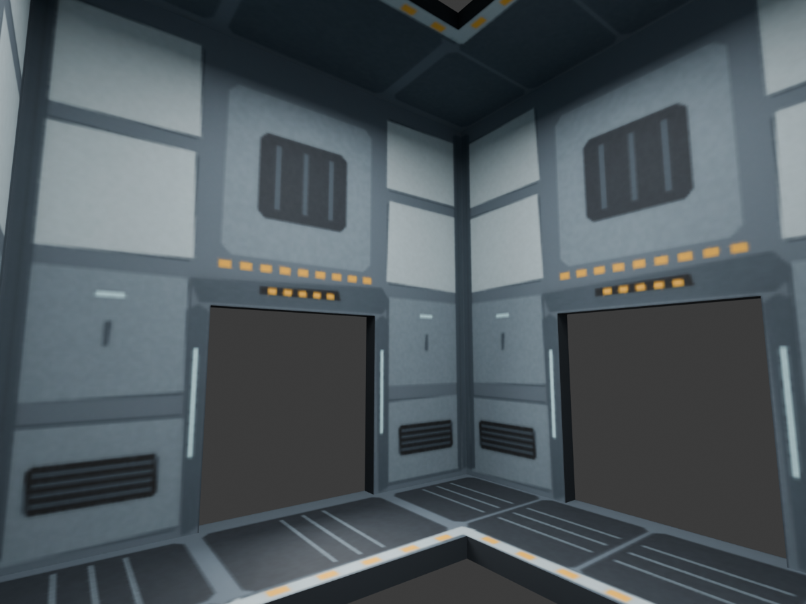

# cube example



A 3 × 3 × 3 lattice of identical-shaped rooms with hatches through every wall,
floor and ceiling, in four flavours, **assembled on the PlayStation 2 at boot**.
You spawn in the middle room. Beyond the doorways: black.

Open `cube.tyra` in the editor and Build & Run (`F5`), or build headless:
`tyrax-editor.exe --build <this folder> --run`.

**TRIANGLE reshuffles the whole cube** — same 27 cells, different rooms in them.

## What it demonstrates

Two features meeting: [prefabs](../../docs/prefabs.md) and
[runtime procedural generation](../../docs/procedural-runtime.md).

Each room is a **prefab**: 20 structural/collision slabs plus a Blender-authored
industrial detail mesh: bevelled wall cassettes, hatch frames, vents, handles,
deck grips and safety markings. Four of them are in the pool — one also
contains a slowly turning cube — next to an empty fifth prefab, literally named
`prefab`, that nothing references. A **runtime Procedural volume** does the
rest, and it is three nodes long:

```
Scatter on Grid (spacing 14, Levels 3)  ─  Pick Prefab (4 rooms in the pool, weighted)  ─  Output
```

`Scatter on Grid` with *Levels* is a full 3D lattice, so 27 cells fall out of
one node. `Pick Prefab` gives each cell a room. That is the whole map.

## Why it is affordable

| | |
|---|---|
| rooms | 27 |
| merged slabs | 540 |
| detail triangles per room | 1,048 (plus 240 shell triangles) |
| full lattice geometry | 34,776 triangles, excluding turning cubes |
| detail materials | one shared 256 × 128 atlas, tinted by room variant |
| spawn-pool slots used | one per red room (the turning cube) |

A PS2 static submit costs ~1 ms of fixed EE time whatever it contains, so 540
slabs as 540 objects would be half a second per frame. Instead:

- every member that is **plain static geometry** merges into the volume's chunk
  grid. Chunks are 14 units wide (one room), with distance removal disabled
  (`Output > Draw distance = 0`). Frustum culling still rejects off-screen
  chunks, and textured details avoid a single huge submit;
- the turning cube **cannot** merge (it carries a flow graph, so something has
  to be able to address it) and takes a clone-pool slot and a submit of its own.

The Prefabs window states that split per prefab before you ever build.

You can still walk into the walls: merged geometry contributes conservative
world AABBs to a static collider list the walker tests, so the rooms are solid
while the detail mesh has collision disabled. Its room-sized bounding box must
never become a collider: that would fill every room with an invisible block.
The complete lattice fits the existing 40,000-triangle output budget.
Do not use a short draw distance to simulate room LOD. The structural slabs
and the textured detail mesh merge into different chunks with different
centres; the runtime tests each centre independently. A 35-unit cutoff can
therefore remove a wall behind panels that are still visible, leaving holes
between them. Room LOD is instead the Pick Prefab rows' **distant version**
(below): it switches a whole room - shell, detail and hatches - at once.
The former slab-only demo's four-draw-call/50-FPS figures do not describe this
more detailed version; measure the target hardware before increasing density.

## The files

- `build-scene.py` — authors the four prefabs, the volume and the shuffle
  button into the `.tyra`. 20 slabs × 4 variants is not something anyone should
  read as JSON; this script is its readable form. Re-run it after
  `tyrax-editor --new` to rebuild the example from scratch.
- `authoring/cube-room.blend` — editable room with 294 named detail pieces,
  a reference collision shell, packed atlas, camera and preview lights.
  Non-destructive Decimate modifiers reduce the 2,748-triangle source detail
  mesh to the 1,048-triangle game export; the render uses those same modifiers.
- `authoring/build-room.py` — reproducible Blender authoring/export recipe.
  Run `blender -b --factory-startup --python authoring/build-room.py` from this
  folder to save the `.blend`, render `authoring/room-preview.png`, and export
  `res/models/cube-room.obj`, `.mtl` and `.png`. Coordinates export as Y-up,
  with the prefab origin at floor level. The Blender lights are preview only;
  the game uses 0.70 ambient / 0.30 diffuse lighting and the indicator strips
  are painted, not actual lights.
- `python build-scene.py --rooms-only` updates the four room prefabs without
  replacing the player, random seed, scene settings or unrelated prefab.
  Run this before the Blender recipe when reconstructing the reference shell.

All four wall openings are 5 units wide and 6 high; the floor/ceiling openings
stay 5 × 5. The X-facing walls now use Y for doorway height, matching the
Z-facing walls. Decorative frames stay outside those clear openings.

Validation: Blender 5.1.2 render and evaluated OBJ export; native PS2 build;
PCSX2 software-renderer captures at initial and turned camera angles, movement
and TRIANGLE regeneration (27 instances after reshuffle). The in-game preview
above uses a turned camera in a test copy; the authored player start is unchanged.
The larger 2,748-triangle export was not retained after unreliable movement
capture runs. No console performance claim is made for this art revision.
The distance-cutoff fix was checked with a fixed seed and camera in a
progressive PCSX2 software-renderer A/B: changing only `draw` from 35 to 0
restored the distant room geometry (3,297 changed pixels in the 448 × 448
capture). Disabling distance removal trades additional distant geometry for
complete rooms; it does not introduce a new runtime LOD system.



## Far-room LOD

`authoring/cube-room-lod.blend` and `res/models/cube-room-lod.obj` contain a
complete far-room model: **240 triangles**, compared with 1,288 for the current
detail mesh plus structural shell (81% fewer). The original 20 solid slabs
preserve all four 5 × 6 doorways and both 5 × 5 vertical hatches. Panel seams,
vents, handles and safety marks are projected into one 1024 × 512 atlas,
`cube-room-lod.png`, referenced by `cube-room-lod.mtl`. The material bake uses
colour and local ambient occlusion; preview lamps are not baked into the atlas.

Every row of the volume's *Pick Prefab* node names it as the row's **distant
version** at **30 units** (the row's second line in *Tools > Procedural*). Past
that distance from a room's cell, the room's 20 slabs and its detail mesh stop
drawing and this one model draws in their place; nearer, the reverse. The
switch is per room and per floor, so no wall leaves early
([how it draws](../../docs/procedural-runtime.md#distant-versions)). The slab
colliders stay at every distance - the far model has none. It takes the
room's detail tint, which is why it is authored neutral. The red room's
turning core is a separate object and does not switch. Y-up on export,
14 × 14 × 14 units, origin at floor level - the same frame as the prefabs.

Checked in PCSX2 (software renderer, frozen camera in an edge room looking
down a row of three, fixed seed, `framePipeline` off - see below), changing only
the rows' distance: 1000 (groups built, nothing far) matched the no-LOD frame
pixel for pixel; 20 switched only the room 28 units away (2,688 changed pixels,
all inside its doorway); 10 also switched the next room (34,011 pixels, all
inside the doorway), seated exactly where the full room was, with no gaps.
GS primitives per vsync: 15,947 without LOD, 7,123 at 20, 3,979 at 10. The
merged geometry grows from 104,328 to 123,768 vertices, because both sides stay
in RAM. From the middle room every room is within 30 units, so the shipped 30
switches only when you stand in an outer room. No console frame-time claim is
made.

On a physical PS2 (same pose and seed, `framePipeline` off, debug build with
the frame profiler; settled 1-second windows, stable to 0.02 ms):

| merge / rows' distance | chunks | SCENE (EE) | FRAME |
|---|---:|---:|---:|
| before: members by own position, no distant version | 25 | 25.4 ms | 40 ms (25 fps) |
| per room, no distant version | 54 | 8.8 ms | 20.8 ms (50 fps) |
| per room, 30 (shipped) | 81 | 7.1 ms | 20.8 ms |
| per room, 20 | 81 | 6.7 ms | 20.8 ms |
| per room, 10 | 81 | 5.1 ms | 20.4 ms |

Most of the gain is the per-room merge, which every volume-placed prefab now
gets: merged by their own position, the members built chunks that spanned all
three floors and crossed the edges of the view, which the EE has to clip.
The far model adds 1.7 ms at 30 units from this pose. The new merge was checked
in PCSX2 against the old one with no distant version: 0 changed pixels.
Runtime occluders built from the room walls were tried and dropped: they hid
nothing (`OCC proxies=16 hidden=0/17`) and cost 0.9 ms, because every
neighbouring room's box touches the walls in front of it
([why](../../docs/occlusion-culling.md#where-a-box-test-cannot-win-rooms-that-touch)).

With `framePipeline: true` this example currently draws nothing in PCSX2: the
EE stops before the first frame. The same thing happens on a build from before
the distant-version change, and `framePipeline: false` renders normally.

Rebuild from the existing near-room Blender source with
`blender -b --factory-startup --python authoring/build-room-lod.py`.
This writes only the LOD assets, its `.blend` and `authoring/room-lod-preview.png`.
Validated in Blender 5.1.2 and with TyraX `--import-model ... --dry-run`:
240 triangles, one material, one texture and no missing dependencies.



## Things worth trying

- Open *Tools > Prefabs*, select the **room-red** tile: 22 members,
  21 mergeable members and 1 spawned object. In the member list
  hovering the `-core` row says *own object*; the rest say *merged*.
- Change the weights in the volume's *Pick Prefab* pool and press TRIANGLE.
- Drag a row's distant-version distance down to 10: every room but your own
  draws as the 240-triangle far model, which shows exactly what it replaces.
- Changing *Levels* adds rooms, geometry and memory use. Increase the triangle
  budget accordingly and re-measure on the target before keeping that change.
- Drop a room prefab into a scene by hand: *Prefabs > Place in scene*, then
  click the ground. It stamps ordinary objects you can edit individually.

## What it is not

Every cell gets the same room shape, so the outer shell has doorways to nowhere
— hence the black sky. A sealed cube would need an edge-room prefab and a filter
that places it, which is a graph, not a feature: `Filter by Attribute` on the
grid's own coordinates would do it.

Generated object values live in `src/gen/scene_objects.gen.cpp`;
`inc/scene_data.hpp` keeps stable declarations. Counts and object IDs live in
the same data file, so ordinary moves, color edits, additions and removals can
rebuild it alone. Changes to features or derived tables can still rebuild consumers.

Generated game methods are split between `src/terrain_game.cpp` and the
`src/gen/game_*.gen.cpp` subsystems, with shared inline helpers/state in
`inc/game_runtime.gen.hpp`. Header changes can compile these units in parallel.
The main file remains user-ownable; generated subsystem files refresh on build.


Hardware timeline instrumentation matches the 1.170 coarse/detail emitter.
Use the [capture and observer-control guide](../../docs/hardware-profiler.md)
when comparing performance; traces add measurable work.

This example explicitly requests `framePipeline: true` (TyraX2). Its authored interlaced output preserves the existing scan mode and quality; ordinary interlaced output is eligible, unlike true field rendering. True field rendering, BLSS, unlimited triple buffering and unavailable queue memory fall back safely. This request does not guarantee 60 FPS. See [TyraX2](../../docs/tyrax2.md).

Generated runtime snapshot refreshed for [dynamic light receivers](../../docs/dynamic-light-receivers.md). This example retains the default **All objects** policy; Players and driven vehicle is an optional project or scene setting.

TyraX 2.0 integration: generated sources have been refreshed with the combined
TyraX2 renderer and mainline collision broad phase; authored settings and
user-owned source files retain their existing ownership rules.
