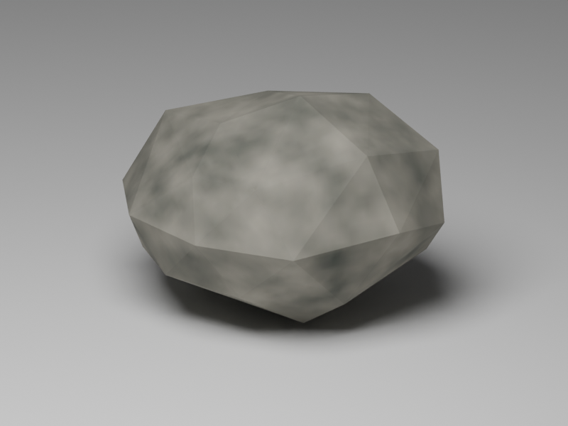

# deep-forest example

A 2048×2048 daylight map with **7,000 instanced placements: 5,914 broadleaf
oaks and 1,086 rocks**, scattered across 560×560 units. Three seeded Forest oak
variants use Blender-baked foliage; a new textured Blender fieldstone replaces
the old eight-triangle rock.


Open `deep-forest.tyra` and Build & Run (`F5`), or use
`tyrax-editor.exe --build <this folder> --run`. Walk with the left stick and
look with the right. FPS is visible; live devkit services and the profiler HUD
are disabled for the authored gameplay configuration.

In the editor, **Show preview** renders the dense forest with the authored
near/far models and draw distance, rather than switching all 7,000 placements
to green crosses. Move the viewport camera within 210 units to inspect it.

## Geometry and distance settings

- Oaks: 503 triangles near, 4 triangles far (two crossed textured capture planes).
- Rock: 56 triangles near, 12 far, one shared 128×128 baked stone texture.
- Near/far switch: oaks 25 units, rocks 35. Instance draw distance: 210.
  Spatial culling cell size: 52.5 (smaller off-camera groups, same draw distance).
- Terrain: detail 512, view distance 320, detail distance 55; fog ends at 290.
- The `pines` scatter keeps its stable object ID/name; its Pick Asset pool now
  selects three oaks (weight 28 each) and the rock (weight 16). `Limit` is 7000.

The ordinary instanced path shares model geometry and stores placement matrices.
Far oak planes are fixed crossed meshes, not camera-facing billboards. Alpha
coverage, angle-dependent silhouettes and visible LOD transitions remain quality
tradeoffs. Instanced models receive sun and ambient lighting.

## Physical PS2 measurements

See the [raw logs, CSVs and measurement report](authoring/oak-density-2026-10-23/README.md)
and the [reproduction recipe](authoring/README.md). With the new rocks, the
default 7,000-placement layout measures **49.97–50.00 FPS**, with no frame
periods above 25 ms across 956 samples: three spawn headings plus a radius-140
camera route. The corresponding 8,000 layout reaches 49.38–50.00 FPS with
three long periods, so it is not the steady-50 default. At the former 35-unit
oak LOD / 105-unit cells, the 8,000-placement stress subset hit 25 FPS.
These counts include rocks, not just trees. Results are specific to the
sampled views and PAL output, not a promise for every camera on the map.

The 25-unit oak switch changes some second-row crown silhouettes; it is not
seamless. Same-view physical-console pictures are included in the report.
A cell-size A/B changed 0.31% of pixels below the HUD in the checked view,
without an obvious loss of tree silhouette detail.

Change `Limit` in the procedural graph to explore density, or shorten the
near/far distance to trade close foliage quality for speed. Do not interpret a
global placement count as a count of trees visible in one frame.

## Asset sources

[Authoring instructions](authoring/README.md) reproduce the three oak variants,
their far captures, the Blender fieldstone and the hardware benchmark.
`authoring/rock.blend` is the editable rock source; the image below is its
**Blender studio preview**, not a console capture.



The heightmap uses generated value noise with a flat clearing at spawn.
Generated sources and instance tables refresh on build. This example requests
[TyraX2](../../docs/tyrax2.md) with interlaced output; that request alone does
not guarantee a frame rate. See [terrain LOD](../../docs/terrain-lod.md),
[instanced procedural output](../../docs/procedural-generation.md#instanced)
and [hardware profiling](../../docs/hardware-profiler.md).

`preview.png` is a physical-PS2 framebuffer capture of the final oak/rock
assets, taken in a separate Live Debugger-enabled run after measurement.
Its HUD includes debugger/capture overhead; use the quiet-run timing table
above for performance. The playable default disables those services.

## Optional historical Blender spruce variants

The optional `res/models/spruce-a.obj`, `spruce-b.obj`, and `spruce-c.obj`
are solid, flat-shaded PS2 trees: a classic five-whorl spruce, a taller narrow
six-whorl spire, and a shorter broad four-whorl tree. Uneven branch lengths,
rotated whorls and long crown leaders break up the old regular stacked tiers.
They use 58, 56 and 56 triangles respectively. Each matching `-lod.obj`
uses 12 triangles: a closed pentagonal crown and tetrahedral trunk. The far
crown preserves the near model's bounding box and tip, simplifying the stepped
outline to an envelope; some silhouette change at the LOD transition is expected.

All six exports are Y-up, base at the origin, opaque, triangulated and flat
shaded, with outward normals. Their individual MTL files copy the existing
`bark` and `needles` diffuse colours. There is no texture atlas or alpha foliage;
These assets remain available for comparison; the active pool now uses oaks.

### Reproduce and inspect

From the repository root (PowerShell):

```powershell
$treeTmp = Join-Path (Resolve-Path examples/deep-forest/authoring) 'tmp'
New-Item -ItemType Directory -Force $treeTmp | Out-Null
$previousTemp, $previousTmp = $env:TEMP, $env:TMP
try {
    $env:TEMP = $env:TMP = $treeTmp
    & 'F:\Program Files\Blender\blender.exe' -b --factory-startup --python examples/deep-forest/authoring/build-spruces.py
    if ($LASTEXITCODE -ne 0) { throw 'Blender failed' }
} finally {
    $env:TEMP, $env:TMP = $previousTemp, $previousTmp
    # This literal target is only this recipe's temporary directory.
    Remove-Item -LiteralPath examples/deep-forest/authoring/tmp -Recurse -Force
}
python examples/deep-forest/authoring/verify-spruces.py
```

The Python recipe is platform independent; elsewhere use the local Blender
executable with the same `-b --factory-startup --python` arguments. Point
`TEMP`/`TMP` at this example's `authoring/tmp` if needed and remove it afterward.

Outputs: `authoring/spruces.blend` (named editable trunk/whorl meshes, instanced
side by side for presentation), `authoring/spruces-preview.png`, six OBJ/MTL
pairs, and `authoring/spruces-validation.json` from the standalone validator.
Exports use the local source meshes, so presentation offsets cannot move
their pivots. The preview's lights, ground and labels are not exported.
The validator checks budgets, finite coordinates, nonzero triangle areas,
material resolution, normal/winding agreement, closed consistently oriented
components, positive volumes, size constraints, and identical near/far bounds.
The preview is a Blender studio render, not an in-game lighting or LOD test.


Verification for this asset drop: all six files passed the standalone validator
and the available TyraX importer with
'--import-model examples/deep-forest <obj> --dry-run' (zero missing resources).
The assets were then wired into the forest and checked in PCSX2 and on a
physical PS2 in the previous spruce layout. If Python is not on PATH,
the validator also runs with Blender's '-b --factory-startup --python' flags.
Blender 5.1.2 saved the blend and rendered the preview successfully; its optional
OS thumbnail-cache write emitted a warning but did not affect either artifact.
