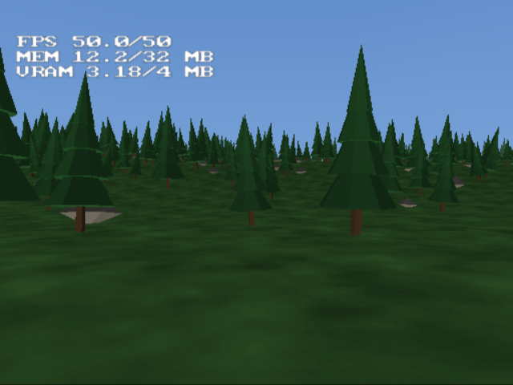
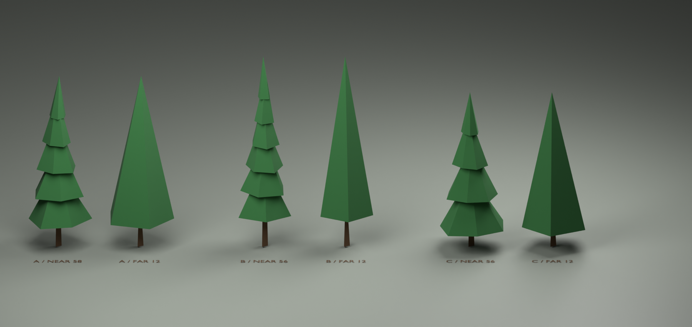

# deep-forest example



A 2048×2048 map in daylight with **8,692 instanced spruces and rocks**,
walkable at **50 FPS** on a PS2 — the example for drawing a forest as
INSTANCES (one copy of each tree in memory, many matrices) and for the
level-of-detail systems around it: [terrain distance
detail](../../docs/terrain-lod.md) for the ground, a distant version and a
draw distance for the trees.

Open `deep-forest.tyra` in the editor and Build & Run (`F5`), or build headless:
`tyrax-editor.exe --build <this folder> --run`. It ships in the **debug**
profile, so the FPS / MEM / VRAM readouts are on screen. Walk with the left
stick, look with the right.

## What it shows

- **A big map that draws.** 2048 units square at terrain detail 512 (a 4-unit
  grid), **View distance 320** so only the ring of tiles around you is in
  memory, and **Detail distance 55**: tiles past 55 units are built from every
  2nd heightmap sample, past 121 from every 4th. Edges are stitched to the
  neighbouring tile's stride, so nothing cracks — and in daylight you can
  actually watch for the bands and not find them.

  Set Detail distance to 0 in *Project > Preferences > World* and rebuild to
  measure what full-detail tiles cost — on this project's night-time
  predecessor that was the difference between 25 and 50 FPS, and the mechanism
  is identical here.

- **A forest that draws.** One
  [procedural volume](../../docs/procedural-generation.md) scatters 8,692
  copies of three Blender spruces and a rock over 560×560 units, filtered by
  slope and by a noise mask so there are clearings. Its Output node says
  **Draw as: Instanced** ([what that
  means](../../docs/procedural-generation.md#instanced)): the console keeps one
  copy of each model and a table of where the copies stand, instead of baking
  them into merged chunk meshes. The same scene merged used to cap at ~2,900
  trees (each merged copy is its own geometry in EE RAM); instanced, the whole
  forest costs ~1 MB. Three throttles keep it walkable:

  - **Draw distance 210** — a copy past 210 units is not drawn. The fog (ends
    at 290) is tuned to make the pop-in a fade-in.
  - **A distant version per tree at 45 units** — each spruce row in the Pick
    Asset pool names its 12-triangle `-lod` model, which replaces that copy
    past 45 units.
  - **Terrain detail distance 55** — the ground under the far forest is a
    quarter of the vertices of the ground under you.

  Measured on a physical PS2 from the spawn, three headings (frozen camera,
  frame profiler on): SCENE 11.8–12.7 ms, ~700–870 copies drawn per frame,
  50 FPS, MEM 12.5 of 32 MB. Instanced copies are lit by the sun and ambient
  only — no probe GI or ambient occlusion on the trees.

- **Fog doing its job.** Fog end (290) sits inside the view distance (320) and
  past the chunk draw distance (210), so neither the streaming ring's edge nor
  the forest's edge is ever the thing you notice.

## Things worth trying

- *Preferences > World > Detail distance* — drag it down to 20 and walk: the
  bands come close enough to watch them settle behind you.
- The scatter volume's graph (select **pines**, open the graph): the `Limit`
  node's 9000 and the `Output` node's draw distance are the whole performance
  story, one click away. Turn the frame profiler on (*Preferences > Build*)
  and the log prints `INSTANCES ... appended ... ordinary` every 50 frames.
- Switch *Output > Draw as* to **Merged** and lower `Limit` to 2800 to see the
  old way: 2,800 merged spruces alone take ~12.6 MB of EE RAM, so this
  layout's 8,692 would not fit in 32 MB.
- Drag a spruce row's distant-version distance to 10 or 200 and watch the far
  crowns move.

## Assets

The trees are the three Blender spruces described in "Blender spruce
variants" below, each with its 12-triangle `-lod` far version. `pine.obj`, the
generated 64-triangle tree the forest used before, stays for reference.
`rock.obj` and `props.mtl` come from the [procedural](../procedural) example.
The heightmap is generated value noise with a flat clearing at the spawn.

Generated object values live in `src/gen/scene_objects.gen.cpp`;
`inc/scene_data.hpp` keeps stable declarations. Counts and object IDs live in
the same data file, so ordinary moves, color edits, additions and removals can
rebuild it alone. Changes to features or derived tables can still rebuild consumers.

Generated game methods are split between `src/terrain_game.cpp` and the
`src/gen/game_*.gen.cpp` subsystems, with shared inline helpers/state in
`inc/game_runtime.gen.hpp`. Header changes can compile these units in parallel.
The main file remains user-ownable; generated subsystem files refresh on build.


Hardware timeline instrumentation matches the 1.170 coarse/detail emitter.
Use the [capture and observer-control guide](../../docs/hardware-profiler.md)
when comparing performance; traces add measurable work.

This example explicitly requests `framePipeline: true` (TyraX2). Its authored interlaced output preserves the existing scan mode and quality; ordinary interlaced output is eligible, unlike true field rendering. True field rendering, BLSS, unlimited triple buffering and unavailable queue memory fall back safely. This request does not guarantee 60 FPS. See [TyraX2](../../docs/tyrax2.md).

Generated runtime snapshot refreshed for [dynamic light receivers](../../docs/dynamic-light-receivers.md). This example retains the default **All objects** policy; Players and driven vehicle is an optional project or scene setting.

TyraX 2.0 integration: generated sources have been refreshed with the combined
TyraX2 renderer and mainline collision broad phase; authored settings and
user-owned source files retain their existing ownership rules.

## Blender spruce variants

The optional `res/models/spruce-a.obj`, `spruce-b.obj`, and `spruce-c.obj`
are solid, flat-shaded PS2 trees: a classic five-whorl spruce, a taller narrow
six-whorl spire, and a shorter broad four-whorl tree. Uneven branch lengths,
rotated whorls and long crown leaders break up the old regular stacked tiers.
They use 58, 56 and 56 triangles respectively. Each matching `-lod.obj`
uses 12 triangles: a closed pentagonal crown and tetrahedral trunk. The far
crown preserves the near model's bounding box and tip, simplifying the stepped
outline to an envelope; some silhouette change at the LOD transition is expected.

All six exports are Y-up, base at the origin, opaque, triangulated and flat
shaded, with outward normals. Their individual MTL files copy the existing
`bark` and `needles` diffuse colours. There is no texture atlas or alpha foliage;
`props.mtl`, the old pine, and rocks are unchanged. The volume's Pick Asset
pool uses all three, each with its `-lod` model as the row's distant version.

### Reproduce and inspect

From the repository root (PowerShell):

```powershell
$treeTmp = Join-Path (Resolve-Path examples/deep-forest/authoring) 'tmp'
New-Item -ItemType Directory -Force $treeTmp | Out-Null
$previousTemp, $previousTmp = $env:TEMP, $env:TMP
try {
    $env:TEMP = $env:TMP = $treeTmp
    & 'F:\Program Files\Blender\blender.exe' -b --factory-startup --python examples/deep-forest/authoring/build-spruces.py
    if ($LASTEXITCODE -ne 0) { throw 'Blender failed' }
} finally {
    $env:TEMP, $env:TMP = $previousTemp, $previousTmp
    # This literal target is only this recipe's temporary directory.
    Remove-Item -LiteralPath examples/deep-forest/authoring/tmp -Recurse -Force
}
python examples/deep-forest/authoring/verify-spruces.py
```

The Python recipe is platform independent; elsewhere use the local Blender
executable with the same `-b --factory-startup --python` arguments. Point
`TEMP`/`TMP` at this example's `authoring/tmp` if needed and remove it afterward.

Outputs: `authoring/spruces.blend` (named editable trunk/whorl meshes, instanced
side by side for presentation), `authoring/spruces-preview.png`, six OBJ/MTL
pairs, and `authoring/spruces-validation.json` from the standalone validator.
Exports use the local source meshes, so presentation offsets cannot move
their pivots. The preview's lights, ground and labels are not exported.
The validator checks budgets, finite coordinates, nonzero triangle areas,
material resolution, normal/winding agreement, closed consistently oriented
components, positive volumes, size constraints, and identical near/far bounds.
The preview is a Blender studio render, not an in-game lighting or LOD test.



Verification for this asset drop: all six files passed the standalone validator
and the available TyraX importer with
'--import-model examples/deep-forest <obj> --dry-run' (zero missing resources).
The assets were then wired into the forest and checked in PCSX2 and on a
physical PS2 (numbers above). If Python is not on PATH,
the validator also runs with Blender's '-b --factory-startup --python' flags.
Blender 5.1.2 saved the blend and rendered the preview successfully; its optional
OS thumbnail-cache write emitted a warning but did not affect either artifact.
