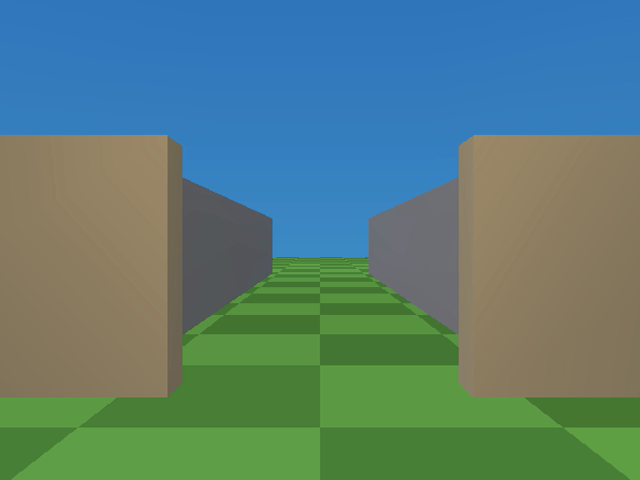

# layer-streaming example



Two buildings joined by a corridor, streamed GTA3-style with
[streaming layers](../../docs/streaming-layers.md): only the building you
are in (plus the corridor) stays in the PS2's memory.

Open `layer-streaming.tyra` in the editor and Build & Run (`F5`), or build
headless: `tyrax-editor.exe --build <this folder> --run`.

## What to do

You spawn inside **building A** (warm colors, crates and an orb). Walk
through the door into the corridor and keep going:

1. A third of the way in, an invisible trigger fires **Set Layer Loaded (load)
   building-b** — the far building streams in ahead of you, a few objects
   per frame, while you walk.
2. Near the far end another trigger fires **Set Layer Loaded (unload) building-a** —
   the building behind you vanishes from memory.
3. Walk back and the mirrored triggers swap them again. Endlessly.

To watch it, enable **Show FPS** and **Show memory usage** (Project >
Preferences > Build & debug, debug profile): **MEM** drops on every unload and climbs
while a building streams in, and **FPS** stays at full rate — loads are
spread one asset per frame, so there is no hitch. (The overlay ships disabled
here while a known engine regression makes it freeze the first frame —
unrelated to layers.)

## How it is wired

- Two layers in the Project panel's **Layers** section: `building-a`
  (**start** on) and `building-b` (**start** off).
- Every wall and prop of a building is assigned to its layer in
  Properties; the corridor walls and the trigger markers have no layer,
  so they are always resident.
- Four **Empty** markers sit in the corridor, each with a two-node flow
  graph (`Near Object` radius 3.5 → `Set Layer Loaded`, load/unload pins), in
  walking order:

  ```
  [A] .. unload-B .. load-B ...... load-A .. unload-A .. [B]
  ```

  Whichever direction you walk, you first pass a no-op (unloading the
  building that isn't loaded), then the load for the building ahead, and
  only close to the far door the unload for the one behind you. Requests
  are idempotent, so walking back and forth needs no extra logic.

## Sounds that stream with the buildings

The buildings bring their sound with them ([sound.md](../../docs/sound.md),
"SPU2 sample RAM"), so the PS2's 2 MB of sound RAM holds only what is near
you:

- Each building has a looping ambience emitter in its layer: a low mains hum
  in A (`hum-a`), a brighter drone in B (`hum-b`). The hum's sample loads
  when its building streams in and is freed, the voice stopped, when the
  building streams out.
- The corridor has a **sound bank**, `corridor` (Project > Audio > Banks),
  holding the PA chime. The two "load the building ahead" triggers also fire
  **Set Sound Bank Loaded (load) corridor**. The `chime` marker in the middle
  of the corridor plays it with Play Sound. Two markers in the building
  doorways, `bank-unload-a` and `bank-unload-b`, unload the bank once you are
  through.
- Because the chime is in a bank, its Play Sound does not keep it loaded for
  the whole scene. Project > Audio shows the worst moment at 118 KB: one
  building's hum, the other's while you are in the corridor, and the chime.
  The scene's own set is empty.

In a debug build `bin/log.txt` shows it happen: `ADPCM loaded` when a
building's hum or the bank arrives, `ADPCM freed` when it leaves. Walking
A -> B -> A loads hum-b and the chime, frees hum-a and the chime, then the
mirror image.

The sounds in `res/sfx` were synthesized for this example. The two hums are
4 s seamless loops (`-loop.wav` makes the encoder loop them).

Buildings reset when they stream back in — position, colors, visibility
return to what was authored in the editor, like GTA3 interiors.

Generated object values live in `src/gen/scene_objects.gen.cpp`;
`inc/scene_data.hpp` keeps stable declarations. Counts and object IDs live in
the same data file, so ordinary moves, color edits, additions and removals can
rebuild it alone. Changes to features or derived tables can still rebuild consumers.

Generated game methods are split between `src/terrain_game.cpp` and the
`src/gen/game_*.gen.cpp` subsystems, with shared inline helpers/state in
`inc/game_runtime.gen.hpp`. Header changes can compile these units in parallel.
The main file remains user-ownable; generated subsystem files refresh on build.


Hardware timeline instrumentation matches the 1.170 coarse/detail emitter.
Use the [capture and observer-control guide](../../docs/hardware-profiler.md)
when comparing performance; traces add measurable work.

This example explicitly requests `framePipeline: true` (TyraX2). Its authored interlaced output preserves the existing scan mode and quality; ordinary interlaced output is eligible, unlike true field rendering. True field rendering, BLSS, unlimited triple buffering and unavailable queue memory fall back safely. This request does not guarantee 60 FPS. See [TyraX2](../../docs/tyrax2.md).

Generated runtime snapshot refreshed for [dynamic light receivers](../../docs/dynamic-light-receivers.md). This example retains the default **All objects** policy; Players and driven vehicle is an optional project or scene setting.

TyraX 2.0 integration: generated sources have been refreshed with the combined
TyraX2 renderer and mainline collision broad phase; authored settings and
user-owned source files retain their existing ownership rules.
