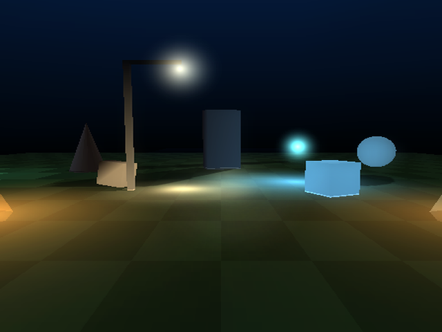

# lighting — the whole lighting toolbox in one night plaza

A first-person night scene that shows the runtime lighting tools side by side:
flickering point lights with glow coronas and cone shafts, a street lamp that
carves **shadow volumes**, a moon throwing **projected silhouette shadows**,
thin blue fog, blob shadows under physics crates, and a **flashlight** held in
the right hand so its own shadows can be seen.

Run it like every example: open `lighting.tyra` in TyraX and press **F5**
(or `tyrax-editor.exe --build examples/lighting --run`).

## The tour (spawn faces the plaza)

| What | Where | Effect it demonstrates |
| --- | --- | --- |
| Two **torches** flanking the path | left/right, just ahead | **Dynamic point lights**: warm flickering pools on the paving and the crates, each with a **glow corona + cone shaft** (*Beam: Glow + cone*) breathing with the flicker. They light a pool each and leave the dark between them to the flashlight |
| The **street lamp** | left of the path, over the crates | A dynamic **spot** light (*Spot (cone)*, 38°) with its own ground pool and *Shadow volumes: On*: the pole, the arm and the crates under it carve exact, hard-edged shadows out of its pool |
| Two **crates** | drop at boot, under the lamp | Physics + **blob shadows** (project preference): the soft dark quad sticks to the ground while they fall and land |
| The blue **crystal** | center of the plaza | A dynamic light driven by its **flow graph**: *Every 6 s* → *Set Light ×1.8* → *Delay 3 s* → *Set Light ×0.7* — the pool and its corona pulse together |
| The blue **lamp** | far left | A **baked** point light for contrast: static pool, zero runtime cost, steady corona |
| **Monolith, orb, obelisk** | back of the plaza | **Projected silhouette shadows** (*Cast shadow (projected)*) from the **moon**: a rotated slab, a circle and a triangle on the ground, all leaning the same way |
| The **fog** | everywhere | The *night* ambience fades distance into a dark blue, so the far plaza reads as depth rather than as a flat backdrop |
| A third **torch**, a blue **ball**, a red **slab** | behind the spawn — turn around | A lamp high over a throwable physics sphere (pick it up with Square) and a wall slab, both casting projected shadows from that lamp |

## Controls

- Left stick walks, right stick looks, X jumps (standard FPP template).
- **Circle** toggles the **flashlight**. It is held 0.2 to the right and 0.25
  below the eye (*Player > Flashlight > Held right / Held below eye*), and
  *Project > Preferences > Graphics > Torch shadows* is on, so
  every solid in the beam throws a shadow you can actually see beside it — a
  torch exactly in the eye hides each shadow behind its own caster.

## What to look at

- **Two lights on one surface**: shine the torch on the orb beside the
  crystal, or a block a torch already lights. The beam lands on it as a
  per-pixel pool and the lamp's light stays: a placed light that reaches a mesh
  keeps the mesh's one per-vertex light slot, and the flashlight's per-vertex
  cone takes only what no lamp lights.
- **Shadows survive the torch**: shine it at a caster whose moon or lamp
  shadow you can see. A torch held in the eye never takes that shadow over (its
  own would be invisible); this one, held off the eye, casts through volumes
  and leaves the projected shadow slots to the moon and the lamps.
- **Flicker vs baked**: the torch pools breathe; the blue lamp's pool never
  moves (baked into vertex colours — free, but frozen).
- **The crystal's pulse** is authored entirely in its flow graph — open the
  crystal's *Flow Graph* tab to see the 4-node loop, next to the *On Start* →
  *Set Light ×1* pair that arms the base brightness.
- **Volumes vs silhouettes vs blobs**: the lamp's and the torch's shadows are
  exact per pixel and hard; the moon's projected silhouettes are soft and fade
  with camera distance (35..50 units); the crates' blobs are the cheapest.

## How it's authored

Plain editor authoring, no scripts: per-light *Dynamic (live)* / *Flicker* /
*Beam* / *Spot (cone)* / *Shadow volumes* in Properties — the editor viewport
draws both halves of a beam, the corona and the cone shaft, so the lights can be
placed against the picture the console will draw — *Cast shadow (projected)* on
the three hero objects, blob shadows plus *Torch shadows* and *Spot light shadows*
in *Project > Preferences*, the moon colour and the fog in the *night* ambience
(*Tools > Ambience Editor*), the flashlight and its hand offset on the Player object.
The crystal's pulse is the only logic, and it is a flow graph.

The dusk *Default* ambience is still in the project: make it the default to
see the plaza with a low sun, lens flare and god rays instead.

Generated object values live in `src/gen/scene_objects.gen.cpp`;
`inc/scene_data.hpp` keeps stable declarations. Counts and object IDs live in
the same data file, so ordinary moves, color edits, additions and removals can
rebuild it alone. Changes to features or derived tables can still rebuild consumers.

Generated game methods are split between `src/terrain_game.cpp` and the
`src/gen/game_*.gen.cpp` subsystems, with shared inline helpers/state in
`inc/game_runtime.gen.hpp`. Header changes can compile these units in parallel.
The main file remains user-ownable; generated subsystem files refresh on build.

Hardware timeline instrumentation matches the 1.170 coarse/detail emitter.
Use the [capture and observer-control guide](../../docs/hardware-profiler.md)
when comparing performance; traces add measurable work.

This example explicitly requests `framePipeline: true` (TyraX2). Its authored interlaced output preserves the existing scan mode and quality; ordinary interlaced output is eligible, unlike true field rendering. True field rendering, BLSS, unlimited triple buffering and unavailable queue memory fall back safely. This request does not guarantee 60 FPS. See [TyraX2](../../docs/tyrax2.md).

Generated runtime snapshot refreshed for [dynamic light receivers](../../docs/dynamic-light-receivers.md). This example retains the default **All objects** policy; Players and driven vehicle is an optional project or scene setting.

TyraX 2.0 integration: generated sources have been refreshed with the combined
TyraX2 renderer and mainline collision broad phase; authored settings and
user-owned source files retain their existing ownership rules.
