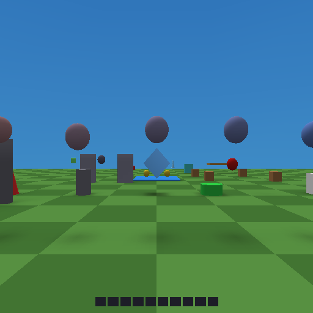
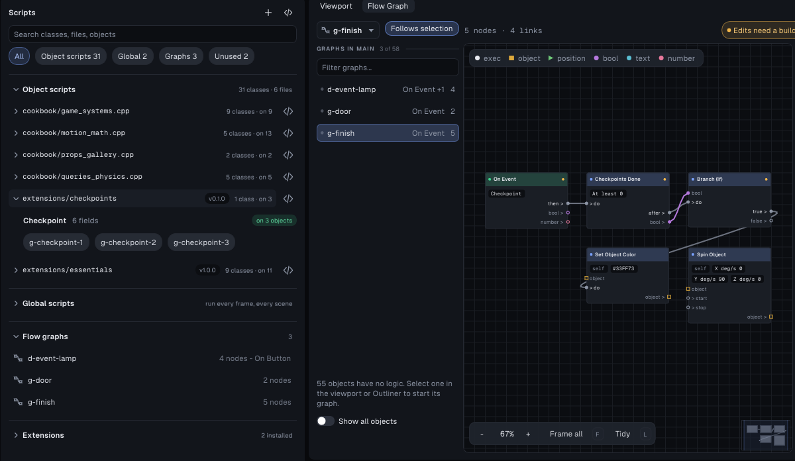

# script-cookbook example



A level that uses the whole C++ script API. Each station shows one part of
it working: easing, random numbers, timers, every transform call,
raycasts, searches, physics, spawning, input, sound, save data, the HUD,
World Facts, events to and from flow graphs, scripts finding scripts, every
lifecycle callback, the camera and the scene - and, in the last row, script
extensions: a library installed into the project and one written in it.
Every object is configured
only through its scripts' **public fields** (`[[tyra::prop]]`). Select one
and look at *Properties > Scripts*.

It is the playable companion of [docs/script-cookbook.md](../../docs/script-cookbook.md),
which has the same snippets with explanations, section by section.

```powershell
build\tyrax-editor.exe --build examples\script-cookbook --run
```

The code is in [`src/scripts/cookbook/`](src/scripts/cookbook), four files
with one class per station:

| File | Stations |
|---|---|
| [`motion_math.cpp`](src/scripts/cookbook/motion_math.cpp) | A EaseShowcase, B1 DiceRoller, B2 Blinker, B3 CooldownButton, B4 TransformTour |
| [`queries_physics.cpp`](src/scripts/cookbook/queries_physics.cpp) | B5 LaserTurret, B6 Sentry, C1 Magnet, C2 LaunchPad, C3 SpawnDemo |
| [`game_systems.cpp`](src/scripts/cookbook/game_systems.cpp) | D1 StickTilt, D2 SoundBox, D3 SaveCounter, D4 EventButton + EventLamp, GameManager, E1 MoodZone, E2 CameraGlance, E3 RestartButton, the global PlayerWatch |
| [`props_gallery.cpp`](src/scripts/cookbook/props_gallery.cpp) | F1 PropsGallery (one field of every kind), E4 LifecycleLogger |
| [`src/extensions/essentials/`](src/extensions/essentials) | row G: Rotator, Bobber, LookAtPlayer, Follower, Collectible, ProximityTrigger, SwingDoor - the repo's [`extensions/essentials`](../../extensions/essentials), installed |
| [`src/extensions/checkpoints/`](src/extensions/checkpoints) | row G: Checkpoint and the *Checkpoints Done* flow node - written in this project, see [below](#write-your-own-extension) |

## Walking through it

You start facing down the course. Objects named `a-…` to `f-…` in the
Outliner match the rows. Press **USE** (X) on anything usable. Debug builds
print every station's reaction to `bin/log.txt` and the Output panel as
`COOKBOOK …` lines.

| Row | What to do | What it shows |
|---|---|---|
| **A** (z 6) | watch | nine spheres, one per `tyrax::Ease` curve, set with an options field |
| **B** (z 13) | USE the white die, the green button; walk behind the wall at the right | `randomInt`/`chance`/`addSaveValue`; a blinking `Timer`; a `Cooldown` (red while cooling); `TransformTour` cycling through `moveBy`/`rotateBy`/`setYaw`/`setScale`/`lookAt`/`spin`; a turret whose `raycast` parks a red dot on what it hits; a sentry that is green while `lineOfSight` reaches you |
| **C** (z 22) | walk near the red magnet; stand on the blue pad and press **Jump** | `overlapSphere` + `addImpulse` pull the crates, `findNearest` tints the closest; the pad's `ActionId` field + `actionPressed` launches the balls, with `vibrate` and `cameraShake`; `spawn`/`despawn` keep four clones alive |
| **D** (z 30) | tilt the left stick (hold Sprint); USE the cyan box, the white counter, the orange button; press **Square** | `stick`/`actionHeld`; `playSound` from a `SoundId` field; a save value, its HUD bar, a HUD text, a save text and a World Fact in one press; an event sent from C++ that both a script (`onEvent`) and the lamp's graph (*On Event → Log*) hear, and the graph's *Call Script* running `EventLamp.flash` |
| **E** (z 38) | walk into the purple box, then the green box; USE the yellow pillar and the red button | `onPlayerEnter`/`onPlayerExit` changing the sky and fog; `setCamera` + `setFade` for a glance; `restartScene` (with `onSceneEnd` in the log); a `LifecycleLogger` printing callbacks |
| **F** (z 44) | select the pink box in the editor; USE it in the game | `PropsGallery`: a slider, a drag, an int slider, a checkbox, a drop-down, a vector, a colour, text, and object, sound, event, scene, save-value, action, HUD-text, HUD-bar and menu references. Its log line prints what the game received |
| **G** (z 50-64) | watch the spinner and the blue spheres; walk past the cone and the green ball; pick up the three coins; walk to the door; step on the three grey pads in order (select one to see its `order`; the third is behind the door) | the **Essentials** extension used as it comes: `Rotator`, `Bobber` (each sphere a different `phase`), `LookAtPlayer`, `Follower`, `Collectible` adding to the `coins` save value; a `ProximityTrigger` sends `NearDoor` and the door's graph runs *Call Script* `SwingDoor.open`. Then **Checkpoints**, written here: each pad lights up and spins only when it is the next one (the last turns gold, a field set on that pad only), and the finish box's graph - *On Event "Checkpoint" → Checkpoints Done → Branch → Set Object Color → Spin Object* - turns it green when all three are done |

## Project data the stations use

The level adds a little project data for the stations to use: the sound
`res/sfx/knock.wav`, the save values `rolls`, `presses` and `coins`, the save text
`last-press`, the HUD text `pressed`, the HUD bar `presses` (bound to the
save value), and the World Fact `cookbook.presses`. The scripts reach all of
them through typed names (`tyrax::SaveTexts::LastPress`,
`tyrax::Facts::CookbookPresses`) or through fields.

[`authoring/build-scene.py`](authoring/build-scene.py) rebuilds the whole
level (objects, field values, graphs and project data) on top of a fresh
`--new script-cookbook . 80 80 fpp` (and makes the ground 160 deep, so the last rows stand on it).

## Write your own extension



[`src/extensions/checkpoints/`](src/extensions/checkpoints) is a whole
extension in four files. It was made like this, and you can follow the same
steps for your own:

1. **Create it.** *Project > Scripts > Extensions*, type a name, **New
   extension** (or `tyrax-editor --new-extension <project> "Checkpoints"`).
   That writes `src/extensions/checkpoints/` with a manifest, an object script
   with one field and a custom flow node, and opens the script in VS Code.
2. **The manifest**, [`extension.json`](src/extensions/checkpoints/extension.json):
   name, version, description, author. The version shows next to the group on
   the Scripts page.
3. **The object script**, [`checkpoints.cpp`](src/extensions/checkpoints/checkpoints.cpp).
   `Checkpoint` is an ordinary object script between
   `TYRAX_NAMESPACE_BEGIN` / `TYRAX_NAMESPACE_END`, so the same file compiles
   in any project whatever its namespace. Its settings are `[[tyra::prop]]`
   fields: `order`, `radius`, two colours, `spinWhenReached` and
   `reachedEvent`. An event is a field, not `tyrax::Events::X`, because the
   project the extension lands in decides which events exist. State shared by
   all checkpoints (which one is next, how many there are) lives in the
   `.cpp` and starts over in `onSceneEnd`. The comment above the class is the
   description the *Add script* picker shows.
4. **The flow node**, [`flow-nodes/checkpoints-done.flownode`](src/extensions/checkpoints/flow-nodes/checkpoints-done.flownode):
   a title, a category, one number (*At least*), a bool output and
   `call = checkpointsDone` with `include = checkpoints_nodes.hpp`. The
   function is in [`checkpoints_nodes.hpp`](src/extensions/checkpoints/checkpoints_nodes.hpp)
   and reads the script's counters through two functions the `.cpp` defines.
   That is the usual way a node and a script share state.
5. **Use it.** Every class in the folder appears in *Add script*, with a chip
   of its own, and the node under *Checkpoints* in the flow graph's add menu.
   Here the pads carry `Checkpoint` with `reachedEvent = Checkpoint`, and the
   finish box's graph is **On Event "Checkpoint" → Checkpoints Done → Branch
   (true) → Set Object Color → Spin Object**.
6. **Share it.** Copy the folder out of `src/extensions/` and install it in
   another project with *Install from folder…* or
   `tyrax-editor --install-extension <project> <folder>`. Nothing else is
   needed: the Makefile already compiles everything under `src/`.

Essentials arrived the other way: *Install from folder…* on the repo's
[`extensions/essentials`](../../extensions/essentials), or
`tyrax-editor --install-extension examples\script-cookbook extensions\essentials`.

## Measured

PCSX2, native build, debug profile: **50 FPS** standing at the start and
next to the turret and sentry, which raycast every frame. Detaching every
script also gives 50. Before the script API put moved objects on the
matrix path, this level ran at 12.5 FPS. See *Performance rules* in the
cookbook.

## Try next

- Stop a station's script on a line: *Build > Debug Scripts in VS Code*, then
  press F5 in VS Code with a breakpoint in, say, `EaseShowcase::onUpdate`
  (`src/scripts/cookbook/motion_math.cpp`). The game stops in PCSX2, and
  Variables shows `t`, `y` and the sphere's fields. See the
  [script debugger](../../docs/script-debugger.md).
- Change a field (a sphere's `curve`, the turret's `sweep`, the pad's
  `launchAction`) in *Properties > Scripts* and Build & Run.
- Add your own station: copy a class, change it, attach it, and give it
  fields.
- Package the stations you like as a [script extension](../../docs/script-extensions.md),
  the way Checkpoints is.
- Add a fourth pad: duplicate `g-checkpoint-3`, set its `order` to 4 and
  move it. The finish needs no change: *Checkpoints Done* with *At least* 0
  waits for all of them.
