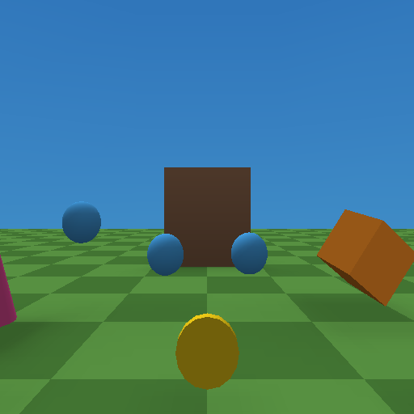

# script-framework example



A walk through the C++ scripting framework: the **Essentials** script
extension installed, its scripts dropped on primitives, each configured with
per-object **public fields**, and a flow graph that calls into a script. There
is no game logic of its own to read: everything here was set in
*Properties > Scripts* or comes from the extension.

Open `script-framework.tyra` in the editor and press **Build & Run** (`F5`),
or build headless:

```powershell
build\tyrax-editor.exe --build examples\script-framework --run
```

## What to do

You start in first person, looking down a short course. Walk with the left
stick or WASD.

- The **orange box** spins, and the **three blue spheres** float up and down
  out of step: `Rotator` and `Bobber`. Each sphere's `phase` field is set
  differently.
- The **pink cone** keeps turning to face you (`LookAtPlayer`).
- The **green ball** follows you and stops 2.5 units away (`Follower`, with
  `distance` = 2.5).
- Walk over the **gold coins**: each disappears and adds 1 to the `coins` save
  value (`Collectible`, with `counter` = coins).
- Walk up to the **door**. An invisible `ProximityTrigger` on the empty
  `door-sensor` sends the event `NearDoor`. The door's own flow graph,
  **On Event "NearDoor" → Call Script "SwingDoor.open"**, opens it 100°.

## How it is wired

| Object | Script | Fields set in Properties |
|---|---|---|
| spinner | `Rotator` | speed = 0 90 30 |
| bobber-1..3 | `Bobber` | height 0.35, period 2, phase 0 / 0.33 / 0.67 |
| watcher | `LookAtPlayer` | turnSpeed 240 |
| follower | `Follower` | distance 2.5, speed 3 |
| coin-1..3 | `Collectible` | counter = coins, radius 1.2 |
| door-sensor (Empty) | `ProximityTrigger` | radius 3.5, enterEvent = NearDoor, once |
| door | `SwingDoor` + a flow graph | openAngle 100, speed 90 |

The scripts live in `src/extensions/essentials/`, a copy of the repo's
[`extensions/essentials`](../../extensions/essentials) installed with
*Project > Scripts > Extensions > Install from folder…*, or headless:

```powershell
build\tyrax-editor.exe --install-extension examples\script-framework extensions\essentials
```

The values above are each object's `"scriptProps"` in `objects/*.json`. The
scripts declare their fields with `[[tyra::prop]]`. `SwingDoor` exposes
`open`, `close` and `toggle` with `TYRA_SCRIPT_METHOD`, which is what the
graph's *Call Script* node lists.

## Try next

- Select a sphere and drag its `phase` or `height` in *Properties > Scripts*,
  then Build & Run.
- Give the door a `toggleOn` event and send it from a graph, or from your own
  script with `tyrax::sendEvent(tyrax::Events::...)`.
- *Project > Scripts > Extensions > New extension* writes a skeleton of your
  own: a manifest, an object script with a field, and a flow node.

See [docs/script-api.md](../../docs/script-api.md),
[docs/object-scripts.md](../../docs/object-scripts.md) and
[docs/script-extensions.md](../../docs/script-extensions.md).
