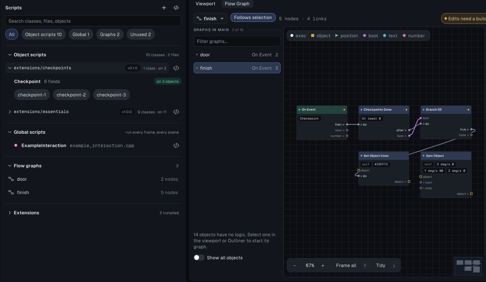

# script-framework example


A walk through the C++ scripting framework: the **Essentials** script
extension installed, its scripts dropped on primitives, each configured with
per-object **public fields**, and a flow graph that calls into a script. A
second extension, **Checkpoints**, was written inside this project: it is the
worked example of [writing your own](#write-your-own-extension).

Open `script-framework.tyra` in the editor and press **Build & Run** (`F5`),
or build headless:

```powershell
build\tyrax-editor.exe --build examples\script-framework --run
```

## What to do

You start in first person, looking down a short course. Walk with the left
stick or WASD.

- The **orange box** spins, and the **three blue spheres** float up and down
  out of step: `Rotator` and `Bobber`. Each sphere's `phase` field is set
  differently.
- The **pink cone** keeps turning to face you (`LookAtPlayer`).
- The **green ball** follows you and stops 2.5 units away (`Follower`, with
  `distance` = 2.5).
- Walk over the **gold coins**: each disappears and adds 1 to the `coins` save
  value (`Collectible`, with `counter` = coins).
- Walk up to the **door**. An invisible `ProximityTrigger` on the empty
  `door-sensor` sends the event `NearDoor`. The door's own flow graph,
  **On Event "NearDoor" → Call Script "SwingDoor.open"**, opens it 100°.
- Step on the three **grey pads** in order: one near the start, one past the
  orange spinner, then the one behind the door. Each lights up and
  spins when reached, but only if it is the next one: try them out of order.
  The last one turns gold. When all three are done, the **grey box** at the
  end turns green and spins (`Checkpoint`, and the *Checkpoints Done* node in
  the box's graph).

## How it is wired

| Object | Script | Fields set in Properties |
|---|---|---|
| spinner | `Rotator` | speed = 0 90 30 |
| bobber-1..3 | `Bobber` | height 0.35, period 2, phase 0 / 0.33 / 0.67 |
| watcher | `LookAtPlayer` | turnSpeed 240 |
| follower | `Follower` | distance 2.5, speed 3 |
| coin-1..3 | `Collectible` | counter = coins, radius 1.2 |
| door-sensor (Empty) | `ProximityTrigger` | radius 3.5, enterEvent = NearDoor, once |
| door | `SwingDoor` + a flow graph | openAngle 100, speed 90 |
| checkpoint-1..3 | `Checkpoint` (Checkpoints) | order 1 / 2 / 3, reachedEvent = Checkpoint; checkpoint-3 also reachedColor = gold |
| finish | a flow graph | - |

The scripts live in `src/extensions/essentials/`, a copy of the repo's
[`extensions/essentials`](../../extensions/essentials) installed with
*Project > Scripts > Extensions > Install from folder…*, or headless:

```powershell
build\tyrax-editor.exe --install-extension examples\script-framework extensions\essentials
```

The values above are each object's `"scriptProps"` in `objects/*.json`. The
scripts declare their fields with `[[tyra::prop]]`. `SwingDoor` exposes
`open`, `close` and `toggle` with `TYRA_SCRIPT_METHOD`, which is what the
graph's *Call Script* node lists.

## Write your own extension



[`src/extensions/checkpoints/`](src/extensions/checkpoints) is a whole
extension in four files. It was made like this, and you can follow the same
steps for your own:

1. **Create it.** *Project > Scripts > Extensions*, type a name, **New
   extension** (or `tyrax-editor --new-extension <project> "Checkpoints"`).
   That writes `src/extensions/checkpoints/` with a manifest, an object script
   with one field and a custom flow node, and opens the script in VS Code.
2. **The manifest**, [`extension.json`](src/extensions/checkpoints/extension.json):
   name, version, description, author. The version shows next to the group on
   the Scripts page.
3. **The object script**, [`checkpoints.cpp`](src/extensions/checkpoints/checkpoints.cpp).
   `Checkpoint` is an ordinary object script between
   `TYRAX_NAMESPACE_BEGIN` / `TYRAX_NAMESPACE_END`, so the same file compiles
   in any project whatever its namespace. Its settings are `[[tyra::prop]]`
   fields: `order`, `radius`, two colours, `spinWhenReached` and
   `reachedEvent`. An event is a field, not `tyrax::Events::X`, because the
   project the extension lands in decides which events exist. State shared by
   all checkpoints (which one is next, how many there are) lives in the
   `.cpp` and starts over in `onSceneEnd`. The comment above the class is the
   description the *Add script* picker shows.
4. **The flow node**, [`flow-nodes/checkpoints-done.flownode`](src/extensions/checkpoints/flow-nodes/checkpoints-done.flownode):
   a title, a category, one number (*At least*), a bool output and
   `call = checkpointsDone` with `include = checkpoints_nodes.hpp`. The
   function is in [`checkpoints_nodes.hpp`](src/extensions/checkpoints/checkpoints_nodes.hpp)
   and reads the script's counters through two functions the `.cpp` defines.
   That is the usual way a node and a script share state.
5. **Use it.** Every class in the folder appears in *Add script*, with a chip
   of its own, and the node under *Checkpoints* in the flow graph's add menu.
   Here the pads carry `Checkpoint` with `reachedEvent = Checkpoint`, and the
   finish box's graph is **On Event "Checkpoint" → Checkpoints Done → Branch
   (true) → Set Object Color → Spin Object**.
6. **Share it.** Copy the folder out of `src/extensions/` and install it in
   another project with *Install from folder…* or
   `tyrax-editor --install-extension <project> <folder>`. Nothing else is
   needed: the Makefile already compiles everything under `src/`.

## Try next

- Select a sphere and drag its `phase` or `height` in *Properties > Scripts*,
  then Build & Run.
- Give the door a `toggleOn` event and send it from a graph, or from your own
  script with `tyrax::sendEvent(tyrax::Events::...)`.
- Add a fourth pad: duplicate `checkpoint-3`, set its `order` to 4 and
  move it. The finish needs no change, because *Checkpoints Done* with
  *At least* 0 waits for all of them.

See [docs/script-api.md](../../docs/script-api.md),
[docs/object-scripts.md](../../docs/object-scripts.md) and
[docs/script-extensions.md](../../docs/script-extensions.md).
