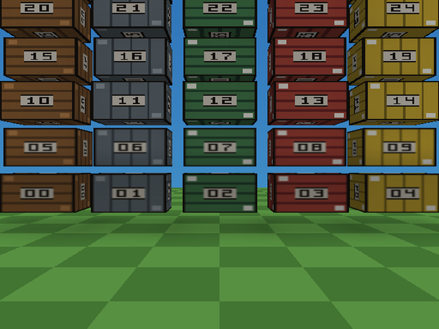

# texture-atlas-filtering



A yard of thirty small crates, each with its own 32×32 texture, and the build
packs all thirty into **one shared GS page**. It exists because
[texture atlasing](../../docs/texture-atlasing.md) is easy to switch on and
hard to judge — this is the scene where the saving is real and measured, and
where you can watch it disappear by turning one setting off.

The same page also carries three [texture filters](../../docs/texture-filtering.md)
at once: the bottom two rows are **Smooth**, the middle two **Pixel** and the
top two **Pixel close-up** - and it is still one page.


## The number

Measured on this project, PCSX2, from the game's own `VRAMSTAT` line
(a debug build prints it into `bin/log.txt` every 120 frames):

| | free GS VRAM | resident texture allocations |
| --- | --- | --- |
| *Texture atlasing* **off** | 0.2349 MB | 34 |
| *Texture atlasing* **on** | **0.2986 MB** | **5** |

**65.3 KB back**, against the 65 KB the editor predicted before the build —
`tyrax-editor --atlas-report examples/texture-atlas-filtering` prints

```
Texture atlas: 30 textures in 1 page(s)
GS VRAM for these textures: 97 KB unpacked, 32 KB as pages (saves 65 KB)
```

and *Tools > Texture Atlas* shows the same page with its thirty members and a
preview. Thirty allocations became one.

## Why the saving is so large here

A 32×32 4-bit texture holds **512 bytes** of pixels and costs **3.25 KB** of GS
VRAM on its own. The GS rounds a palettized texture's width up to 128 texels,
and it is charged whole blocks of the page it lands in — so a small texture is
mostly padding. Thirty of them are 97 KB; the same thirty on one 256×256 4-bit
page are 32 KB, and 49 would fit before a second page is needed.

That is the era's reason for atlasing, and it is why the break-even is a
property of the ART rather than of the feature: pack **many small** textures and
it pays, pack a few 128×128 ones and it cannot (see the docs' table).

## Three filters, one page


| Crates | Filtering | Set where |
| --- | --- | --- |
| 00-09 | Smooth | the project default, *Project > Preferences > Graphics > Texture filtering* |
| 10-19 | Pixel | per texture: Asset Browser > *Filtering*, or *Tools > Texture Filtering* |
| 20-29 | Pixel close-up | the same, per texture |

All thirty are still members of the one atlas page above, and the VRAM figure
does not move: the GS takes the filter from `TEX1`, which the engine sends with
every mesh, so it belongs to the draw rather than to the image in VRAM. A page
never has to be split by filter.

Pixel and Pixel close-up look the same from the spawn point - a crate's texels
are still bigger than a screen pixel there. Walk back across the field: once a
texel is smaller than a pixel, the Pixel rows start to crawl as you move and the
close-up rows blend instead (there are no mipmaps, so this is the setting that
calms distant walls).

## Why the shared palette costs nothing here

A page is quantized **as one image**, so its members share one palette — 16
colours at 4 bits. Every prop in this scene is drawn from **one 16-colour
palette** (see the top of `build-scene.py`), which is exactly what an artist of
the era would have done, so the shared page reproduces all thirty textures
without loss.

Art with thirty independent palettes would not survive that, and the page depth
is where you say so: per texture, in the Texture Atlas window, *page: 8-bit*
lifts the whole group to 256 shared colours (twice the page, still a saving at
this member count).

## Things worth trying

- **Change a row's filter.** Pick a crate texture in the Asset Browser and set
  its *Filtering* row, or select a batch in *Tools > Texture Filtering* and set
  them together; the viewport shows it at once, the game after a rebuild. The
  viewport's *Texture filtering* view menu can show everything smooth or
  everything pixel without touching the project.

- **Turn it off.** *Project > Preferences > Graphics > Advanced > Texture atlasing*, then
  build and watch `VRAM` on the HUD: 3.70 → 3.76 MB used, and the boot log's
  `Texture atlas:` line disappears.
- **Read why something is not on the page.** The terrain texture never is — it
  tiles. *Tools > Texture Atlas > Not atlased* says so for every texture the
  packer considered.
- **Break the palette on purpose.** Edit `PALETTE` in `build-scene.py` to
  something wild, re-run it, rebuild: the page now has to represent thirty
  clashing images with 16 colours, and the crates go blotchy. Then set one
  member to *page: 8-bit* and they come back.
- **Group them by hand.** Give half the crates a group name in the window and
  the packer splits them across two pages — which costs VRAM here, and is what
  you would do if the two halves belonged to different rooms of a streamed
  level (a page is one allocation: whatever shares it stays resident together).

## How the scene is built

`build-scene.py` writes the whole thing: the thirty 32×32 palettized PNGs and
their `.mtl` files into `res/materials/props/`, the crate objects, and the
player's spawn, plus the project's filtering (the row bands above). Re-run it
after `tyrax-editor --new texture-atlas-filtering <dir> 40 40 fpp` to rebuild
the example from scratch. Every texture carries its own number,
so a mis-mapped UV shows up as the wrong crate rather than as a subtle shift.

## Assets

Generated by `build-scene.py` — no third-party art.

Generated object values live in `src/gen/scene_objects.gen.cpp`;
`inc/scene_data.hpp` keeps stable declarations. Counts and object IDs live in
the same data file, so ordinary moves, color edits, additions and removals can
rebuild it alone. Changes to features or derived tables can still rebuild consumers.

Generated game methods are split between `src/terrain_game.cpp` and the
`src/gen/game_*.gen.cpp` subsystems, with shared inline helpers/state in
`inc/game_runtime.gen.hpp`. Header changes can compile these units in parallel.
The main file remains user-ownable; generated subsystem files refresh on build.


Hardware timeline instrumentation matches the 1.170 coarse/detail emitter.
Use the [capture and observer-control guide](../../docs/hardware-profiler.md)
when comparing performance; traces add measurable work.

This example explicitly requests `framePipeline: true` (TyraX2). Its authored interlaced output preserves the existing scan mode and quality; ordinary interlaced output is eligible, unlike true field rendering. True field rendering, BLSS, unlimited triple buffering and unavailable queue memory fall back safely. This request does not guarantee 60 FPS. See [TyraX2](../../docs/tyrax2.md).

Generated runtime snapshot refreshed for [dynamic light receivers](../../docs/dynamic-light-receivers.md). This example retains the default **All objects** policy; Players and driven vehicle is an optional project or scene setting.

TyraX 2.0 integration: generated sources have been refreshed with the combined
TyraX2 renderer and mainline collision broad phase; authored settings and
user-owned source files retain their existing ownership rules.
