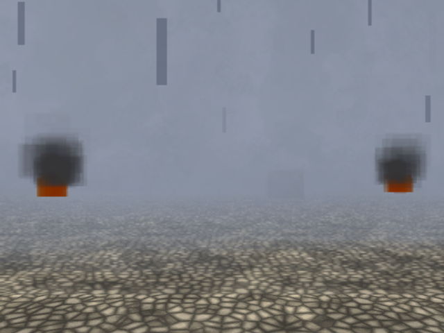

# upscaler-lab — a fill-bound haze yard for the upscaler (BLSS)

Every other example in this repo is built to look right. This one is built to be
**measured**: a deliberately overdraw-heavy PAL scene for the
[upscaler](../../docs/upscaler.md). Six banks of huge soft haze puffs, two
campfires and rain put dozens of full-screen blended layers on the GS while the
EE does almost nothing - the one kind of frame where drawing fewer pixels can
pay.

It ships with *Use the upscaler* on and **Draw reduced: Particles only**: the
yard, the buildings, the HUD and every texture render at full resolution, and
only the emitters draw at a quarter of the pixels. A **spot lamp with shadow
volumes** hangs over the west crates. (A linked portal pair was here while the
particles shape was being proven to work beside one - it does - and was taken
out again: a portal submits the scene a second time, which is EE work the
upscaler cannot remove, so it only diluted the measurement.)

Open `upscaler-lab.tyra` and Build & Run (`F5`), or headless:
`tyrax-editor --build <this folder> --run`.

## Measured

Real PS2, over ps2link, PAL 512x448, 2x2, frozen camera at the player's start
(the director removed so its tour does not run, Player walk/look speed 0), one
ELF switching modes every 20 s with **Set Upscaler** - no pad traffic, no
rebuild between arms. `work` is the frame's sub-frame work from the
`TYRA_FRAME_PROFILE 2` FRAMETIME line, 50-frame windows, the first window after
each switch dropped:

| arm | 50-frame windows | `work` mean | per-arm means |
|---|---|---|---|
| native, lamp on | 27 | **34.79 ms** | 35.18 / 34.63 |
| native, lamp off | 18 | 35.38 ms | 35.91 / 34.84 |
| particles only 2x2, lamp on | 56 | **13.83 ms** | 13.88 / 13.75 / 13.88 |
| particles only 2x2, lamp off | 18 | 13.64 ms | 13.92 / 13.37 |

**2.5x less frame work** (-21.0 ms) with the particles reduced, the same in
every alternating arm (window sd under 1.3 ms); the bracket itself - two
quarter-area copies, the mask and the composite - reads about 1 ms of it. The
spot lamp's shadow volumes cost nothing measurable from this vantage (the
casters are ~25 units away and small on screen). An earlier run with a linked
portal pair in the scene measured 38.62 -> 19.30 ms (2.0x): the portal submits
the scene a second time, EE work the upscaler cannot touch. Measured
2026-10-23, frozen camera at the player's start in `examples/upscaler-lab`.

PCSX2's software renderer cannot price this (it under-reports GS fill ~76x,
[profiling.md](../../docs/profiling.md)); use it for pictures, the console for
milliseconds. Over ps2link the game also pays host: file polling every frame, so
absolute frame rates there are lower than from a disc - the A/B is the
difference.

## What is in the scene

A 96x96 cobbled service yard between two industrial blocks, under a haze bank
thick enough to matter and thin enough to watch.

| Piece | Count | Why |
|---|---|---|
| Depot blocks (`res/models/depot/block-{west,east}.obj`, 1 134 + 998 tris) | 2 | The textured static landmarks. Kit-bashed from Kenney's Retro Urban Kit (CC0) - see [How the buildings were made](#how-the-buildings-were-made). |
| Static boxes (wall, fence posts + rails, crates, two slabs) | 26 | Cheap, static-batched, textured. |
| Parked trucks (`res/models/depot/trucks.obj`, 108 tris) | 1 object, 3 vehicles | Three kit models merged into one material - a single bag submit. |
| Wobbler (`wobbler.glb`, clips `Wiggle` / `Twist`) | 2 | 123 vertices each - the animated pass, kept small because skinning is EE work the upscaler does not reduce. |
| **Custom haze emitters** | **6 x 32** | **The fill.** `kind: "custom"`, `size 9.0`, `opacity 0.8`, one shared 128² soft-puff material, every centre above eye height. A `size 9` puff 10 m away is about 1.6 screen heights: one full-screen blended layer for one EE vertex. |
| Campfire (`fire` 48 + `smoke` 40) | 2 | Two more emitter kinds. |
| Rain (`kind rain`, 200, `followPlayer`) | 1 | Many small quads beside the few huge ones. |
| Spot lamp with shadow volumes (`lamp`) | 1 | `spotShadowVolumes` on: the volumes count into a full-screen band, which is GS fill. |
| Cutscene Director sequence, 20 s | 1 | `On Start` plays a camera tour through the yard. |
| Flow graph on an Empty (`ab-switch`) | 1 | **Square** / **Circle** turn every emitter off / on; **Triangle** / **R1** switch the upscaler off / on (Set Upscaler) - both A/Bs from the same camera in the same run. |

**Why `kind: "custom"` and not `fog`**: at the same *Opacity*, `fog` peaks at
alpha 60 while `custom` reaches 128 - more than twice the fill per layer, which
is the whole point of the fixture.

## Things worth trying

- **Triangle / R1** - native vs reduced particles, live. Look at the cobbles
  under the haze: that is the price; look at the frame time: that is the win.
- **Square / Circle** - the particle A/B. It is the honest measure of how much
  of this frame is fill.
- Switch *Draw reduced* to **Whole 3D scene** in *Project > Preferences >
  Graphics > Advanced*: everything 3D goes soft, the z buffer shrinks, and a
  portal, depth of field or split screen would now be refused by the build.
- Turn on **Adapt resolution to frame budget**: the particles stay native until
  frames start missing fields. On the physical console the whole-scene adaptive
  2x2 state measured 16.1 -> 44.0 FPS from the parked vantage.
- Walk right up into a puff and watch it **vanish**: the VU1 billboard program
  drops a quad whose corner leaves the GS ±2048 raster window, and at `size 9`
  that is anything closer than ~2 m. Every bank's centre sits above eye height
  for exactly this reason.

`palFullHeight` is deliberately absent from the manifest so a PAL BIOS boots
512x448 every time, and `bloom`, `grain` and `dofAmount` are 0, so an A/B
compares the upscaler and nothing else.

## Assets

Every art asset here is **CC0 1.0** and attributed in
`THIRD-PARTY-NOTICES.txt`. Total committed assets under `res/`: **475 KB** (it
was 1.7 MB before the swap), of which the buildings and trucks are **217 KB** of
Wavefront text and **45 KB** of 64² and 128² textures, and the animated model is
**14 KB**. Nothing here is over 512 px or non-power-of-two, so `texbake` resizes
nothing on the way to the console.

### How the buildings were made

`block-west.obj`, `block-east.obj` and `trucks.obj` are **kit-bashes of Kenney's
Retro Urban Kit** (CC0 1.0, `www.kenney.nl`) — derivative works, which CC0 permits
without condition. The recipe is written down in `THIRD-PARTY-NOTICES.txt` so the
result is reproducible rather than mysterious, and three decisions in it are worth
keeping if you re-cut them:

- **Merged, not placed.** A model renders one bag submit *per material part* and
  is never static-batched (`staticBatchEligible` takes primitives only), so
  thirty kit modules dropped in as thirty scene objects would be thirty draw
  calls. They are merged into one `.obj` per building instead, with faces grouped
  by material — 5 parts each — and the three trucks into a single one-material
  file.
- **Kenney's OBJ export writes every face twice.** Dropping the duplicate halves
  the triangle count for nothing.
- **Interior faces are culled on the grid.** The modules are 1x1x1 cells, so a
  face with another module behind it can never be seen and is dropped at author
  time. That is what keeps a solid, articulated mass down to ~1 100 triangles.

**Windows must be stamped onto cells that are actually exposed**, not authored by
hand into the plan. A `wall-a-window` module's window quad has normal `(0, 0, -1)`
— an axis direction — so the interior-face cull deletes it exactly like a wall
face when the cell behind it is occupied. Hand-authored window rows landed inside
the mass, the cull removed all of them, and the building came out blank with no
error anywhere. The generator now finds the exposed cells itself and rotates each
module's front toward open air.

**Why the textures are not atlased.** `ProjectSettings::textureAtlas` would pack
these 64² `map_Kd`s into shared pages and cut the part count, and it correctly
refuses to: every model in the kit **tiles** its UVs (they run to u = −46), and an
atlas page can only hold textures sampled inside [0, 1]. That is why a building
costs 5 submits rather than 1, and it is a property of the source art, not a
setting anyone can flip.

### The animated model

`wobbler.glb` — already shipped by five other examples, so it adds no new licence
surface at all. **Quaternius' Universal Base Characters [Standard] was evaluated
first and rejected on evidence**: its free tier ships a rigged mesh (a skin and a
130-bone skeleton) but **zero animation clips** — the glTF has no `animations`
array and the FBX has no `AnimationStack` and no `AnimationCurve`. The rigged,
animated sources are in the paid SOURCE version. A rig with no clips renders as a
statue, and faking one was not on the table. `THIRD-PARTY-NOTICES.txt` records
this so nobody re-derives it.

**Static geometry wants `.obj`, never `.fbx`.** `.fbx` is *always* treated as an
animated model (`project.hpp:890`, `isAnimatedModelPath`), so a building shipped
as one would go down the skeletal pipeline, pay per-frame EE pose work for
something that never moves. The buildings are `.obj` for that reason.

Generated object values live in `src/gen/scene_objects.gen.cpp`;
`inc/scene_data.hpp` keeps stable declarations. Counts and object IDs live in
the same data file, so ordinary moves, color edits, additions and removals can
rebuild it alone. Changes to features or derived tables can still rebuild consumers.

Generated game methods are split between `src/terrain_game.cpp` and the
`src/gen/game_*.gen.cpp` subsystems, with shared inline helpers/state in
`inc/game_runtime.gen.hpp`. Header changes can compile these units in parallel.
The main file remains user-ownable; generated subsystem files refresh on build.

Hardware timeline instrumentation matches the 1.170 coarse/detail emitter.
Use the [capture and observer-control guide](../../docs/hardware-profiler.md)
when comparing performance; traces add measurable work.

This example explicitly requests `framePipeline: true` (TyraX2). The upscaler's brackets keep synchronous compatibility rendering. True field rendering, BLSS, unlimited triple buffering and unavailable queue memory fall back safely. This request does not guarantee 60 FPS. See [TyraX2](../../docs/tyrax2.md).

Generated runtime snapshot refreshed for [dynamic light receivers](../../docs/dynamic-light-receivers.md). This example retains the default **All objects** policy; Players and driven vehicle is an optional project or scene setting.

TyraX 2.0 integration: generated sources have been refreshed with the combined
TyraX2 renderer and mainline collision broad phase; authored settings and
user-owned source files retain their existing ownership rules.
